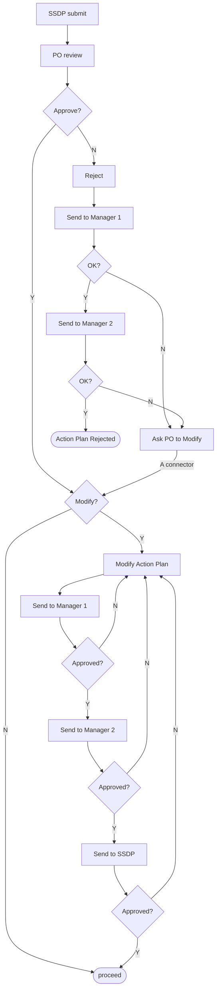

# Action Plan Approval Flow (from whiteboard image)

Drawn from the whiteboard image added to `10-StatusFlow.md`. The flow is kept as drawn, including the
points that differ from the written decisions in `02-changes.md` (noted under the chart).

## How the code maps the whiteboard (Design A, 18 Nov 2026)

- **Send to Manager 1 / Manager 2:** the manager levels of the approval route (Data Config).
- **Send to SSDP:** the plan's SSDP creator, appended by the backend as the last Modify level. Answers with `approval/approve` (Y)
  or `approval/reject` (N), like the managers, without the 162 / 163 privilege.
- **Approved? = Y at SSDP:** the proposal is applied and the plan is `approved` (proceed).
- **Approved? = N at any level (SSDP included):** the plan goes back to the PO as `waiting_review` (need_review); the proposal is dropped.
- **Reject lane:** managers only. OK? = Y is `approval/reject`; after the last level the plan is
  `rejected` (Action Plan Rejected, terminal). OK? = N is `approval/modify` (Ask PO to Modify) → `waiting_review`.

## Still different from the image

- **PO options after a return:** the image allows only "Modify Action Plan" after a Modify-lane N, and Modify? (modify or proceed)
  after Ask PO to Modify (connector A). The code returns to `waiting_review`, where the PO can approve, modify or reject
  (kept on purpose, 18 Nov; concurrent PO decisions are race-safe).
