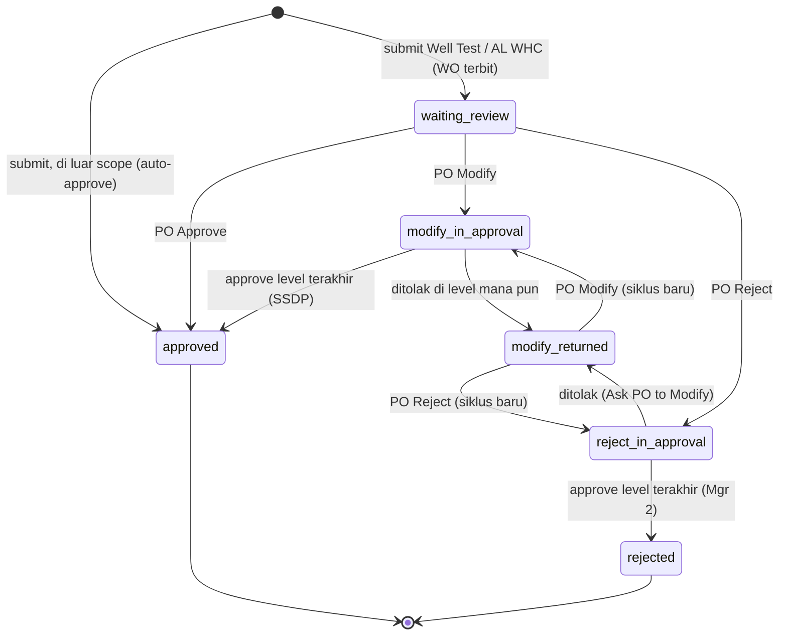
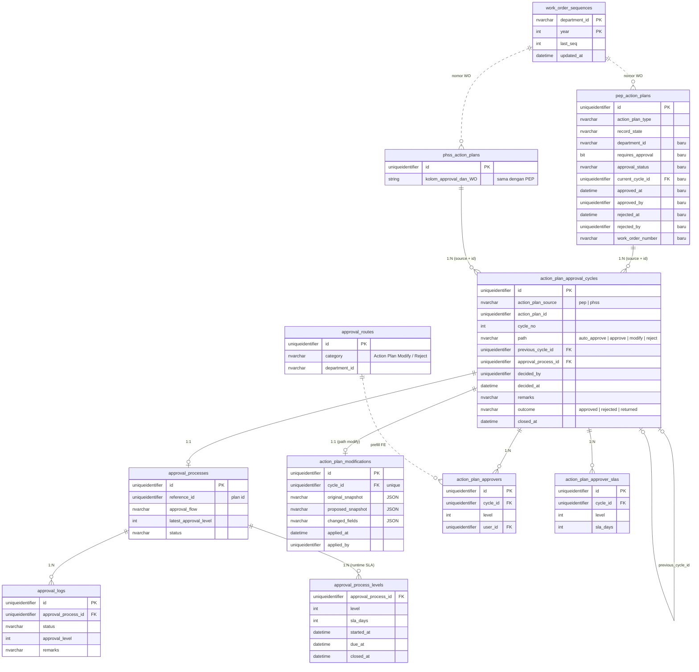

# Action Plan Approval — Analisa Kebutuhan & Desain

_Diperbarui 30 Oct 2026 · Sumber: [Claude Doc](https://claude.ai/artifact/Nstbt96GXCo74SaUhZp7pp) · Bruno: `collections/phi-phantom/Action Plan Approval`_

## Latar belakang & scope

Action plan yang di-submit SSDP saat ini langsung aktif tanpa approval. Ke depan, **Well Test** dan **Artificial Lift dengan metode Well Head Compressor** wajib direview Production Operations (PO) sebelum dijalankan. Tipe lain otomatis berstatus Approved saat submit.

| Action type | Kondisi | Perlu approval |
| --- | --- | --- |
| `well_test` | semua mode | Ya |
| `artificial_lift` | `method = well_head_compressor` | Ya |
| `artificial_lift` | `method = gas_lift` / `pump` | Tidak, auto-approved |
| `choke`, `sonolog`, `others` | semua | Tidak, auto-approved |

Berlaku untuk PEP (`pep_action_plans`) dan PHSS (`phss_action_plans`).

- Di kode saat ini `artificial_lift.method` hanya `gas_lift | pump`. Nilai `well_head_compressor` belum ada, jadi perlu ditambahkan (lihat Open questions).
- Di PHSS, artificial lift berelasi 1:N (satu baris per `action_mode`). Plan perlu approval kalau **ada satu saja** baris aktif dengan metode WHC.
- Penentuan perlu approval atau tidak dihitung sekali saat submit, lalu disimpan di `requires_approval`. Dengan begitu perubahan rule di kemudian hari tidak mengubah plan yang sudah berjalan.

## Alur bisnis

PO mengambil satu dari tiga keputusan. Approve langsung final. Modify dan Reject masing-masing masuk approval berjenjang. Penolakan di level mana pun, baik di jalur modify maupun reject (“Ask PO to Modify” di flowchart), selalu kembali ke PO, yang lalu memilih Modify ulang atau pindah ke Reject, dengan status `modify_returned`.

*State machine `approval_status` · 6 status, 2 final. Data live berubah hanya saat modify di-approve final.*

1. SSDP Area 1/2 submit, dan work order number langsung terbit untuk plan yang butuh approval. Kalau tipe di luar scope, plan langsung `approved`, tanpa work order number, dan satu siklus `auto_approve` dicatat.
2. Plan dalam scope menjadi `waiting_review` dan masuk inbox PO.
3. **Approve**: plan menjadi `approved`.
4. **Modify**: PO mengirim data usulan, yang disimpan sebagai snapshot dan dibandingkan dengan data asli. Approval berjalan Manager 1 → Manager 2 → SSDP. Approve di level terakhir menerapkan usulan ke data live, lalu plan menjadi `approved`.
5. **Reject**: approval berjalan Manager 1 → Manager 2. Kalau semua approve, plan menjadi `rejected`.
6. Penolakan level di jalur 4 atau 5 mengubah plan menjadi `modify_returned`. PO lalu memilih **Modify** ulang (siklus modify baru) atau **Reject** (siklus reject baru). Dengan jalan keluar ke Reject, loop modify selalu bisa berakhir di status final.

## Peran & routing approver

Route approval disimpan di master `approval_routes` yang sudah ada, dengan dua category baru. Route dipilih berdasarkan `department_id` submitter, karena level terakhir jalur Modify adalah SSDP Area yang mengajukan plan.

| Peran | Department | Tugas | Sumber user |
| --- | --- | --- | --- |
| Requestor | SSDP Area 1 / SSDP Area 2 | Submit action plan | User login (`created_by`) |
| Reviewer | Production Operations | Approve / Modify / Reject, dan modify ulang kalau dikembalikan | Pool user department PO dengan permission dari config `action_plan_review_permission_id` |
| Manager 1 | Production Operations | Level 1 di jalur Modify & Reject | `payload approvers (prefill dari route)` |
| Manager 2 | Production Operations | Level 2 di jalur Modify & Reject | `payload approvers (prefill dari route)` |
| SSDP Approver | SSDP Area submitter | Level 3, khusus jalur Modify | `payload approvers (prefill dari route)` |

| `approval_routes.category` | `department_id` | Level | Ditulis ke `approval_processes.approval_flow` |
| --- | --- | --- | --- |
| `Action Plan Modify` | SSDP Area 1 | L1 Manager 1 · L2 Manager 2 · L3 SSDP Area 1 | `PEP Action Plan Modify` / `PHSS Action Plan Modify` |
| `Action Plan Modify` | SSDP Area 2 | L1 Manager 1 · L2 Manager 2 · L3 SSDP Area 2 | sama |
| `Action Plan Reject` | SSDP Area 1 / 2 | L1 Manager 1 · L2 Manager 2 | `PEP Action Plan Reject` / `PHSS Action Plan Reject` |

- Prefix PEP/PHSS di `approval_flow` wajib ada. `reference_id` menunjuk ke dua tabel berbeda, dan tabel approval tidak menyimpan asal sumbernya.
- Master route hanya menjadi **template prefill**. Approver yang benar-benar dipakai dikirim FE di payload `approvers` setiap kali PO memilih Modify atau Reject (PO boleh mengubah hasil prefill). Isinya disimpan ke `action_plan_approvers` per siklus, sama seperti create project/contract. Perubahan master route tidak mempengaruhi siklus yang sedang berjalan.
- SLA per level: lihat bagian SLA per level.

Catatan: `AddApprovalRoute` mengisi `department_id` dari department context user login, bukan dari payload. Route untuk SSDP Area 1 dan Area 2 harus dibuat masing-masing dalam konteks department tersebut.

## ERD

Mesin approval yang sudah ada (`approval_processes`, `approval_logs`, `approval_routes`) dipakai tanpa perubahan skema. Lima tabel baru menambahkan siklus journey, snapshot modify, approver per siklus, SLA per siklus, dan counter work order. Tracking SLA runtime memakai `approval_process_levels` yang sudah ada (tidak digambar).

*ERD approval action plan · 5 tabel baru, 2 tabel diubah, tabel approval existing dipakai ulang. Garis putus-putus = relasi logis, bukan FK.*

Satu plan bisa punya banyak siklus (misalnya Modify → dikembalikan → Modify → Approved). Setiap siklus Modify/Reject membuka `approval_process` baru, sehingga log per level tidak tercampur antar siklus. Pola reuse proses lintas revise seperti di project sengaja tidak dipakai.

## Kamus data

Ada 2 tabel existing yang mendapat kolom baru dan 5 tabel baru: 3 di bagian ini, `work_order_sequences` di bagian Work order number, dan `action_plan_approver_slas` di bagian SLA per level. Mesin approval (`approval_processes`, `approval_logs`, `approval_routes*`) dipakai apa adanya.

### Kolom baru di `pep_action_plans` dan `phss_action_plans`

Nama kolomnya sengaja **bukan** `status`. Field `status` di response list sudah dipakai untuk status jadwal (`on_schedule/upcoming/overdue/done`), begitu juga query `?status=`.

| Kolom | Tipe | Null | Keterangan |
| --- | --- | --- | --- |
| `department_id` | nvarchar(50) | ya | Department submitter (SSDP Area 1/2). Diisi saat submit, dipakai untuk memilih route. Tipenya mengikuti `approval_routes.department_id`. |
| `requires_approval` | bit | tidak, default 0 | Hasil rule scope saat submit |
| `approval_status` | nvarchar(30) | ya | Null selama masih draft. Nilainya lihat tabel di bawah. |
| `current_cycle_id` | uniqueidentifier | ya | FK ke `action_plan_approval_cycles`, siklus yang sedang berjalan atau yang terakhir |
| `approved_at` / `approved_by` | datetime / uniqueidentifier | ya | Diisi saat status final Approved (termasuk auto-approve) |
| `rejected_at` / `rejected_by` | datetime / uniqueidentifier | ya | Diisi saat status final Rejected |

Index: `(approval_status, department_id) WHERE deleted_at IS NULL` untuk inbox dan filter list.

| `approval_status` | Arti | Siapa yang memegang |
| --- | --- | --- |
| `waiting_review` | Baru di-submit, menunggu keputusan PO | Reviewer PO |
| `modify_in_approval` | Usulan modify sedang di approval berjenjang | Approver level berjalan |
| `modify_returned` | Ada level yang menolak (modify atau reject), kembali ke PO untuk Modify ulang atau Reject | Reviewer PO |
| `reject_in_approval` | Usulan reject sedang di approval berjenjang | Approver level berjalan |
| `approved` | Final, plan aktif dan dijalankan | — |
| `rejected` | Final, plan tidak dijalankan | — |

### Tabel baru `action_plan_approval_cycles` (journey)

Satu baris per keputusan PO, termasuk auto-approve. Ini tulang punggung histori journey. Detail approve/reject per level tetap dicatat di `approval_logs` lewat `approval_process_id`.

| Kolom | Tipe | Keterangan |
| --- | --- | --- |
| `id` | uniqueidentifier PK | default newid() |
| `action_plan_source` | nvarchar(10) | `pep` / `phss` |
| `action_plan_id` | uniqueidentifier | ID plan (polymorphic, tanpa FK fisik) |
| `cycle_no` | int | 1, 2, 3, … per plan. Unique `(action_plan_source, action_plan_id, cycle_no)` |
| `path` | nvarchar(20) | `auto_approve` / `approve` / `modify` / `reject` |
| `previous_cycle_id` | uniqueidentifier null | Siklus yang mengembalikan ke modify. Membentuk rantai journey. |
| `approval_process_id` | uniqueidentifier null | FK ke `approval_processes`. Null untuk `auto_approve` / `approve`. |
| `decided_by` / `decided_at` | uniqueidentifier / datetime | Siapa yang memilih path (SSDP sistem untuk auto, PO untuk lainnya) |
| `remarks` | nvarchar(max) null | Alasan PO |
| `outcome` | nvarchar(20) null | `approved` / `rejected` / `returned` (kembali ke modify). Null selama berjalan. |
| `closed_at` / `closed_by` | datetime / uniqueidentifier null | Level atau aksi yang menutup siklus |
| `created_at` / `created_by` | audit |  |

### Tabel baru `action_plan_modifications`

Relasi 1:1 dengan siklus ber-path `modify`. Data live **tidak disentuh** sampai approver terakhir menyetujui.

| Kolom | Tipe | Keterangan |
| --- | --- | --- |
| `id` | uniqueidentifier PK |  |
| `cycle_id` | uniqueidentifier FK, unique | ke `action_plan_approval_cycles` |
| `original_snapshot` | nvarchar(max) JSON | Data live saat modify dibuat, yaitu data asli SSDP |
| `proposed_snapshot` | nvarchar(max) JSON | Usulan PO. Skemanya sama dengan body submit PEP/PHSS. |
| `changed_fields` | nvarchar(max) JSON | Daftar path field yang berubah, dihitung saat simpan, untuk highlight di FE |
| `applied_at` / `applied_by` | datetime / uniqueidentifier null | Waktu proposed diterapkan ke tabel live (saat final approve) |
| `created_at` / `created_by` | audit |  |

### Tabel baru `action_plan_approvers`

Approver per siklus, diisi dari payload `approvers` di request review, dengan pola yang sama seperti `project_approvers`. Satu baris per user per level.

| Kolom | Tipe | Keterangan |
| --- | --- | --- |
| `id` | uniqueidentifier PK |  |
| `cycle_id` | uniqueidentifier FK | ke `action_plan_approval_cycles` |
| `level` | int | 1..n |
| `user_id` | uniqueidentifier FK | ke `users`. Satu level boleh berisi banyak user (any-of). |

## Work order number

Nomor work order terbit **saat SSDP submit action plan ke PO** (draft → submitted), hanya untuk plan yang butuh approval (review #1432). Plan auto-approved tidak mendapat nomor dan `wo_number` yang dikirim diabaikan. Format `{seqNum}/WO/{departmentName}/{year}`, contoh `001/WO/SDA1/2026`. Nomor tetap melekat walaupun plan akhirnya Rejected, dan tidak pernah dipakai ulang.

| Bagian | Sumber | Aturan |
| --- | --- | --- |
| `seqNum` | `work_order_sequences.last_seq + 1` | Zero-pad 3 digit (`D3`), sama seperti nomor SPK. Lebih dari 999 tetap tumbuh (`1000`). Reset per department per tahun. |
| `WO` | Konstanta |  |
| `departmentName` | Nama pendek dari mapping config `work_order_department_short_names` | Contoh `SDA1`, `SDA2`. Karakter `/` dilarang. Kalau department belum punya mapping, submit ditolak 400. |
| `year` | Tahun `submitted_at` (waktu lokal) |  |

Counter dihitung per department per tahun. PEP selalu di-submit SDA 1 dan PHSS selalu SDA 2, jadi counter tiap department sekaligus menjadi counter per source. Karena nama department ada di dalam nomor, PEP dan PHSS tidak mungkin menghasilkan nomor kembar.

**Kolom baru di `pep_action_plans` dan `phss_action_plans`**

| Kolom | Tipe | Keterangan |
| --- | --- | --- |
| `work_order_number` | nvarchar(100) null | Diisi saat submit. Unique filtered `WHERE work_order_number IS NOT NULL`. Tidak berubah walaupun modify diterapkan atau plan di-reject. Null untuk draft dan data lama. |

> **Diganti 2026-11-05:** tabel ini tidak dibuat. Nomor WO memakai pola SPK: nomor berikutnya = nomor `NNNN/WO/{short}/{year}` terbesar yang sudah dipakai + 1 (4 digit, Q3), preview `GET /well-surveilence/action-plans/next-wo-number`, dikirim sebagai `wo_number` saat submit; nomor terpakai → 400. Lihat `PRD-Gaps.md` Q3.

> **Dipakai lagi 2026-11-09 (review #1432):** counter per `short_name` + `year`, PK `(short_name, year)`, dikunci `UPDLOCK, HOLDLOCK` dalam transaksi submit (pola SPK e-sign) supaya PEP dan PHSS tidak menerbitkan nomor sama. Baris baru mulai dari nomor terbesar yang sudah terpakai. Migration `20261109080000_AddWorkOrderSequences`.

**Tabel baru `work_order_sequences`**

| Kolom | Tipe | Keterangan |
| --- | --- | --- |
| `department_id` | nvarchar(50) PK |  |
| `year` | int PK |  |
| `last_seq` | int | Nomor terakhir yang terbit |
| `updated_at` | datetime |  |

- Penerbitan nomor berjalan dalam transaksi submit. Baris counter dibaca dengan `UPDLOCK, HOLDLOCK` lalu di-increment, supaya dua submit bersamaan tidak mendapat nomor sama. Kalau baris `(department, year)` belum ada, dibuat dengan `last_seq = 1`.
- Save/update draft tidak menyentuh counter.
- Mapping nama pendek disimpan sebagai baris `custom_config` `work_order_department_short_names`, misalnya `{"<id SDA 1>": "SDA1", "<id SDA 2>": "SDA2"}`. Mapping ini khusus WO dan terpisah dari mapping display-name department yang sudah ada (mapping itu berisi pasangan terbalik, jadi jangan dipakai ulang).
- Data lama (sebelum rilis): `work_order_number` dibiarkan null, tanpa backfill.
- Nomor ditampilkan di list, detail, inbox, dan approval history (field `work_order_number`).

## SLA per level

SLA approval memakai tiga lapisan yang sama dengan project: template di route, instance per siklus, dan tracking runtime per level. Satu-satunya tabel baru adalah `action_plan_approver_slas`.

| Lapisan | Tabel | Diisi kapan | Keterangan |
| --- | --- | --- | --- |
| Template | `approval_route_level_slas` (existing) | Saat admin membuat/mengubah route `Action Plan Modify` / `Reject` (`approvers[].sla_days`) | Dipakai FE untuk prefill |
| Instance | `action_plan_approver_slas` (baru) | Saat PO memilih Modify/Reject, dari payload `approvers[].sla_days` | Satu baris per siklus per level |
| Runtime | `approval_process_levels` (existing) | Baris dibuka saat level jadi giliran, ditutup saat approve/reject | `started_at`, `due_at`, `closed_at`, `outcome` |

**Tabel baru `action_plan_approver_slas`**

| Kolom | Tipe | Keterangan |
| --- | --- | --- |
| `id` | uniqueidentifier PK |  |
| `cycle_id` | uniqueidentifier FK | ke `action_plan_approval_cycles`. Unique `(cycle_id, level)` |
| `level` | int |  |
| `sla_days` | int | Hari kerja |

- Urutan fallback `sla_days`: payload (instance), lalu template route, lalu default global `approval_sla_default_days`. Kalau payload null atau ≤ 0, nilai turun ke lapisan berikutnya. Ini sama dengan project.
- `due_at` dihitung dengan helper hari kerja yang sama dengan project (`ApprovalSlaService`). Kalau kalender holiday-aware sudah di-merge, action plan otomatis ikut.
- Status level `on_track` / `near_due` / `delay` dan ambang near-due (`approval_sla_near_due_percentage`) memakai config yang sama.
- Field yang di-expose sama dengan project. Di inbox: blok `routing` (`status`, `total_sla_days`, `total_due_at`, `current_delay_days`, `accumulation_delay_days`). Di detail: `current_level_sla_days`, `current_level_due_at`, `current_level_status`. Di history: `duration_days` dan `delay_days` per log.
- Satu siklus = satu `approval_process`, jadi baris runtime tidak tercampur antar siklus.

## Notifikasi

Enam status (tujuh template) memicu insert ke tabel `notifications`, satu baris per penerima. `web_link` dan `mobile_link` berisi URL yang sama.

| Status | Pemicu | Penerima | Title | Message |
| --- | --- | --- | --- | --- |
| `waiting_review` | Submit plan yang `requires_approval` | Pool PO (permission review, department PO) | `{Action Type} Request` | WO Number {WO Number} {Action Type} need Approval. |
| `modify_in_approval`, level selain terakhir (Manager) | PO memilih Modify, dan setiap kali naik level | User di `action_plan_approvers` pada level yang jadi giliran | Modify Action Plan | WO Number {WO Number} Action Plan requires your approval and remarks before returning to SSDP department. |
| `modify_in_approval`, level terakhir (SSDP) | Naik ke level terakhir jalur Modify | User di `action_plan_approvers` level terakhir | Modify Action Plan | WO Number {WO Number} Action Plan has been modified by Production Operations and requires your approval. |
| `reject_in_approval` | PO memilih Reject, dan setiap kali naik level | User di `action_plan_approvers` pada level yang jadi giliran | Reject Action Plan | WO Number {WO Number} Action Plan rejection requires your approval and remarks. |
| `modify_returned` (draft) | Approver menolak di level mana pun, baik jalur Modify maupun Reject | Pool PO (permission review, department PO) | Action Plan Returned | WO Number {WO Number} Action Plan was returned by {Approver Name}. Please modify or reject it. |
| `approved` (draft) | Status final Approved lewat PO approve atau approve level terakhir Modify. Auto-approved tidak dinotifikasi. | SSDP submitter (`created_by` plan) | Action Plan Approved | WO Number {WO Number} {Action Type} Action Plan has been approved and is ready to be executed. |
| `rejected` (draft) | Status final Rejected (approve level terakhir jalur Reject) | SSDP submitter (`created_by` plan) | Action Plan Rejected | WO Number {WO Number} {Action Type} Action Plan has been rejected by Production Operations. |

Baris bertanda *(draft)* belum diminta end-user. Template-nya tetap disiapkan dan di-seed, supaya copy-nya bisa direview dan diubah tanpa perubahan kode.

Link: `{baseUrl}/well-surveillance/{pep|phss}?well_id={wellID}&action_plan_id={actionPlanID}`. `baseUrl` diambil dari `AppSettingsConfig:WebBaseUrl`, sama seperti notifikasi alert sumur.

**Implementasi (mengikuti pola yang sudah ada)**

- Copy title/message disimpan sebagai 7 baris `notification_templates` baru (seed SQL, pola `seed_eur_update_notification_templates.sql`) dengan placeholder `[action_type]`, `[wo_number]`, dan `[approver_name]`. Insert lewat `NotificationDispatcher.StageFromTemplateAsync` dalam `SaveChanges` yang sama dengan perubahan status, supaya notifikasi tidak terkirim kalau transaksi gagal.
- `modify_in_approval` / `reject_in_approval`: tambah branch flow `PEP|PHSS Action Plan Modify/Reject` di `ApprovalNotifier.NotifyApproversAsync`, dengan template dan link sendiri seperti branch EUR. Penerima diambil dari `action_plan_approvers` untuk level `latest_approval_level + 1`.
- Pool PO untuk `waiting_review` dan `modify_returned`: permission ID dibaca dari `custom_config` `action_plan_review_permission_id` (nilai awal `160`, tanpa permission group). Penerima diambil lewat `UsersService.GetUsersByPermissionAsync` yang sudah ada (p-rule `v2` → role → g-rule → user), lalu difilter ke department Production Operations lewat domain g-rule (`v2`). Kalau config belum di-seed, notifikasi dilewati dan dicatat sebagai warning, tanpa menggagalkan submit.
- `{Action Type}` dipetakan ke label: `well_test` → Well Test, `artificial_lift` → Artificial Lift.
- Plan auto-approved tidak memicu notifikasi apa pun.
- `approved` / `rejected` dikirim ke `created_by` plan, yaitu SSDP yang submit. Hanya satu penerima, bukan seluruh department.

**Concern & pertanyaan**

- [x] **Message `waiting_review`**: diputuskan memakai `{Action Type}`, bukan “Artificial Lift” hard-code.
- [x] **Copy jalur Reject & level SSDP**: diputuskan memakai copy terpisah (lihat tabel). “Level terakhir” ditentukan dari jumlah level di `action_plan_approvers` siklus itu, bukan angka 3 hard-code.
- [x] **Notifikasi `modify_returned`**: template disiapkan (draft) ke pool PO, menunggu request user.
- [x] **Notifikasi hasil final ke SSDP**: template Approved/Rejected disiapkan (draft), menunggu request user.
- [x] **Permission ID**: diputuskan hanya permission ID, disimpan di `custom_config` `action_plan_review_permission_id`. Permission group 29 tidak dipakai.
- [x] **Scope penerima pool PO**: diputuskan hanya department Production Operations. *Masih perlu: nilai identifier department PO di domain g-rule (dari config atau konstanta?).*
- [ ] **Penerima per level**: asumsiku notifikasi hanya ke level yang sedang jadi giliran, bukan ke semua level sekaligus.
- [ ] **Ejaan path FE**: link memakai `well-surveillance`, sedangkan API memakai `well-surveilence`. Pastikan route FE memang `well-surveillance`.
- [ ] **Kategori/tab notifikasi**: masuk ke kategori apa (misalnya Approval) supaya tampil di tab yang benar?
- [ ] **Email**: hanya in-app, atau juga email seperti flow approval project?

## My task list, my approval list & badge

Action plan masuk ke tiga endpoint `/my-*` sebagai **dua section baru**: tahap review PO dan tahap approval berjenjang. Dipisah karena penerima dan aksinya berbeda (PO memutuskan Approve/Modify/Reject, approver hanya approve/reject). Bentuk group dan item-nya mengikuti section `eur_update_approval`, satu-satunya section yang sudah berbasis sumur pep/phss.

| Section | Token `approval_type` | Isi | Siapa yang melihat | Sumber `due_date` |
| --- | --- | --- | --- | --- |
| `action_plan_review` | `action_plan_review` | Plan `waiting_review` + `modify_returned` | Pool PO (permission review, department PO) | SLA review PO (baru, lihat di bawah) |
| `action_plan_approval` | `action_plan_approval` | Plan `modify_in_approval` + `reject_in_approval` | User di `action_plan_approvers` pada level `latest_approval_level + 1` | `approval_process_levels.due_at` level berjalan |

Kedua section berisi group `on_track` / `near_due` / `delayed`, seperti section lain.

**Field item** (sama untuk kedua section)

| Field | Keterangan |
| --- | --- |
| `action_plan_id`, `source` (`pep`/`phss`), `action_plan_type`, `work_order_number` | Identitas plan, untuk link FE `/well-surveillance/{source}?well_id=&action_plan_id=` |
| `well_id`, `well_name` |  |
| `approval_status` | `waiting_review` / `modify_returned` / `modify_in_approval` / `reject_in_approval` |
| `path`, `cycle_no` | Null untuk `waiting_review`. Untuk section approval: `modify` / `reject`. |
| `current_level`, `total_levels` | Hanya section approval (null di section review) |
| `requested_by`, `submitted_at` | SSDP submitter dan tanggal submit (dd-MM-yyyy) |
| `waiting_since` | Kapan item mulai menunggu user ini: submit, waktu dikembalikan, atau waktu level dibuka |
| `due_date`, `days_overdue` | Deadline tahap/level berjalan (dd-MM-yyyy). `days_overdue` = 0 kalau belum lewat. |

**Perilaku per endpoint**

- `my-task-list`: dua section ditambahkan di response, tanpa filter.
- `my-approval-list`: ikut filter window `start_due_date..end_due_date` terhadap `due_date`, dan dua token `approval_type` baru. Section yang tidak diminta tetap dikirim sebagai group kosong, dan query-nya tidak dijalankan.
- `my-task-badge`: count dari kedua section ikut menentukan warna (red/yellow/green) dan `task_count`. Action PO dan approver memanggil `IMyTaskBadgeCache.InvalidateAsync` untuk diri sendiri setelah commit, sama seperti flow EUR. User lain mengikuti TTL.
- Pool PO dicek sekali per request (apakah user login punya permission review di department PO), bukan resolve seluruh pool. Badge dipanggil sangat sering, jadi cek ini harus murah.

### SLA review PO (`waiting_review` / `modify_returned`)

Diputuskan: tahap review PO mendapat SLA **3 hari kerja** dari config global, dihitung saat dibaca (compute on read). Tahap ini bukan approval process, jadi tidak punya baris `approval_process_levels`. Tanpa SLA ini, item review akan selalu `on_track`, tidak pernah membuat badge kuning/merah, dan plan yang tertahan di PO tidak kelihatan.

- Nilai SLA dibaca dari `custom_config` `action_plan_review_sla_days` (hari kerja), di-seed dengan nilai **3**. Kalau baris config hilang, nilai jatuh ke default global approval `approval_sla_default_days`.
- Jam mulai: `submitted_at` untuk `waiting_review`, dan `closed_at` siklus yang mengembalikan untuk `modify_returned`. Jam di-reset setiap kali plan kembali ke PO.
- `due_date` dihitung saat dibaca (compute on read) dengan `ApprovalSlaService.AddWorkingDays`, dan ambang near-due memakai `approval_sla_near_due_percentage` yang sama. Tidak perlu tabel atau kolom baru.
- Konsekuensi compute on read: kalau nilai config diubah, `due_date` semua item review yang sedang berjalan ikut bergeser. Ini sama dengan perilaku data existing di project, dan sudah diterima. Alternatif `review_due_at` di tabel plan tidak dipakai.
- SLA review **tidak** ikut dihitung di blok `routing` (total SLA approval). `routing` tetap hanya menjumlah level approval, supaya angkanya konsisten dengan project.

## API contract

Semua operasi tulis memakai POST (kebijakan API: tanpa PUT). Base path: `/api/v1/well-surveilence/action-plans`, dengan `{source}` = `pep` | `phss`. Request contoh untuk tiap endpoint ada di Bruno, folder **Action Plan Approval**.

| # | Method & path | Dipakai oleh | Fungsi |
| --- | --- | --- | --- |
| 1 | `GET /approvals/need-action` | PO, Manager, SSDP | Inbox user login. `stage=review` untuk `waiting_review` + `modify_returned` (PO), `stage=approval` untuk level yang jadi giliran user. Filter: `approval_status` (opsional; `waiting_review`\|`modify_returned` untuk review, `modify_in_approval`\|`reject_in_approval` untuk approval, nilai lain 400), `source`, `action_plan_type`, `page`, `page_size`. Tiap item membawa `start_date`, `end_date`, `pic` dan `pic_ids` dari data live plan, dengan bentuk yang sama seperti list `GET /well-surveilence/action-plans/{pep\|phss}`. |
| 2 | `POST /{source}/:id/review` | PO | Keputusan PO. Saat `waiting_review`: `approve` / `modify` / `reject`. Saat `modify_returned`: `modify` / `reject`. `modify` wajib menyertakan `proposed` (skema body submit). `modify` dan `reject` wajib menyertakan `approvers` `[{level, user_id[], sla_days}]`, yang diprefill FE dari master route. Setiap keputusan membuka siklus baru. |
| 3 | `POST /{source}/:id/approval/approve` | Manager / SSDP | Approve level berjalan. Kalau ini level terakhir: modify berarti terapkan proposed, lalu `approved`; reject berarti `rejected`. |
| 4 | `POST /{source}/:id/approval/reject` | Manager / SSDP | Tolak di level berjalan. Kedua jalur jadi `modify_returned`. `remarks` wajib. |
| 5 | `GET /{source}/:id/approval-history` | Semua | Journey per siklus + log per level |
| 6 | `GET /{source}/:id/modification-diff?cycle_id=` | Semua | Original vs proposed per field. Tanpa `cycle_id` = siklus modify terakhir. |

**Perubahan endpoint existing**

- `POST /{source}/submit` mengisi `department_id`, `requires_approval`, dan `approval_status`. Response menambah `approval_status` (`waiting_review` atau `approved`) dan `work_order_number`.
- `GET /{source}` (list) menambah field `approval_status` dan filter `approval_status` (multi-nilai `a|b`, sama seperti filter `status`). Default tab `ongoing` hanya menampilkan `approved`.
- `GET /{source}/:id` (detail) menambah blok `approval`: `{ approval_status, requires_approval, current_cycle: { cycle_no, path, current_level, approvers[] }, can_review, can_approve }`.
- `POST /approval-routes` dan `/approval-routes/:id/update` tidak berubah. Cukup dibuat route dengan `category` `Action Plan Modify` / `Action Plan Reject`.

**Validasi & guard**

- `review` hanya boleh saat `waiting_review` atau `modify_returned`. `approve` saat `modify_returned` ditolak, karena data asli sudah pernah dinilai perlu diubah atau ditolak. Selain itu dijawab 400 dengan pesan status saat ini.
- `approvers` (wajib untuk `modify`/`reject`, diabaikan untuk `approve`): level berurutan mulai dari 1 tanpa lompatan, setiap level minimal 1 user aktif, dan satu user tidak boleh muncul di dua level dalam siklus yang sama. Kalau kosong, request ditolak 400; tidak ada fallback diam-diam ke master route.
- `approve`/`reject` hanya untuk user di `action_plan_approvers` pada `level = latest_approval_level + 1`. Pola guard sama dengan project.
- `proposed` divalidasi dengan validator submit yang sudah ada (FK, overlap jadwal, uniqueness mode). Plan yang sedang dievaluasi dikecualikan dari cek terhadap dirinya sendiri.
- `proposed` tidak boleh mengganti `action_plan_type` atau `well_id`. Kalau dibutuhkan, itu jadi plan baru.

## Dampak ke fitur existing

Saat ini semua fitur di bawah menganggap `record_state = submitted` berarti aktif. Setelah approval ada, definisi aktif menjadi `submitted AND approval_status = approved`.

| Area | Perilaku sekarang | Perubahan |
| --- | --- | --- |
| List tab `ongoing` / `history` | Semua yang submitted | Hanya `approved`. Plan yang masih dalam proses tampil di inbox dan tab baru “In approval” (keputusan FE). |
| Status jadwal `overdue` / `upcoming` | Dihitung dari `start_date` | Hanya untuk `approved`, supaya plan yang belum disetujui tidak tampil overdue |
| Uniqueness per mode (`*ModeUniquenessTests`) | Submitted memblokir mode yang sama | `rejected` dikecualikan. Yang sedang dalam proses tetap memblokir, supaya tidak ada dua plan bersaing. |
| Overlap jadwal (`ActionPlanScheduleOverlapTests`) | Semua submitted | Sama seperti uniqueness |
| Alert / highlight / dashboard / well history | Membaca plan submitted | Hanya `approved`. Data modify baru terlihat setelah final approve, karena tabel live baru diperbarui saat itu. |
| `GetLatestMine` (draft terakhir) | Tidak berubah | Tidak berubah |

**Migrasi & backfill**

1. Tambah kolom di kedua tabel plan, buat 5 tabel baru, lalu seed `custom_config` (`work_order_department_short_names`, `action_plan_review_permission_id`, `action_plan_review_sla_days`) dan 7 `notification_templates`.
2. Backfill semua plan `submitted` menjadi `approval_status = approved`, `requires_approval = 0`, `approved_at = submitted_at`. Data lama tidak ikut masuk approval.
3. `department_id` untuk data lama diambil dari department `created_by` (best effort). Kalau user tidak punya department, kolom dibiarkan null.
4. Tidak dibuat baris `action_plan_approval_cycles` untuk data lama. History-nya kosong, mengikuti keputusan yang sama di Approval SLA.

**Notifikasi**: lihat bagian Notifikasi.

## Open questions

Desain di atas memakai asumsi pada kolom kanan. Perlu konfirmasi end-user sebelum implementasi.

- [ ] **Well Head Compressor**: belum ada sebagai nilai `artificial_lift.method` (sekarang hanya `gas_lift`/`pump`). Apakah ditambahkan sebagai method baru, atau dibaca dari atribut lain (misalnya relasi compressor ke sumur)? *Asumsi: method baru `well_head_compressor`.*
- [x] **Delete atau Reject**: requirement awal menyebut “Delete”, flowchart menyebut “Reject”. *Asumsi: Reject, data tetap ada dan bisa diaudit.*
- [ ] **Setelah Rejected mau ke mana** (sticky note di flowchart): *Asumsi: final dan read-only. SSDP bisa membuat plan baru (opsi “Duplicate as draft” di FE).*
- [ ] **Siapa “Send to SSDP”**: submitter asli, atau approver SSDP Area di master route? *Asumsi: dari master route per department.*
- [ ] **Reviewer PO**: semua user PO (pool, siapa cepat dia dapat) atau user tertentu? Permission casbin apa? Diputuskan: pool department PO, permission dari config `action_plan_review_permission_id` (lihat Notifikasi).
- [ ] **Loop modify**: diputuskan. Dari `modify_returned`, PO bisa Modify ulang atau pindah ke Reject. Tidak ada batas jumlah siklus. *Masih terbuka: kalau siklus Reject dikembalikan lagi oleh Manager (“Ask PO to Modify”), PO kembali memilih Modify/Reject. Apakah perlu aturan supaya tidak berputar terus?*
- [ ] **Approver edit**: Manager/SSDP hanya approve/reject, tidak bisa mengubah data. *Asumsi: ya.*
- [ ] **Jadwal lewat saat proses**: kalau `start_date` sudah lewat sebelum Approved, apakah boleh lanjut atau wajib di-modify? *Asumsi: boleh lanjut, ditandai di inbox.*
- [ ] **Satu level berisi banyak user**: cukup salah satu yang approve (any-of), atau semua (all-of)? *Asumsi: any-of, mengikuti project.*

- [x] **WO – departmentName**: diputuskan memakai nama pendek dari mapping config `work_order_department_short_names` (misalnya `SDA1`).
- [x] **WO – kapan terbit**: diputuskan terbit saat SSDP submit ke PO.
- [x] **WO – counter**: diputuskan per department per tahun. SDA 1 untuk PEP dan SDA 2 untuk PHSS, jadi nomor tidak kembar.
- [x] **WO – data lama**: diputuskan dibiarkan kosong.
- [ ] **Submitter vs source**: apakah BE perlu menolak PEP yang di-submit user di luar SDA 1 (dan PHSS di luar SDA 2)? Tanpa aturan ini, PEP yang di-submit SDA 2 akan memakai counter SDA2. *Asumsi: ditolak 400.*

- [ ] **Approver level terakhir jalur Modify**: apakah wajib user dari department SSDP submitter (divalidasi BE), atau cukup konvensi lewat prefill route? Apakah jumlah level boleh berbeda dari template? *Asumsi: tidak dikunci, BE hanya memvalidasi struktur.*
- [x] **SLA per level**: diputuskan sama dengan project (template, instance, runtime). Lihat bagian SLA per level.
- [x] **SLA tahap review PO**: diputuskan config global `action_plan_review_sla_days`, default 3 hari kerja, compute on read (lihat bagian My task list).
