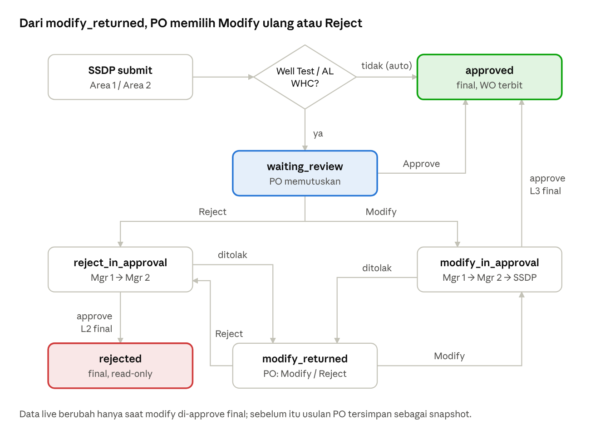
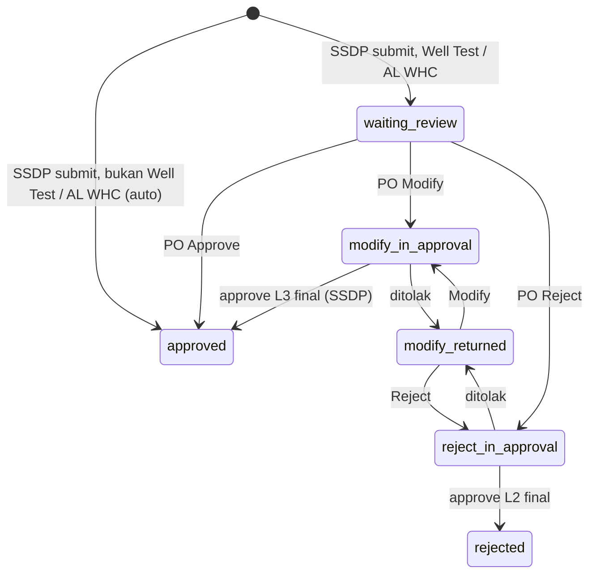

# Action Plan Approval — Flow Steps

Transcribed from `ApprovalFlow.png` (2026-11-02). Design source: `Approval.md`.

**Title:** Dari modify_returned, PO memilih Modify ulang atau Reject

## Steps

1. **SSDP submit** (Area 1 / Area 2) → decision **"Well Test / AL WHC?"**
   - **tidak (auto)** → **approved** (final, WO terbit)
   - **ya** → **waiting_review** (PO memutuskan)
2. From **waiting_review**:
   - **Approve** → **approved**
   - **Modify** → **modify_in_approval** (Mgr 1 → Mgr 2 → SSDP)
   - **Reject** → **reject_in_approval** (Mgr 1 → Mgr 2)
3. From **modify_in_approval**:
   - **approve L3 final** → **approved**
   - **ditolak** → **modify_returned**
4. From **reject_in_approval**:
   - **approve L2 final** → **rejected** (final, read-only)
   - **ditolak** → **modify_returned**
5. From **modify_returned** (PO: Modify / Reject):
   - **Modify** → **modify_in_approval**
   - **Reject** → **reject_in_approval**

Footer: Data live berubah hanya saat modify di-approve final; sebelum itu usulan PO tersimpan sebagai snapshot.

## Where the image differs from the PRD and the design

- **"approved — final, WO terbit":** `Approval.md` issues the WO number at SSDP submit for every plan, not at approval. The label should be "approved — final".
- **"Well Test / AL WHC?":** the PRD trigger is AL WHC **Installation** (see `PRD-Gaps.md` G9 / Q1).
- **Not shown:** SSDP Assign to at submit (G6), PO Assign to + PIC on approve (G7), final approved/rejected notifications to SSDP and PO (G10).
