# Work Order: Knowledge

One file for all WO knowledge: the Knowledge Documents (PRD), the team doc, the MoM, the Figma and prototype, the design notes, and the gaps.
**Rule:** when new knowledge comes in, update the section it belongs to **and** §1 Gaps (add a new gap, or move an answered one to the decision log `01-Decision-Log.md`).
Old separate files are in `archive/` (rearranged 24 Nov).

## Contents
- §1. Gaps: open questions and open decisions
- §2. Knowledge Documents (from the PRD)
- §3. Team doc decisions ("PRD Phantom Fase 2", 24 Nov)
- §4. MoM vs the Knowledge Documents
- §5. Figma, prototype and the first review
- §6. Category breakdown
- §7. Approval route
- §8. Status flow and approval route flow (Mermaid)
- §9. Permissions plan
- §10. Project and task changes
- §11. References (all links)

---

## 1. Gaps: open questions and open decisions

20 Nov 2026, updated 24 Nov. This file has **only open questions**. Each question has:
- one short question,
- the reason we ask,
- our proposal, if we have one.

Decisions and answered questions are in `01-Decision-Log.md`. The ID in brackets, for example [K1], shows where the question comes from. The section "Reference" at the end explains each ID and each source.

**Words used in this file:**
- **WO:** Work Order.
- **AP:** Action Plan.
- **Level:** a department in the WO flow.
  - Level 0 = the requestor department.
  - Level 1 = the target department (Request To).
  - Level 2 = the assigned department (only after a Transfer).
- **Layer:** a step in one Level.
  - Layer 0 = PIC or requestor.
  - Layer 1 = Senior or Asst. Manager.
  - Layer 2 = Manager.
  - The system does not check the position. Each layer holds a permission ID. Every user with that permission, in the department of the Level, can act.
- **Route (approval flow):** the approval chain in Data Config. Each department selects its own flow by hand.
- **WO project:** a project that a WO makes.

---

### A. Design source

**Q01 [Q1]. Which prototype and which layout are the source of truth?**
- **Why we ask:**
  - Two boards have the same logic but different detail layouts:
    - "Unified Overview": collapsible sections, PIC list with roles.
    - "SSDP ⇄ PO": flat cards, first 5 PIC names.
  - The Figma links to a newer prototype (`S4gBiqBpHasmfJnZKQQZMu`).
- **Proposal:** use the newer prototype and the Unified layout. Ignore the "SSDP ⇄ PO" board.

---

### B. Request To and categories

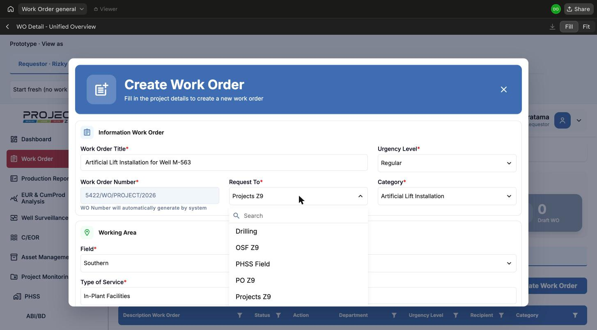

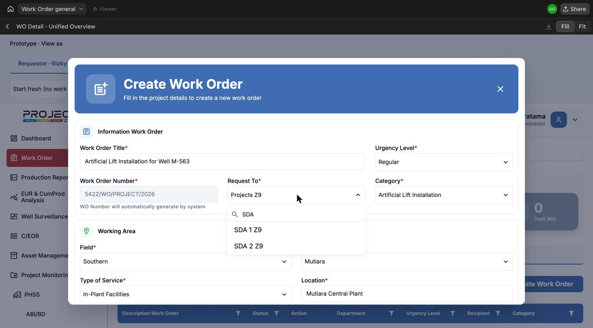

**Q04 [Q2b]. What does a WO to SDA 1 Z9 or SDA 2 Z9 mean?**
- **Why we ask:**
  - The team doc lists SDA 1 Z9 and SDA 2 Z9 in Request To, with no Category and no Function.
  - Today SDA only makes action plans. SDA does not receive them.
  - SDA is not in the schedule-type list (simple or detailed).
- Which work does SDA do with the WO, and which schedule does it use?

**Q08 [K4]. Does Facility Upgrade belong to Projects Z9 or to OSF Z9?**
- **Why we ask:** the prototype puts it in Projects. A Figma note puts it in OSF.
- A: Use Figma
- **New conflict (24 Nov):** the newer team doc lists Facility Upgrade under **Project Z9**. Confirm that the Figma (OSF) is still correct.

**Q09 [K5]. Which non-well categories need approval?**
- **Examples:** Maintenance, Plant Upgrading, Heavy Equipment, WLI work.
- **Proposal:** each category that makes a project needs the full approval chain.

**Q10 [K7]. Where does the work go for Updating Well Data and Plant Performance Study?**
- **Why we ask:** these two categories have no AP.

**Q13 [K10]. Does the category set the Work Order Type, or does the user select it?**
- The types are Updating Parameter, Study and New Work.
- **Proposal:** the category sets it. Example: Choke = Updating Parameter, PPS = Study, RTWS = New Work.

**Q15 [D1]. Can one WO have more than one AP (more than one well)?**
- Also:
  - Can Well Surveillance make an AP without a WO?
  - What do we do with the ~50 dev APs that already have a WO number?

**Answered (see `01-Decision-Log.md`):**
- Q02 (which Request To can receive Well Test / AL WHC Installation): answered 24 Nov by the team doc lists. Well Test: PHSS Field, PEP Production, PO Z9. AL Installation: PO Z9 and Project Z9. Each department selects its own approval flow.
- Q03 (AL Installation to Projects Z9 or PO Z9): answered 24 Nov. The team doc lists both.
- Q05 (Request To "Internal, Level 1, or Level 2"): answered. User: "It same". The list is the 11 departments of the team doc.
- Q06 (add the Figma-only categories): answered. User: "Yes".
- Q07 (category names): answered 24 Nov. PCTGL, Choke, "Sonolog / BJP Update". "Inception" = Inspection and "Gas List" = Gas Lift are typos.
- Q11 (Sonolog for PHSS): answered 24 Nov. The team doc lists Sonolog / BJP Update for PHSS Field.
- Q12 (PHSS Function): answered 24 Nov. The Function stays on the form. Both PHSS functions have the same category list.
- Q14 (Drilling flow): answered 24 Nov. Drilling uses the simple schedule. The form shows no Category and no Function.

---

### C. Approval

**Q18 [Q4c]. Do the buttons use "Work Order" or "Action Plan" in their names?**
- **Example:** "Approve Modification" or "Approve Action Plan".
- **Proposal:** use the WO name, because the WO is the parent (D1).

**Q23 [R9]. Does Layer 0 (PIC) ever approve?**
- **Proposal:** no. Layer 0 only makes the WO or does the work.

**Q24 [D4]. Does a WO with no approval still get a WO number and notifications?**
- **Proposal:** yes.

**Q25 [Q6c]. Do we keep a counter of reject loops?**
- **Why we ask:** the Figma asks for a modification error rate and a reject count per level.
- **Proposal:** keep the counter for reports only.

**Answered (see `01-Decision-Log.md`):**
- Q16 (how the system finds the Layer of a user): answered 24 Nov. Each layer of the route holds a permission ID. Every user with that permission, in the department of the Level, can review. No step is skipped for a Senior requestor: another Senior reviews. The backend uses the permission ID only to list users (`GET /users/by-permission/{id}`). It does not check it on actions. The user's first proposal was "a permission number for each Layer, in the user's department … read, modify, approval (level 1, 2, 3)".
- Q17 (one or two confirmations for a Level 1 rejection): answered. Two confirmations, as the MoM says: the target Manager, then the requestor Manager (D3b).
- Q19 (more than one approver in one layer): answered 24 Nov. Every user with the permission can review, so the first user who acts decides.
- Q20 (change the approvers during approval): answered 24 Nov. Nobody edits a list. The approvers are the users with the permission.
- Q21 (Modify and Reject route by category): answered 24 Nov. The target department selects its own flow by hand in "Set Approval Flow".
- Q22 (phase 1 of the automatic route change): no longer needed. The automatic route search is replaced by manual flow selection (24 Nov).

---

### D. Transfer and Disposition

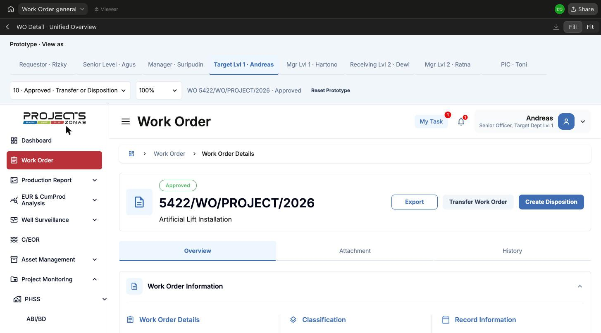

**Q26 [Q5a]. Can a Well Test WO or an AL WHC Installation WO go to a Level 2 department (Transfer)?**

**Q27 [Q5b]. Is the Disposition PIC the same as today's execution PIC?**
- **Why we ask:** today the execution PIC must be an active user of the execution department.

**Answered (see `01-Decision-Log.md`):**
- Q28 (AL flow: Transfer or new WO): answered. User: "Transfer keeps the same WO number. A new WO gets a new number."
- Transfer rules, decided 24 Nov: a user needs the transfer permission. The user selects a department from a list and a sub-unit. Notes are optional. The status goes back to Waiting Approval, and the assigned department selects its own flow. The assigned department cannot transfer again.

---

### E. Schedule and project

**Q30 [P10]. What is different between a detail schedule and a simple schedule?**
- **Why we ask:** WO projects do not use `.mpp` (P0).
- **Proposal:**
  - **Detail:** many WBS levels, manual weight, one PIC per task.
  - **Simple:** two levels; weight from cost.

**Q31 [K14, P3]. Must each task have a cost?**
- **Why we ask:**
  - The MoM (6 Nov) says cost is not required.
  - The MoM (19 Nov) says cost or percentage is required, and the total must not be more than the WO budget.
  - With no cost, the S-curve is flat.
- **Proposal:** follow 19 Nov. Each task needs a cost.

**Q32 [P9]. Does the WO budget limit each project, or the total of all its projects?**

**Q33 [P2]. Does the daily plan use working days or all calendar days?**
- **Why we ask:** the Knowledge Documents say Monday to Friday. The code uses all days.
- **Proposal:** working days, with the holiday list in Data Config.

**Q34 [P4]. Is a WO project without a critical path acceptable?**
- **Why we ask:** the critical path comes from `.mpp`. WO projects do not use `.mpp`.

**Q35 [P6]. Is the Project No of a WO project the WO number?**
- **Why we ask:** the Figma "Project Details" sample shows Project Number / AFE = "5422/WO/PROJECT/2026" (the WO number).
- **Alternative:** the PIC types a number (AFE).
- **Proposal:** use the WO number, as the Figma shows.

**Q36 [P7]. Who sets the project approvers of a WO project?**
- **Proposal:** the route sets them (Manager of the PIC's Level). Nobody changes them manually.

**Q37 [P11]. Which project category does each WO category use?**
- **Why we ask:**
  - Dev has only three project categories: `fasprod`, `newwelldevelopment` and `flowline`.
  - OSF, WLI, PHSS, PEP and PO categories have none.
- **What the Figma shows (23 Nov):** each WO category maps to "Budget Type → Project Category → Class". Examples:
  - RTWS → ABI BD → NWD → RTWS
  - Heavy Equipment → ABI NBD or ABO → Fasprod → HE
  - Well Test → ABO → Well Test
  - The full list is in the category breakdown, section "Project class list".
- **Proposal:**
  - Use the Figma Project Category values (NWD, Fasprod, PCTGL, WORKOVER, Well Service, Drilling, Maintenance, Well Action, Well Test, Study…) as the project categories.
  - Store the Class (RTWS, HE, AFA…) as the sub-category.
  - Map each WO category to one category and class.

**Q38 [P12]. Do we add a `budget_type` field to projects?**
- **Why we ask:**
  - The WO budget types are ABI BD, ABI NBD, ABO R and ABO NR.
  - `projects.rkap_type` has CO, UB and CF.
  - These are two different lists.

**Q39 [P13]. Which field records match "PHSS Northern" and "PHSS Southern"?**
- **Why we ask:** a project needs a field before submit.

**Q40 [P14]. Can a WO project have no WBS?**
- **Why we ask:** the MoM (19 Nov) says WBS is optional for a WO. Today project submit requires a WBS.
- **Proposal:** yes. Skip the WBS check for WO projects.

**Q41 [P15]. Can the PIC save a schedule that is not complete and continue later?**
- **Why we ask:** a task needs dates, duration and weight. A half-typed schedule does not have them yet.
- **Proposal:** yes. The PIC saves the schedule as a draft. The system makes the project tasks only when the PIC submits a complete schedule.

**Q42 [C6]. How does the PIC change the schedule of a WO project after approval?**
- **Why we ask:** today a schedule change (rebaseline) needs a new `.mpp` file. WO projects do not use `.mpp`.
- **Proposal:**
  - The PIC edits the grid or uploads a new Excel file.
  - The change goes through the same rebaseline approval as today.

**Answered (see `01-Decision-Log.md`):**
- Q29 (department or category sets the schedule type): answered 24 Nov. The **department** sets it. Simple = WLI, Field PHSS, Field PEP RAM, Field PEP PE, PO Zona, Drilling. Detailed = Project, OSF.

---

### F. Finish and close

**Q43 [Q7b, K15, P8]. When does a WO close, and who closes it?**
- **Why we ask:**
  - MoM 6 Nov: the WO is complete at project Finish.
  - MoM M014 (Work Order topic): the requestor checks the work first.
  - MoM 19 Nov: "Finish Work Order" finishes all schedules of the WO.
  - So one WO can have more than one project.
- **Proposal:** the WO closes when all its projects are finished. The requestor's well update comes after and does not stop the close.

**Q44 [K11]. Which Finish fields does each category need?**
- **Why we ask:** the Figma shows only the Maintenance fields and the cost / RKAP cards.

---

### G. WO number

**Q45 [D5]. How does the system make the WO number?**
- **Known from the code (24 Nov):** `WorkOrderNumbers` gives `{seq:D4}/WO/{short name}/{year}`. 4 digits. The short name is the **requestor** department (`work_order_department_short_names`). One counter per short name per year, shared by the Action Plan PEP / PHSS and `work_orders`. A WO draft takes its number at **Draft** (`wo_number` is NOT NULL and unique).
- **Still open:** do we change the existing WO numbers to the new format? Is the format read from `custom_configurations` (plan §3.3) or kept in the code?

---

### H. Action Plan form

**Q46 [F12]. Is Prime Mover required for AL Update and AL Installation?**
- **Why we ask:** the sources do not agree.
  - The Figma "Action Plan – Artificial Lift Update" form (method Gas Lift) shows **Prime Mover\*** and **Power\*** as required.
  - The prototype shows Prime Mover as optional.
  - MoM M002: for SRP, Prime Mover and Power are **not** required.
  - The current system does not require it.
- **Proposal:** Prime Mover and Power are required only when the Figma marks them (Gas Lift). They stay optional for SRP and ESP (M002).

---

### Reference

#### Source documents
- **All links:** see `02-Knowledge.md` §11.
- **Knowledge Documents:** the WO knowledge that we collected (flows, data, rules). It is the main reference of this file.
- **First draft of the Knowledge Documents:** "Work Order Module (PHANTOM)". The design team wrote it from the prototype.
- **Prototype:** the claude.ai artifact `S4gBiqBpHasmfJnZKQQZMu`. The Figma links to it. It is newer than the prototype of the first draft of the Knowledge Documents.
- **Figma:** "PHI - Latest Design", page "Work Order". It shows the flows:
  - "Flow Work Order V2",
  - "Detail Schedule",
  - "Simple Schedule".
- **MoM:** the Google Doc "Recap MOM PHI (Phantom)". It has notes from many meetings. It gives each topic a code (M002, M009, M014…).

#### MoM meetings used in this file
- **MoM 22 Okt:** KOM Sprint 2. Topics: WHC ticket, Gas Lift PHSS flow, department list, WO number format.
- **MoM 6 Nov:** MoM Sprint 3. Topics: approval flow, disposition, link to Project Monitoring, simple and detail schedule.
- **MoM 19 Nov:** "Regarding Work Order Module". This is a Q&A with PHI (Ardi, Atina) and Ocean (Naya). Topics:
  - WO fields,
  - Level and Layer names,
  - rejection and modify flow,
  - urgency,
  - simple schedule.

#### MoM topic codes
- **M002:** "Data Parameter dan Equipment Artificial Lift (SRP & ESP)". The AL parameters for PEP: SRP, ESP, HPU.
- **M009:** "Notifikasi Gas Lift / Artificial Lift". The AL notifications.
  - **Point 2:** a well with no flow and low cumulative production gets a notification to change the AL. The new work connects this notification to the WO.
  - **Point 3:** a gas-lift need sends a notification to PO. There are two entry points:
    1. An AP to install AL in Well Surveillance: SSDP makes it, PO validates it, then **PO makes a WO to Project**.
    2. The general WO module (M014).
  - PHI joined M009 and M014 into one flow.
- **M014:** "Work Order". The general WO module: purpose, Incoming / Outgoing, Draft / Submit, urgency and SLA, approval levels, requestor check at the end.

#### ID prefixes in brackets
- **Q1–Q7:** the first question list (18–19 Nov). It came from the Knowledge Documents review and the Figma.
- **F12:** a finding of the Knowledge Documents review about the Prime Mover field.
- **D1, D4, D5:** open sub-questions of the decisions D1, D4 and D5 (from the Knowledge Documents review).
- **C6:** the schedule-type point of the Knowledge Documents review. The Figma settled it: PRJ and OSF use the detail schedule.
- **TD1–TD16:** decisions of 24 Nov from the team doc and the user's answers (`02-Knowledge.md` §3).
- **K1–K15:** open points of the category breakdown (categories per Request To).
- **X10–X14:** conflicts between the MoM and the Knowledge Documents.
- **R2–R9:** questions on the automatic approval route idea (stages, bindings, layer rules). The team replaced that idea on 24 Nov with manual flow selection.
- **P2–P15:** questions on WO projects and project tasks.

#### Decision codes in the text
- **D1:** the WO is the parent. The AP is the child. The approval route is on the WO.
- **D3b:** a declined rejection goes back to the target Senior. The Reject button is hidden.
- **C6:** PRJ and OSF use the detail schedule. All other departments use the simple schedule. Confirmed 24 Nov with the full department list.
- **P0:** a WO project does not use `.mpp`. The PIC makes the schedule in the app (grid or Excel).
- The full decision list is in the decision log (`01-Decision-Log.md`).

### Open decisions for the build (update this list when a new gap is found)

| #   | Gap                                                                                                                                                                                                                                                                                                                                                    | Source                                          | Proposal                                                                               |     |
| --- | ------------------------------------------------------------------------------------------------------------------------------------------------------------------------------------------------------------------------------------------------------------------------------------------------------------------------------------------------------ | ----------------------------------------------- | -------------------------------------------------------------------------------------- | --- |
| G1  | Path convention `/api/v1/work-order/...` with `{id:guid}`                                                                                                                                                                                                                                                                                              | Other agent, 24 Nov; `03-Endpoint-Plan.md` §2.0 | Use it. Waits for the user OK.                                                         |     |
| G2  | ~~Privilege numbers: 273+ or 164+~~ | §9 | **Closed 25 Nov:** 273–279, groups 31 / 32 (on dev) |     |
| G3  | Approval route steps: new table or new columns on `approval_route_users`                                                                                                                                                                                                                                                                               | `03-Endpoint-Plan.md` §3.2                      | –                                                                                      |     |
| G4  | Route gate (`RbacRouteMaps`) on the WO pages                                                                                                                                                                                                                                                                                                           | `03-Endpoint-Plan.md` §3.8                      | Yes for page access, no for actions                                                    |     |
| G5  | Transfer: is `pic_id` required? Figma: yes. Team doc: no PIC.                                                                                                                                                                                                                                                                                          | §3, Figma                                       | Body `{ department, sub_unit?, pic_id, notes? }`; `sub_unit` only for a Field          |     |
| G6  | Level 0 reject: final (decision X3) or resubmit (Figma History shows "Revision")                                                                                                                                                                                                                                                                       | §5, Figma                                       | Final                                                                                  |     |
| G7  | Urgent WO 2 × 24 h bypass: keep or drop                                                                                                                                                                                                                                                                                                                | MoM only                                        | –                                                                                      |     |
| G8  | Old Action Plans that already have a WO number                                                                                                                                                                                                                                                                                                         | Q15                                             | –                                                                                      |     |
| G9  | Facility Upgrade: OSF (Figma) or Project Z9 (team doc)                                                                                                                                                                                                                                                                                                 | Q08                                             | –                                                                                      |     |
| G10 | `request_to` value: map the 11 Request To labels to `users.department`                                                                                                                                                                                                                                                                                 | Other agent, 24 Nov; #1533 Incoming             | Store the real department name; map in `custom_configurations` `work_order.request_to` |     |
| G11 | Field departments (PHSS Field, Sangasanga, Sangatta, Tanjung) have no `users.department`                                                                                                                                                                                                                                                               | `05-Production-Checklist.md` §5                 | –                                                                                      |     |
| G12 | Validate the Request To / Function / Category combination                                                                                                                                                                                                                                                                                              | Other agent, 24 Nov                             | Validate at Submit from config; Draft takes any value                                  |     |
| G13 | Budget Type / Disposition Work Type stored as codes `abi_bd`, `abi_nbd`, `abo_r`, `abo_nr`                                                                                                                                                                                                                                                             | Other agent, 24 Nov                             | Yes; labels from config. Draft stores free text today.                                 |     |
| G14 | "Next" (Action Plan) button: do Maintenance Field and Modification (`pp`) use it?                                                                                                                                                                                                                                                                      | Figma Input Parameter                           | Figma has forms for Well Test Update, AL Update, AL Installation, Sonolog, Choke only  |     |
| G15 | Time zone of list / detail dates (notifications use WITA)                                                                                                                                                                                                                                                                                              | Knowledge Documents, other agent                | Store UTC, show WITA                                                                   |     |
| G16 | `field_id`, `page`, `page_size` on #1533 must be `string?` (empty value gives 500)                                                                                                                                                                                                                                                                     | #1533 follow-up                                 | Change, and validate by hand                                                           |     |
| G17 | Incoming hides a WO when the requestor department is also the target department                                                                                                                                                                                                                                                                        | #1533 follow-up                                 | Check before go-live                                                                   |     |
| G18 | Prime Mover required (Q46)                                                                                                                                                                                                                                                                                                                             | Figma                                           | Required only for Gas Lift                                                             |     |
| G19 | **Closed 25 Nov:** both. Draft `POST /work-order/draft` + Create `POST /work-order/{working_area}`, all multipart. ~~Create path and format: FE spec = `POST /work-order/{working_area}` multipart (create = submit). BE built `POST /work-order/draft` JSON; plan #8 = `POST /work-order/submit`                                                      | FE API Spec (Notion, 25 Nov)                    | Agree one path with the FE before #8                                                   | ~~  |
| G20 | **Closed 25 Nov:** store the code, map with `work_order.request_to`. ~~`request_to`, `function`, `category`, `type_service` are **codes** in the FE spec (`osf`, `projects`, `phss_field`, `sangatta_field`, `po`, `wli`; `wo_ws`, `heavy_equipment`, …). Incoming (#1533) matches `request_to` with `users.department` names, so a code never matches | FE API Spec; G10                                | Map code → department name in config, or store both                                    | ~~  |
| G21 | **Closed 25 Nov:** FE values. ~~`urgency_level`: FE sends `important`; BE draft accepts only `Regular` / `High Priority` (400)                                                                                                                                                                                                                         | FE API Spec                                     | Agree the values                                                                       | ~~  |
| G22 | **Closed 25 Nov:** FE codes, sent as an array, one value now. ~~`budget_type` / disposition `work_type` codes: FE = `abibd`, `abinbd`, `abo_routine`, `abo_non_routine` (G13 proposal was `abi_bd` …)                                                                                                                                                  | FE API Spec                                     | Take the FE codes                                                                      | ~~  |
| G23 | **Closed 25 Nov:** both; `approvers` wins over the route. ~~Approvers: FE sends `approvers: [{ level, sla_days, user_id[] }]` at Create and Set Approval Flow. Decision TD1: the user selects a route; the permission lists the users; the backend copies the steps. BE draft takes `approval_route_id`                                                | FE API Spec; §3                                 | Send `approval_route_id`; BE copies                                                    | ~~  |
| G24 | Level labels on FE: `1 Senior Level, 2 Manager, 3 Target Department` (old model). Our model: Level 0 / 1 / 2 × Layer 1 / 2                                                                                                                                                                                                                             | FE API Spec                                     | FE uses `level` + `layer` from the detail response                                     |     |
| G25 | **Closed 25 Nov:** 5 files. Edit-description endpoint still to add. ~~Attachments: FE = max **1** file at Create (`file`), edit description (`PUT …/attachments/{id}`). Plan = max 5 files (#12), no edit endpoint                                                                                                                                     | FE API Spec; Figma                              | Decide 1 or 5; add an edit-description endpoint                                        | ~~  |
| G26 | Verbs: FE uses `PUT` (modify, attachment) and `DELETE` (attachment). Repo style = `POST` only (`…/delete`)                                                                                                                                                                                                                                             | FE API Spec; `03-Endpoint-Plan.md` rules        | Keep POST; tell the FE                                                                 |     |
| G27 | Transfer body: FE = `{ department, pic_ids[] (min 1), notes? }`, no `sub_unit`. TD = sub-unit                                                                                                                                                                                                                                                          | FE API Spec; G5                                 | Decide with G5                                                                         |     |
| G28 | Endpoints the FE needs that are not in the plan: Export PDF (`GET …/{id}/export`), Modification list (`GET …/{id}/modifications`, display strings before / after)                                                                                                                                                                                      | FE API Spec                                     | Add to `03-Endpoint-Plan.md`                                                           |     |
| G29 | Action Plan inside Create: FE sends one key per category (`well_test`, `artificial_lift_update`, …) on the same call; `updating_well_data` reuses `well_test`                                                                                                                                                                                          | FE API Spec; Figma Input Parameter              | Accept on submit (#8), not on draft yet                                                |     |
| G30 | List `status`: FE knows only `waiting_approval`, `modification_review`, `project_approval`, `approved`. BE also sends `draft`, `under_review`, `rejected`, `rejection_review`, `needs_revision`, …                                                                                                                                                     | FE API Spec; #1533                              | FE handles every value of `WorkOrderStatusConstants`                                   |     |
| G32 | **Seeded 25 Nov:** short names PROJECTS (Project), OSF (Operation & Surface Facilities), PO (Production Operations), DRILLING (Drilling), WLI (WLI) appended by `seed_work_order_config.sql`. Check the Drilling / WLI keys against `users.department`. ~~Short names had only SDA 1 / SDA 2~~ | Code, 25 Nov | Check names on the DB before go-live; other departments (Fields) still have none | Partly closed |
| G33 | **Seeded 25 Nov:** `wli` → WLI, `phss_field` → PHSS Field, `sangatta_field` → Sangatta Field. The names come from the Request To list (G11); check them against `users.department` | `seed_work_order_config.sql` | Check names on the DB before go-live | Partly closed |
| G31 | Next WO number: FE uses the existing `GET /well-surveilence/action-plans/next-wo-number`. Same counter as the WO (requestor department)                                                                                                                                                                                                                | FE API Spec                                     | OK to reuse; plan #3 not needed                                                        |     |

---

## 2. Knowledge Documents (from the PRD)

Draft v0.2 · 24 Nov 2026 (v0.1: 19 Nov) · format follows "Phantom Fase 2" (team format reference) (tab Artificial Lift).

**Sources:** team doc "PRD Phantom Fase 2" (Sprint 3 SSDP, WO Lv 0 / Lv 1 / Lv 2, read 24 Nov), first draft of the Knowledge Documents, "Work Order Module (PHANTOM)" (`claude.ai/artifact/3A8M7RGwuGg1RnGYuyedah`), prototype `claude.ai/artifact/S4gBiqBpHasmfJnZKQQZMu`, Figma "PHI - Latest Design" › page Work Order (Flow Work Order V2 3/11/2026, Detail Schedule 5/11/2026, Simple Schedule 5/11/2026), current system (AL / WT Action Plan approval, PR #1476).

**Decisions applied (18–19 Nov):** D1 WO is the parent of the Action Plan · D2 approval levels come from approval routes (submit, Modify, Reject) · D3 returns go back to the reviewer, Rejected is final · D4 only Well Test + AL WHC Installation need target approval · D5 WO number `<seq>/WO/PROJECT/<year>` · C6 PRJ + OSF use detail schedule, others use simple schedule · D7 Finish may skip the result parameters · D8 bulk approve = plain Approve only.

**Decisions applied (19–24 Nov), they replace older rules above where they differ:**
- Levels: Level 0 = requestor department, Level 1 = target department (Request To), Level 2 = assigned department (only after a Transfer). Layer 1 = Senior / Asst. Manager, Layer 2 = Manager (an SOP only; the system does not check the position).
- Approval flow: the requestor selects the Level 0 flow in Create WO (Layer 1, then Layer 2 of the requestor department). The target department and the assigned department each select their own flow in the "Set Approval Flow" window.
- Approvers: each route layer holds a permission ID. Every user with that permission in the department of the Level can act. No step is skipped for a Senior requestor: another Senior reviews. The backend uses the permission ID only to list users (`GET /users/by-permission/{id}`). It does not check the permission ID to allow or block an action.
- Level 0: an approver can modify and approve in one step; the requestor gets a notification only (X2). A reject at Level 0 is final; the requestor makes a new WO with a new number (X3).
- Level 1 modify: Layer 2 Level 1 approves, then Layer 2 Level 0 checks (X4). If Level 0 declines, the system drops the proposal and the WO goes to Approved with the old values (X5).
- Level 1 reject: two confirmations, first Layer 2 Level 1, then Level 0. If Level 0 declines the rejection, the WO goes back to Layer 1 Level 1 and the Reject button is hidden (D3b, R8).
- A category with no approval skips all approval steps (R1).
- WO number format comes from `custom_configurations` (D5b; the format itself is open, Q45). The Finish parameters are required (D7b).
- Schedule type by department: simple = WLI, Field PHSS, Field PEP RAM, Field PEP PE, PO Zona, Drilling; detail = Project, OSF (TD4).
- No `.mpp` for WO projects: both schedule types are built in the app (P0). A well WO also makes a simple project; an Action Plan WO skips the project approval (P1). A flag on `projects` marks a project from a WO (F1).
- Transfer: needs a permission, department from a list for each department, sub-unit, notes optional, status back to Waiting Approval, no second transfer (TD12, TD15).
- Full list and dates: `01-Decision-Log.md`. Status chart: `02-Knowledge.md` §8.

Matched with MoM recap (M014, 22 Okt, 6 Nov, 19 Nov): see `02-Knowledge.md` §4. MoM items are tagged [MoM].

Open items are in each story's **Question** row and in `02-Knowledge.md` §1 (Q01–Q46). Links: `02-Knowledge.md` §11.

Figma: https://www.figma.com/design/usSi3zXbPKJf1snvAFEyLl/PHI---Latest-Design?node-id=18789-49609

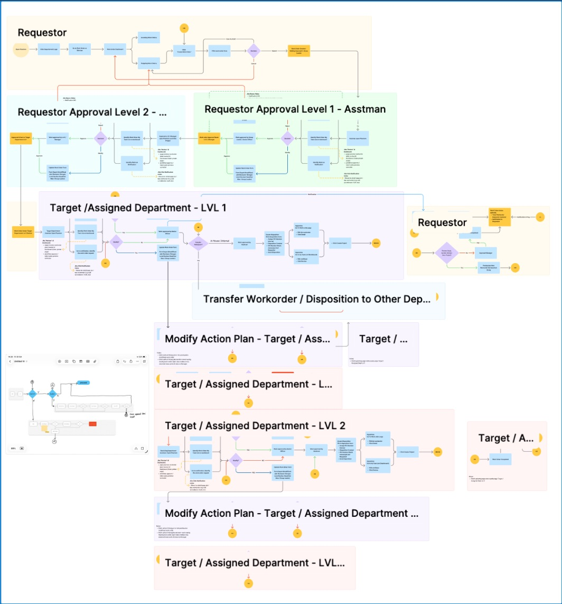

---

### **FEATURE BREAKDOWN**

| Flow | Story | Actor | Figma lane | Jira |
| :---- | :---- | :---- | :---- | :---- |
| FLOW 1 – Create & Submit | 1.1 Create / edit WO (form + cascading rules) | Requestor | Requestor | TBD |
| | 1.2 Action Plan step for well categories | Requestor | Requestor | TBD |
| | 1.3 WO number generation | System | – | TBD |
| FLOW 2 – Requestor Approval | 2.1 Layer 1 Level 0 (no skip; another Senior reviews) | Senior / Asst. Manager (permission) | Requestor Approval Lvl 1 | TBD |
| | 2.2 Approval Level 2 | Manager Requestor | Requestor Approval Lvl 2 | TBD |
| | 2.3 Requestor-side reject | Senior Level / Manager | Requestor Approval Lvl 1/2 | TBD |
| | 2.4 Bulk approve | Senior Level / Manager | – | TBD |
| | 2.5 SLA + auto-escalation by Urgency [MoM] | System | – | TBD |
| FLOW 3 – Target Review Approve | 3.1 Review and approve | Senior Officer target | Target Lvl 1 | TBD |
| | 3.2 Set Approval Flow (target / assigned dept) | Target or assigned dept user (permission) | – | TBD |
| FLOW 4 – Modify | 4.1 Modify WO / Action Plan | Senior Officer target | Modify | TBD |
| | 4.2 Modify approve (Layer 2 Level 1, then Layer 2 Level 0) | Manager target → Manager Requestor | Modify | TBD |
| | 4.3 Modify reject (return to reviewer) | Any Modify route level | Modify | TBD |
| FLOW 5 – Reject | 5.1 Target-side reject (two confirmations) | Senior Officer → Manager target → Manager Requestor | Rejection | TBD |
| FLOW 6 – Transfer / Disposition | 6.1 Transfer WO to the assigned dept (Level 2) | Level 1 user with the transfer permission | Approved | TBD |
| | 6.2 Create Disposition | Senior Officer Lvl 1/2 | Approved | TBD |
| FLOW 7 – Project / Action creation | 7.1 Create Project – detail schedule (PRJ, OSF) | PIC | Detail Schedule | TBD |
| | 7.2 Create Project / Action – simple schedule (others) | PIC | Simple Schedule | TBD |
| | 7.3 Project approval | Manager of PIC's level | Detail / Simple | TBD |
| FLOW 8 – Finish | 8.1 Finish + result parameters | PIC | All lanes (end) | TBD |
| | 8.2 Requestor checks result and updates well | Requestor | All lanes (end) | TBD |
| FLOW 9 – Screens & Notification | 9.1 WO list (Incoming / Outgoing / Waiting for me) | All | – | TBD |
| | 9.2 WO detail, History, View Changes | All | – | TBD |
| | 9.3 Notification center | All | Entry notes | TBD |

---

### **DATA ATTRIBUTES**

Status column: **New** = new column/table · **Move** = exists on the action plan today, moves to the WO (D1) · **Exists** = reuse as is · **Change** = exists, rule changes.

#### **A. `work_orders` (new, parent)**

| Field | Type | Req | Rule / source | Status |
| :---- | :---- | :---- | :---- | :---- |
| id | Guid | Y | PK | New |
| work_order_number | nvarchar(30) | Y | Format from `custom_configurations` (D5b; changed 19 Nov). The format itself is open (Q45: `<seq>/WO/PROJECT/<year>` or the requester dept code of MoM 22 Okt). Unique, never changes (also after transfer / disposition). The Action Plan uses the WO number; it does not make its own (D1) | Move (from `pep_/phss_action_plan.work_order_number`) |
| title | nvarchar(200) | Y | Work Order Title | New |
| urgency_level | nvarchar(20) | Y | LOV: Regular / High Priority (19 Nov MoM: "Urgent"). Drives SLA: Regular = layer SLA from the route (e.g. 14 days), High = 2 × 24 h per layer, then the WO goes to the next layer and the system records it [MoM 19 Nov] | New |
| work_order_type | nvarchar(30) | Y | LOV: Updating Parameter / Study / New Work [MoM 19 Nov] | New |
| review_by_user_id | Guid | N | Review By | New |
| requestor_user_id | Guid | Y | Creator | New |
| requestor_department_id | Guid | Y | From the creator's department (org tree) | New |
| request_to_department_id | Guid | Y | LOV Request To (11 depts): Drilling, OSF Z9, PHSS Field, PO Z9, Project Z9, Sangasanga Field, Sangatta Field, SDA 1 Z9, SDA 2 Z9, Tanjung Field, WLI Z9. Use the same key style as `requestor_department_id` | New |
| function | nvarchar(30) | C | Required when Request To = Tanjung / Sangatta / Sangasanga (RAM / PE / Production) or PHSS Field (WO/WS / Facility Maintenance) | New |
| category | nvarchar(60) | C | LOV by Request To (+ Function). None for Drilling, SDA 1 Z9, SDA 2 Z9. "Others" for the rest | New |
| type_of_service | nvarchar(20) | Y | In-Plant / Out-Plant Facilities | New |
| working_area | nvarchar(10) | Y | PHSS / PEP | New |
| field_id, area_id | Guid | Y | Cascading (e.g. PHSS Northern, PHSS Southern); Area follows Field; changing Field clears an invalid Area | New |
| plant_id | Guid | C | Required for In-Plant | New |
| location_text | nvarchar(200) | C | Required for Out-Plant (free text) | New |
| start_date, end_date | date | Y | end ≥ start | New |
| wbs | nvarchar(max) JSON array | N | Digits only, several, no duplicates | New |
| rkap_year | int | Y | LOV 2026, 2027 | New |
| budget_type | nvarchar(20) | Y | ABI BD / ABI NBD / ABO R / ABO NR (master list open) | New |
| prod_gain_mmscf, prod_gain_bbls | decimal(18,2) | N | Production Gain or Loss Avoidance | New |
| lpo_mmscf, lpo_bbls | decimal(18,2) | N | LPO Potential | New |
| scope_of_works | nvarchar(max) | Y | Free text | New |
| requires_approval | bit | Y | From the category (see `02-Knowledge.md` §6, "Approval flow by category"). False = skip all approval steps, Level 0 too (R1, changed 20 Nov) | Move |
| schedule_kind | nvarchar(10) | Y | Set by the department, not by the user (TD4, changed 24 Nov): `detail` = Project, OSF; `simple` = WLI, Field PHSS, Field PEP RAM, Field PEP PE, PO Zona, Drilling. Fixed in code first, configurable later | New |
| status | nvarchar(30) | Y | See §C status list | Move (`approval_status`) |
| current_round | nvarchar(10) | N | submit / modify / reject | New |
| current_cycle_id | Guid | N | FK `work_order_approval_cycles` | Move |
| current_level | int | Y | Level that must act: 0 requestor, 1 target, 2 assigned (changed 24 Nov) | New |
| current_layer | int | N | Layer that must act: 1 Senior / Asst. Manager, 2 Manager | New |
| level0_route_id, level1_route_id, level2_route_id | Guid | N | Flow selected by each department: Level 0 in Create WO, Level 1 / 2 in "Set Approval Flow" (TD1, TD2) | New |
| no_reject | bit | Y | True after Level 0 declines a rejection: Layer 1 Level 1 can only Approve or Modify (D3b) | New |
| owner_department_id | Guid | Y | Target (Level 1), then the assigned dept (Level 2) after a transfer | New |
| sub_department | nvarchar(20) | C | Sub-unit selected at Transfer: PE / PO / RAM / WO-WS (TD12) | New |
| review_pic_id | Guid | N | Senior Officer who holds the review | Move |
| execution_department_id, execution_pic_id | Guid | N | Disposition PIC = execution PIC? (Q5b) | Move |
| reject_loop_count | int | Y | Default 0; reporting only (Q6c) | New |
| modification_count | int | Y | For "modification error rate" (Figma Modify note) | New |
| project_id | Guid | N | Changed 24 Nov: do not link one project here. One WO can have more than one schedule (K15, MoM 19 Nov). The link is `projects.work_order_id` (not unique) | Remove |
| submitted_at, approved_at, approved_by, rejected_at, rejected_by, completed_at, completed_by | datetime / Guid | N | Audit | Move + New |
| created_at, created_by, updated_at, updated_by, is_deleted | – | Y | Standard | New |

#### **B. Child and support tables**

| Table | Key fields | Rule | Status |
| :---- | :---- | :---- | :---- |
| `pep_action_plan`, `phss_action_plan` | + `work_order_id` Guid FK | D1: Action Plan is the child. Approval columns (`approval_status`, `current_cycle_id`, `review_pic_id`, `execution_*`, `requires_approval`) move to `work_orders`. 1 WO : N plans? (Q / D1) | Change |
| `*_action_plan_well_test` | contract_number, well_test_type (`production_test` / `optimization_test`), start, end | PHI-2354 values, not the Knowledge Documents's New / Routine / Re-test | Exists |
| `*_action_plan_artificial_lift` | whc_type, compression_type, owned_by, contract_number / asset_number, cost_allocation, production ≤ compression | Prime Mover: optional for SRP (MoM M002: only stroke length + SPM are required; prime mover = SRP free text). The Figma AL Update form (Gas Lift) marks Prime Mover and Power as required (F12y, 23 Nov) — **open, Q46**. Pressure dropped | Exists |
| `*_action_plan_choke` | bean (up/down), start, end, choke_setting, relation_gain_days, compressor_id | Compressor capacity warning (BR-5) is new | Change |
| `pep_action_plan_sonolog` | start, end | PEP only today; Knowledge Documents list PHSS Field | Exists |
| `work_order_sequences` | short_name, year, last_seq | Today it counts per department short name (SDA1 / SDA2). Format from `custom_configurations` (D5b); key, padding and issue time open (Q45) | Change |
| `work_order_approval_cycles` | id, work_order_id, round (submit/modify/reject), cycle_no, path, previous_cycle_id, approval_process_id, outcome, decided_by/at, remarks, closed_at/by | Re-host of `action_plan_approval_cycles` (replace `action_plan_source` + `action_plan_id`) | Move |
| `work_order_approvers` | cycle_id, stage, level, layer, permission_id, department, user_id, received_at, due_at, acted_at, escalated_at, escalated_from_user_id | Changed 24 Nov: copied when each department sets its flow (Level 0 at submit, Level 1 / 2 at "Set Approval Flow"). Users = `GET /users/by-permission/{id}` filtered by the department of the Level. No skip for a Senior requestor. One user can be in more than one step. No permission check on actions. due_at from Urgency SLA; escalated_* set by the escalation job | Move + New cols |
| `work_order_approver_slas` | cycle_id, level, sla_days | Drives On Track / Near Due / Delayed chips | Move |
| `work_order_modifications` | cycle_id, modified_by, modified_role, level (Target / Receiving), original_snapshot, proposed_snapshot (WO + Action Plan fields), changed_fields, outcome, applied_at/by, visibility | Drives View Changes; Lvl 1 / Lvl 2 visibility rule | Move |
| `approval_routes` | category "Work Order - {Department}"; Level 0 / 1 / 2, each with Layer 1 and Layer 2; each layer holds a permission ID | Changed 24 Nov (TD3, TD11): one route category per department; people select the route by hand. Replaces `wo_{dept}_submit` / `_modify` / `_reject` | Change (new categories) |
| `work_order_transfers` | work_order_id, from_department_id, to_department_id, sub_department, notes, transferred_by/at | Only from Level 1 Approved; once (no second transfer). Needs the transfer permission. Department from a list for each department; sub-unit required; notes optional (TD12) | New |
| `work_order_pics` | work_order_id, user_id, kind (transfer / disposition), assigned_by/at | Multi PIC; must be active user of the dept | New |
| `work_order_dispositions` | work_order_id, work_type (ABI BD / ABI NBD / ABO Routine / ABO Non Routine), project_class, notes, created_by/at | Work Type by department (TD5): ABI/BD only Projects and PO; ABI/NBD only OSF; ABO Routine and ABO Non Routine for all. Work type pre-fills Project Type. Project class from category (Figma, checked 23 Nov): PRJ ABI BD → NWD → Flowline / RTWS / Gas Lift, ABI BD → Fasprod; OSF ABI NBD / ABO → Fasprod → HE / AFA / Maintenance / Inspection (budget type sets the class), ABO → Fasprod → Others / Study / Rig Inspection; WLI → Well Service / PCTGL / Workover; Fields / PO → ABO → Maintenance / Operation / Well Action / Updating Data / Well Test / Study / AL Install; Drilling → ABI BD → Drilling. Full list: `02-Knowledge.md` §6 | New |
| `work_order_attachments` | work_order_id, kind (request / result / study), file_key (MinIO), file_name, size, mime, uploaded_by/at | Max 5 files, 10 MB, PDF/DOC/DOCX/XLS/XLSX/JPG/PNG | New |
| `work_order_results` | work_order_id, category, parameters JSON, finished_by/at, requestor_checked_by/at, well_updated_at, well_update_target (status_sumur / al_equipment / choke / sonolog / mtu / eur_zona) | Finish pop-up (Figma) + Requestor check; the parameters are required (D7b, changed 19 Nov). Maintenance parameters: Desc. Project / Scope, Timeline, Potential Gain, Potential LPO, Remarks. Pop-up also shows read-only project cost cards (Budget, Actual, Commitment, EAC, Total RKAP) and RKAP rows | New |
| `work_order_activity_logs` | work_order_id, occurred_at, activity, user_id, role, duration_since_prev, remarks, cycle_id, modification_id | One row per action (History tab) | New |
| `projects` | + `work_order_id` (not unique), + origin flag (`manual` / `work_order`) | Project born from a WO; one WO can have more than one project; Finish of the WO finishes all of them. A well WO also makes a simple project (P1). Project No = WO number (Figma sample, Q35). Project Details shows the WO Number [MoM 6 Nov]; Finish checks it. See `02-Knowledge.md` §10 | Change |
| `project_tasks` | wbs_code (num), level, name (desc), start, finish, predecessors (pred), plan_cost (cost), weight | Simple schedule rows → tasks without Aspose; weight from cost, fallback when cost is empty (cost weight not mandatory [MoM 6 Nov]); On Stream last (PHI-2267); input on screen or Excel upload [MoM]; no `.mpp` for WO projects, detail and simple (P0) | Change (new import path) |
| `custom_configurations` | `wo.request_to`, `wo.category.{dept}`, `wo.function`, `wo.budget_type`, `wo.work_type`, `wo.urgency`, `wo.type_of_service`, `wo.number_format`, `wo.transfer_departments.{dept}`, `wo.schedule_type` (later) | LOV store, one row per list | New rows |

#### **C. Status list (changed 24 Nov)**

Status = the badge. `current_level` + `current_layer` say who must act. Chart: `02-Knowledge.md` §8.

| Status | Who acts (Level / Layer) | Next |
| :---- | :---- | :---- |
| draft | Requestor | waiting_approval (Level 0 / Layer 1); approved if the category has no approval (R1) |
| waiting_approval (Level 0) | Layer 1, then Layer 2 of the requestor dept | next layer, or waiting_approval at Level 1; Modify = edit and approve in one step (X2); rejected (final, X3) |
| waiting_approval (Level 1 or 2) | Layer 1 of the target / assigned dept | approved; "Set Approval Flow" first for Modify or Reject (then Approve is hidden) |
| modification_review | Layer 2 Level 1, then Layer 2 Level 0 | approved with the new values; target Manager rejects → waiting_approval (Level 1, proposal dropped); Level 0 declines → approved with the old values (X5) |
| rejection_review | Layer 2 Level 1, then Layer 2 Level 0 | rejected; target Manager "No, Cancel" → waiting_approval (Level 1); Level 0 declines → waiting_approval (Level 1) with `no_reject` (D3b) |
| approved | Layer 1 of the target dept | waiting_approval at Level 2 (Transfer, Level 1 only); project_preparation (Create Disposition) |
| rejected | – (final; new WO with a new number) | – |
| project_preparation | PIC | project_approval; on_going for an Action Plan WO (project approval skipped, P1) |
| project_approval | Project approvers (Q36 open) | on_going, project_preparation |
| on_going | PIC | completed (Finish, parameters required) |
| completed | – | – |

Removed: needs_revision as its own step, the Re-Submit of a rejected WO, the skip of Layer 1 for a Senior requestor. Study path (study review / study approval): in the Figma Requestor lane, not decided yet. Bypass by the urgent SLA: check with the team.

---- | :---- | :---- |
| draft | Requestor | waiting_approval |
| waiting_approval (submit route level n) | Senior Level / Manager Requestor | waiting_review, rejected |
| waiting_review | Senior Officer target / receiving | approved, modification_review, rejection_review |
| modification_review (route level n) | Modify route (last = Manager Requestor?) | approved, waiting_review |
| rejection_review (route level n) | Reject route | rejected, waiting_review |
| approved | Senior Officer | waiting_review (receiving, after transfer), project_preparation |
| rejected | – (final; Figma allows re-submit, Q6b) | – |
| project_preparation | PIC | project_approval |
| project_approval | Manager of PIC's level | on_going, project_preparation |
| on_going | PIC | completed |
| completed | – | – |

Removed by D3: needs_revision (mr1/mr2), "rejection not approved" banner, Re-Submit from target-side reject. Study path (sr / sa / sn): the Figma Requestor lane has it ("Review Study Apakah Dilanjut New Project?" Yes → new WO based on the study, No → Manager approval → Completed), but no screen leads into it. Out of scope until confirmed.

---

### **FLOW 1 - CREATE & SUBMIT**

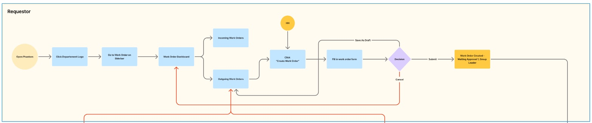

### **NID WO-1.1 [Jira TBD]**

**Work Order - Create & Submit - Requestor Create Work Order**

| Notion ID               | WO-1.1 / Create Work Order                                                                                                                                                                                                                                                                                                                                                                                                                                                                                                                                                                                                                                                                                                                                                                                                                                                                                                                                                                                                                                                                                                                                                                                                                                                                                                                                                                                                                                                                                                                                  |
| :---------------------- | :---------------------------------------------------------------------------------------------------------------------------------------------------------------------------------------------------------------------------------------------------------------------------------------------------------------------------------------------------------------------------------------------------------------------------------------------------------------------------------------------------------------------------------------------------------------------------------------------------------------------------------------------------------------------------------------------------------------------------------------------------------------------------------------------------------------------------------------------------------------------------------------------------------------------------------------------------------------------------------------------------------------------------------------------------------------------------------------------------------------------------------------------------------------------------------------------------------------------------------------------------------------------------------------------------------------------------------------------------------------------------------------------------------------------------------------------------------------------------------------------------------------------------------------------------------- |
| **Link Figma**          | https://www.figma.com/design/usSi3zXbPKJf1snvAFEyLl/PHI---Latest-Design?node-id=18789-49609                                                                                                                                                                                                                                                                                                                                                                                                                                                                                                                                                                                                                                                                                                                                                                                                                                                                                                                                                                                                                                                                                                                                                                                                                                                                                                                                                                                                                                                                 |
| **Acceptance Criteria** | **ENTRY POINT : Work Order page › Create Work Order** **Given** Requestor is on the Work Order page **When** Requestor clicks Create Work Order **Then** System shows the form with: Work Order Title, Work Order Type (Updating Parameter / Study / New Work), Urgency Level, Review By, Request To, Function, Category, Type of Service, Field, Area, Location, Start Date, End Date, WBS, RKAP, Budget Type, Production Gain or Loss Avoidance (MMSCF / BBLS), LPO Potential (MMSCF / BBLS), Scope Of Works, Approval Flow, attachments, WO PIC 1. Request To (11): Drilling, OSF Z9, PHSS Field, PO Z9, Project Z9, Sangasanga Field, Sangatta Field, SDA 1 Z9, SDA 2 Z9, Tanjung Field, WLI Z9 2. Function shows only for PHSS Field (WO/WS, Facility Maintenance) and Sangasanga / Sangatta / Tanjung Field (RAM, PE, Production) 3. Category follows Request To (+ Function). Drilling, SDA 1 Z9, SDA 2 Z9 have no Category and no Function. OSF Z9: Heavy Equipment, AFA / Modification, Maintenance, Inspection, Others. PHSS Field: Maintenance Field, Choke Adjustment, Well Test, Sonolog / BJP Update, Artificial Lift Update. PO Z9: Choke Adjustment, Artificial Lift Update, Artificial Lift Installation, Well Test. Project Z9: RTWS Installation, Gas Lift Installation, Plant Upgrading, Artificial Lift Installation, Facility Upgrade. Field RAM: Maintenance Field, Modification. Field PE: Choke Adjustment, Sonolog / BJP Update, Artificial Lift Update, Updating Well Data. WLI Z9 and Field Production: see the team doc (cut in the export) 4. Approval Flow: the requestor selects one flow from Data Config ("Work Order - {Department}"). It has only the Level 0 steps: Layer 1 (Senior / Asst. Manager), then Layer 2 (Manager) of the requestor dept. If the flow does not exist, the requestor makes it first in Approval Route (TD1, changed 24 Nov: the target-Senior step is removed) 5. Attachments: max 5 files, 10 MB each, PDF / DOC / DOCX / XLS / XLSX / JPG / PNG 6. Changing Request To / Function clears an invalid Category; changing Field clears an invalid Area 7. Location = plant for In-Plant, free text for Out-Plant 8. WBS: digits only, Enter adds, duplicates ignored, Backspace on empty removes the last **When** Requestor clicks Save as Draft **Then** WO is saved with status Draft and shows in Outgoing › Draft WO. Only the Requestor can edit or submit it **When** Requestor clicks Submit (non-well category) **Then** the system copies the Level 0 steps of the selected flow to the WO, and the WO goes to Waiting Approval at Layer 1 Level 0 (Flow 2). Every user with the layer permission in the requestor dept gets a notification **When** the category has no approval (R1) **Then** the WO skips all approval steps and goes to Approved at the target dept **When** Requestor clicks Cancel **Then** user returns to the Work Order dashboard and nothing is saved |
| **Design**              | img/q2-request-to-list.jpg, img/q2-request-to-sda.jpg                                                                                                                                                                                                                                                                                                                                                                                                                                                                                                                                                                                                                                                                                                                                                                                                                                                                                                                                                                                                                                                                                                                                                                                                                                                                                                                                                                                                                                                                                                       |
| **Negative Case**       | End Date before Start Date → "End date cannot be before start date" Required field empty → Submit disabled, field marked WBS with letters → not added Upload 6th file / > 10 MB / wrong type → "Maximum 5 files" / "file is larger than 10 MB" / "file type is not supported"                                                                                                                                                                                                                                                                                                                                                                                                                                                                                                                                                                                                                                                                                                                                                                                                                                                                                                                                                                                                                                                                                                                                                                                                                                                                      |
| **Question** | Answered 24 Nov: the route is selected by hand (Level 0 by the requestor). Answered 23 Nov: the Figma has the Drilling lane (simple schedule). Still open: what a WO to SDA 1/2 Z9 means; "Request To: Internal, Level 1, or Level 2" (MoM 19 Nov, Q05); "PIC: Predefined value" — from where? Work Order Type (Updating Parameter / Study / New Work) and Review By are not in the team doc form — keep or drop? |

### **NID WO-1.2 [Jira TBD]**

**Work Order - Create & Submit - Action Plan step (well categories)**

| Notion ID | WO-1.2 / Action Plan as WO child (D1) |
| :---- | :---- |
| **Link Figma** | https://www.figma.com/design/usSi3zXbPKJf1snvAFEyLl/PHI---Latest-Design?node-id=18789-49609 |
| **Acceptance Criteria** | **Given** Requestor picks a well category (Choke Adjustment, Well Test, Sonolog / BJP Update, AL Update, AL Installation) **When** Requestor fills the WO form **Then** Submit becomes **Next** and opens the Action Plan form: Target Well (filtered by Field and Area) + category fields: - Choke Adjustment: Bean Up/Down, Start, End, Choke Setting, Relation Gain (days), Compressor; warning when the target exceeds compressor capacity - Well Test: Contract, Well Test Type (production_test / optimization_test), Start, End; latest well test shown read-only - Sonolog / BJP Update: Start, End; fluid level + pump intake read-only - AL Update: Start, End, Method, Power, Prime Mover. For Gas Lift the Figma marks Prime Mover and Power as required; for SRP / ESP they are optional (MoM M002) — **open, Q46** - AL Installation (WHC): WHC Type, Compression Type, Owned By (Rental → Contract No. / Owned → Asset No.), Production (≤ compression), Cost Allocation (WBS) **When** Requestor clicks Submit **Then** System saves the WO and the Action Plan with `work_order_id` = the WO. Approval state lives on the WO, not on the Action Plan |
| **Design** | img/q3-senior-level-approval.jpg (AL Installation WO with Action Plan) |
| **Negative Case** | Target Well not in the selected Field / Area → cannot submit AL Installation Production > Compression Type value → blocked Required category field empty → Submit disabled |
| **Question** | Decided: the Action Plan uses the route of the WO (X12). Decided: a well WO also makes a simple project (P1). Still open: M009 "PO makes a WO to Project" — new WO or Transfer (X13)? One WO with several wells / Action Plans (Q15)? Can Well Surveillance still make a plan without a WO? Migrate ~50 dev plans that already have a WO number? Prime Mover / Power for Gas Lift (Q46) |

### **NID WO-1.3 [Jira TBD]**

**Work Order - Create & Submit - WO number**

| Notion ID | WO-1.3 / WO number (D5) |
| :---- | :---- |
| **Link Figma** | – |
| **Acceptance Criteria** | **When** a WO gets its number **Then** the format comes from `custom_configurations` (D5b), for example `<seq>/WO/PROJECT/<year>` (5422/WO/PROJECT/2026); the number is sequential from `work_order_sequences` **And** the Action Plan uses the WO number; it does not make its own number (D1) **And** the number never changes, also after Transfer, Disposition and Create Project ("Workorder Number selalu terbawa") |
| **Design** | – |
| **Negative Case** | Two submits at the same time → no duplicate number (row lock on sequence) |
| **Question** | Open (Q45): which format goes in the config — `PROJECT` or the requester dept code of MoM 22 Okt ("4 digit/WO/pemberi kerja/tahun")? Padding (5422 vs 0044)? One counter per year or per dept? Issued at draft or at submit? Migrate `{D4}/WO/{SDA1\|SDA2}/{year}` numbers? |

---

### **FLOW 2 - REQUESTOR APPROVAL**

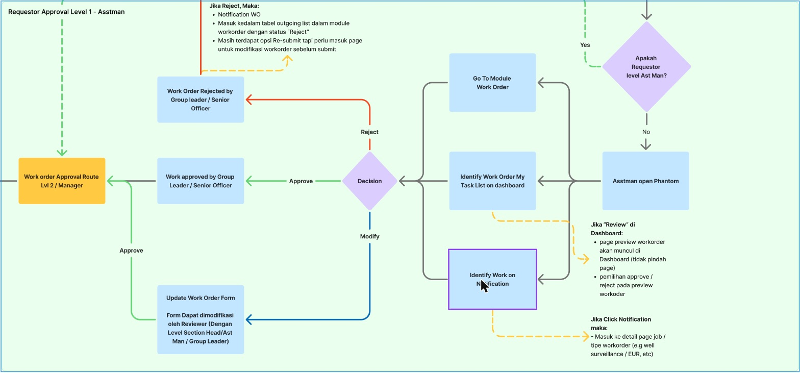

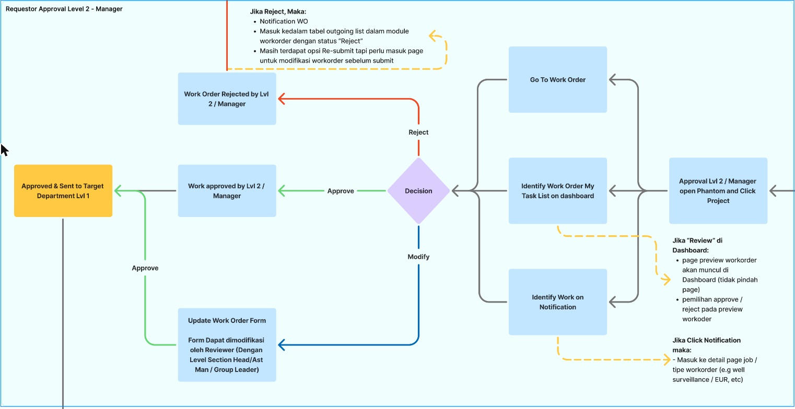

### **NID WO-2.1 [Jira TBD]**

**Work Order - Requestor Approval - Layer 1 Level 0 (Senior / Asst. Manager)**

| Notion ID | WO-2.1 / Layer 1 Level 0 |
| :---- | :---- |
| **Link Figma** | https://www.figma.com/design/usSi3zXbPKJf1snvAFEyLl/PHI---Latest-Design?node-id=18789-49609 |
| **Acceptance Criteria** | **ENTRY POINT : Notification Center / Waiting for me / Dashboard Review preview** **Given** a WO is submitted **Then** WO status = Waiting Approval at Layer 1 Level 0. Every user with the Layer 1 permission in the requestor dept can act **And** no step is skipped when the requestor is a Senior: another Senior reviews (TD8, changed 24 Nov). The system does not check the position **When** the Senior clicks Approve **Then** the WO goes to Layer 2 Level 0; Manager Requestor and Requestor are notified ("Work Order Approved at Level 1") **When** the Senior clicks Modify, edits and approves **Then** the WO changes and is approved in one step; a modification record is saved (who, role, time, before / after); the Requestor gets a notification only; the flow does not stop (X2) |
| **Design** | img/q3-senior-level-approval.jpg, img/figma-requestor-l1.jpg |
| **Negative Case** | User who is not the pending approver → read-only, "Waiting for approval by <name>" |
| **Question** | Decided: the chain is the Level 0 flow that the requestor selects (TD1). Decided: no position validator (TD3, TD8). Open: can the Level 0 flow be empty? |

### **NID WO-2.2 [Jira TBD]**

**Work Order - Requestor Approval - Layer 2 Level 0 (Manager Requestor)**

| Notion ID | WO-2.2 / Layer 2 Level 0 |
| :---- | :---- |
| **Link Figma** | https://www.figma.com/design/usSi3zXbPKJf1snvAFEyLl/PHI---Latest-Design?node-id=18789-49609 |
| **Acceptance Criteria** | **Given** WO is at Layer 2 Level 0 **When** Manager Requestor clicks Approve **Then** WO goes to Waiting Approval at Layer 1 Level 1 (target dept, Request To); every user with the Layer 1 permission in the target dept gets "Incoming Work Order Request"; the Requestor gets "Work Order Approved at Level 2" **And** the WO shows in the target's Incoming Work Orders **When** Manager clicks Modify **Then** the WO changes and is approved in one step (X2); the Requestor gets a notification only; the Senior is notified |
| **Design** | img/prd-flow-requestor-approval-l2.jpg |
| **Negative Case** | – |
| **Question** | – |

### **NID WO-2.3 [Jira TBD]**

**Work Order - Requestor Approval - Reject**

| Notion ID | WO-2.3 / Requestor-side reject |
| :---- | :---- |
| **Link Figma** | https://www.figma.com/design/usSi3zXbPKJf1snvAFEyLl/PHI---Latest-Design?node-id=18789-49609 |
| **Acceptance Criteria** | **When** Senior Level or Manager Requestor clicks Reject **Then** a reason is required (max 500 chars) and Fields to revise is optional **And** WO status = Rejected, shown in Outgoing with status "Reject"; Requestor is notified "Work Order Rejected" with the fields to revise |
| **Design** | img/figma-requestor-l1.jpg |
| **Negative Case** | Empty reason → Reject disabled; > 500 chars → blocked by counter |
| **Question** | Decided (X3): a reject at Level 0 is final. There is no Re-submit. The Requestor makes a new WO with a new number |

### **NID WO-2.4 [Jira TBD]**

**Work Order - Requestor Approval - Bulk Approve**

| Notion ID | WO-2.4 / Bulk approve (D8) |
| :---- | :---- |
| **Link Figma** | – |
| **Acceptance Criteria** | **Given** Senior Level / Manager has several WOs in Waiting For My Action **When** user selects cards and clicks Approve Selected (or Approve All) **Then** each WO moves to its next level and each party is notified **And** only WOs where the user holds a plain Approve are selectable (not modification, rejection or study approvals) |
| **Design** | – (Approve All not in design yet) |
| **Negative Case** | One WO fails (e.g. already acted by another user) → others still move; failed WO is listed with the reason |
| **Question** | G3: partial-failure message wording |

### **NID WO-2.5 [Jira TBD]**

**Work Order - Approval - SLA and auto-escalation [MoM]**

| Notion ID | WO-2.5 / Urgency SLA |
| :---- | :---- |
| **Link Figma** | – |
| **Acceptance Criteria** | **Given** a WO waits at an approval level **When** Urgency = Regular **Then** the level's due time = the route level SLA (e.g. 14 days) **When** Urgency = High Priority / Urgent **Then** the layer's due time = 2 × 24 hours [MoM 19 Nov] **When** the due time passes without action **Then** the system moves the WO to the next layer automatically, logs "Escalated" in History, and notifies the next approver and the skipped approver **And** routing chips show On Track / Near Due / Delayed from the due time |
| **Design** | – |
| **Negative Case** | Last level passes its due time → no next level: stays, chip = Delayed, notify the level's manager? |
| **Question** | Open: does the team still want this bypass (not in the team doc of 24 Nov)? Does it apply to target review, Modify and Reject too? Working days or calendar hours? What happens at the last layer? |

---

### **FLOW 3 - TARGET REVIEW APPROVE**

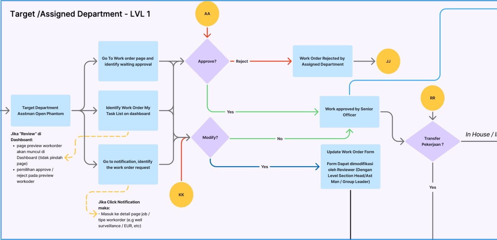

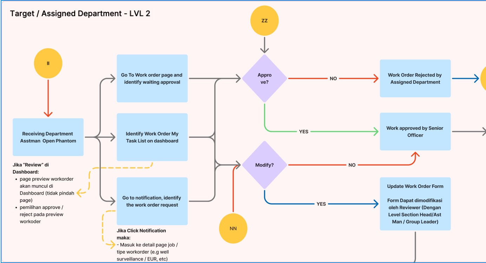

### **NID WO-3.1 [Jira TBD]**

**Work Order - Target Review - Senior Officer Approve**

| Notion ID | WO-3.1 / Target review |
| :---- | :---- |
| **Link Figma** | https://www.figma.com/design/usSi3zXbPKJf1snvAFEyLl/PHI---Latest-Design?node-id=18789-49609 |
| **Acceptance Criteria** | **ENTRY POINT : Notification Center ("Incoming Work Order Request" → Go to Work Order) / Incoming Work Orders** **Given** WO is in Waiting Approval at Layer 1 Level 1 (target dept) **When** a user with the Layer 1 permission of the target dept opens it **Then** the buttons Approve and Set Approval Flow are shown. Modify and Reject need the target dept's flow first (WO-3.2). Approve does not need a flow **When** Senior Officer clicks Approve **Then** WO status = Approved; Requestor gets "Work Order Approved by Target Department"; Transfer / Create Disposition become available (Flow 6) **And** for a well WO the Action Plan status becomes On Going and the Action Plan Details button on the well page can be clicked |
| **Design** | img/q5-approved-transfer-disposition.jpg |
| **Negative Case** | Category without approval (R1) → WO skips all approval steps and goes straight to Approved |
| **Question** | Decided 24 Nov: the pool = users with the layer permission in the target dept (`GET /users/by-permission/{id}` + department filter). Open: the permission IDs (see `02-Knowledge.md` §9) and the Retina role mapping |

### **NID WO-3.2 [Jira TBD]**

**Work Order - Target Review - Set Approval Flow (new 24 Nov)**

| Notion ID | WO-3.2 / Set Approval Flow |
| :---- | :---- |
| **Link Figma** | – |
| **Acceptance Criteria** | **Given** WO status = Waiting Approval at Level 1 (or Level 2 after a Transfer) **And** the user is in the department of that Level (Request To, or the assigned dept) and has the permission "set approval at level 1" **When** the user opens WO Details from the Incoming tab **or** the Outgoing tab and clicks Set Approval Flow **Then** the system shows the window Set Approval Flow with the mandatory field Approval Flow. The user searches and selects a flow from Data Config ("Work Order - {Department}") **And** the window shows the approvers of each layer of the selected flow **When** the user clicks Submit **Then** the system checks the field, saves the flow on the WO, copies the steps of that Level, and shows "Set work order approval flow succeed" **And** WO Details shows only Modify and Reject (no Approve) **When** the user clicks Cancel or Close (X) **Then** nothing is saved |
| **Design** | Team doc "PRD Phantom Fase 2", WO Lv 1 - Modal Set Approval Flow (see `02-Knowledge.md` §11) |
| **Negative Case** | No flow selected → Submit blocked. User of another dept → button hidden |
| **Question** | – |

---

### **FLOW 4 - MODIFY**

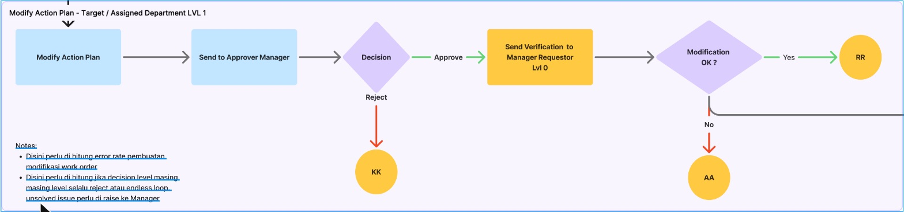

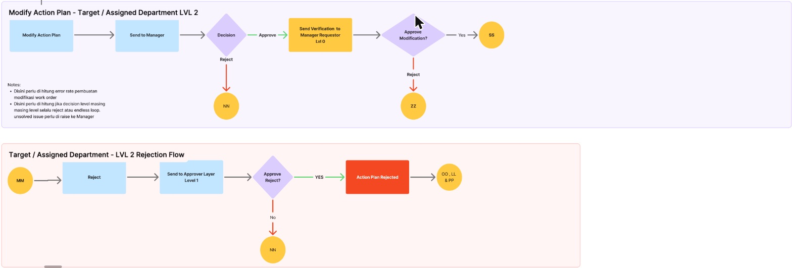

### **NID WO-4.1 [Jira TBD]**

**Work Order - Modify - Senior Officer Modify**

| Notion ID | WO-4.1 / Modify WO + Action Plan |
| :---- | :---- |
| **Link Figma** | https://www.figma.com/design/usSi3zXbPKJf1snvAFEyLl/PHI---Latest-Design?node-id=18789-49609 |
| **Acceptance Criteria** | **Given** the target dept set its flow (WO-3.2) **When** Senior Officer clicks Modify **Then** the form opens with WO fields and Action Plan fields **When** Senior Officer clicks Save Modification **Then** a modification record is saved (original + proposed snapshot, changed fields) and WO status = Modification Review at Layer 2 Level 1 **And** the WO data does not change until the last level approves **And** Requestor side sees every modification; Lvl 1 sees only Lvl 1 changes, Lvl 2 only Lvl 2 changes |
| **Design** | img/q4-modify-lane-manager-requestor.jpg |
| **Negative Case** | Save with no change → "No changes to save" |
| **Question** | – |

### **NID WO-4.2 [Jira TBD]**

**Work Order - Modify - Approve Modification**

| Notion ID | WO-4.2 / Modify approve |
| :---- | :---- |
| **Link Figma** | https://www.figma.com/design/usSi3zXbPKJf1snvAFEyLl/PHI---Latest-Design?node-id=18789-49609 |
| **Acceptance Criteria** | **When** Layer 2 Level 1 (Manager target) clicks Approve Modification **Then** WO goes to Layer 2 Level 0 (Manager Requestor, found by the layer permission in the requestor dept) to check ("Send Verification to Manager Requestor Lvl 0", X4). This also applies after a Transfer (Level 2 modified) **When** the Manager Requestor clicks "Modification OK?" = Yes **Then** the proposed snapshot is applied, WO status = Approved, Requestor + Level 1 (+ Level 2 if transferred) get "Modification Approved" **When** the Manager Requestor declines **Then** the system drops the proposal and the WO goes to Approved with the old values (X5) **And** the WO shows the banner "This work order has been modified" + View Changes |
| **Design** | img/q4-modify-lane-manager-requestor.jpg |
| **Negative Case** | – |
| **Question** | Decided: Manager Requestor checks (X4); decline = old values (X5). Open: button text names the WO, not Action Plan (Q18) |

### **NID WO-4.3 [Jira TBD]**

**Work Order - Modify - Reject Modification**

| Notion ID | WO-4.3 / Modify reject (D3) |
| :---- | :---- |
| **Link Figma** | https://www.figma.com/design/usSi3zXbPKJf1snvAFEyLl/PHI---Latest-Design?node-id=18789-49609 |
| **Acceptance Criteria** | **When** Layer 2 Level 1 (Manager target) clicks Reject Modification (reason required) **Then** the proposal is dropped, the WO returns to Waiting Approval at Layer 1 Level 1 with the old values, `reject_loop_count` + 1 **And** the Senior Officer can Approve, Modify or Reject again |
| **Design** | img/figma-modify-reject-lanes.jpg |
| **Negative Case** | Empty reason → blocked |
| **Question** | Q6c: keep loop / error-rate counters for reporting only? Escalation "raise unsolved issue to Manager" in scope? |

---

### **FLOW 5 - REJECT**

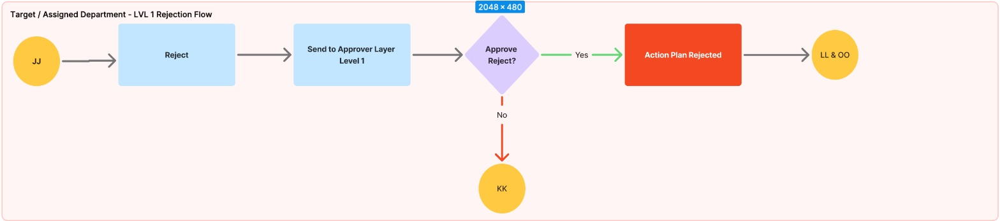

### **NID WO-5.1 [Jira TBD]**

**Work Order - Reject - Target-side Reject with approval**

| Notion ID | WO-5.1 / Target reject |
| :---- | :---- |
| **Link Figma** | https://www.figma.com/design/usSi3zXbPKJf1snvAFEyLl/PHI---Latest-Design?node-id=18789-49609 |
| **Acceptance Criteria** | **Given** the target dept set its flow (WO-3.2) **When** Senior Officer clicks Reject (reason required) **Then** WO status = Rejection Review at Layer 2 Level 1; the Manager target gets "Rejection Approval" **When** the Manager target clicks "Yes, Reject" **Then** the WO goes to Layer 2 Level 0 (Manager Requestor) to approve or refuse the rejection (D3b, R8) **When** the Manager target clicks "No, Cancel" **Then** WO returns to Waiting Approval at Layer 1 Level 1 **When** the Manager Requestor approves the rejection **Then** WO status = Rejected (final); Requestor + all levels get "Work Order Rejected" **When** the Manager Requestor refuses the rejection **Then** WO returns to Layer 1 Level 1, `no_reject` = true: the Reject button is hidden; only Approve or Modify (D3b) |
| **Design** | img/q4-reject-lane-manager-requestor.jpg, img/d3-rejection-not-approved-banner.jpg |
| **Negative Case** | Empty reason → blocked |
| **Question** | Decided: two confirmations (MoM, R8); a declined rejection hides Reject (D3b, changed 19 Nov). Open: Q17 — tell PHI that the Figma shows only one layer |

---

### **FLOW 6 - TRANSFER / DISPOSITION**

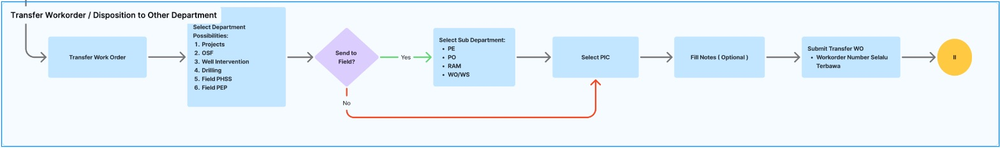

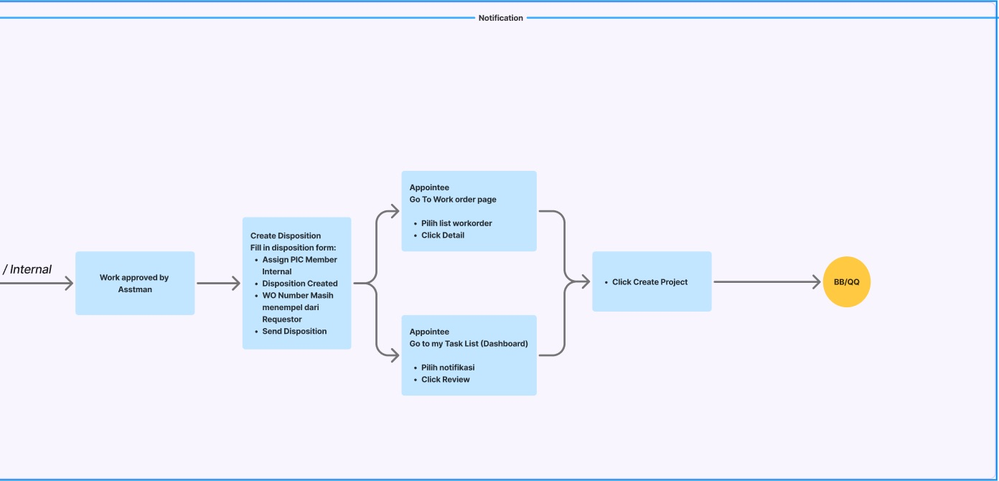

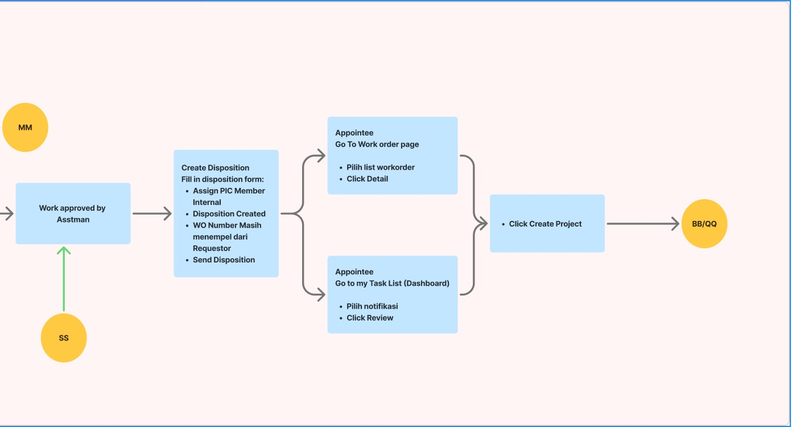

### **NID WO-6.1 [Jira TBD]**

**Work Order - Approved - Transfer Work Order**

| Notion ID | WO-6.1 / Transfer |
| :---- | :---- |
| **Link Figma** | https://www.figma.com/design/usSi3zXbPKJf1snvAFEyLl/PHI---Latest-Design?node-id=18789-49609 |
| **Acceptance Criteria** | **Given** WO is Approved at Level 1 **And** the user has the transfer permission in the target dept (TD12) **When** the user clicks Transfer Work Order **Then** dialog: Department (required; from the list for each department in `custom_configurations`), Sub-unit (PE / PO / RAM / WO-WS, required), PIC (multi; open), Notes (optional) **When** user clicks Transfer **Then** WO number stays the same; WO status = Waiting Approval at Level 2 (assigned dept) (TD15); users of the assigned dept get "Transferred Work Order"; Requestor gets "Work Order Transferred" **And** the assigned dept selects its own flow in Set Approval Flow (WO-3.2), then can Approve / Modify / Reject (Flow 3–5) **And** the assigned dept cannot transfer again; it can only make a disposition (M8) |
| **Design** | img/q5-approved-transfer-disposition.jpg |
| **Negative Case** | No department or no sub-unit → Transfer disabled; Level 2 Approved → Transfer button hidden; user without the permission → button hidden |
| **Question** | Open: Transfer allowed for Well Test and AL WHC Installation WOs (Q5a)? Is PIC still in the Transfer dialog (MoM 19 Nov: Department, PIC, Notes)? |

### **NID WO-6.2 [Jira TBD]**

**Work Order - Approved - Create Disposition**

| Notion ID | WO-6.2 / Disposition |
| :---- | :---- |
| **Link Figma** | https://www.figma.com/design/usSi3zXbPKJf1snvAFEyLl/PHI---Latest-Design?node-id=18789-49609 |
| **Acceptance Criteria** | **When** Senior Officer clicks Create Disposition **Then** dialog: Work Type (required): ABI/BD only for Projects and PO, ABI/NBD only for OSF, ABO Routine and ABO Non Routine for all departments (TD5); Assign PIC Member Internal (multi, required); Notes (optional) **When** user clicks Send Disposition **Then** WO status = Project Preparation and the button Create Project shows; PIC and Requestor get "Disposition Created"; the WO number stays ("WO Number masih menempel dari Requestor") |
| **Design** | img/q5-approved-transfer-disposition.jpg |
| **Negative Case** | No Work Type / no PIC → Send disabled; Work Type not allowed for the dept → not in the list; PIC not an active user of the dept → blocked |
| **Question** | Q5b: Disposition PIC = today's `execution_pic_id`? |

---

### **FLOW 7 - PROJECT / ACTION CREATION**

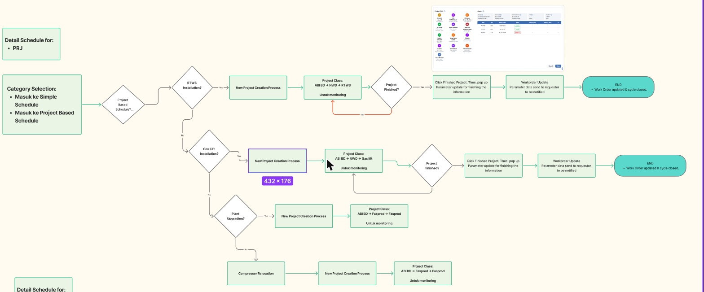

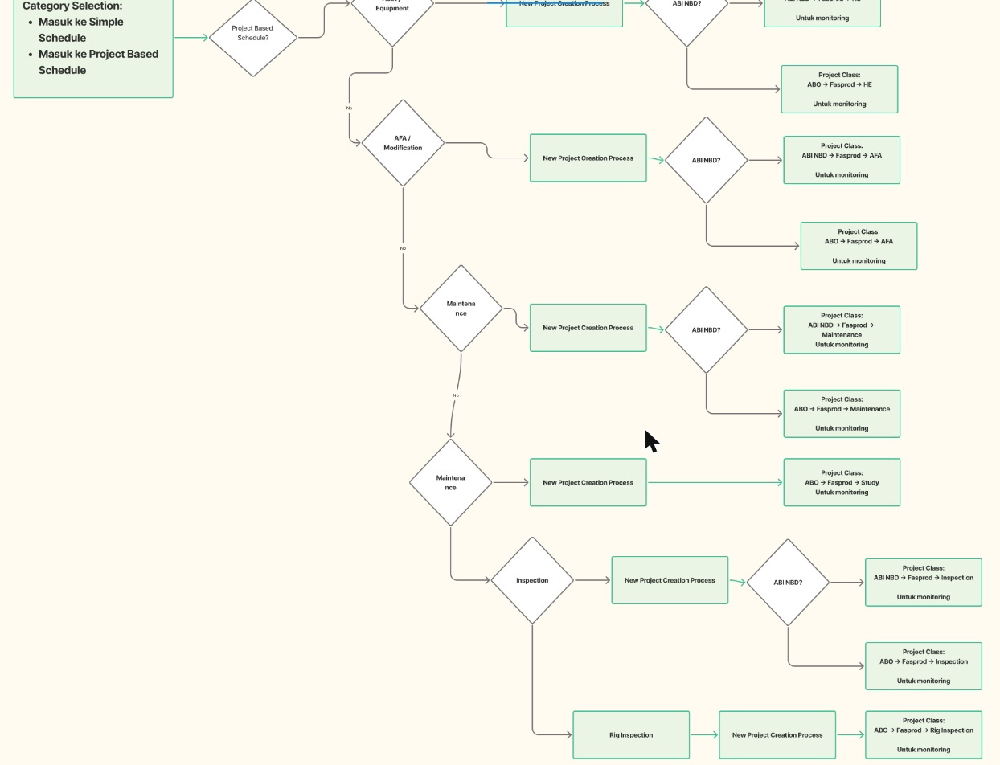

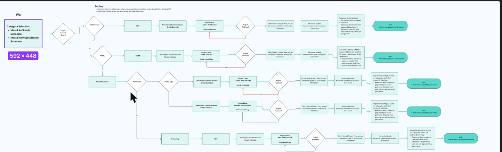

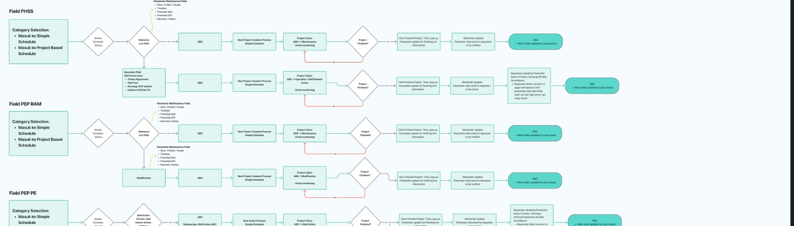

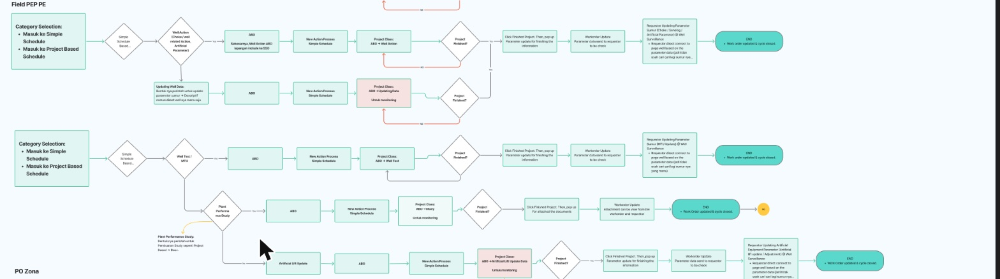

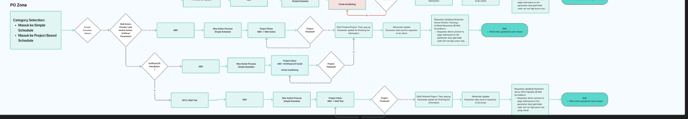

### **NID WO-7.1 [Jira TBD]**

**Work Order - Create Project - Detail Schedule (Projects Z9, OSF Z9)**

| Notion ID               | WO-7.1 / Detail schedule                                                                                                                                                                                                                                                                                                                                                                                                                                                                                                                                                                                                                                                                                                                          |
| :---------------------- | :------------------------------------------------------------------------------------------------------------------------------------------------------------------------------------------------------------------------------------------------------------------------------------------------------------------------------------------------------------------------------------------------------------------------------------------------------------------------------------------------------------------------------------------------------------------------------------------------------------------------------------------------------------------------------------------------------------------------------------------------ |
| **Link Figma**          | https://www.figma.com/design/usSi3zXbPKJf1snvAFEyLl/PHI---Latest-Design?node-id=18789-49609                                                                                                                                                                                                                                                                                                                                                                                                                                                                                                                                                                                                                                                       |
| **Acceptance Criteria** | **ENTRY POINT : Work Order page / Task List › WO › Create Project** **Given** WO is in Project Preparation and the department is Project or OSF (`schedule_kind` = detail) **When** PIC clicks Create Project **Then** the project form opens with Project Type pre-filled from Work Type; fields: Description, Project Number / AFE, Category, Sub-Category, Rig Type, Working Area → Field → Area → Plant, Start / End, WBS, RK year + RK Type, Estimation Cost, Potential Gain, LPO, Remarks, Project PIC; completion % shown **When** PIC clicks Submit **Then** the PIC builds the detail schedule in the app (grid or Excel upload); there is no `.mpp` for a WO project (P0, changed 20 Nov). The project gets `projects.work_order_id` = the WO and origin = `work_order`; WO status = Project Approval |
| **Design**              | img/prd-flow-detail-schedule-prj.jpg, img/prd-flow-detail-schedule-osf.jpg                                                                                                                                                                                                                                                                                                                                                                                                                                                                                                                                                                                                                                                                        |
| **Negative Case**       | Wrong Excel template → rejected; WBS already used by a live project → blocked                                                                                                                                                                                                                                                                                                                                                                                                                                                                                                                                                                                                                                                                          |
| **Question**            | I4: several WO WBS values → one project WBS? Sub-Category DLC/GL/FL/RTWS vs DLC/Non-DLC. F2: add Compressor Relocation category?                                                                                                                                                                                                                                                                                                                                                                                                                                                                                                                                                                                                                  |

### **NID WO-7.2 [Jira TBD]**

**Work Order - Create Project - Simple Schedule (all other departments)**

| Notion ID               | WO-7.2 / Simple schedule                                                                                                                                                                                                                                                                                                                                                                                                                                                                                                                                                                                                                                                                                                                                                                                                                                                  |
| :---------------------- | :------------------------------------------------------------------------------------------------------------------------------------------------------------------------------------------------------------------------------------------------------------------------------------------------------------------------------------------------------------------------------------------------------------------------------------------------------------------------------------------------------------------------------------------------------------------------------------------------------------------------------------------------------------------------------------------------------------------------------------------------------------------------------------------------------------------------------------------------------------------------ |
| **Link Figma**          | https://www.figma.com/design/usSi3zXbPKJf1snvAFEyLl/PHI---Latest-Design?node-id=18789-49609                                                                                                                                                                                                                                                                                                                                                                                                                                                                                                                                                                                                                                                                                                                                                                               |
| **Acceptance Criteria** | **Given** `schedule_kind` = simple (WLI, Field PHSS, Field PEP RAM, Field PEP PE, PO Zona, Drilling) **When** PIC fills the project form and clicks Next **Then** step 2 lets the PIC build the schedule on screen **or** upload an Excel file [MoM 6 Nov]; the task grid: No (1, 1.1 …), Task, Start, End, Predecessor, Cost (Rp or % of WBS budget) 1. Two levels (parent, sub-task); row 1 = project, spans earliest start → latest end 2. On Stream is required and always the last row 3. Predecessor MS-Project style: `2`, `2FS+3d`, `3SS`, `4FF-1d`; empty = FS after previous; working days Mon–Fri 4. Dates are manual; system shows "Earliest start …" / "Earliest end …" 5. Parent dates and cost roll up from sub-tasks; Rp ↔ % are derived; cost is optional (weight falls back when empty) **When** PIC clicks Submit **Then** backend converts rows to `project_tasks` (no Aspose), weight from cost, On Stream date per PHI-2267; WO status = Project Approval **And** a well WO (Action Plan) also makes this simple project, because SPK and contract need a project; it skips the project approval and goes to On Going (P1) |
| **Design**              | img/prd-flow-simple-schedule-wli.jpg, -phss-pep-ram.jpg, -pep-pe.jpg, -po-zona.jpg                                                                                                                                                                                                                                                                                                                                                                                                                                                                                                                                                                                                                                                                                                                                                                                        |
| **Negative Case**       | Unknown task / self link / link to own parent or child / circular predecessor / end before start → row error No On Stream row or not last → Submit blocked                                                                                                                                                                                                                                                                                                                                                                                                                                                                                                                                                                                                                                                                                                             |
| **Question** | Decided: no `.mpp`, Excel / grid for both (P0); a well WO also makes a simple project (P1). Open: Gantt / S-curve / weight rules [MoM 6 Nov]; working days or calendar days (Q33); AL Installation via PO simple (Figma) or Projects Z9 (prototype)? Backend owner for the new import?                                                                                                                                                                                                                                                                                                                                                                                                                                                                                                                                                                                                                                   |

### **NID WO-7.3 [Jira TBD]**

**Work Order - Create Project - Project Approval**

| Notion ID | WO-7.3 / Project approval |
| :---- | :---- |
| **Link Figma** | https://www.figma.com/design/usSi3zXbPKJf1snvAFEyLl/PHI---Latest-Design?node-id=18789-49609 |
| **Acceptance Criteria** | **ENTRY POINT : Project Monitoring › Project Approval Summary › Project Details** **When** the project is submitted **Then** it goes to the project approvers (proposal: the Manager of the PIC's Level, Level 1 or Level 2; open, Q36); they get "New Project Approval" **And** an Action Plan WO skips this step (P1) **When** manager approves **Then** project = On Going, WO = On Going, PIC gets "Project Approved" **And** Project Details shows the Work Order Number with a link to the WO [MoM 6 Nov] **When** manager revises / rejects **Then** WO returns to Project Preparation with the reason; PIC is notified |
| **Design** | – |
| **Negative Case** | – |
| **Question** | I4: today project approval is approve / revise only (revise → draft); add Modify? I5: suppress project approval email for WO projects? |

---

### **FLOW 8 - FINISH**

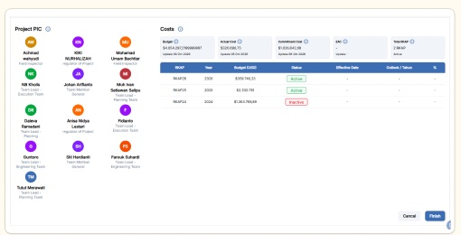

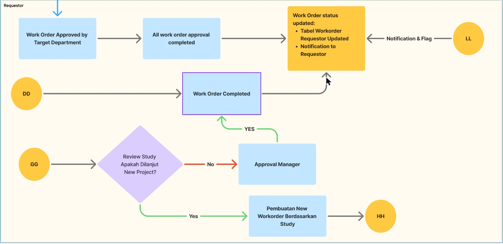

### **NID WO-8.1 [Jira TBD]**

**Work Order - Finish - PIC Finish Project**

| Notion ID | WO-8.1 / Finish |
| :---- | :---- |
| **Link Figma** | https://www.figma.com/design/usSi3zXbPKJf1snvAFEyLl/PHI---Latest-Design?node-id=18789-49609 |
| **Acceptance Criteria** | **Given** project / action is On Going **When** PIC clicks Finished Project **Then** the system checks the project has a Work Order Number [MoM 6 Nov]; if yes, pop-up "Parameter update for finishing the information" opens with the category's result fields (Choke Adjustment Result, Well Test Result, Post-Installation Result) or study document upload (Plant Performance Study). MoM examples: RTWS = time parameter, Gas Lift = Gas Lift schedule, Fast Prod = time / schedule **When** PIC confirms "Yes, Project Finished" **Then** result is saved in `work_order_results`, WO = Completed (or waits for Requestor check, see Question), Requestor and Senior Officer get "Work Order Completed" **And** the parameters are required (D7b, changed 19 Nov) **And** Finish of the WO finishes all schedules (projects) under it [MoM 19 Nov] |
| **Design** | img/prd-flow-finish-parameter-popup.jpg, img/prd-flow-requestor-finish.jpg |
| **Negative Case** | Non-PIC user → Finish hidden |
| **Question** | Decided: parameters required (D7b). Open: which Finish fields for each category (Q44) |

### **NID WO-8.2 [Jira TBD]**

**Work Order - Finish - Requestor checks and updates well**

| Notion ID | WO-8.2 / Requestor follow-up |
| :---- | :---- |
| **Link Figma** | https://www.figma.com/design/usSi3zXbPKJf1snvAFEyLl/PHI---Latest-Design?node-id=18789-49609 |
| **Acceptance Criteria** | **ENTRY POINT : Notification "Work Order Completed" → Go to Work Order** **Given** PIC finished a well WO **When** Requestor opens the notification **Then** Requestor sees the result parameters and a link to the well page (Well Surveillance / EUR Page) **When** Requestor updates the well parameter (Choke / Sonolog / AL Parameter / MTU / EUR Zona) **Then** `requestor_checked_at` / `well_updated_at` is set and the WO cycle is closed ("Work Order updated & cycle closed") |
| **Design** | img/prd-flow-finish-parameter-popup.jpg, img/prd-flow-requestor-finish.jpg |
| **Negative Case** | – |
| **Question** | Open (Q43): is this step in scope? Does the WO stay open until the Requestor updates the well, or close at Finish? (M014: the receiver sends a verification to the requestor; 6 Nov: notification "WO selesai" at Finish) |

---

### **FLOW 9 - SCREENS & NOTIFICATION**

### **NID WO-9.1 [Jira TBD]**

**Work Order - List - Incoming / Outgoing**

| Notion ID | WO-9.1 / WO list |
| :---- | :---- |
| **Link Figma** | https://www.figma.com/design/usSi3zXbPKJf1snvAFEyLl/PHI---Latest-Design?node-id=18789-49609 |
| **Acceptance Criteria** | **When** user opens the Work Order page **Then** 6 summary cards: Total WO, Received WO, In Review, Submit WO, Rejected WO, Draft WO **And** tabs Incoming Work Order / Outgoing Work Order; the selected tab has a blue bottom line and a light blue background **And** "Search work order" filters the table while the user types or on Enter **And** "+ Create Work Order" shows only on the Outgoing tab **And** the table has 11 columns: Description (filter), Status (filter), Action ("Detail"), Recipient (filter), Category (filter), Field (filter), Start Date (sort), End Date (sort), Created Date (sort), Approve Date (sort; "-" when empty), Remarks ("-" when empty) **And** (prototype) task tiles (Waiting for me, Completed WO, On going elsewhere) and Waiting For My Action cards — not in the team doc; keep or drop is open **And** Export the open WO to CSV (Section, Field, Value) |
| **Design** | Figma Overview Work Order (node 18806-94201, see `02-Knowledge.md` §11) |
| **Negative Case** | Empty → "No work order yet" / "No task is waiting for you" |
| **Question** | The team doc says the same overview for every Level (the Lv 2 overview is a copy of Lv 0). Open: Q1 final layout Unified vs SSDP ⇄ PO board? Does the requestor story "entitas PHSS" mean one page for each working area? |

### **NID WO-9.2 [Jira TBD]**

**Work Order - Detail - Overview, History, View Changes**

| Notion ID | WO-9.2 / WO detail |
| :---- | :---- |
| **Link Figma** | https://www.figma.com/design/usSi3zXbPKJf1snvAFEyLl/PHI---Latest-Design?node-id=18789-49609 |
| **Acceptance Criteria** | **When** user opens a WO **Then** tabs Overview / Attachment / History. Overview blocks: Header (no., title, status chip, urgency, owner actions), Banners (Rejected by…, Modified + View Changes), Work Order Information, Scope Of Works, Location & Asset, Plan & Actual Schedule, Project Classification, Production Impact, Action Plan / Result, Record Information, Work Order PIC, Current Cycle Progress, Approval History, Disposition & New Project **When** user clicks View Changes **Then** Before vs After with tiles (Total / Added / Removed / Modified) and tabs All / Added / Removed / Changed / Unchanged, grouped by section incl. Action Plan fields **And** History rows: Date & Time, Activity, User + role, Duration, Remarks **And** Current Cycle Progress shows the steps of the flows that each department selected (Level 0, Level 1, Level 2), like Project Approval [MoM 19 Nov] **And** every department can view the WO (except sensitive data); Create / Modify / Reject buttons show only for the owning department [MoM 22 Okt] |
| **Design** | – |
| **Negative Case** | Lvl 1 user opens a Lvl 2 modification → not visible |
| **Question** | – |

### **NID WO-9.3 [Jira TBD]**

**Work Order - Notification Center**

| Notion ID | WO-9.3 / Notifications |
| :---- | :---- |
| **Link Figma** | – |
| **Acceptance Criteria** | **When** any transition happens **Then** in-app notification: title, "Work Order Number [No. WO] …", time WITA dd/mm/yyyy hh:mm, CTA Go to Work Order (Go to Project for project events). Recipients = the next route level + the parties in the Knowledge Documents §6 table **When** user clicks the banner **Then** user lands on the WO detail (or the well / EUR page for the Requestor follow-up) |
| **Design** | – |
| **Negative Case** | – |
| **Question** | I5: map to existing `phantom_iac_*` templates or new `wo_*` templates? |

---

## 3. Team doc decisions ("PRD Phantom Fase 2", 24 Nov)

Source: Google Doc "Phantom Fase 2", tab of Sprint 3 SSDP. Sections:
- "Work Order Lv 0 - Overview Work Order"
- "Work Order Lv 0 - Creating Work Order" (section "Approval Flow") and the "Master Data/Config" list under "Work Order Lv 0 - Modify - Reject"
- "Work Order Lv 1 - Modal Set Approval Flow"
- "Work Order Lv 1 - Approve & Create Disposition"
- "WO Lv 2 - Overview Work Order"
- 2 comments on "Layer 1" / "Layer 2" (20 Nov)

---

### 1. Who selects the approval flow

**The requestor selects the flow for the requestor department only.**
- In Create Work Order, the requestor selects one approval flow from the list in Data Config ("Approval Route").
  - If the flow does not exist, the requestor must make it first in "Approval Route".
- The flow has these steps:
  - Step 1 = Senior / Asst. Manager of the requestor department.
  - Step 2 = Manager of the requestor department.
- Before, the flow also had step 3 (the Senior of the target department). The team doc removes it: "jadinya gaada, pakai modal di level 1".

**The target department selects its own flow later.**
- The target department uses the new "Set Approval Flow" window on the WO Details page.
- When: the WO status is "Waiting Approval".
- Who can do it, both conditions:
  - a user of the department that the requestor selected in "Request To", and
  - a user who has the permission "set approval at level 1".
- The user selects one flow from Data Config. The window shows the approvers of each step. The flow is mandatory.
- On Submit, the system saves the flow on the WO and shows "Set work order approval flow succeed". Then the page shows the buttons "Modify" and "Reject".
- Use of this flow: the approval of a **Modify** and of a **Reject** in the target department.

**What changes for us**
- Our old proposal: the system finds the flow automatically (rules by department and category). Replaced: **people select the flow by hand.**
- The system does not copy all approvers at submit:
  - At submit, it copies the requestor department approvers.
  - When the target department sets its flow, it copies the target department approvers.

### 2. How the approval route is set up in Data Config

- One route category for each department: "Work Order - {Department}".
- Each route has 3 levels, and each level has 2 layers:
  - Level 0 (requestor): Layer 1 (approver 1, 2, 3, …) and Layer 2 (approver 1, …).
  - Level 1: Layer 1 and Layer 2.
  - Level 2: Layer 1 and Layer 2. The doc calls Level 2 "Target Department". Check this, because the MoM calls Level 2 the **transfer** department.

**The system does not check the position (comments of 20 Nov)**
- The system lets the admin select **any position** and **any department** as an approver.
- The rule is only an SOP (a work rule):
  - Layer 1 = Senior / Asst. Manager.
  - Layer 2 = Manager.
- Reasons in the comment:
  - Retina data can have errors.
  - It makes the system less complex.

**What changes for us**
- The system does not need a permission for each Layer to find the approvers. The route holds the names of the approvers.
- We still need a permission for "set approval at level 1" (and for create / read WO).
- Open: can the system skip Layer 1 when the requestor is a Senior? With no position check, the system cannot know this. Proposal: no automatic skip. The admin makes a route without Layer 1 for that case.

### 3. Schedule type for each department (WO Type Mapping)

Minimum: fixed in the code. Better: configurable.
- **Simple schedule:** WLI, Field PHSS, Field PEP RAM, Field PEP PE, PO Zona, Drilling.
- **Detailed schedule:** Project, OSF.

So the department sets the schedule type. The user does not select it.

### 4. Request To, Function and Category (Create Work Order)

| Request To | Shows | Function → Category |
|---|---|---|
| Drilling | no Category, no Function | – |
| OSF Z9 | Category | Heavy Equipment, AFA / Modification, Maintenance, "Inception" (= Inspection?), Others |
| PHSS Field | Category + Function | WO/WS and Facility Maintenance: Maintenance Field, Choke Adjustment, Well Test, Sonolog / BJP Update, Artificial Lift Update |
| PO Z9 | Category | Choke Adjustment, Artificial Lift Update, Artificial Lift Installation, Well Test |
| Project Z9 | Category | RTWS Installation, "Gas List" (= Gas Lift?) Installation, Plant Upgrading, Artificial Lift Installation, Facility Upgrade |
| Sangasanga / Sangatta / Tanjung Field | Category + Function | RAM: Maintenance Field, Modification · PE: Choke Adjustment, Sonolog / BJP Update, Artificial Lift Update, Updating Well Data · Production: (text cut in the export) |
| SDA 1 Z9, SDA 2 Z9 | no Category, no Function | – |
| WLI Z9 | Category | (text cut in the export) |

Other form rules:
- Urgency: Regular / High Priority.
- Attachments: max 5 files, 10 MB each. Formats: PDF, DOC, DOCX, XLS, XLSX, JPG, PNG.

### 5. Overview page

- 6 cards:
  - Total WO
  - Received WO
  - In Review
  - Submit WO
  - Rejected WO
  - Draft WO
- 2 tabs: Incoming Work Order and Outgoing Work Order.
- The "+ Create Work Order" button shows only on the Outgoing tab.
- Search: the table filters when the user types or presses Enter.
- Table, 11 columns:
  - Description (filter)
  - Status (filter)
  - Action ("Detail")
  - Recipient (filter)
  - Category (filter)
  - Field (filter)
  - Start Date (sort)
  - End Date (sort)
  - Created Date (sort)
  - Approve Date (sort; "-" when empty)
  - Remarks ("-" when empty)
- The Lv 2 "Overview Work Order" text is a copy of the Lv 0 text. There is no separate overview for the transfer department.

### 6. Approve and disposition (target department)

- Approve: a confirmation window says that the requestor gets a notification. After Approve:
  - The status becomes Approved.
  - Approve, Reject and Modify disappear.
  - "Transfer Work Order" and "Create Disposition" appear.
- Create Disposition window:
  - Work Type (mandatory). The allowed values depend on the department:
    - ABI/BD: only Projects and PO.
    - ABI/NBD: only OSF.
    - ABO Routine and ABO Non Routine: all departments.
  - Assign PIC Member (internal, mandatory).
  - Notes (optional).
- Send Disposition → status "Project Preparation", and the button "Create Project" appears.

---

### 7. Points to ask the team
1. **Wrong tab?** The "Set Approval Flow" text starts at the **Outgoing** tab. The target department sees the WO in the **Incoming** tab.
2. **Level 2 name:** the Data Config list calls Level 2 the "Target Department". The MoM calls it the department that gets a transferred WO. Which one is correct?
3. **The Approve button:** after Set Approval Flow, the page shows "Modify" and "Reject". Does "Approve" also show?
4. **Requestor is a Senior:** can Layer 1 of the requestor department be skipped? The system has no position check now.
5. **Copied text:** "Approve & Create Disposition" (second copy) and "Approve & Transfer Work Order" have the Set Approval Flow text pasted in. They have no content of their own yet.
6. **Spelling:** "Inception" (OSF) is probably "Inspection". "Gas List" (Project) is probably "Gas Lift".
7. **Category lists:** WLI Z9 and the Production function are cut in the export. Check them in the doc.

### 8. Effect on our earlier work
- `02-Knowledge.md` §7: the automatic route search is replaced by manual selection (requestor for Level 0, the target department for Level 1). Keep the "copy approvers at the start of each step" idea.
- `02-Knowledge.md` §9: Layer permissions are not needed to find approvers. Keep only Read / Create / Process WO and a new "Set Approval Flow (Level 1)" permission.
- PR #1523 comment, problem 5: one part is now wrong. The requestor **does** select the flow, but only for the requestor department. Still valid:
  - the target department approvers are copied later (when it sets its flow), and
  - the unique index `(work_order_id, user_id)` blocks one person in two steps.
- Question "does the department or the category set the schedule type": answered. The department sets it.
- Question "how does the system find the Layer of a user": answered. It does not. The route holds the names, and the position is an SOP only.

---

### 9. Answers from the user (24 Nov)
1. **Tab:** "Set Approval Flow" is available from **both** tabs (Incoming and Outgoing).
2. **Level 2 name:** follow **Data Config**. Level 2 = "Target Department". The MoM meaning ("the department that gets a transferred WO") is replaced. Still to confirm: what Level 1 means with this naming.
3. **Approve button:** **no**. After Set Approval Flow, the page shows only Modify and Reject.
4. **Requestor is a Senior:** the system does not skip a step. **Another Senior** reviews the WO. The approver is found by **permission ID**: every user who has the permission can review.
5. **Copied text:** the user asks what to decide. See §10.
6. **Spelling:** yes, these are typos. "Inception" = **Inspection**. "Gas List" = **Gas Lift**.

### 10. What to decide for the two empty sections
**"Approve & Create Disposition" (second copy):** it is a copy of the first section. Decide: delete it, or use it for another case (for example the disposition in the Level 2 department).

**"Approve & Transfer Work Order":** it has no content. Decide:
1. Who can transfer, and from which status (Approved only?).
2. Which departments the user can select (all, or a list for each department).
3. Does the user select a sub-unit (Send to Field: PE / PO / RAM / WO-WS)?
4. Are notes mandatory?
5. After the transfer: the status, and who sets the approval flow of the receiving department (the same "Set Approval Flow" window?).
6. Can the receiving department transfer again? Earlier decision: no, it can only make a disposition.

### 11. More answers from the user (24 Nov)

**Level names (replaces answer 2 in §9):**
- Level 0 = the requestor department.
- Level 1 = the target department (Request To).
- Level 2 = the assigned department (only if needed, after a Transfer).

**Approvers:** the route holds a **permission ID**. Every user with that permission can review.

**Transfer Work Order:**
1. Who: a user with the transfer permission (the same model as approval).
2. Departments: a **list** for each department.
3. Sub-unit: **yes**, the user also selects a sub-unit (Send to Field: PE / PO / RAM / WO-WS).
4. Notes: **not** mandatory.
5. After the transfer: the assigned department uses the same **"Set Approval Flow"** window to select its own flow.
6. Transfer again: **no**. The assigned department can only make a disposition.

**Still open:**
- "Approve & Create Disposition" (second copy): delete it, or use it for the Level 2 disposition?
- The status after a transfer.
- Does the permission apply in every department, or only in the department of the Level? Proposal: only in the department of the Level. Example: a PO Senior with the permission must not review an OSF WO.

**Backend rule (user, 24 Nov):** the permission ID is used only to **list** users (`GET /users/by-permission/{id}`). The backend does **not** check it to allow or block an action.
- Note: `GetUsersByPermissionAsync` reads casbin, or Retina for a fixed list of ids (161, 162, 163). A new WO permission that is only in Retina must be added to that list (`IsRetinaOnlyPermissionAsync`, `UsersService.cs:560`).

### 12. Last open points, answered (24 Nov)
1. The second "Approve & Create Disposition" section: **delete it**.
2. The status after a Transfer: **Waiting Approval**.
3. A permission counts **only in the department of its Level**. The list of users by permission must be filtered by that department (today `/users/by-permission/{id}` has no department filter).

All questions in this file are now answered.

---

## 4. MoM vs the Knowledge Documents

19 Nov 2026 · Source: Google Doc "Recap MOM PHI (Phantom)" (Work Order parts), compared with `02-Knowledge.md` §2.

> **Status 24 Nov.** This file records the comparison of 19 Nov. Do not change the rows. The decisions after 19 Nov change these rows (see `01-Decision-Log.md`):
> - **M4 (approval from config):** changed. The requestor selects the Level 0 flow in Create WO. The target department and the assigned department select their own flow in "Set Approval Flow". Every flow comes from Data Config.
> - **G3 (skip rule for a Senior requestor):** removed. No step is skipped. Another Senior reviews the WO. The system does not check the position.
> - **M014 "position validator":** not needed. Each layer holds a permission ID. The backend uses it only to list users, in the department of the Level.
> - **M9 (Transfer fields):** the user also selects a sub-unit. Notes are optional. The departments come from a list for each department.
> - **X1 (WO number format):** the format comes from `custom_configurations`.
> - **X2 (requestor-side Modify):** the approver edits and approves in one step. The requestor gets a notification only.
> - **X3 (requestor-side Reject):** final. No re-submit.
> - **X4 (who verifies a modification):** the Manager of the requestor department.
> - **X5 (requester declines the modification):** the system drops the proposal. The WO goes to Approved with the old values.
> - **X6 (rejection not approved):** the WO goes back to the target Senior. The Reject button is hidden, so the Senior can only Approve or Modify.
> - **X8 (Finish parameters):** required.
> - **X10 (Request To values):** an 11-department list (team doc). "Level 1 / Level 2" are the Level names: 0 = requestor, 1 = target, 2 = assigned (only after a Transfer).
> - **X11 (Drilling):** a simple schedule (WO Type Mapping).
> - **X12 (Action Plan route):** the AP uses the route of the WO.
> - **X14 (schedule upload):** no `.mpp` for a WO project. Both schedule types are built in the app (grid or Excel).
> - **Still open:** X9 (WO close / requestor verification), X13 (AL entry point 1), and the urgent 2 × 24 h rule (G1: check with the team).

The MoM parts used:
- **MoM 9:** "9. Work Order & Action Plan Ownership".
- **22 Okt:** KOM Sprint 2. This covers the WHC ticket, the Gaslift PHSS flow, the department list and the WO number.
- **M002 / M009:** AL parameters and AL notification.
- **M014:** "Work Order".
- **6 Nov:** MoM Sprint 3. This covers approval workflow, disposition, the Project Monitoring link, and Simple and Detail schedule.
- **19 Nov:** "Regarding Work Order Module", a Q&A with Ardi, Atina and Naya.

Legend: ✅ match · ➕ gap, now added to the Knowledge Documents · ⚠️ conflict with a user decision or the Figma, which needs an answer · ❓ still open in the MoM too.

**Deadline:** the 19 Nov MoM lists Work Order as an item that must be ready for the PHANTOM launch on **4 Dec 2026**.

---

### 1. Matches (no change)
| # | Topic | MoM | Knowledge Documents |
|---|---|---|---|
| M1 | WO purpose | M014: request, give or dispose tasks between departments | §Overview |
| M2 | Incoming / Outgoing / Dashboard | M014: Incoming = assigned to the PIC, Outgoing = made by the Requestor. 19 Nov: "WO under Dashboard, for All Tenant" | WO-9.1 |
| M3 | Save as Draft / Cancel / Submit | M014: Draft → Outgoing, Cancel saves nothing, Submit → approval level 1 | WO-1.1 |
| M4 | Approval from config | 6 Nov: the reviewer comes from approval routing in data config, and the requester doesn't pick one. 19 Nov: "Approval Flow: Predefined in config" | D2, WO-2.x |
| M5 | Well Action Plan inside the WO module | M014: every Well Action Plan made or received shows in Incoming / Outgoing. 19 Nov (Ardi): "Data General WO dan Data Action Plan itu sama", and empty fields are filled in WO General | D1, WO-1.2 |
| M6 | Manager entry points | 6 Nov: Work Order Module, Personal Dashboard, Notification Center | WO-2.x entry points |
| M7 | Manager modify shows the diff | 6 Nov: changes must show before vs after | WO-4.1, WO-9.2 |
| M8 | Disposition depth | 6 Nov: "Proses disposisi dibatasi sampai dengan level 2" | WO-6.1 (Lvl 2 can't transfer) |
| M9 | Transfer and Disposition fields | 19 Nov: Transfer = Department, PIC, Notes. Disposition = Work Type, several PICs, Notes, usually sent by the Asst Manager | WO-6.1, WO-6.2 |
| M10 | Simple vs Detail schedule, reuse Project Monitoring | 6 Nov: two schedule types on the existing Project Monitoring, no new module | Flow 7 |
| M11 | Project link | 6 Nov: a project from a WO must carry the WO Number | `projects.work_order_id` |
| M12 | WBS optional, RKAP and Budget Type required | 19 Nov | Data §A |
| M13 | SSDP owns WO creation | MoM 9: SSDP creates the WO, PO is the assignee. PO suggestions never become a WO automatically | WO-1.1 |
| M14 | Approve or Reject only | 22 Okt: "Remind Me Later" dropped | – |
| M15 | Contract belongs to the receiver | 22 Okt: SSDP types the contract no. by hand, PO checks it. The contract shown is the target department's | WO-1.2 AL / WT |

### 2. Gaps: now added to the Knowledge Documents
| # | Topic | MoM | Added where |
|---|---|---|---|
| G1 | **Urgency SLA + auto-escalation** | M014: **Regular** = the SLA of each level (e.g. 14 days); after that the WO goes to the next level automatically. **High Priority** = 48 h per level, then auto-escalate. 19 Nov calls it "Regular, **Urgent**" | WO-1.1 rule, new story WO-2.5, Data: `urgency_level`, `work_order_approvers.due_at / escalated_at` |
| G2 | **Work Order Type** | 19 Nov: "Updating Parameter, Study, or New Work". M014: WO is "Multi" (Study, Project-based, Artificial Lift, Well Activities) | WO-1.1, Data `work_order_type` |
| G3 | **Skip rule covers Senior too** | M014: if the requestor is a **Senior or** Asst Manager, go straight to the Manager. A position validator is needed | WO-2.1 |
| G4 | **WO Number on Project Details** | 6 Nov: add a WO Number field to Project Details | WO-7.3 |
| G5 | **Finish checks for a WO number** | 6 Nov: on Finish Project, if the project has a WO Number → pop-up to update the WO parameters with actual results → notification "parameter updated & WO completed". Examples: RTWS = time parameter, Gas Lift = schedule, Fast Prod = time / schedule | WO-8.1 |
| G6 | **Schedule input: on the spot + Excel upload** | 6 Nov: build the schedule in the UI **or** upload Excel | WO-7.2 |
| G7 | **Cost weight not mandatory** | 6 Nov: cost weight is not required yet. Gantt / S-curve / weight needs are still to be defined | WO-7.2 (weight fallback) |
| G8 | **Receiving dept modify → first requester verifies** | 6 Nov: a modify by a later-level department goes back to the **first requester**, not to the department that transferred it | WO-4.2 |
| G9 | **Cross-dept view-only** | 22 Okt: everyone can view (except sensitive data). Create / Modify / Reject belong to the owning department only | WO-9.2 |
| G10 | **Cycle Progress per Request To** | 19 Nov: the cycle is set by Request To, like Project Approval | WO-9.2 |
| G11 | **Field values** | 19 Nov: Field = PHSS Northern, PHSS Southern. Area follows Field | WO-1.1 |

### 3. Conflicts: need an answer
| # | Topic | MoM | Our Knowledge Documents / decision | Ask |
|---|---|---|---|---|
| X1 | **WO number format** | 22 Okt: "format 4 digit/WO/**pemberi kerja**/tahun", where the code is the **requesting department**, with a "Z9" marker because PO exists in both zone 9 and the field | **D5:** `<seq>/WO/PROJECT/<year>` (literal PROJECT) | D5 goes against an agreed MoM. Keep PROJECT, or use the requester dept code (e.g. `0001/WO/SDA1/2026`, `…/PO Z9/…`)? |
| X2 | **Requestor-side Modify (L1)** | M014: Senior / Asst Man **Modify = return to the Requestor** to edit | Knowledge Documents: the approver edits and approves in one step | Which one? If returned: new status "returned to requestor", and the Requestor re-submits |
| X3 | **Requestor-side Reject** | M014: "dikembalikan ke Requestor untuk **tidak dilanjutkan**" (final) | Figma F4: re-submit allowed. D3: Rejected is final | The MoM agrees with D3. Drop the Figma re-submit note (Q6b)? |
| X4 | **Who verifies a modification** | 6 Nov: after the approval layer approves, the **first requester** (the person) gets a notification and verifies. 22 Okt: "requester dan penerima notifikasi akhir di SSDP adalah orang yang sama" | Figma / prototype: Manager Requestor (Lvl 0). Today: SSDP is the last route level | MoM = the requestor person. Answers Q4a? |
| X5 | **Requester declines the modification** | 6 Nov: send it back for **re-modify** or **continue with the old parameters** | Knowledge Documents: return to reviewer (D3) | Add the outcome "continue with previous parameters"? |
| X6 | **Rejection not approved** | 6 Nov: the options are **Continue** (as requested) or **Modify**. 22 Okt: "Jika tidak disetujui, PO harus melakukan modify" | **D3:** back to waiting_review, and the reviewer may reject again | MoM = no second reject. Keep D3, or hide Reject after a declined rejection (BR-7, which D3 removed)? |
| X7 | **Modify route levels** | 22 Okt: Manager L1 then L2. A reject at any level → back to PO. After approval → SSDP notified → ongoing | D2: from routes | ✅ fits D2. Confirm the Figma's single-layer Reject vs the 2-level Modify |
| X8 | **Finish parameters** | 6 Nov: the pop-up updates the WO parameters; "Finish Project … menjadi trigger untuk memperbarui parameter Work Order" | **D7:** Finish may skip the parameters | The MoM and Figma both expect parameters. Q7a |
| X9 | **WO close / requestor verification** | M014: the receiver updates the WO and sends verification to the requestor when the task is done. The requestor can add a new task or verify. 6 Nov: the notification says "WO selesai" | Figma: the requestor updates the well. Knowledge Documents: closes at Finish | Does the WO close at Finish (6 Nov) or after requestor verification (M014)? Q7b |
| X10 | **Request To values** | 19 Nov: "Request To: **Internal, Level 1, or Level 2**" | Knowledge Documents: Request To = 11 departments | Is this a second field (scope: internal / L1 / L2), or a renamed Request To? |
| X11 | **Drilling project flow** | 19 Nov (Ardi): add a Drilling project flow to the Figma. Project-based schedule = "locking the categories which work is RTWS". 6 Nov: Drilling is in the schedule users | Knowledge Documents: Drilling has no Category and no schedule | Add a Drilling category / flow when the Figma has it |
| X12 | **Action Plan approval route** | 19 Nov (Naya): Well Action has no route, WO has one. Option 1: the AP is sent to the WO for the route. Option 2: Well Surveillance adds the route to its form. Ocean to assess | **D1:** the WO is the parent, and the route lives on the WO | D1 = option 1. Tell PHI it is decided |
| X13 | **AL entry point 1** | M009: Action Plan install AL in Well Surveillance → **PO validates → PO makes a WO to Project** | Knowledge Documents: one WO, transfer PO → Projects | Is this a second WO (PO → Projects), or a Transfer of the same WO (number kept)? |
| X14 | **Schedule upload format** | 6 Nov: Excel upload | Detail today = `.mpp` only (Aspose) | Excel for simple only, or also replace `.mpp` for detail? |

### 4. Still open in the MoM
- **19 Nov:** "Which Work Order is Project Based Schedule?" Ardi: Figma annotation needed (the Figma now says PRJ + OSF, C6).
- **19 Nov:** Category concept "like Add SPK from Project Monitoring". The full category list is in the Figma; Well Surveillance categories are a small part of it.
- **19 Nov:** "PIC: Predefined value". From where (a department member list)?
- **6 Nov:** Gantt, S-curve and weight input still need definitions.
- **M014 Next Action:**
  - UI for the Action Plan entry point vs the dedicated WO module.
  - Which Action Plan data goes into the WO form.
  - The position validator for requestor and approval levels.
- **MoM 9:** the PO suggestion → SSDP mechanism is still to be assessed.

---

## 5. Figma, prototype and the first review

Reviewed 2026-11-18 · Knowledge Documents rev 11 (claude.ai/artifact/3A8M7RGwuGg1RnGYuyedah) · Design version 1795000848-2b2b
Updated 2026-11-19 with the Figma "PHI - Latest Design" › Work Order page and the newer prototype it links to (claude.ai/artifact/S4gBiqBpHasmfJnZKQQZMu, version 1795050409-bd7a). See § "Figma flow + newer prototype".

> **Status 24 Nov.** This file records the review of 18–19 Nov. Do not change the findings. Many decisions in the table below were changed later:
> - **D3:** changed (a declined rejection goes back to the target Senior without the Reject button).
> - **D5:** changed (the format comes from `custom_configurations`).
> - **D7:** changed (the Finish parameters are required).
> - **D2:** changed. The approval flow is not found by rules. The requestor selects the Level 0 flow, and the target and assigned departments select theirs in "Set Approval Flow". Each layer holds a permission ID. The backend uses it only to list users, in the department of the Level.
> - **The position skip rule:** removed. Another Senior reviews the WO.
> - **F12 (Prime Mover):** open again as Q46. The Figma Gas Lift form marks it as required.
>
> For the current rules, read `01-Decision-Log.md`, `02-Knowledge.md` §2, `02-Knowledge.md` §3 and `02-Knowledge.md` §8.

**Sources**
- `uni` = `project/WO-Prototype-ycvm-uni.dc.html` (line numbers are given as `uni:L####`)
- `Status` = `project/WO-Status.dc.html`
- `Compare` = `project/WO-Modify-Compare.dc.html`
- `AP` = the current Action Plan approval code, worktree `.worktrees/action-plan-al-wt/src-be` (PR #1476, uncommitted working tree)
- `docs/` = `docs/ActionPlan/*`

**Verdict:** the Knowledge Documents matches the prototype well. All 28 codes, the 15 labels, the 8 personas, the button set per status, the upload rules, the WBS chips, the schedule engine and most notifications trace back to code.

It has two kinds of problem:
1. **About 20 places where it describes the design wrongly.** One is inverted: which departments get the simple schedule.
2. **It ignores the Action Plan approval that already exists for Artificial Lift (WHC Installation) and Well Test.** That flow already issues WO numbers, has different approvers and different terminal states, and runs on different roles and permissions. The Knowledge Documents cannot be built as written until it says how the two fit together.

---

### Decisions (user, 18 Nov 2026)
These decisions override the findings below. Each row lists what the Knowledge Documents must change.

| # | Decision | Knowledge Documents change it forces | Still open |
|---|---|---|---|
| D1 (C1) | **WO is the parent and the Action Plan is the child.** Routing and approval live on the WO, not on the action plan. | Add a "WO ↔ Action Plan" section. The approval state, cycles, modifications and the WO number move from `pep_/phss_action_plan` to a `work_orders` table. The action plan gets a `work_order_id` FK. The PR #1476 engine is re-hosted on the WO. | Can 1 WO have more than 1 action plan (several wells)? Do Well Surveillance users still create plans per well, or only via Create WO? What happens to plans already on dev that have a WO number? |
| D2 (C2) | **Approval levels are flexible and come from approval routes**, for all three rounds: the submit chain, Modify approval and Reject approval. | Replace the hard-coded chains in FR-2/4/5, §2 and §6: Senior Level → Manager, Manager Lvl n → Manager Requestor. Define them as **default route templates**, with route categories per Request To × round (for example `wo_{dept}_submit / _modify / _reject`). Roles become route levels. §6 recipients become "the next route level". | Is the requestor-side chain (Senior Level, Manager) a route too? Is SSDP still the last route level of Modify (latest AP index note: no creator step)? Who may edit the approvers at runtime (AP today: the PO sends `approvers[]`)? |
| D3 (C3) | **Use today's return behaviour.** Every return → back to the reviewer (`waiting_review`) and the proposal is dropped. The reviewer can approve, modify or reject again. `rejected` is terminal. | Remove: Needs Revision (mr1, mr2), "Revise Action Plan", the "rejection not approved" banner, BR-7 (Reject hidden), and Re-Submit from Rejected (AC-2, OQ3). Decide BR-16 (loop counter). The 15 statuses shrink. | Does terminal also apply to the requestor-side reject (rej1, rej2)? Today there is no such stage. Does the Requestor then create a new WO, with a new number? Keep the loop counter for reporting only? |
| D4 (C4) | **Use today's scope rule.** Only Well Test and AL WHC Installation need approval; the other action-plan categories are auto-approved. | Add a per-category table. Choke, Sonolog, AL Update, non-WHC AL: the WO goes straight to Approved, or skips approval. | Which approval do non-well WO categories get (Maintenance, Plant Upgrading, Heavy Equipment, Well Service…), when they have no action plan? Does an auto-approved WO still get a number and notifications? |
| D5 (C5) | **WO number uses the Knowledge Documents format** `<seq>/WO/PROJECT/<year>`. | Replace `{seq:D4}/WO/{SDA1\|SDA2}/{year}` and the `work_order_department_short_names` config. | Padding (5422 has none; `D4` today)? One counter per year globally? Issued at draft or at submit? Is "PROJECT" literal for every Request To? Do the existing ~50 dev numbers get migrated? |
| C6 | **Settled by the Figma (19 Nov):** Projects (PRJ) and OSF use the project-based (detail) schedule; every other department uses the simple schedule. The Knowledge Documents are inverted. | Fix FR-7/FR-9 (see C6). Add a backend item: simple-schedule rows → `project_tasks` without the `.mpp`/Aspose import. | Does PO's AL Installation get the simple schedule (Figma) or go to Projects Z9 (prototype `CAT_EXTRA`)? Add Compressor Relocation to the PRJ categories? |
| D7 (C7) | **Finish may skip** the result params and document. | FR-8, BR-12 and AC-9 change from "must" to "optional". Remove N7. | Confirm: optional everywhere, or only from the WO header? **Conflict:** the Figma Finish step pops up the parameter update and sends it to the Requestor to check (F3). |
| D8 (C8) | **Bulk approve as the Knowledge Documents say**: only a plain Approve, with Approve Selected and Approve All. | The design must add Approve All, and its eligibility must exclude ma*a, rf*a and sa. Keep AC-15 and AC-16. | Partial failure handling (G3). |

---

### Critical

#### C1. The Knowledge Documents invents a WO root entity that collides with the existing Action Plan flow
- **Knowledge Documents say:** the WO is the root. The action plan is an inner step of Create WO ("Submit becomes Next", FR-1), and one 15-status lifecycle covers everything.
- **Current system:** there is no WO entity. The action plan (`pep_action_plan` / `phss_action_plan`) is the root, created per well from Well Surveillance. "WO" is only the `work_order_number` column, stamped at submit. Status lives in `approval_status` (`waiting_review`, `modify_in_approval`, `reject_in_approval`, `approved`, `rejected`).
- **Evidence:** `Logics/Services/ActionPlanApproval/ActionPlanApprovalSubmit.cs:12-40`; `docs/Approval.md` ERD; `docs/approval-route-action-plan.md` §1a.
- **Fix:** add a section "Relationship to existing Action Plan approval" that picks one of these:
  - (a) A new `work_orders` table wraps the plan. Say whether the AP engine is reused or retired, and how `approval_status` maps onto the WO status.
  - (b) The WO is a separate flow for non-well categories, and the well categories keep the AP flow.
  - (c) The WO flow replaces the AP flow. Then say what happens to PR #1476 and to the plans already on dev.

#### C2. Approver chain conflicts with the AL/WT flow the user agreed on 18 Nov
- **Knowledge Documents say:**
  - Requestor side: Senior Level, then Manager Requestor.
  - Target side: the Senior Officer reviews.
  - Modify lane: Manager Lvl n, then Manager Requestor.
  - Reject lane: Manager Lvl n, then Manager Requestor.
- **Current system:**
  - There is no requestor-side approval. An SSDP submit goes straight to `waiting_review` at the PO pool (perm 161).
  - Modify lane: route managers Mgr1 → Mgr2, then the **plan creator**, whom the backend auto-appends as the last level; the creator needs no 162/163.
  - Reject lane: **managers only**; all agree → `rejected`.
- **Evidence:** `ActionPlanApprovalService.cs:643-661` (creator appended), `:332-372` (reject round); `docs/02-Changes.md:2-15`; `docs/11-WhiteboardFlow.md:39-45`.
- **Fix:** say whether "Manager Requestor" replaces the creator-as-last-level step. It is a manager in the Knowledge Documents and the creator today, and the Knowledge Documents also adds it to the Reject lane. Say whether the requestor-side L1/L2 stage is new for SSDP too.

#### C3. Return and reject semantics are the opposite of today's
| Case | Knowledge Documents | Current system (AP) |
|---|---|---|
| Modification rejected | **Needs Revision** at the Senior Officer, who revises (FR-4) | Back to `waiting_review`; the **proposal is dropped**; `modify_returned` was removed on purpose |
| Rejection not approved | Back to the Senior Officer, **Reject hidden** (BR-7), loop counter +1 | Back to `waiting_review`; the PO **can reject again** (kept on purpose, 18 Nov) |
| Final reject | `Rejected`; the Requestor **Re-Submits** (AC-2) | `rejected` is **terminal and read-only**; SSDP creates a new plan |

- **Evidence:** `ActionPlanApprovalService.cs:391-420`; `docs/02-Changes.md:10,27-29,80,92`; `docs/11-WhiteboardFlow.md:49-51`.
- **Fix:** choose per row and write it into FR-4 and FR-5. If Needs Revision stays, say whether the reviewer's proposal is kept.

#### C4. Approval scope: the Knowledge Documents sends every category through approval; today only two do
- **Knowledge Documents say:** every WO, including Choke Adjustment, Sonolog and Maintenance, passes the full chain.
- **Current system:** only `well_test` (all) and `artificial_lift` with `method = well_head_compressor` and `activity_type = installation` need approval. Choke, sonolog, others and non-WHC AL are auto-approved with **no WO number, no notification and no task**.
- **Evidence:** `ActionPlanApprovalRules.cs:37-43` (`RequiresApproval`); `ActionPlanApprovalSubmit.cs:42-62`.
- **Fix:** add a per-category table: does it create a WO, and does it need approval?

#### C5. WO number format and timing conflict
- **Knowledge Documents say:** `<seq>/WO/PROJECT/<year>` (for example `5422/WO/PROJECT/2026`), generated "once at creation" (BR-1).
- **Current system:**
  - Format: `{seq:D4}/WO/{dept short name}/{year}`, for example `0044/WO/SDA1/2026` (`WorkOrderNumbers.cs:19-20`).
  - Counter: one per (short name, year) with a lock, in table `work_order_sequences`. That table is dropped by db commit 878c5aba, which is an open conflict.
  - Short names: the config `work_order_department_short_names` maps only SDA1/SDA2. Any other department gets **400**.
  - Timing: issued at **submit**, not at draft. The FE previews it via `GET …/next-wo-number`.
  - Volume: about 50 numbers are already issued on dev.
- **Fix:**
  - Define the middle segment: the literal "PROJECT", the Request To department, or the requestor's department.
  - Define the padding, the counter scope, and whether drafts get a number.
  - Say whether existing AP numbers stay valid.
  - Say whether the follow-up WO from a study gets a new number. The design gives it one (`uni:L2344-2348`), and BR-1 says "never changes … study follow-up".

#### C6. FR-7 inverts which departments get the simple schedule
- **Where:** the PIC's **Create Project** dialog (status `pj`), after Disposition. It is not the Create WO form. The rule reads the WO's **Request To** + Category.
- **Example:**
  - A WO to **PO Z9** with Category **Well Test**: Create Project shows **Next**, then step 2, the simple schedule (task grid, On Stream last).
  - A WO to **Projects Z9** with Category **Plant Upgrading**: Create Project shows **Submit** directly, with no schedule step. Presumably those projects get a full schedule (MPP) in Project Monitoring.
- **Knowledge Documents say:** "For **Projects Z9 and OSF Z9** categories, a second step asks for a simple schedule."
- **Design says:** the opposite. Projects Z9 and OSF Z9 get `'detail'`, which has no schedule step. Every other Request To with a specific category gets `'simple'`.
- **Evidence:** `uni:L1520` `const DETAIL_DEPT = ['Projects Z9', 'OSF Z9']`; `uni:L1539` `schedKind = … DETAIL_DEPT.includes(rt) ? 'detail' : 'simple'`; `uni:L2638`.
- **Fix:** reword it: "Requests to WLI Z9, PO Z9, PHSS Field and the 3 PEP fields with a listed category get the simple schedule. Projects Z9 and OSF Z9 use the detailed schedule (define it), and Others / no-category requests get none."
- **Figma confirms the design (19 Nov).** Note "For: OSF Projects ( - RTWS Installation - Gas Lift Installation - Plant Upgrading - Facility Upgrade )" sits on the project-based rows; "For: All besides OSF Projects ( - Artificial Lift Insatallation )" sits on the simple-schedule rows. The "Detail Schedule" flowchart covers PRJ and OSF only; the "Simple Schedule" flowchart has lanes for WLI, Field PHSS, Field PEP RAM, Field PEP PE and PO Zona.
- **How each path creates the project today vs new:**
  - Detail: today's flow. `POST /projects` (draft) → `POST /projects/tasks/validate-upload` (`.mpp` only, `MppConstant.cs:12`, parsed by Aspose) → `/projects/tasks/validate/confirm` → `POST /projects/submit` → `POST /projects/approval`.
  - Simple: new. The grid rows (`num, level, desc, start, end, pred, cost`, row 0 = project, On Stream last; `uni:L2665`) must become `project_tasks` without Aspose, with weights from cost and On Stream lined up with the PHI-2267 on-stream dates. The Knowledge Documents have no such backend requirement.

#### C7. Finish can bypass the required result and document (design bug the Knowledge Documents would inherit)
- **Knowledge Documents say:** Finish is blocked until result params or a study document exist (FR-8, BR-12, AC-9).
- **Design says:**
  - The check runs only from Project Details (`pdFinish`, `uni:L2721`).
  - The `px` rule is not `pdOnly` (`uni:L2022`), so **Project Finished also shows in the WO detail header**. There it opens a plain confirm dialog and calls `complete()` with no params or document.
- **Fix:** add "Finish is available only from Project Details" or "the same validation applies on every entry point". Add a negative test (N7).

#### C8. Bulk approve can approve a rejection
- **Knowledge Documents say:** bulk approve is "only for WOs where they hold a plain Approve" (§5.1). FR-2 also says "Approve Selected / **Approve All**".
- **Design says:**
  - Eligibility is any rule with `kind === 'approve' && ui === 'approve'` (`uni:L2224`).
  - For the Manager Requestor that includes **ma1a/ma2a (Approve Action Plan), rf1a/rf2a (Approve Rejection) and sa (Study Approve)**.
  - The seeded bulk scenario includes an ma1a WO (`uni:L2085-2091`).
  - Approve All is computed (`askBulkAll`) but never rendered.
- **Fix:** limit bulk to `l1` and `l2` only, and drop Approve All, or add it to the design. Define what happens on a partial failure (see G3). The AP backend has no bulk endpoint today.

---

### Major

#### Design traceability mismatches (Knowledge Documents vs prototype)
| # | Knowledge Documents say | Design says | Evidence |
|---|---|---|---|
| M1 | FR-2/AC-2: an L1/L2 Reject "can mark Fields to revise" | L1/L2 Reject has no fields input; only Reject Action Plan has `rj.fields` | `uni:L1948,1953,2548` |
| M2 | FR-1 form has Review By | No Review By input in Create/Edit; it is still in FIELDS and compared | `uni:L715-760`, `L1755` |
| M3 | Location is "a plant for In-Plant" | Always free text; In-Plant only pre-fills "Mutiara Central Plant" | `uni:L731,2277` |
| M4 | BR-3: End ≥ Start on the WO form and the project | Not enforced on either: the WO Submit button is never disabled, and the project checks only completion %. Enforced only in the action plan, the pp finish and the schedule. | `uni:L774,2662` vs `L2317,2301,1680` |
| M5 | FR-7: project Modify = "edit then approve" | Modify = Save Changes; the status stays pa1/pa2 and Approve is a separate click | `uni:L1934-1938,2661` |
| M6 | BR-10: Sub Department required for field departments | Dead path: `isField` tests `'Field'`, but DEPTS are all "… Zona 9" | `uni:L2559`, `L1508` |
| M7 | FR-4: the Manager "reviews the modified action plan" | Modify edits **WO fields only**; the action-plan step is skipped in modify mode | `uni:L2311` `acpNeeded = … && s.formMode !== 'modify'` |
| M8 | BR-16: loop count "shown in the approval history" | Shown as a hint banner when `loops >= 2`; it counts rejection-not-approved, **any** action-plan reject and a study reject, but **not** an L1/L2 reject | `uni:L2472,1822,1862,1897` |
| M9 | §6: Re-Submit notifies Senior Level | Also notifies the Manager Requestor: "Work Order Revised by Requestor" | `uni:L2360-2361` |
| M10 | §6: a Manager modify notifies "next approver + Requestor (+Senior Level)" | The next approver gets only "Incoming Work Order Request"; "Modified by Manager" goes to Requestor and Senior Level | `uni:L1913-1919` |
| M11 | AC-5: "all 20 fields" | Function is hidden when empty (19 rows); the Compare board shows 18 rows and the non-master value "ABI BU" | `uni:L2380`; Compare `ROWS` |
| M12 | §5.3: compares the 20 fields of FR-1 | Approval Flow, Gain type, LPO type and attachments are in FR-1 but not compared | `uni:L1755` |

#### Integration with the current system
- **I1. Roles are not mapped to RBAC.**
  - The Knowledge Documents names 8 roles. None exists today as a role.
  - Today: Retina SYSROLE ACL 153–156 (area view/write; SDA1 writes PEP, SDA2 writes PHSS), 161 review, 162/163 level decisions. Perm 160 is unused. The PO pool is a department match on Production Operations.
  - "Senior Level" and "Senior Officer" exist only as R3 POSNAME text.
  - Evidence: `ActionPlanVisibility.cs:22-41`, `ActionPlanApprovalNotifier.cs:116-121`, `Auth/R3PositionHelper.cs:16`.
  - **Fix:** add a table with these columns: role · SYSROLE/department · permission ID · how resolved (POSNAME, route level, explicit pick). Rename "Lvl 1 / Lvl 2" to "Target / Receiving dept", because "level" already means approval-route level in the code.
- **I2. The target is not always PO.**
  - Request To has 11 departments, but the reviewer pool, the inbox and visibility are PO-only today.
  - Knowledge Documents-Gaps Q6 found no field-department users on dev.
  - **Fix:** say how the Senior Officer and Manager are resolved for each Request To.
- **I3. Action-plan field lists differ from what is built.**
  - Well Test Type: the Knowledge Documents have New Well / Routine / Re-test, but the PHI-2354 decision gave `production_test` / `optimization_test` (`seed_action_plan_custom_configs.sql:27-38`).
  - AL Installation: the Knowledge Documents require Pressure, but WHC dropped Pressure and requires `whc_type`, `compression_type`, `owned_by` and contract/asset number, with production ≤ compression (`ActionPlanShared/ActionPlanWhc.cs`; Knowledge Documents-Gaps G1–G3).
  - "AL Update" vs "AL Installation" is not mapped to `activity_type` / `action_mode`.
  - Choke: the compressor field and the BR-5 capacity warning are new. PEP `production_destination` is missing from the Knowledge Documents.
  - Sonolog exists for **PEP only**, but the Knowledge Documents list it under PHSS Field.
- **I4. Project creation and approval differ from the existing Projects module.**
  - Project approval today uses multi-level route approvers with **approve / revise** only, and revise returns to draft (`ProjectsService.cs:1828-1840,3018-3035`).
  - Sub-Category values are DLC/GL/FL/RTWS, not DLC/Non-DLC.
  - There is no LPO and no Project Type (ABI/ABO).
  - WBS is **one** value of up to 16 characters, unique among live projects (`:1903-1904,2014-2022`), while a WO allows several.
  - **Fix:** say whether to reuse or extend the module, and how several WO WBS values become one project WBS.
- **I5. Notifications.**
  - The Knowledge Documents say in-app only.
  - AP is in-app, but uses different titles (12 `phantom_iac_*` templates) and the CTA links to the well page (`ActionPlanApprovalNotifier.cs:24-35,107`).
  - Project approval **also sends email** (`Notifications/ApprovalNotifier.cs:204-245`).
  - **Fix:** add a template mapping. Say whether email is suppressed for projects born from a WO.
  - **25 Nov:** the template list (N1–N20) and the tables to insert are in `03-Endpoint-Plan.md` §3.6.1.
- **I6. PIC overlap.**
  - The Knowledge Documents have a Transfer PIC and a Disposition PIC.
  - AP already has `assigned_department` (set by SSDP) and `execution_department_id` + `execution_pic_id` (set by PO). The PIC must be an active user of that department. It is required for WT and optional for AL (`ActionPlanApprovalService.cs:566-596`).
  - The design's PIC is free text (`uni` transfer/dispo dialogs).
  - **Fix:** say whether Disposition PIC = execution PIC.
- **I7. Status naming.** Add a mapping column to the §3 table: Knowledge Documents code → stored value (AP `approval_status`, Project `ProjectConstant`).

#### Study path (FR-10) is unreachable in the design
- The entry action `wu` ("Update Work Order") is `hidden: true` and then `delete RULES.wu` (`uni:L2023,2094`). `createDispo` always goes to `pj` (`uni:L1883`).
- With it enabled, **ABO Routine** goes PIC → Submit Study Result (document + Finished/On going flag) → `sr`, and sends a "Study Finished" notification. That notification is missing from §6.
- Other types get "Update Work Order Parameter", where Job Finished = Yes completes the WO without a project.
- Creating a follow-up WO sets the original to `done` (`uni:L2344-2348`), which the Knowledge Documents do not say.
- **Fix:** specify the `wu` step. Say whether ABO Routine skips Project Preparation and Project Approval.

---

### Minor
| # | Finding | Evidence | Fix |
|---|---|---|---|
| m1 | Budget Type form value typo "AB NBD"; the Budget Type and Disposition Work Type lists are separate fields, not two copies of one list | `uni:L2322` vs `L1705` | Reword OQ4 (see below) |
| m2 | "Waiting for approval by \<name\>" appears only in Project Details; the WO detail says "Waiting for \<role\> to take the next action" | `uni:L2470,2728` | Pick one |
| m3 | Waiting For My Action is a table plus a Review side panel with Approve/Reject, not cards | `uni:L575-650` | Correct §5.1 |
| m4 | Tile "In Review" = `tasks.length`, the same as "Waiting for me" | `uni:L2209-2214` | Define In Review |
| m5 | Working Area is hard-coded to "PHSS" in Location & Asset; Target Well sits in the Action Plan card | `uni:L2405` | Derive it from Field |
| m6 | Project Details has 8 tabs (adds Attachment) | `uni:L2808` | Correct §5.5 |
| m7 | Tile names: "Project Routing Delayed / Total Project Near Due / Total Project On Track" | `uni:L2746-2748` | Match the copy |
| m8 | Upload: the Knowledge Documents say 5 × 10 MB including JPG/PNG; the shared constant today is 25 MB, no images, no count limit | `FileUploadAttachmentConstant.cs:10-11` | Use WO-specific constants, or change the shared one |
| m9 | The "Chocke" spelling differs from the existing `choke` key and labels | | Use "Choke" |
| m10 | Missing fields: Requestor Dept (`REQ_DEPTS`), Gain type, LPO type Yes/No, RK years 2026–2030, the 13 required project fields for the % | `uni:L1702,2322,1616,2632` | Add them to FR-1 and FR-7 |
| m11 | Missing UI: "Rejection needs your review" banner with inline buttons; inline Approve in Current Cycle Progress; list CSV export (12 columns) | `uni:L2459-2465,2505-2510,2257-2261` | Add them to §5 |
| m12 | Closed: the SSDP ⇄ PO board (`wver`) has the same logic as uni; see "SSDP ⇄ PO board" below | | |

---

### Grill: ambiguities and missing edge cases
- **G1. Concurrency.** Two Managers Requestor, or two Senior Officers in a pool, act on the same WO at the same time. AP already uses a conditional-UPDATE claim (`ClaimForReviewAsync`). The Knowledge Documents must require optimistic locking on every transition; the loser gets 409 "already processed by \<name\>".
- **G2. Re-submit after rejT.** The design resets everything: `status = l1`, `transfer = null`, `l1/l2 = null` (`uni:L2358`). So a Lvl 2 rejection sends the WO back through Senior Level, Manager and **Lvl 1** again. The Knowledge Documents must say whether that is intended, whether the old transfer is kept in history, and whether the modification history survives.
- **G3. Bulk approve partial failure.** It is not defined whether bulk is atomic or per item. Recommend per item: return a result per WO and keep the failed ones selected. Also define the maximum batch size, and whether a modified or blocked WO is excluded.
- **G4. SLA.** The Knowledge Documents leaves it as an open question, but AP already has per-level SLA (`approval_route_level_slas`, PO review = 3 working days, `seed_action_plan_approval.sql:27-32`). Reuse it, and define on_track / near_due / delayed thresholds and working days (holiday calendar `calendars.holiday`).
- **G5. Permissions edge cases.**
  - A user holding two roles, for example Senior Level and Manager, or a requester who is also the target. Can they approve their own WO?
  - A deactivated approver or PIC while a WO is pending: who takes over?
  - Delegation or out-of-office.
  - Super Admin override.
- **G6. Draft lifecycle.** Who can delete a draft, whether drafts expire, and whether the WO number is reserved for a draft (see C5).
- **G7. Edits while pending.** Can the Requestor withdraw or cancel after submit? No Cancel exists in the design or the Knowledge Documents. What happens to a WO whose project is canceled in Project Monitoring?
- **G8. Data retention and audit.** Retention for attachments, modification snapshots and the activity log. Whether history is append-only and immutable, and whether exported CSV includes hidden Lvl 2 changes for Lvl 1 users. BR-15 needs "duration since previous step" defined in working or calendar time.
- **G9. Visibility leak.** AC-6 hides Lvl 2 changes from Lvl 1, but the CSV export, the History tab, the notification text and the list "Remarks" column could still show them. AC-6 must cover every channel.
- **G10. Untestable wording.**
  - "the system validates them" (FR-9)
  - "parties are notified" (FR-2)
  - "modified fields are flagged" (§5.2)
  - "simple schedule"

  Each needs an observable result: a message, a recipient list, or a style token.
- **G11. Master data drift.** Request To lists "Projects Z9" but Transfer DEPTS say "Projects Zona 9". Use one department master: `organizations` / `departments`.
- **G12. Reject reason.** Max 500 characters, but is a whitespace-only reason valid? The design trims, so the Knowledge Documents should say "non-blank". Is the reason editable later?

---

### Open questions (§8) checked against the design
| # | Knowledge Documents question | Answer from design / system | Sharpened question |
|---|---|---|---|
| 1 | Which disposition type triggers the study path? | **Settled: ABO Routine** (`uni:L2024,2575`, `DTYPES[2]`). The entry action `wu` is disabled. | "Does ABO Routine skip Project Preparation and Approval and go PIC → Submit Study Result → Study Review? Does 'Plant Performance Study' (finish document) relate to it?" |
| 2 | Is Approved terminal, or can it time out or escalate ("Raise unsolved issue to Manager")? | **Settled: terminal**, no timer. The phrase is a reject-loop display flag at `loops >= 3`, in a card the design removes (`uni:L2419-2421,2449`); the live hint is at `loops >= 2`. | "Is reject-loop escalation a real action? Threshold 2 or 3? Recipient? Does it block further rejects?" |
| 3 | Re-Submit after rejT: Senior Level or straight to the target? | **Settled: full restart at Senior Level, transfer cleared** (`uni:L2358`). Note: today AP rejected is terminal (C3). | "Confirm the full restart, including dropping the Lvl 2 transfer. Or is rejected terminal, as in the AP flow?" |
| 4 | Which Budget Type list is master? | **Premise is wrong:** these are two fields, WO Budget Type (`L2322`, typo "AB NBD") and Disposition Work Type (`L1705`, which drives Project Type and the study trigger). | "Give one code list with short and long labels. Should Work Type default from Budget Type? Is Budget Type stored on the project?" |
| 5 | Configurable approval flow later? | Not settled. A single hard-coded option each (`uni:L2322,2625`); the selection has no effect. The current system already has an `approval_routes` master with route prefill. | "Should the WO reuse `approval_routes` (category per Request To) now, so a flow is selectable without code?" |
| 6 | SLA rule for the routing chips? | Not in the design (static seed `APPR_T`, `uni:L2096-2101`). **It exists in the current system** (G4). | "Adopt the existing per-level SLA and calendar? Give the near-due threshold." |
| new | | | Which entity owns the flow (C1)? Which categories need approval (C4)? WO number format and timing (C5)? The role → permission map (I1)? |

---

### Extra acceptance criteria
- **AC-13** Given a WO in any status, when two eligible users act at the same time, then exactly one transition is applied and the other user gets "already processed".
- **AC-14** Given a Choke Adjustment WO, when it is submitted, then it follows the per-category approval rule from C4, and the WO number is assigned per C5 at the defined moment.
- **AC-15** Given the Manager Requestor with 3 WOs selected (one l2, one ma1a, one rf1a), when Approve Selected is clicked, then only the l2 WO is eligible, or the Knowledge Documents states the opposite explicitly.
- **AC-16** Given bulk approve of N WOs where one fails validation or was taken by someone else, then N−1 move forward, the failed one stays selected with its reason, and notifications go only for the successes.
- **AC-17** Given a Lvl 1 user, then Lvl 2 field changes are absent from View Changes, the History tab, notifications, the list Remarks column and the CSV export.
- **AC-18** (D7) Given a well-category project in On Going, when the PIC finishes without result params or a document, then the WO becomes Completed and the result section shows "Not provided".
- **AC-19** Given Request To = PO Z9 with Category = Well Test, then the simple-schedule step is shown; given Projects Z9, it is not (per C6).
- **AC-20** Given a WO rejected at Lvl 2 (rejT), when the Requestor re-submits, then the status is Waiting Approval (L1), the transfer is cleared, and the earlier cycles are still in Approval History.
- **AC-21** Every role in §2 maps to a permission ID. A user without it gets 403 on the API, not only a hidden button.

### Negative test cases (Given / When / Then)
| # | Given | When | Then |
|---|---|---|---|
| N1 | A WO in `l1`, user = Requestor | POST approve via the API | 403; status unchanged; no log row |
| N2 | A WO in `r1` with the "rejection not approved" block | The Senior Officer calls reject via the API (the button is hidden) | 400/409; Reject is also blocked server-side (BR-7) |
| N3 | Reject dialog | Reason = 3 spaces, or 501 characters | Submit is disabled / 400 "reason is required" / "max 500" |
| N4 | Upload | 6th file; an 11 MB PDF; an `.exe` renamed to `.pdf` | "Maximum 5 files"; "file is larger than 10 MB"; rejected by content type, not only the extension |
| N5 | WBS input | "12a", "12 3", duplicate "123", paste "123,456" | Only digits accepted; duplicate ignored; paste behaviour defined |
| N6 | WO form | End Date < Start Date | Submit blocked (BR-3). Today the design does **not** block it (M4) |
| N7 | (removed by D7: finish may skip result params) | | |
| N8 | Schedule | Predecessors "1" on task 1; "2FS+3d" where 2 is the parent; a cycle 2→3→2; "9" (missing); "2XX" | The exact errors from FR-9, one per case; Submit disabled |
| N9 | Transfer at `dis2` (Lvl 2 Approved) | API call to transfer | 400 "Lvl 2 cannot transfer" (BR-9) |
| N10 | Request To changed from PO Z9 to Drilling after picking Well Test | | Category cleared; Action Plan step removed; Submit (not Next) shown |
| N11 | Target Well from another Field/Area (tampered payload) | Submit | 400 (BR-4 enforced server-side) |
| N12 | A WO number already issued | A second create in the same counter scope at the same time | Distinct numbers; no duplicates (counter lock) |
| N13 | Manager Lvl 1 user | Opens a WO modified at Lvl 2 via a direct URL to View Changes | 403, or the Lvl 2 diff is hidden |
| N14 | Disposition with no PIC, or Transfer with no Department | Submit | Field error; button disabled (BR-10) |
| N15 | A deactivated user is the pending approver | Notification sent | Defined fallback (G5); the WO is not stuck |

---

### SSDP ⇄ PO board (`WO-Prototype-ycvm-wver.dc.html`)
**Result:** despite its title, `wver` is **not** an SSDP → PO flow. It is an older layout of the same prototype.
- Its business logic is identical to uni: the content after `ST`, `RULES`, `PERSONAS`, `FIELDS`, `CAT_DEPT`, `CAT_FUNC`, `LOC`, `REQ_TO` and `ACP_OPT` hashes the same in both files.
- A line diff finds 11 hunks, all in the WO detail Overview layout. There are no changes to statuses, buttons, owners, notifications or fields.
- The title "(SSDP ⇄ PO) copy" is inherited from the archived board `WO-Prototype-ycvm-3g8c` (page "Archive"), which was not reviewed.
- **The Knowledge Documents should not adopt wver as the well-category flow.** It conflicts with D2, D3 and D4 exactly as uni does. Write the well-category flow from D1–D8 plus today's AP engine.

**Layout differences** (wver vs uni):
| Area | uni (Knowledge Documents source) | wver |
|---|---|---|
| Overview | One collapsible "Work order overview" card (Info, Scope, Location, Schedule, Classification, Impact) | Separate flat cards; Cycle and History sit above Location and Schedule |
| Collapsing | 4 accordions: Overview, Cycle, History, PIC (`uni:L2595-2597`) | None |
| Work Order PIC | Avatars with name + role, all people | Name-only chips, first 5 + "See more" (`wver:L1033-1041,2582`) |

**How the personas map to today's AP flow:**
- `req` = SSDP (SDA1/SDA2).
- `sen` / `mgr` = an SSDP-side approval that does not exist today.
- `tsr` = the PO pool reviewer (161) when Request To = PO Z9.
- `mg1` = the route managers (162/163).
- `rsr` / `mg2` (Transfer) has no AP equivalent.
- `pic` = the execution PIC.

**New findings**
- **Major M-A. Target department for well categories is ambiguous.** Well Test, Choke and AL Update can target PO Z9, PHSS Field or a PEP field via Function PE/Production (`wver:L1513-1520`). Today every SSDP plan goes to the one PO pool. *Fix:* for the D4 approval categories, fix the target as PO, or map each target to an approval route (D2).
- **Major M-B. SDA is a Request To target.** "SDA 1 Z9 / SDA 2 Z9: no category, submitted directly" (`wver:L1499`). Today SDA only *originates* plans. *Fix:* define what a WO sent to SDA means, or remove it. State that SSDP is a requestor department.
- **Minor m-A. Action-plan wording vs D1.** Buttons say "Approve / Reject / Revise Action Plan" and "The action plan will be rejected" (`wver:L1953,1973-2001`; same in uni). *Fix:* reword them as WO modification approval/rejection.
- **Minor m-B. "Products Operation"** in `REQ_DEPTS` (`wver:L1690`). *Fix:* use the department master name, Production Operations.
- **Minor m-C. Layout choice.** The Knowledge Documents follows uni; state the accordion behaviour and the PIC cap.

**Questions**
1. Is `wver` safe to ignore? If an SSDP ⇄ PO variant was intended, export the archived `WO-Prototype-ycvm-3g8c` for review.
2. For Well Test and AL WHC Installation, is Request To always PO, or can SSDP send them to PHSS Field or a PEP field?
3. Does an SSDP-originated WO pass the requestor-side Senior / Manager (l1, l2) stage, or go straight to PO review as today?
4. Does the Modify round end with SSDP / the creator (today) or with the Manager Requestor (board)?
5. Does Transfer to a receiving department apply to well categories?
6. Which detail layout is final: uni or wver?

---

### Figma flow + newer prototype (added 19 Nov 2026)
**Sources**
- Figma file "PHI - Latest Design", page **Work Order**, read via Chrome (view-only). Sections read:
  - "Flow Work Order (V2) 3/11/2026"
  - "Detail Schedule 5/11/2026"
  - "Simple Schedule 5/11/2026"
- The "Lancar lvl 0/1/2" screen rows (happy path, no Modify, project-based vs simple schedule) were seen only at overview zoom, not checked screen by screen.
- The Figma links to the prototype `claude.ai/artifact/S4gBiqBpHasmfJnZKQQZMu` (version 1795050409-bd7a), **not** the one reviewed above (`caf7d8a9…`, 1795000848-2b2b). Diff results are under F12.

**Findings**
- **F1 (closes C6).** PRJ and OSF use the project-based schedule; all other departments use the simple schedule. See C6.
- **F2 (Minor). Categories differ between the Figma, the prototype and the Knowledge Documents.**
  - The Figma's PRJ list includes **Compressor Relocation** (ABI BD → Fasprod → Fasprod). It is not in `CAT_DEPT` or the Knowledge Documents.
  - **AL Installation** is on the PO Zona simple-schedule lane (ABO → Artificial Lift Install). The prototype instead lists it as a Projects Z9 extra (`CAT_EXTRA`, no schedule step).
  - The Figma also gives each category a project class, for example ABI BD → NWD → RTWS, ABI NBD/ABO → Fasprod → HE or AFA, ABO → Well Test. The Knowledge Documents's project-type rule doesn't mention this.
- **F3 (Major, conflicts with D7). Finish expects parameters and a requestor follow-up.** Every lane runs:
  1. "Click Finished Project. Then, pop up Parameter update for finishing the information"
  2. "Workorder Update Parameter data send to requestor to be check"
  3. For well lanes: "Requestor Updating Parameter Sumur (Choke / Sonolog / Artificial Parameter / MTU / EUR Zona) @ Well Surveillance / EUR Page", where the Requestor is linked straight to that well's page.
  4. END, "Work Order updated & cycle closed"

  The requestor follow-up is not in the Knowledge Documents. With D7 (skip allowed), say what the Requestor checks when nothing was entered.
- **F4 (Major, affects D3 / Q6b). A requestor-side reject can be re-submitted.** Both Requestor Approval lanes say, on reject: "Notification WO · masuk ke tabel outgoing dengan status 'Reject' · masih terdapat opsi Re-submit tapi perlu masuk page untuk modifikasi workorder sebelum submit". So the Figma treats a requestor-side reject as re-submittable after editing, not terminal.
- **F5 (Major, missing from Knowledge Documents). Requestor Level 1 can be skipped.** The Level 1 lane starts with "Apakah Requestor level Ast Man?". If yes, the WO goes straight to Level 2 (Manager). The Knowledge Documents always starts at Senior Level. Under D2, this is a route rule: skip a level when the requestor already holds that level.
- **F6 (affects Q4). Modify lane ends at the Manager Requestor.** It runs: Modify Action Plan → Send to Approver Manager → Decision:
  - **Approve:** "Send Verification to Manager Requestor Lvl 0", then "Modification OK?" Yes → Transfer/Disposition. No → back to the Target Lvl 1 start.
  - **Reject:** back to the "Modify?" decision.

  Notes on the lane say: "count the error rate of modifications", "count when each level keeps rejecting or loops endlessly", "raise unsolved issues to the Manager". That is a reporting requirement (BR-16 / Q6c), and an escalation the Knowledge Documents doesn't define.
- **F7 (Minor). The rejection lane shows one approver layer.** "Reject → Send to Approver Layer Level 1 → Approve Reject?":
  - **Yes:** "Action Plan Rejected", and the Requestor is notified.
  - **No:** back to the "Modify?" decision, so Reject is effectively hidden.

  The prototype has two approvers here (Manager Lvl n, then Manager Requestor). Under D2 this is just route depth, but the two designs disagree.
- **F8. Transfer and Disposition match FR-6.**
  - **Transfer:** to Projects, OSF, Well Intervention, Drilling, Field PHSS or Field PEP. A field transfer then picks a sub-department (PE / PO / RAM / WO/WS), then the PIC, with optional notes. "Workorder Number selalu terbawa" (the number always carries over).
  - **Disposition:** Assign PIC Member Internal; "WO Number masih menempel dari Requestor".
  - **Create Project:** the appointee opens the WO from the Work Order page or Task List, then clicks Create Project, which leads to the Detail or Simple flow.
- **F9 (Minor, affects D1). Well-action lanes say "New Action Process – Simple Schedule".** In the PE and PO lanes, Well Action, Well Test and AL Update create an *action*, while the other lanes say "New Project Creation Process". Confirm that under D1 a well WO's child is an Action Plan with a simple schedule, not a Project.
- **F10 (Minor). Scope note.** On the Simple Schedule board: "Untuk Case ini, asumsi new well dan existing well tidak di masukan" (for this case, new wells and existing wells are not included). Note that workover in the annual scope is seen as New Well Dev or Existing Well.
- **F11 (Minor). Each lane has an entry note.** "Review" opens a preview with approve/reject on the dashboard; a notification click opens the detail page or the work-order type page (Well Surveillance, EUR…).
- **F12. The newer prototype (S4gBiq…) differs from the one reviewed above.** Its business constants are unchanged: `DETAIL_DEPT`, `schedKind`, `CAT_*`, `DTYPES`, `NO_CAT` and `projLvl`. The changes are:
  - **Needs Revision (mr1/mr2):** the Senior Officer now gets **Reject / Modify / Approve**; before, it was only "Revise Action Plan". This moves toward D3, but the status still exists.
  - **Modify lane buttons:** at Manager Lvl 1/2 they are now "Reject / Approve" with "Reject this modification? / Approve this modification?". The Manager Requestor still sees "Reject / Approve Action Plan" (m-A partly fixed; Q4c).
  - **Modify form and View Changes:** the form now includes the Action Plan fields, and the change list covers them (`acpDiff`). The compare view is grouped into sections (Info, Scope, Location, Schedule, Classification, Impact, Action Plan / Project Parameters).
  - **Required fields:** AL Installation/Update no longer require **Prime Mover**, but Knowledge Documents lines 210 and 214 still list it.
  - **Seed data:** the AL Installation seed WO now has a filled Action Plan.

---

## 6. Category breakdown

19 Nov 2026. Sources:
- **Prototype** `S4gBiq…` (`CAT_DEPT`, `CAT_FUNC`, `CAT_EXTRA`, `NO_CAT`, `ACP_KIND`, `DETAIL_DEPT`, `FIN_DOC_CATS`)
- **Figma** › Work Order › Detail Schedule and Simple Schedule, which give the project class
- **Knowledge Documents** §7 master data
- **Current system** (AL / WT action plan)
- **MoM**
- **Team doc "PRD Phantom Fase 2"** (read 24 Nov): the Request To, Function and Category lists of the Create Work Order form. See `02-Knowledge.md` §3.

**Update 24 Nov:** this file now follows the decisions of 24 Nov (`01-Decision-Log.md`, entries TD1–TD16):
- The team doc lists are the current lists. A category that is only in the Figma is marked "Figma only".
- The **department** sets the schedule type. The user does not select it.
- The approvers are found by **permission**, in the department of the Level. The system does not check the position.

### Request To list (team doc, 24 Nov)
| Request To | The form shows | Schedule |
|---|---|---|
| Drilling | no Category, no Function | simple |
| OSF Z9 | Category | detailed |
| PHSS Field | Category + Function (WO/WS, Facility Maintenance) | simple |
| PO Z9 | Category | simple (PO Zona) |
| Project Z9 | Category | detailed |
| Sangasanga Field | Category + Function (RAM, PE, Production) | simple (PEP RAM / PEP PE) |
| Sangatta Field | Category + Function (RAM, PE, Production) | simple (PEP RAM / PEP PE) |
| Tanjung Field | Category + Function (RAM, PE, Production) | simple (PEP RAM / PEP PE) |
| SDA 1 Z9 | no Category, no Function | not in the schedule list (see Q04) |
| SDA 2 Z9 | no Category, no Function | not in the schedule list (see Q04) |
| WLI Z9 | Category | simple |

Schedule type for each department (decided 24 Nov): **simple** = WLI, Field PHSS, Field PEP RAM, Field PEP PE, PO Zona, Drilling. **Detailed** = Project, OSF. It is fixed in the code first. It can become a configuration later.

Key for the fields:
- **AP:** the Action Plan child (D1). The kind codes are `ch` choke, `wt` well test, `so` sonolog, `up` AL update, `in` AL installation, `pp` description-type.
- **Appr:** target-side approval under D4. ✔ means approval is needed; – means auto-approved (the WO skips all approval steps, R1).
- **Sched:** `detail` is the project-based schedule, `simple` is the simple schedule. A WO project uses no `.mpp`: the PIC makes both kinds in the app (grid or Excel).
- **Class:** the Figma's Budget Type → Project Category → Class.
- **Finish:** what the Finish pop-up asks for (D7 makes it required).
- **Well upd:** what the Requestor updates on the well after Finish (Figma).

### 1. Projects Z9 (detail schedule)
- **RTWS Installation**
  - AP: –
  - Appr: ?
  - Sched: detail
  - Class (Figma): ABI BD → NWD → RTWS
  - Finish: time parameter (MoM)
  - Well upd: –
  - Source: all
- **Gas Lift Installation**
  - AP: –
  - Appr: ?
  - Sched: detail
  - Class (Figma): ABI BD → NWD → Gas Lift
  - Finish: Gas Lift schedule (MoM)
  - Well upd: –
  - Source: all
- **Plant Upgrading**
  - AP: –
  - Appr: ?
  - Sched: detail
  - Class (Figma): ABI BD → Fasprod → Fasprod
  - Finish: ?
  - Well upd: –
  - Source: all
- **Compressor Relocation**
  - AP: –
  - Appr: ?
  - Sched: detail
  - Class (Figma): ABI BD → Fasprod → Fasprod
  - Finish: ?
  - Well upd: –
  - Source: **Figma only**
- **Facility Upgrade**
  - AP: –
  - Appr: ?
  - Sched: detail
  - Class (Figma): ?
  - Finish: ?
  - Well upd: –
  - Source: prototype `CAT_EXTRA`, Knowledge Documents and the **team doc (Project Z9)**. A Figma note lists it under "OSF Projects". **Conflict:** the user said "Use Figma" (Q08), but the newer team doc puts it in Project Z9 (see K4)
- **Artificial Lift Installation**
  - AP: `in`
  - Appr: ✔
  - Sched: detail (the department sets it: Project = detailed)
  - Class (Figma): –
  - Finish: Post-Installation Result
  - Well upd: AL parameter
  - Source: prototype `CAT_EXTRA` and the **team doc** (Project Z9 and PO Z9). The Figma shows it on PO only
- **Flowline Installation**
  - AP: –
  - Appr: ?
  - Sched: detail
  - Class (Figma): ABI BD → NWD → Flowline
  - Source: **Figma only** (23 Nov)

### 2. OSF Z9 (detail schedule)
- **Heavy Equipment**
  - AP: –
  - Appr: ?
  - Sched: detail
  - Class (Figma): ABI NBD / ABO → Fasprod → HE
  - Finish: ?
  - Source: all
- **AFA / Modification**
  - AP: –
  - Appr: ?
  - Sched: detail
  - Class (Figma): → AFA
  - Finish: ?
  - Source: all
- **Maintenance**
  - AP: –
  - Appr: ?
  - Sched: detail
  - Class (Figma): → Maintenance
  - Finish: ?
  - Source: all
- **Inspection**
  - AP: –
  - Appr: ?
  - Sched: detail
  - Class (Figma): → Inspection
  - Finish: Summary Inspection Document, Recommendation Document (if any)
  - Source: all. The team doc writes "Inception": this is a typo for Inspection
- **Others**
  - AP: –
  - Appr: ?
  - Sched: detail
  - Class (Figma): ABO → Fasprod → Others
  - Finish: ?
  - Source: team doc + Figma
- **Rig Inspection**
  - AP: –
  - Appr: ?
  - Sched: detail
  - Class (Figma): → Rig Inspection
  - Finish: ?
  - Source: **Figma only**. Add it (answer to Q06: "Yes")
- **Study**
  - AP: –
  - Appr: ?
  - Sched: detail
  - Class (Figma): → Study
  - Finish: document
  - Source: **Figma only**. Add it (answer to Q06: "Yes")

### 3. WLI Z9 (simple schedule)
- **Well Service**
  - AP: –
  - Appr: ?
  - Sched: simple
  - Class (Figma): ABO → Well Service
  - Well upd: status / AL / EUR
  - Source: all
- **PCTGL**
  - AP: –
  - Appr: ?
  - Sched: simple
  - Class (Figma): ABI BD → PCTGL
  - Well upd: status / AL / EUR
  - Source: all (PCTGL is the correct name)
- **Well Intervention**
  - AP: –
  - Appr: ?
  - Sched: simple
  - Class (Figma): Workover? → ABI BD / ABI NBD → Workover
  - Well upd: status / AL / EUR
  - Source: all
- **Fracturing**
  - AP: –
  - Appr: ?
  - Sched: simple
  - Class (Figma): ABO → Workover
  - Well upd: status / AL / EUR
  - Source: **Figma only**. Add it (answer to Q06: "Yes")
- Note: the team doc export cuts the WLI Z9 category list. Check it in the team doc.

### 4. PHSS Field (simple schedule). Function: WO/WS or Facility Maintenance
The team doc gives the **same** category list for both functions. So the Function stays on the form, but it does not change the PHSS categories.
- **Maintenance Field**
  - AP: `pp`
  - Appr: –
  - Sched: simple
  - Class (Figma): ABO → Maintenance
  - Finish: Desc / Timeline / Gain / LPO / Remarks
  - Well upd: –
- **Choke Adjustment**
  - AP: `ch`
  - Appr: –
  - Sched: simple
  - Class (Figma): ABO → Operation / Well Related Action
  - Finish: Choke Adjustment Result
  - Well upd: choke
- **Well Test**
  - AP: `wt`
  - Appr: ✔
  - Sched: simple
  - Class (Figma): same
  - Finish: Well Test Result
  - Well upd: MTU
- **Sonolog / BJP Update**
  - AP: `so`
  - Appr: –
  - Sched: simple
  - Class (Figma): same
  - Finish: ?
  - Well upd: sonolog. Built for PEP only today. The team doc lists it for PHSS, so we build it for PHSS too
- **Artificial Lift Update**
  - AP: `up`
  - Appr: –
  - Sched: simple
  - Class (Figma): same
  - Finish: ?
  - Well upd: AL parameter

### 5. PEP fields: Tanjung / Sangatta / Sangasanga (simple schedule, categories by Function)
- **RAM – Maintenance Field**
  - AP: `pp`
  - Appr: –
  - Class (Figma): ABO → Maintenance
  - Finish: Desc / Timeline / Gain / LPO / Remarks
  - Well upd: –
- **RAM – Modification**
  - AP: `pp`
  - Appr: –
  - Class (Figma): ABO → Maintenance
  - Finish: same
  - Well upd: –
- **PE – Choke Adjustment**
  - AP: `ch`
  - Appr: –
  - Class (Figma): "New Action Process" ABO → Well Action
  - Finish: Choke Result
  - Well upd: choke
- **PE – Sonolog / BJP Update**
  - AP: `so`
  - Appr: –
  - Class (Figma): ABO → Well Action
  - Finish: ?
  - Well upd: sonolog
- **PE – Artificial Lift Update**
  - AP: `up`
  - Appr: –
  - Class (Figma): ABO → Well Action
  - Finish: ?
  - Well upd: AL parameter
- **PE – Updating Well Data**
  - AP: **none**
  - Appr: –
  - Class (Figma): ABO → Updating Data
  - Finish: ?
  - Well upd: well data
- **Production – Well Test**
  - AP: `wt`
  - Appr: ✔
  - Class (Figma): ABO → Well Test
  - Finish: Well Test Result
  - Well upd: MTU
- **Production – Plant Performance Study**
  - AP: **none**
  - Appr: –
  - Class (Figma): ABO → Study
  - Finish: **document** (`FIN_DOC_CATS`)
  - Well upd: –
- Note: the team doc export cuts the Production category list. Check it in the team doc.
- **Production – Artificial Lift Update**
  - AP: `up`
  - Appr: –
  - Class (Figma): ABO → AL Update Data
  - Finish: ?
  - Well upd: AL parameter

### 6. PO Z9 (simple schedule)
- **Choke Adjustment**
  - AP: `ch`
  - Appr: –
  - Class (Figma): ABO → Well Action
  - Finish: Choke Result
  - Well upd: choke
- **Artificial Lift Update**
  - AP: `up`
  - Appr: –
  - Class (Figma): ABO → Well Action
  - Finish: ?
  - Well upd: AL parameter
- **Artificial Lift Installation (WHC)**
  - AP: `in`
  - Appr: ✔
  - Class (Figma): ABO → Artificial Lift Install
  - Finish: Post-Installation Result
  - Well upd: AL parameter
- **Well Test (MTU)**
  - AP: `wt`
  - Appr: ✔
  - Class (Figma): ABO → Well Test
  - Finish: Well Test Result
  - Well upd: MTU

### 7. No category
- **Drilling**
  - The form shows no Category and no Function (team doc).
  - Schedule: **simple** (decided 24 Nov).
  - Figma (23 Nov): "Drilling New Well" → ABI BD → simple schedule → class "ABI BD → Drilling".
- **SDA 1 Z9, SDA 2 Z9**
  - The form shows no Category and no Function (team doc). Today SDA only *creates* plans and never receives them. What a WO to SDA means is still open (Q04)
- **Every other Request To**
  - Rule: "Others": no AP, no schedule (`schedKind` = null)

### Approval flow by category

#### The two flows
- **Multi-level approval**
  - **Who approves:** each layer of the route holds a **permission ID**. Every user who has that permission, in the department of the Level, can act. The system does not check the position. "Layer 1 = Senior / Asst. Manager, Layer 2 = Manager" is a work rule (SOP) only.
  - **Who selects the flow:** each department selects its own flow by hand from Data Config ("Work Order - {Department}").
  - Requestor department (Level 0), flow selected by the requestor in Create Work Order:
    - **Layer 1 (Senior):** approves, or modifies and approves in one step, or rejects. **No skip:** if the requestor is a Senior, another Senior reviews.
    - **Layer 2 (Manager):** the same actions. After that, the WO goes to the target department.
    - A reject here is final.
  - Target department (Level 1):
    - The Senior can **Approve** at once.
    - For **Modify** or **Reject**, the Senior first selects the target flow in "Set Approval Flow". Then only Modify and Reject show.
    - **Modify lane:** the target Manager approves, then the requestor Manager checks (X4). If the requestor Manager refuses, the change is dropped and the WO is Approved with the old values (X5).
    - **Reject lane:** the target Manager confirms ("Yes, Reject / No, Cancel"), then the requestor Manager accepts or refuses the rejection. If it is refused, the WO goes back to the target Senior with the Reject button hidden (D3b).
  - Optional transfer (Level 1 only): a user with the transfer permission selects a department from the list and a sub-unit. The status goes back to Waiting Approval. The assigned department (Level 2) selects its own flow and runs the same steps. It cannot transfer again.
  - After approval: Disposition → PIC.
  - Urgency SLA (2 × 24 h per layer) applies at every level (G1).
- **No approval (auto-approved)**
  - Submit → Approved at once. The WO skips **all** approval steps, also the requestor department steps (R1, decided 20 Nov).
  - The target Senior goes straight to Disposition or Transfer.
  - The WO still gets a WO number and notifications (Q24, proposal: yes).

#### Multi-level approval
- **Well Test** (`wt`)
  - Request To: PHSS Field, PEP Production, PO Z9 (MTU)
  - Basis: D4. Approval is required today.
- **Artificial Lift Installation** (`in`)
  - Request To: PO Z9 (WHC), Project Z9 (team doc lists both)
  - Basis: D4. Approval is required today.
- **Project-based categories**: proposed (K5), because these create a Project with budget / RKAP
  - Project Z9: RTWS Installation, Gas Lift Installation, Plant Upgrading, Facility Upgrade, Compressor Relocation (Figma only), Flowline Installation (Figma only)
  - OSF Z9: Heavy Equipment, AFA / Modification, Maintenance, Inspection, Others, Rig Inspection (Figma only), Study (Figma only)
  - WLI Z9: Well Service, PCTGL, Well Intervention, Fracturing (Figma only)
  - Basis: the prototype and Figma run every WO through L1 → L2 → target review. D4 does not cover these, because they are not Action Plans today.

#### No approval (auto-approved)
- **Choke Adjustment** (`ch`): PHSS Field, PEP PE, PO Z9
- **Sonolog / BJP Update** (`so`): PHSS Field, PEP PE
- **Artificial Lift Update** (`up`): PHSS Field, PEP PE, PEP Production, PO Z9
- **Maintenance Field** (`pp`): PHSS Field, PEP RAM
- **Modification** (`pp`): PEP RAM
- Basis: D4. These Action Plan kinds are auto-approved today.

#### Not decided
- **Updating Well Data** (PEP PE) and **Plant Performance Study** (PEP Production): no Action Plan and no Project (K7)
- **Drilling, SDA 1 Z9, SDA 2 Z9:** no category. Does a WO to them need approval?
- Closed 20 Nov: "no approval" skips **all** steps, also the requestor department steps (R1).

### Project class list (Figma, checked 23 Nov)
Source: Figma "PHI - Latest Design", page "Work Order". Find "Class:" gives 35 flow nodes. The Figma writes each class as **Budget Type → Project Category → Class**.

#### Detail schedule (PRJ), lane "Detail Schedule for: PRJ"
- Flowline Installation → **ABI BD → NWD → Flowline** (new on 23 Nov)
- RTWS Installation → **ABI BD → NWD → RTWS**
- Gas Lift Installation → **ABI BD → NWD → Gas lift**
- Plant Upgrading → **ABI BD → Fasprod → Fasprod**
- Compressor Relocation → **ABI BD → Fasprod → Fasprod**

#### Detail schedule (OSF)
The OSF lane asks "ABI NBD?" after "New Project Creation Process". The budget type then sets the class.
- Heavy Equipment → **ABI NBD → Fasprod → HE**, or **ABO → Fasprod → HE**
- AFA → **ABI NBD → Fasprod → AFA**, or **ABO → Fasprod → AFA**
- Maintenance → **ABI NBD → Fasprod → Maintenance**, or **ABO → Fasprod → Maintenance**
- Others → **ABO → Fasprod → Others** (new on 23 Nov)
- Study → **ABO → Fasprod → Study**. Finish asks for the Engineering / Result Documents.
- Inspection → **ABI NBD → Fasprod → Inspection**, or **ABO → Fasprod → Inspection**. Finish asks for the Summary Inspection Document and a Recommendation Document (if any).
- Rig Inspection → **ABO → Fasprod → Rig Inspection**

#### Simple schedule (WLI)
- Well Service → **ABO → Well Service**
- PCTGL → **ABI BD → PCTGL** (an older Figma version wrote "PCTOL"; PCTGL is correct)
- Well Intervention / Workover → **ABI BD → WORKOVER**, or **ABI NBD → WORKOVER**
- Fracturing → **ABO → WORKOVER**

#### Simple schedule (PHSS, PEP RAM)
- Maintenance → **ABO → Maintenance**
- Operation Field → **ABO → Operation / Well Related Action**
- Modification → **ABO → Modification**

#### Simple schedule (PEP PE, Production) — "New Action Process"
- Well Action (Choke, Sonolog, AL Update) → **ABO → Well Action**
- Updating Well Data → **ABO → Updating Data**
- Well Test / MTU → **ABO → Well Test**
- Plant Performance Study → **ABO → Study**. Finish asks for the attached documents.
- AL Update → **ABO → Artificial Lift Update Data**

#### Simple schedule (PO Zona) — "New Action Process"
- Well Action → **ABO → Well Action**
- AL Installation → **ABO → Artificial Lift Install**
- Well Test → **ABO → Well Test**

#### Simple schedule (Drilling), new on 23 Nov
- Drilling New Well → ABI BD → "New Project Creation Process – Simple Schedule" → **ABI BD → Drilling**

#### What this shows
- **Project Category values** in the Figma: NWD, Fasprod, PCTGL, WORKOVER, Well Service, Drilling, Maintenance, Operation / Well Related Action, Modification, Well Action, Updating Data, Well Test, Study, Artificial Lift Update Data, Artificial Lift Install.
- **Classes under a category:**
  - NWD → Flowline, RTWS, Gas lift.
  - Fasprod → Fasprod, HE, AFA, Maintenance, Others, Study, Inspection, Rig Inspection.
- **Budget type:** for OSF, the budget type (ABI NBD or ABO) changes the class. In all other lanes, the category sets one budget type.
- **Project Details (Figma sample):** Project Category = "Fasprod". Project Number / AFE = "5422/WO/PROJECT/2026" (the WO number).

### Open points on categories
- **K1**: Closed 24 Nov: the team doc lists AL Installation under PO Z9 **and** Project Z9. The department sets the schedule: Project Z9 = detailed, PO Z9 = simple.
- **K2**: Closed: add the Figma-only categories (Compressor Relocation, Rig Inspection, Study, Fracturing). User answer to Q06: "Yes".
- **K3**: Closed 24 Nov: the names are PCTGL, Choke, Inspection, Gas Lift and "Sonolog / BJP Update" (team doc). "Inception" and "Gas List" in the team doc are typos (user, 24 Nov).
- **K4**: **Facility Upgrade:** the user answered "Use Figma" (OSF). But the newer team doc (24 Nov) lists it under **Project Z9**. Confirm which one is correct.
- **K5**: **D4 for non-well categories:** does every non-AP category need target approval, or none? (Today's rule only covers WT and AL WHC.)
- **K6**: Closed 20 Nov: a well WO makes an Action Plan **and** a simple project, because SPK and contract need a project. The project approval is skipped for an Action Plan WO (P1).
- **K7**: **Categories with no AP:** Updating Well Data and Plant Performance Study have no Next step. Where does the well data or study scope go?
- **K8**: Closed 24 Nov: the team doc lists Sonolog / BJP Update for PHSS Field. Build it for PHSS.
- **K9**: Closed 24 Nov: the team doc keeps the PHSS Function on the form, with the same category list for both functions. For the PEP fields, the Function (RAM, PE, Production) changes the list.
- **K10**: **Work Order Type** (Updating Parameter / Study / New Work, MoM 19 Nov): is it derived from the category (e.g. Choke = Updating Parameter, PPS = Study, RTWS = New Work) or picked by the user?
- **K11**: **Finish fields per category:** "?" cells. The Figma shows only the Maintenance fields and the cost / RKAP cards.
- **K12**: **Storage:** a category list in `custom_configurations` per Request To / Function, holding AP kind, appr flag, class mapping and finish template? Update 24 Nov: the **schedule kind is per department** and fixed in the code first (configurable later). It is not stored per category.
- **K13**: Closed 24 Nov: the **department** sets the schedule type (simple = WLI, Field PHSS, Field PEP RAM, Field PEP PE, PO Zona, Drilling; detailed = Project, OSF). The history of this point is below.
  - **Old question:** schedule type: fixed per department or locked per category?
  - **Figma:** the lanes split by department (PRJ + OSF = Project Based; WLI / PHSS / PEP / PO = Simple). But every Category Selection box lists *both* "Masuk ke Simple Schedule" and "Masuk ke Project Based Schedule".
  - **MoM M014:** the assignee "akan membuat Schedule (Simple atau Project-based (konsep seperti Project atau OSF))", so the receiver makes one of the two.
  - **MoM 6 Nov:** "Untuk proses pembuatan project, tersedia dua pilihan: Simple Schedule / Detail Schedule". Schedule users are Drilling, WLI, Maintenance Field, Project and OSF.
  - **MoM 19 Nov (Ardi, 59:20):** "Which Work Order is Project Based Schedule?" → "It is for **locking the categories** which work is RTWS". He also asks to add a Drilling project flow to the Figma.
  - **Current decision C6** (19 Nov, from the Figma): PRJ + OSF = detail; all others = simple.
  - **Old recommendation (replaced 24 Nov):** store `schedule_kind` per category.
- **K14**: **Simple schedule cost: required and capped?**
  - **MoM 6 Nov:** cost weight is "belum diwajibkan" (not required yet).
  - **MoM 19 Nov (01:58:00):** the simple schedule is a ".mpp-looking UI" that "needs to be filled, especially on cost and percentage". Cost and percentage **cannot be over the WO budget plan**. Cost ↔ percentage auto-fill each other from the estimation cost.
  - **Knowledge Documents WO-7.2:** cost optional, weight fallback, no budget cap.
  - **Recommendation:** follow 19 Nov (the newer MoM). Cost or % is required on each row, and the total is capped by the WO estimation cost. Add this to WO-7.2 with a negative case "over budget → Submit blocked".
- **K15**: **One WO, several schedules?**
  - **MoM 19 Nov (01:22:00):** "When Finishing Work Order, all schedules under the same Work Order will be Finished too". This implies one WO can hold more than one schedule / project (for example one per disposition PIC).
  - **Knowledge Documents:** one project per WO (`projects.work_order_id`); Finish of the project closes the WO.
  - **Recommendation:** allow N projects per WO (FK already on `projects`). The WO closes when the requestor finishes the WO, which finishes all its open schedules. Ties to X9 (WO close).

---

## 7. Approval route

First written 20 Nov 2026. **Updated 24 Nov** with the decisions from the team doc and the user (`02-Knowledge.md` §3, decisions TD1–TD16 in `01-Decision-Log.md`). The status flow is drawn in `02-Knowledge.md` §8.

Goal: Data Config holds the WO approval routes. The people in each department select the route by hand. A layer of the route holds a permission ID.

---

### 0. Words (MoM 19 Nov, Level names updated 24 Nov)

- **Level = which department**
  - **Level 0** = the requestor department.
  - **Level 1** = the target department (the Request To).
  - **Level 2** = the assigned department. It exists only after a Transfer.
- **Layer = which step inside that Level**
  - **Layer 0** = PIC / requestor (the person). Layer 0 never approves.
  - **Layer 1** = Senior / Asst. Manager.
  - **Layer 2** = Manager.
  - The system does **not** check the position. "Layer 1 = Senior, Layer 2 = Manager" is an SOP (a work rule) only. Reasons (team doc comments, 20 Nov): Retina data can have errors, and it keeps the system simple.
- **Writing a step:** "Layer *n* Level *m*". Example: "Layer 2 Level 1" = the Manager step of the target department.
- **In the database:** the route tables use `level` for the order of the steps inside one route. To keep one meaning for each word:
  - **WO Level (0/1/2)** is stored as `wo_level`.
  - **The order inside a route** is stored as `layer`.

#### What each step may do
- **Layer 1 and Layer 2 of Level 0:** approve the submitted WO. A Modify at Level 0 changes the WO and approves it in one step. The requestor gets a notification only.
- **There is no skip** when the requestor is a Senior. Another user with the Layer 1 permission reviews the WO.
- **Layer 1 Level 1:**
  - **Approve** needs no route. After Approve: Transfer (to Level 2) or Create Disposition.
  - **Modify** and **Reject** need the Level 1 route first ("Set Approval Flow"). After the route is set, the page shows only Modify and Reject (no Approve).
- **Modify at Level 1:** the change stays a proposal.
  1. Layer 2 Level 1 approves or rejects it. A reject drops the proposal, and the WO goes back to Layer 1 Level 1 with the old values.
  2. Layer 2 Level 0 (the requestor Manager) checks it. OK = the system copies the proposal into the WO, and the WO goes to Approved. Not OK = the system drops the proposal, and the WO goes to Approved with the old values.
- **Reject at Level 1:** two confirmations.
  1. Layer 2 Level 1: "Yes, Reject" or "No, Cancel". "No, Cancel" sends the WO back to Layer 1 Level 1.
  2. Level 0 (the requestor Manager) accepts or refuses the rejection. Accept = Rejected (final). Refuse = the WO goes back to Layer 1 Level 1 with the Reject button hidden (only Approve or Modify).
- **Level 2:** the same as Level 1, except that Level 2 can only make a Disposition. It cannot transfer again.
- **Rejected at Level 0:** final. The requestor makes a new WO with a new number.
- **A category with no approval:** the WO skips all approval steps (Level 0 too) and goes to Approved.

---

### 1. Today: what limits us
- **One route for each `category` text.**
  - Example: `action_plan_pep_well_test`.
  - Lookup: `FindRouteAsync` takes the newest active route with that category (`ActionPlanApprovalService.cs:704`).
- **"Needs approval" is in the code.** `ActionPlanApprovalRules.RequiresApproval` covers only `well_test` and `artificial_lift` (WHC + installation).
- **The approver is a fixed user for each step** (`approval_route_users.level`). The WO needs a permission for each step instead.
- **Fixed steps in the code.** The SSDP creator is added as the last Modify step, and Reject uses managers only.
- **SLA for each step only.** Urgency does not change the SLA. The MoM wants urgent = 2 × 24 h, and then the WO goes to the next step, and the system records this.
- **SPK v2 levels (`approval_route_levels`, paraf / full sign) are for SPK only.** They do not fit the WO.

---

### 2. The design (24 Nov)

#### 2.1 Who selects the route, and when
| WO Level | Who selects the route | Where | When the system copies the steps into the WO |
|---|---|---|---|
| Level 0 | The requestor | Create Work Order, field "Approval Flow" | At Submit |
| Level 1 | A user of the target department | "Set Approval Flow" window on WO Details (status Waiting Approval, Incoming or Outgoing tab) | When the user submits the window |
| Level 2 | A user of the assigned department | The same "Set Approval Flow" window, after a Transfer (status goes back to Waiting Approval) | When the user submits the window |

- The requestor route has only the Level 0 steps (Layer 1, then Layer 2). The old step "Senior of the target department" is removed from it.
- If the requestor needs a route that does not exist, the requestor must make it first in Data Config "Approval Route".
- The Level 1 and Level 2 routes are used for the approval of a **Modify** and of a **Reject**.

#### 2.2 How a route is set up (Data Config "Approval Route")
- Route category: **"Work Order - {Department}"**.
- Each route has Level 0, Level 1 and Level 2. Each Level has **Layer 1** and **Layer 2**. There is no Layer 3.
- **Each layer holds a permission ID.** The approvers of a layer = every active user who has that permission **in the department of that Level**.
  - Example: a PO Senior with the permission does not review an OSF WO.
- The system lists the approvers with `GET /api/v1/users/by-permission/{permissionId}`.
  - That endpoint has **no department filter** today. The WO flow must filter the list by the department of the Level.
  - `GetUsersByPermissionAsync` reads casbin, or Retina for a fixed list of ids (161, 162, 163 in `IsRetinaOnlyPermissionAsync`, `UsersService.cs:560`). A new WO permission that exists only in Retina must be added to that list. If not, the endpoint returns no users.
- **Backend rule:** the permission ID is used **only to list users**. The backend does **not** check the permission ID to allow or block Approve, Modify or Reject.

#### 2.3 Copy the steps into the WO
- When a department sets its route, the system copies that department's steps into `work_order_approvers`. A later change in Data Config does not change a running WO.
- The system does **not** copy all Levels at Submit. The Level 1 and Level 2 steps are not known at Submit.
- The copy must let one person appear in more than one step. Example: the requestor Manager approves at Submit and again checks a modification. So the unique key must include the step (Level, Layer, stage), not only `(work_order_id, user_id)`.
- Each copied step stores the permission ID and the department of the Level (or the user list made from them).

#### 2.4 Urgent WO (check with the team)
- MoM: each layer has 2 × 24 h. After that, the WO goes to the next layer, and the system records this ("bypassed").
- Proposal: add `sla_hours_urgent` to `approval_route_level_slas`. `sla_days` stays for Regular.

---

### 3. Replaced 24 Nov: automatic route search

The 20 Nov proposal had an automatic route search: `approval_route_bindings` (the most specific match of requestor department, Request To, function, category and urgency won), and `approval_route_layer_rules` with the approver types `users`, `permission`, `position`, `level0_manager` and `requestor`, plus skip rules (`skip_if_requestor_holds`). The team chose **manual route selection** and **a permission ID for each layer** instead. So the bindings, the position type, the `level0_manager` type and the Senior skip rule are **not used**. The ideas that stay: the WO Level on each step (`wo_level`), the copy of the steps into the WO, the urgent SLA, and the two-confirmation reject.

---

### 4. Migrating today's Action Plan routes
- Under the "WO is the parent" decision, the Action Plan uses the route of its WO when the WO goes live.
- The PO review pool (config `action_plan_review_permission_id` = 161) becomes the permission of Layer 1 Level 1 for PO.
- The fixed "SSDP creator as the last Modify step" goes away. The requestor Manager (Layer 2 Level 0) checks a modification.
- An Action Plan WO skips the project approval.

---

### 5. Data Config screen (Approval Route)
- **Route list:** filter by category ("Work Order - {Department}").
- **Route form:** for Level 0, Level 1 and Level 2, one card for each layer (Layer 1, Layer 2): the permission, the SLA Regular / Urgent.
- **Validation on save:** each layer that is used needs a permission ID.

---

### 6. Open questions
| # | Question | Answer |
|---|---|---|
| R1 | Does "no approval" also skip the Level 0 steps? | **Decided 20 Nov: skip the whole chain.** |
| R2 | One approver or all approvers for each layer? | Open. Proposal: one approver (the first one decides), as today. |
| R3 | How does the system find Layer 2 Level 0 (the requestor Manager)? | **Decided 24 Nov:** by the permission ID of the layer, in the requestor department. |
| R4 | Can a reviewer change the approvers of a running WO? | Open. Proposal: no. Only the route that the department selects sets them. |
| R5 | Do Modify and Reject routes differ by WO category? | **Replaced 24 Nov:** each department selects its own route by hand. |
| R6 | Does urgency change the route, or only the SLA? | Proposal: only the SLA (2 × 24 h, then bypass). Check with the team. |
| R7 | Scope for the 4 Dec launch | Open. Proposal: manual route selection, permission per layer, department filter on the user list, copy of the steps, two-confirmation reject, modify check. Urgent bypass if there is time. |
| R8 | Reject at Level 1: one confirmation or two? | **Decided: two** (MoM). Layer 2 Level 1, then Level 0. |
| R9 | Does Layer 0 (PIC) ever approve? | **Decided: no.** Layer 0 is only the actor (requestor / PIC). |

---

## 8. Status flow and approval route flow (Mermaid)

Made on 24 Nov from the decisions in `01-Decision-Log.md` and `02-Knowledge.md` §3.

Words:
- **Level 0** = requestor department.
- **Level 1** = target department (Request To).
- **Level 2** = assigned department (only after a Transfer).
- **Layer 1** = Senior / Asst. Manager. **Layer 2** = Manager. The system does not check the position. Every user who has the permission of the layer, in the department of the Level, can act.

Not in these charts:
- The Study flow (study review / study approval).
- The urgent rule: 2 × 24 h per layer, then the WO goes to the next layer.

---

### 1. Work Order status flow

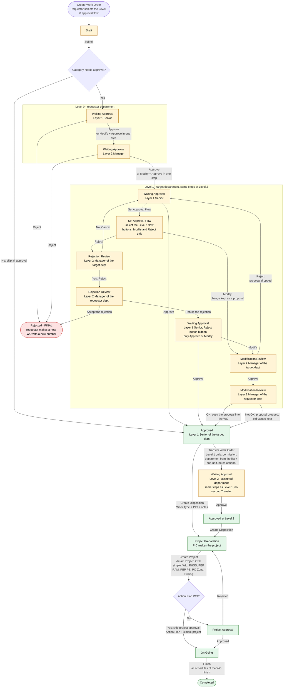

**How to read it**
- **Level 0:** a Modify by the Senior or the Manager of the requestor department changes the WO and approves it in one step. The requestor gets a notification only.
- **Level 1:**
  - Approve does not need an approval flow.
  - Modify and Reject need the target department's flow first ("Set Approval Flow").
- **A modification in the target department:** the change stays a proposal until both Managers agree. If the requestor Manager refuses it, the WO becomes Approved with the old values.
- **A Reject from the target department needs two confirmations:** first the target Manager, then the requestor Manager. If the requestor Manager refuses the rejection, the WO goes back to the target Senior with the Reject button hidden.
- **Level 2:** the WO gets Level 2 only after a Transfer. The steps are the same as Level 1, but the assigned department cannot transfer again.

---

### 2. Approval route flow (who approves, and when the system finds them)

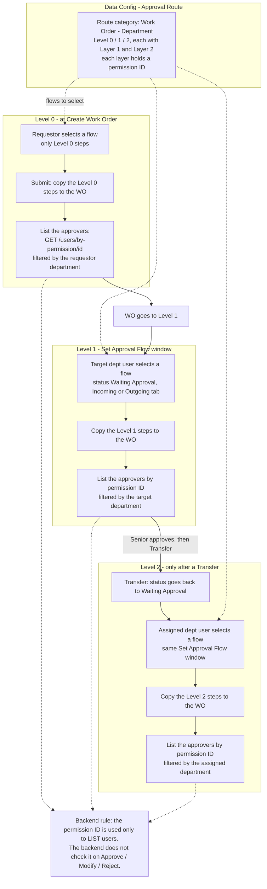

---

### 3. Status of one approval step

Each copied step (Level + Layer) on a WO moves through these states.

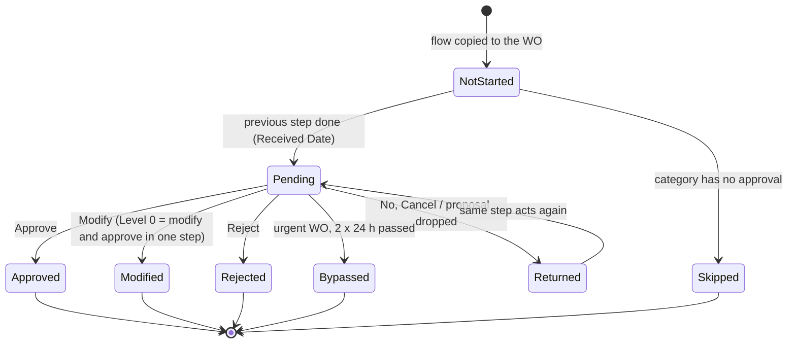

- Received Date = the time the step goes to **Pending**. Action Date = the time it leaves Pending. Duration = the difference, compared with the SLA.
- **Bypassed** is from the urgent rule in the MoM. Check whether the team still wants it.

---

## 9. Permissions plan

Status: **plan only**. Nothing is built. First checked on 24 Nov in the dev database (read-only), the code (`phi-dev`) and the RBAC sheet ("Phantom PHI Mapping" and "Phantom PHI - NEW" tabs). **Updated 24 Nov** with the user's decisions (TD11, TD13, TD16 in `01-Decision-Log.md`; `02-Knowledge.md` §3 §9–§12).

**Decisions that set this plan**
- Each layer of an approval route holds a **permission ID**. Every user with that permission can act on that layer.
- The permission counts **only in the department of its Level**. Example: a PO Senior with the permission does not review an OSF WO.
- **Backend rule:** the permission ID is used **only to list users** (`GET /api/v1/users/by-permission/{permissionId}`). The backend does **not** check it to allow or block an action.
- There is **no position check** and **no skip** when the requestor is a Senior. Another user with the Layer 1 permission reviews the WO.
- The route has Layer 1 and Layer 2 only. There is **no Layer 3**.

Words: see `01-Decision-Log.md` (Level, Layer).

---

### 1. What we have today

**Database (dev, 24 Nov)**
- `permissions`: the highest id is **163**. `permission_groups`: the highest id is **30**.
  - Group 29 "Action Plan": 160 Process Action Plan Request.
  - Group 30 "Action Plan Approval": 161 Review, 162 Approve, 163 Reject.
- The privileges 160–163 have **no casbin rows**. Only Retina gives them. Projects (54), SPK (58) and Contract (63) approval have casbin rows.
- **The system can list the holders** of 161–163. `GetUsersByPermissionAsync` (`UsersService.cs:510`) asks Retina (`RetinaUsersByAclQueryId`) for these ids, and it reads casbin for the other ids. (Correction: an earlier version of this file said that the system cannot list them.)
  - Limit 1: the Retina ids are a fixed list (`IsRetinaOnlyPermissionAsync`, `UsersService.cs:560`). A new WO permission that exists only in Retina must be added to that list.
  - Limit 2: the endpoint has **no department filter**. The WO flow must filter the list by the department of the Level.
- `users.pos_name` / `position_name` are not clean data (55 users have no position, mixed values, no "Senior / Asst. Manager" value). This does not matter now, because the system does not check the position.
- `users.department`: 65 users have no department. The data has duplicate names ("OSF" and "Operation & Surface Facilities"; "Project" and "Projects"). The department filter must handle these names.
- `approval_tierings` + `role_approval_tierings`: an old "approval level 1–3 for each role" table for Project, Contract, SPK and SPK BoQ Progress. Only the user profile shows it (`UsersService.cs:300`). The WO does not use it.
- `custom_configurations` has `action_plan_review_permission_id` (= 161) and `work_order_department_short_names`.

**RBAC sheet**
- "Phantom PHI Mapping" stops at **158**. It has no rows for 159 (Data Config), 160–163 (Action Plan) or any Work Order privilege.
- "Phantom PHI - NEW" uses the numbers **137–272** with other meanings (example: 161 = "Read Compressor Engine Type"). These numbers clash with the database. Each new WO privilege needs a number that is free in the database **and** in the NEW tab.
- The Retina roles are one SYSROLE for each department (`retina_department_roles.oracle.sql`). The permissions of a user = the SYSROLEs of the selected department.

---

### 2. Options (decided 24 Nov)

- **Option A: one permission for each layer, in the department of the Level.** **Chosen.** Retina gives the permission through the SYSROLE of the department. The route layer holds the permission ID.
- **Option B: reuse `approval_tierings`.** Not used. It is for each role, not for each department, and no flow reads it.
- **Option C: use the position (`pos_name`).** Rejected. The data is not clean, and the team does not want a position check.

---

### 3. Proposed permissions

New groups after 30. Number the new privileges from **273**, so that they do not clash with the NEW tab (see P1).

**Group 31 "Work Order"**
- 273 Read Work Order (View)
- 274 Create / Submit Work Order (Modify). The requestor.
- 275 Process Work Order (Modify). The PIC of Level 1 / Level 2: Disposition, Create Project, Finish.
- 278 Set Approval Flow (Modify). A user of the target or the assigned department selects the route of that department ("Set Approval Flow" window).
- 279 Transfer Work Order (Modify). A user of the target department transfers the WO to the assigned department.

**Group 32 "Work Order Approval"** (the layers)
- 276 Approve Work Order Layer 1 (SOP: Senior / Asst. Manager)
  - At Level 0: approve the submitted WO (Modify + Approve in one step is allowed).
  - At Level 1 / 2: Approve, or Modify / Reject after the route is set.
- 277 Approve Work Order Layer 2 (SOP: Manager)
  - At Level 0: approve the submitted WO. Check a Level 1 modification. Accept or refuse a rejection.
  - At Level 1 / 2: approve a Modify. Confirm a Reject ("Yes, Reject" / "No, Cancel").

**Rules**
- The route layer holds 276 or 277 (or another permission that the admin selects). The approvers = the users with that permission **in the department of the Level**.
- The backend uses the permission only to **list** the users. It does not check the permission on actions. The same rule applies to 278 and 279: they fill the list of who can act; they are not an access check.
- Layer 0 never approves.
- The Action Plan review pool (161) stays for the Action Plan. When the Action Plan uses the route of its WO, 161 becomes the Layer 1 Level 1 permission for PO.
- The project approval keeps the Project Approval privilege (54). An Action Plan WO skips the project approval.

---

### 4. Work to do (after the team agrees)
1. Add groups 31–32 and privileges 273–279 to `permissions` / `permission_groups` (seed SQL, one INSERT for each row, literal ids).
2. Add rows to the sheet:
   - "Phantom PHI Mapping": rows for 159–163 (missing now) and 273–279.
   - "PHI-NEW by Method": the View / Modify category.
3. Add the new privileges to the Retina SYSROLEs of each department that is a WO Level.
4. Add the new Retina-only ids to `IsRetinaOnlyPermissionAsync`, or make that list come from config.
5. Add a department filter to the user list (a new optional `department` query parameter on `/users/by-permission/{id}`, or a filter in the WO service).

---

### 5. Open questions
- **P1:** Which numbers? **Answered 25 Nov: 273–279** (no clash with the NEW tab). Groups 31, 32. Added on dev by `sql/seed_wo_test_users.sql`. Manager SYSROLE = `{Dept} - Approval Manager` (`06` §4).
- **P2:** Do we need "Approval Layer 3"? **Answered 24 Nov: no.** The route has Layer 1 and Layer 2 only.
- **P3:** How does the system list the holders of a layer? **Answered 24 Nov:** with `/users/by-permission/{id}` (casbin, or Retina for the listed ids), filtered by the department of the Level.
- **P4:** What if a layer has no user with the permission in that department? **Open.** Proposal: the system blocks the step and shows an error, so that the admin fixes the route or the Retina roles.
- **P5:** One user in two departments (GM / SM picker): does the permission count only in the selected department? **Partly answered (TD16):** it counts only in the department of the Level. Open: a GM / SM who holds the role in two departments is listed in both.

---

## 10. Project and task changes

20 Nov 2026. Question: when a WO creates a **Project** and its **Project Tasks**, what must change? The schedule still needs tasks, and the tasks must still connect to **Contract, BOQ and SPK**.

**Updated 24 Nov:** the department sets the schedule type (simple: WLI, Field PHSS, Field PEP RAM, Field PEP PE, PO Zona, Drilling; detail: Project, OSF). Level 2 = the assigned department (after a Transfer). The project approver comes from a permission in the PIC's department. See `01-Decision-Log.md` (TD4, TD5, TD10, TD11, TD16).

**Decision, 20 Nov:** a WO project needs **no `.mpp`**. Both kinds, `detail` (PRJ / OSF) and `simple`, build their schedule in the app (grid or Excel upload). They write the same `project_tasks` rows. `.mpp` / Aspose stays only for projects made outside a WO.

**Short answer:** almost nothing on `project_tasks` itself.
- The table already has every link that Contract, BOQ and SPK need.
- The work is in **how the in-app schedule (grid / Excel) writes the rows**, so they look exactly like `.mpp` rows. It is not in new columns.
- The only schema changes are on `projects`:
  - the WO link,
  - the schedule kind,
  - possibly the K6 Action Plan link.

---

### 1. How a task connects today (verified in code)
- **Task → Project:** `project_tasks.project_id`. It is **required**, so a task cannot exist without a project. All links are logical, with no DB FK.
- **Task → Contract:** `project_tasks.contract_id`. It is set when a BOQ is connected (`ProjectTaskBoqsService.cs:685`) or an SPK BOQ is assigned (`SpksService.cs:2804`), and cleared on unassign.
- **Task → SPK:**
  - **legacy:** one SPK per task, in `project_tasks.spk_id`, `spk_cost`, `spk_type`.
  - **current:** `project_task_spks` (task ↔ SPK, `is_primary`, `spk_cost`, unassign audit, `source`), which supports several SPKs per task (multi-source SPK).
  - **Create SPK:** the request carries `ProjectTaskIds` (`SpksDto.cs:244`).
- **Task → BOQ:**
  - `project_task_boqs`: BOQ lines per task (unit, volume, price, `spk_boq_id`, `spk_id`, progress).
  - `project_task_boq_drafts`: per task + contract (+ SPK).
  - `spk_boqs` → `project_task_boqs`.
- **Task → plan / S-curve:** `project_task_schedules` holds one row per day with plan / actual weight, cost and progress.
- **Rules the SPK / BOQ / weight code relies on:**
  - `data_type` is `header` (summary row) or `item` (leaf).
    - Weight and cost totals count **items only** (`ProjectTaskSpkMirror.cs:184`).
    - SPK / BOQ attach to **items**.
  - `weight` = `estimated_cost / Σ item estimated_cost`. If the total cost is 0, the import weights stay unchanged.
  - `breakdown` is the WBS code (`1`, `1.2`). Roll-ups match by prefix (`'1.2' + '.%'`), so it must be trimmed.
  - `unique_id` / `parent_unique_id` give the tree. `predecessor` / `successor` are JSON `[{id, uniqueID, type, lag}]`, the MS Project shape.
  - **On Stream** is found by `description = "On Stream"`. Plan On Stream = that task's `end_date`, and Expected = its `etc` (`ProjectsService.cs:4430`, PHI-2267).
- **Two ways a task is made today:**
  - **`.mpp` import** (Aspose parse → `ProjectTasksService.cs:844`): full fields, predecessor JSON, calendar, critical path.
  - **Manual add task** (`ProjectTasksService.cs:652`): one row, with header / item from the breakdown, `duration = end − start + 1`, daily schedules built evenly (`BuildDailySchedules`), and `predecessor = "[]"`.

The **simple schedule** can reuse the manual path, with some fixes (§3).

---

### 2. Changes on `projects`
| Column | Type | Why |
|---|---|---|
| `work_order_id` | uniqueidentifier, null | Already in the Knowledge Documents (MoM 6 Nov). **Not unique**: K15 / MoM 19 Nov allows several schedules (projects) per WO, and "Finish WO finishes all schedules under it" |
| `schedule_kind` | nvarchar(10): `detail` / `simple` | Both kinds use the in-app grid (no `.mpp`). The kind decides the grid's rules (levels / fields, P10). Copy it from the WO **department** (Request To): detail = Project, OSF; simple = all other departments (24 Nov) |
| `source` | nvarchar(20): `manual` / `work_order` (optional) | Reporting and filters ("projects from WO"). Can be derived from `work_order_id`; add it only if a list needs it |

- Unchanged:
  - RKAP (`rkap_projects`), WBS, budget type, approval and PICs: the WO fills them as today's project form does.
  - Project Approval (`approval_processes`): this is the second approval for the project path.

---

### 3. Changes in how in-app schedule rows (simple **and** detail) are written to `project_tasks`
No new column is needed. These rules make a grid / Excel row equal to an `.mpp` row, so Contract / BOQ / SPK, the S-curve, Gantt and On Stream all work unchanged.

| Field | Rule for the simple schedule | Today's gap |
|---|---|---|
| `breakdown` | `1`, `1.1`, `1.2`, `2`… from the grid's No column; trimmed | – |
| `unique_id` / `parent_unique_id` | The backend assigns 1..n in row order. A sub-task points to its parent | The manual path takes `UniqueId` from the request and does not set `parent_unique_id` |
| `data_type` | A row with sub-tasks = `header`; a row without = `item`. Only items can get an SPK / BOQ | Same rule as today ✔ |
| `predecessor` / `successor` | Parse the grid text (`2`, `2FS+3d`, `3SS`, `4FF-1d`) into the JSON `[{id, uniqueID, type, lag}]` that `.mpp` writes. Build `successor` as the inverse. Keep the typed text in `other.predecessor_text` for editing | The manual path writes `"[]"`, so the Gantt shows no links |
| `start_date` / `end_date` / `duration` | Manual dates (Knowledge Documents). Duration in **working days, Mon–Fri** + holidays (`custom_configurations` "calendars.holiday") | `BuildDailySchedules` spreads over **every calendar day** (weekends included). Decide which (P2) |
| `start_etc` / `etc` | = planned dates at create (as today) | ✔ |
| `estimated_cost` | Grid Cost (Rp). Percentage is shown and derived from the WO budget, and **not stored** (MoM 19 Nov: cost ↔ % auto-fill). Σ item cost ≤ WO estimation cost (K14) | – |
| `weight` | Recompute with the existing rule (`estimated_cost / Σ item cost`) after all rows are inserted | Manual path takes weight from the request; call the existing `RecalculateProjectTaskWeightsAsync` instead |
| `project_task_schedules` | Build per item from duration, weight and cost (existing `BuildDailySchedules`), after the weight recompute | Schedules use the request weight; rebuild after the recompute |
| `milestone` | `1` for the **On Stream** row (0 duration, last row, required) | – |
| `description` | Grid Task name. The last row must be exactly **"On Stream"**, so Plan / Expected On Stream work (PHI-2267) | – |
| `contract_id`, `spk_id`, SPK / BOQ tables | **Empty at create.** They are filled later by the existing Add SPK / connect BOQ flows, the same as an `.mpp` project | ✔ no change |
| `project_calendar`, `critical_path`, `constraint_*` | `"{}"` / empty (no Aspose); `is_critical_path = false` | ✔ (no critical path from Aspose for any WO project; see P4) |
| `tenant_id`, `status` | As today (`not_started`) | ✔ |

**Where to build it:** one service method, "create tasks from rows". The grid and the Excel upload both call it. It inserts everything in **one transaction**, then recomputes the weights, then builds the schedules. Re-use the manual-add logic; don't add a new path for each source.

---

### 4. The K6 problem: Action Plan without a Project
- The Figma's PE / PO well lanes say "New **Action** Process – Simple Schedule". In K6 we proposed that well categories create **no Project**.
- **But** `project_tasks.project_id` is required, and every Contract / BOQ / SPK flow, the S-curve, `spk_cost_allocations → projects` and service acceptance → projects all hang off a **Project**.
- Without a project, a well WO's schedule could not get an SPK or a contract. Fixing that means changing the SPK, BOQ, progress, SA and invoice services.
- **Decided 20 Nov:** a well WO **also creates a Project** with `schedule_kind = simple`, linked to both the WO and the Action Plan.
  - **Link:** add `projects.action_plan_id` + `action_plan_source` (pep / phss), or keep the link only through the WO (D1: the WO is the Action Plan's parent; the WO has the project).
  - **Approval:** the second (project) approval can be **skipped** by configuration for Action Plan WOs. That keeps "one approval only" for Action Plans.
  - **Why this is better:** the PIC still gets tasks, contract, BOQ and SPK, and the Action Plan status follows the project (On Going → Finished).
- Prefer the **WO link only**: there is no new column, the Action Plan is reached through `work_orders`, and there is a single source of truth.

---

### 5. Things that do not work for simple projects yet
- **Rebaseline:** today it is an `.mpp` re-upload + diff (`project_rebaselines`). Every WO project (simple and detail) needs "edit the grid / re-upload the Excel → the same diff engine". The reconcile works on task rows, so only the input changes.
- **Add / edit / delete task after create:** the manual endpoints exist. Check that they also rebuild the predecessor JSON and weights for simple projects.
- **Excel template:** the columns match the grid (No, Task, Start, End, Predecessor, Cost). The same validation as the grid applies (row errors, On Stream last).

---

### 6. Open questions
- **P1:** ~~a Project for well categories, with the project approval skipped for Action Plan WOs?~~ **Decided 20 Nov: yes.**
- **P2:** simple-schedule duration and the daily plan: Mon–Fri working days (Knowledge Documents) or every calendar day (today's `BuildDailySchedules`)? The S-curve differs.
- **P3:** must every **item** row have a cost, or can some be 0? This matters for the weight: if all are 0, the weights stay unchanged and the S-curve is flat.
- **P4:** WO projects have no critical path and no calendar from Aspose. Is that acceptable, or should the critical path be computed from the predecessors?
- **P5:** ~~convert simple → detail via `.mpp`~~ **Closed 20 Nov:** WO projects never use `.mpp`.

---

### 7. Changes in the Project module (lifecycle)
Today's lifecycle (verified, `ProjectsService.cs`, `ProjectsEndpoint.cs`):
- **Create:** `POST /projects` creates a `draft`.
- **Tasks:** `.mpp` validate → `POST /projects/tasks/validate/confirm`, or manual `POST /projects/tasks/create`.
- **Approvers:** `POST /projects/{id}/approver`. The user picks the approvers per level by hand (`project_approvers`).
- **Submit:** `POST /projects/submit` → `on hold` + `approval_processes` (flow "Project").
- **Approve:** `POST /projects/approval`, level by level → `in progress`.
- **Finish:** `POST /projects/finish` (note required; only from `in progress`) → `finished`. The reverse is `/projects/reopen`.
- **Cancel:** `POST /projects/cancel` → `canceled`.

#### 7.1 Create from a WO
- **New entry point:** "Create Project" from the WO (Disposition PIC, WO status Project Preparation).
  - It opens the project form **pre-filled from the WO**:
    - description ← WO title / scope,
    - field / area / plant / working area ← WO location,
    - start / end ← WO dates,
    - WBS ← WO WBS,
    - RKAP ← WO RKAP,
    - budget type ← WO budget type,
    - Project Type ← Disposition Work Type. The allowed Work Types depend on the department (24 Nov): ABI/BD only Projects and PO; ABI/NBD only OSF; ABO Routine and ABO Non Routine for all departments,
    - `work_order_id`,
    - `schedule_kind` ← the WO department (Request To), 24 Nov.
  - The PIC can edit the pre-filled values.
- **Mapping to set up:**
  - WO **category** → project `category` / `sub_category` (Figma class: Budget Type → Project Category → Class, e.g. ABI BD → NWD → RTWS = `newwelldevelopment` / RTWS).
  - WO **budget type** (ABI BD / ABI NBD / ABO Routine / ABO Non Routine) → `rkap_type`.
  - Store the mapping in the category config (K12). It must not be typed by hand.
- **Project No:** the Knowledge Documents / prototype use the WO number when the PIC leaves it empty (`p.no || wo.no`). Confirm (P6).

#### 7.2 Submit validation (`ValidateReadyToSubmitAsync`)
The existing rules block a WO project:
- **WBS required:** the MoM 19 Nov says **WBS is optional** for a WO. Skip this rule when `work_order_id` is set.
- **Project number required:** satisfied by the WO number fallback.
- **At least one task:** keep it. For simple, also require the **On Stream** row last, and the cost cap (K14).
- **RKAP / field / working area / dates:** keep them (RKAP is mandatory in the MoM).

#### 7.3 Project approval (second approval)
- **Today:** the approvers are **picked by hand** per project.
- **WO (Knowledge Documents WO-7.3):** the approver is the **Manager of the PIC's Level**: Layer 2 Level 1 (target department), or Layer 2 Level 2 (assigned department) after a Transfer.
- **Change (24 Nov):** for a WO project, the approvers = the users who have the Layer 2 permission **in the PIC's department** (the route of that department, `02` §7 §2). The system lists them with `/users/by-permission/{id}` and a department filter. The backend does not check the permission on Approve. Hide the manual approver edit, or keep it as an override (P7).
- **Action Plan WOs:** the project approval is skipped (decided 20 Nov). On Submit the project goes straight to `in progress`, with the log "auto-approved (Action Plan WO)".
- **Reject / Revise:** the existing "Revise" sends the project back to the PIC (prototype: "The PIC has to adjust the project and send it again"). No change, but the WO status must follow (7.5).

#### 7.4 Finish (D7: parameters required)
- **Today:** Finish needs only a note.
- **Change:** when `work_order_id` is set, Finish:
  1. Opens the **WO parameter pop-up** (the category's Finish fields, K11), with the cost cards: Budget, Actual, Commitment, EAC, RKAP.
  2. **Requires** those parameters and saves them to `work_order_results`.
  3. Notifies the Requestor ("parameter updated & WO completed", MoM 6 Nov).
  4. Updates the WO:
     - **Simple / well categories:** the WO waits for the Requestor's well update. This is non-blocking if X9 = close at Finish.
     - **Several projects per WO (K15):** the WO completes when **all** its projects are finished. Or, per the MoM, "Finish WO" finishes every open schedule. Decide which side drives (P8).
- **Reopen:** reopening a WO project reopens the WO, which goes back to On Going. The saved parameters stay, as history.
- **Cancel:** cancelling the **only** project of a WO sends the WO back to Project Preparation, so the PIC can create a new one. It does not cancel the WO.

#### 7.5 WO status follows the project
| Project event | WO status |
|---|---|
| created (draft) | Project Preparation |
| submitted (`on hold`, approval active) | Project Approval |
| approved (`in progress`) / auto-approved | On Going |
| revised / rejected back to PIC | Project Preparation |
| finished (+ parameters) | Completed, or waiting for the requestor update (X9) |
| reopened | On Going |
| canceled | Project Preparation |

- **How:** one place updates the WO when the project status changes, e.g. a `WorkOrderProjectSync` called from Submit / Approval / Finish / Reopen / Cancel. Don't spread it over the endpoints.
- **Notification:** project events reach the WO participants with the CTA "Go to Project" (prototype `ntp`).

#### 7.6 Screens
- **Project Details:** add a **WO Number** field (link to the WO; MoM 6 Nov).
- **Project list / Approval Summary:** a filter "From Work Order", and the schedule kind.
- **Schedule tab:**
  - `detail` → the same grid editor with the detail rules (P10). No `.mpp` upload button for WO projects.
  - `simple` → the grid editor (§3).
  - Both kinds use a grid-based rebaseline (§5).
- **SPK / Contract / BOQ screens:** no change (§1). They work on the tasks as today.

#### 7.7 More open questions
- **P6:** Project No for a WO project: the WO number, or still a typed number (AFE)?
- **P7:** project approvers from the route only, or can the PIC / manager still edit them?
- **P8:** several projects per WO: does the WO complete when all its projects are finished, or does "Finish WO" force-finish them (MoM 19 Nov)?
- **P10:** with no `.mpp`, what makes **detail** different from **simple**? Proposal: detail = unlimited WBS levels and manual weight; simple = 2 levels, weight from cost.
- **P9:** does the WO budget (estimation cost) cap the **sum** of all its projects' costs, or each project separately?

---

### 8. Flag "from WO" vs "outside WO", and the NOT NULL check
Checked 20 Nov:
- the **dev DB** (`sys.columns`, read-only),
- the **EF model** (`PhantomDb.Project.cs`, `PhantomDb.ProjectTask.cs`; DataAccess has `<Nullable>enable</Nullable>`, so a non-nullable C# type without `IsRequired(false)` is **required** in EF),
- the **code that assumes a value** (submit validation, weight, roll-up, On Stream).

#### 8.1 The flag (new columns on `projects`)
| Column | Type | Rule |
|---|---|---|
| `origin` | nvarchar(20) **NOT NULL** default `'manual'` | `manual` = made in Project Monitoring (outside WO); `work_order` = made from a WO. Backfill: all 1,297 existing rows = `manual` |
| `work_order_id` | uniqueidentifier NULL + index | Set only when `origin = 'work_order'`. CHECK: `origin = 'work_order'` ⇔ `work_order_id IS NOT NULL`. Not unique (K15) |
| `schedule_source` | nvarchar(10) **NOT NULL** default `'mpp'` | `mpp` (Aspose import, outside WO) / `in_app` (grid / Excel). Every WO project = `in_app` (20 Nov decision) |
| `schedule_kind` | nvarchar(10) NULL | `detail` / `simple`. Only for WO projects (null for `manual`) |

- An explicit `origin` makes filters, lists and reports easy, and the CHECK keeps it consistent with `work_order_id`.
- `schedule_source` is separate from `origin` because the screens and the rebaseline branch on **how the tasks were made**, not on where the project came from.

#### 8.2 `projects`: NOT NULL columns
**The DB has only 2 NOT NULL columns:** `id` (default `newid()`) and `created_at`. Everything else is nullable. The risk is in **EF** and in **code that expects a value**.

| Column | DB | EF | Can it be null from a WO? | Action |
|---|---|---|---|---|
| `id` | NOT NULL (default) | – | No | – |
| `created_at` | NOT NULL | required | No | Set at create |
| `status` | null | **required** (`string = null!`) | No if we set `draft` (5 dev rows are already null) | Always set `draft` at create |
| `created_by` | null | **required** (Guid) | **Yes**, if the project is created by the system (auto-create from Disposition) | Use the PIC's user id. Never a system create without an actor |
| `wbs` | null | – | **Yes**: the MoM 19 Nov says WBS is optional | Submit validation requires it today, so skip that rule for `origin = work_order` |
| `project_no` | null | – | **Yes**, if the PIC leaves it empty | Fall back to the WO number (P6); otherwise submit fails |
| `category` | null | – | **Yes**: dev values are only `fasprod`, `newwelldevelopment`, `flowline` ("New Well Development" also exists, a dirty duplicate). OSF / WLI / PHSS / PEP / PO categories have **no project category** | Add project categories, or map each WO category to one (K12). Submit requires it |
| `sub_category` | null | – | Yes | Optional; map from the Figma class (RTWS, Gas Lift…) |
| `rkap_type` | null | – | **Yes**: dev values are `CO` / `UB` / `CF`, **not** the WO budget type (ABI BD / ABI NBD / ABO R / ABO NR) | Different meaning. Add `budget_type` (new column) for the WO budget type; keep `rkap_type` as is |
| `field_id` | null | – | **Yes**: the WO Field is "PHSS Northern / PHSS Southern" (G11). Is that a row in `fields`? | Map the WO field to `fields.id`, or the submit rule "field is required" fails |
| `area_id`, `plant_id` | null | – | Yes ("Area follows Field"; plant may be empty) | Optional; working area is still required at submit |
| `start_date`, `end_date` | null | – | No (WO has start / end) | Pre-fill from the WO |
| `description` | null | – | No (WO title / scope) | Pre-fill |
| `department_id` | null | – | Possible | Set from the PIC's department: the target department (Level 1) or the assigned department (Level 2) |
| `rig_id`, `rig_name`, `fid`, `zone`, `potential_gain_*`, `budget_forecast` | null | – | Yes | Fine: NWD / optional fields |

#### 8.3 `project_tasks`: NOT NULL columns
**DB NOT NULL:** `id`, `project_id`, `weight`, `start_date`, `end_date`, `created_at`, `created_by`, `unique_id`, `milestone`, `duration`, `is_critical_path`.

| Column | DB | EF | Can it be null from a WO (in-app grid / Excel)? | Action |
|---|---|---|---|---|
| `project_id` | NOT NULL | required | **Yes**, if a well WO saves an Action Plan schedule without a project (K6) | Always create the project first (P1). Tasks are inserted with it |
| `unique_id` | NOT NULL | required | **Yes**: no `.mpp` gives it any more | The backend assigns `MAX(unique_id)+1` per project. The manual-add endpoint today takes it from the request; don't trust the client |
| `start_date`, `end_date` | NOT NULL | required | **Yes** for **parent rows** (dates roll up from sub-tasks) and for **incomplete rows** while the PIC is still typing | Compute parent dates before insert. Keep a draft grid out of `project_tasks` (in `projects.other` or the WO), and insert only on Submit / Save with a complete row |
| `duration` | NOT NULL | required | Yes for parents / incomplete rows | Compute (working days, P2); parents = span of children; On Stream = 0 |
| `weight` | NOT NULL | required | **Yes**, if cost is empty (MoM 6 Nov: cost not required) | Insert `0`, then recompute from cost. If every cost is 0, the weights stay 0 and the S-curve is flat. Requiring cost (K14 / P3) fixes this |
| `milestone` | NOT NULL | required | No | `0`; `1` for On Stream |
| `is_critical_path` | NOT NULL | required | No | `false` (no Aspose) |
| `created_at`, `created_by` | NOT NULL | required | `created_by` yes if system-created | Use the PIC's id |
| `predecessor`, `successor` | null | **required** (non-null string, no `IsRequired(false)`) | **Yes**: no predecessor typed. 2,110 dev rows are already null | Always write `"[]"` when empty; the parsed JSON otherwise |
| `breakdown` | null | optional | Yes if the No column is empty | **Logically required**: roll-ups match by prefix. The backend generates it from the row order |
| `data_type` | null | optional | Yes if not computed | **Logically required**: weight / SPK use header vs item. Compute it (has children → header) |
| `description` | null | optional | Yes (empty task name) | Require a name; the last row must be "On Stream" |
| `status` | null | optional | Yes | Set `not_started` |
| `parent_unique_id` | null | – | Yes, for top rows (normal) | Set for sub-tasks; null only for top level (3,699 dev rows null = top rows) |
| `estimated_cost` | null | – | Yes (2,093 dev rows null) | Weight treats null as 0. Fine if K14 = optional, but the S-curve suffers |
| `contract_id`, `spk_id`, `spk_cost`, `spk_type`, `assignee` | null | – | Yes at create (normal) | Filled later by SPK / BOQ (§1) |
| `etc`, `start_etc` | null | optional | No | = planned dates at create |
| `project_calendar`, `critical_path*`, `constraint_*`, `ts` | null | optional | Yes (no Aspose) | `"{}"` / `""` as the manual path does |
| `tenant_id` | null | optional | No | Same hardcoded tenant as today |

#### 8.4 Summary
- **Must handle, or the insert fails (DB NOT NULL):** `unique_id`, `start_date` / `end_date` / `duration` of parent and incomplete rows, `weight`, `created_by` and `project_id` on `project_tasks`.
- **Must handle, or EF / reads break (EF-required, DB nullable):**
  - `projects.status`, `projects.created_by`,
  - `project_tasks.predecessor` / `successor`.
- **Must handle, or the WO project can't be submitted (submit rules):** `wbs` (optional for WO), `project_no`, `category` (no project category for most WO categories), `field_id` (does the WO field map?), RKAP, working area.
- **New mapping / columns needed:**
  - `budget_type` (WO budget type ≠ `rkap_type`),
  - WO category → project category,
  - WO field → `fields.id`.

---

## 11. References (all links)

This file lists every link that the WO docs in this folder use. Add a new link here when you use a new source.

---

### Google Docs

- **Team doc "PRD Phantom Fase 2"**: the team's Sprint 3 SSDP text for the WO screens (Lv 0 / Lv 1 / Lv 2). This is the source of the decisions of 24 Nov (`02-Knowledge.md` §3).
  - Link: https://docs.google.com/document/d/1g_vkah0cJ9ftP4zgRZmNIi14nBtegGcacsy6LBxOeVk/edit
  - Tab with the WO sections: https://docs.google.com/document/d/1g_vkah0cJ9ftP4zgRZmNIi14nBtegGcacsy6LBxOeVk/edit?tab=t.cmnruvi1ai01#heading=h.wlo8l19fg6du
  - Other tab used before: https://docs.google.com/document/d/1g_vkah0cJ9ftP4zgRZmNIi14nBtegGcacsy6LBxOeVk/edit?tab=t.w0fbg9bdzjsb
- **MoM "Recap MOM PHI (Phantom)"**: notes of the meetings (MoM 22 Okt, 6 Nov, 19 Nov; topics M002, M009, M014). Used in `02-Knowledge.md` §4.
  - Link: https://docs.google.com/document/d/10YzIw_-i5oXEiTSLueDq5k4sYMgk4HY94ybpZrgHWSo/edit?tab=t.9uwqupx38zhn#heading=h.ohj6qnnx1733
- **Questions doc "Work Order Question"**: the online copy of `02-Knowledge.md` §1. Tab "Open Questions (20 Nov)" (not yet updated with the 23–24 Nov changes).
  - Link: https://docs.google.com/document/d/1kgrYlD_LZWFYuj-JNp4OM2LhXiKkXo_c_E0LX2lHbtg/edit
  - Tab "Open Questions (20 Nov)": https://docs.google.com/document/d/1kgrYlD_LZWFYuj-JNp4OM2LhXiKkXo_c_E0LX2lHbtg/edit?tab=t.wshhabqp0do9
- **Knowledge Documents doc** (title still "PRD — Work Order (PHANTOM)"; the rename is not approved yet). The category breakdown is before FLOW 1.
  - Link: https://docs.google.com/document/d/1gGHUGofaNSa4oGFPPD6MS4nLDgj6vdCmui0o_Z7FlqQ/edit?tab=t.0
- **A second doc with the same title**, made on 19 Nov: https://docs.google.com/document/d/1SoQfx2JV4I7zCm-yUGFwK5gKHq0YQUQ9V2QpMgoqIUc/edit. Check it: it may be an empty copy that we can trash (only after your OK).

### Google Sheet

- **RBAC privilege sheet**: the privilege groups and IDs for each route. Tabs: "Phantom PHI Mapping", "Phantom PHI - NEW", "PHI-NEW by Method", "Role - …". Used in `02-Knowledge.md` §9.
  - Link: https://docs.google.com/spreadsheets/d/1HHv1QMmyZ917KGBdW6iMKMSJ9n9fvL_IS6D7ldhGSD8

### Figma ("PHI - Latest Design", page "Work Order")

- File: https://www.figma.com/design/usSi3zXbPKJf1snvAFEyLl/PHI---Latest-Design
- WO page / flow board: https://www.figma.com/design/usSi3zXbPKJf1snvAFEyLl/PHI---Latest-Design?node-id=18789-49609
- WO page (the link we opened first): https://www.figma.com/design/usSi3zXbPKJf1snvAFEyLl/PHI---Latest-Design?node-id=18789-42789&p=f
- Frames that we opened during the review (19 Nov):
  - https://www.figma.com/design/usSi3zXbPKJf1snvAFEyLl/PHI---Latest-Design?node-id=18840-70098
  - https://www.figma.com/design/usSi3zXbPKJf1snvAFEyLl/PHI---Latest-Design?node-id=18840-70433
  - https://www.figma.com/design/usSi3zXbPKJf1snvAFEyLl/PHI---Latest-Design?node-id=18840-70540
- Frames that we opened during the project class check (23 Nov):
  - https://www.figma.com/design/usSi3zXbPKJf1snvAFEyLl/PHI---Latest-Design?node-id=19380-207190
  - https://www.figma.com/design/usSi3zXbPKJf1snvAFEyLl/PHI---Latest-Design?node-id=19380-207371
- Linked from the team doc:
  - Overview Work Order: https://www.figma.com/design/usSi3zXbPKJf1snvAFEyLl/PHI---Latest-Design?node-id=18806-94201
  - Creating Work Order: https://www.figma.com/design/usSi3zXbPKJf1snvAFEyLl/PHI---Latest-Design?node-id=18806-94200

### Claude artifacts

- **First draft of the Knowledge Documents**, "Work Order Module (PHANTOM)" (rev 11): https://claude.ai/artifact/3A8M7RGwuGg1RnGYuyedah
- **Source design of that first draft** (the older prototype): https://claude.ai/code/artifact/caf7d8a9-212d-4633-ab93-474cc9a6d204
- **Newer prototype** (linked from the Figma): https://claude.ai/artifact/S4gBiqBpHasmfJnZKQQZMu

### GitHub (oceaninov/phantom)

- **PR #1523**, "feat(work-order): add work_orders schema": https://github.com/oceaninov/phantom/pull/1523
  - Our first review (5 problems, other checks, code points): https://github.com/oceaninov/phantom/pull/1523#pullrequestreview-6036132834
  - Our follow-up comment (new decisions of 24 Nov): https://github.com/oceaninov/phantom/pull/1523#issuecomment-7127114186
  - Our notes: `archive/archive/10-PR-1523-Review.md`
- **PR #1533**, "feat(work-order): paged list endpoint per flow_type": https://github.com/oceaninov/phantom/pull/1533
  - Our review: https://github.com/oceaninov/phantom/pull/1533#pullrequestreview-6039043183
- **PR #1476**, the Action Plan approval branch (one approval branch for AL and Well Test; the reject round): https://github.com/oceaninov/phantom/pull/1476

### Bruno

- Repo `oceaninov/phi-phantom-collections`, local `../bruno`. WO requests: worktree `../bruno/.worktrees/work-order`, branch `feat/work-order`, folder `collections/phi-phantom/Work Order`. PR: https://github.com/oceaninov/phi-phantom-collections/pull/235
- Next WO number (Action Plan): `collections/phi-phantom/Action Plan Approval/Get Next WO Number.yml` (already on `main`).

### Code and database (no URL)

- Endpoint plan: `03-Endpoint-Plan.md`
- WO number: `src-be/Logics/Services/ActionPlanApproval/WorkOrderNumbers.cs`
- Approval routes: `src-be/Logics/Services/ApprovalRoutes/ApprovalRoutesService.cs`, `ApprovalRouteV2Constants.cs`

- Approval route search: `src-be/Logics/Services/ActionPlanApproval/ActionPlanApprovalService.cs` (`FindRouteAsync`)
- Review permission (161): `src-be/Logics/Services/ActionPlanApproval/ActionPlanApprovalRules.cs` (`ReviewPermissionIdAsync`)
- Users by permission: `src-be/Logics/Services/Users/UsersService.cs` (`GetUsersByPermissionAsync`, `IsRetinaOnlyPermissionAsync`), endpoint `GET /api/v1/users/by-permission/{permissionId}` in `src-be/WebApi/Services/Users/UsersEndpoint.cs`
- Retina roles per department: `.worktrees/acl-per-sysrole/src-be/DataAccess/Database/retina_department_roles.oracle.sql`
- Dev database tables: `permissions`, `permission_groups`, `casbin_rule`, `approval_routes`, `approval_tierings`, `role_approval_tierings`, `work_order_sequences`, `custom_configurations` (`action_plan_review_permission_id`, `work_order_department_short_names`), `pep_action_plan` / `phss_action_plan` (`work_order_number`)

- **FE API Spec (Notion, "Work Order — API Spec (FE)")**: the FE draft of 16 endpoints, read 25 Nov. Compared in §1 Gaps G19–G31.
  - Link: https://lyrical-boater-6b1.notion.site/Work-Order-API-Spec-FE-421d22772a158170ae44c332e9da8617
