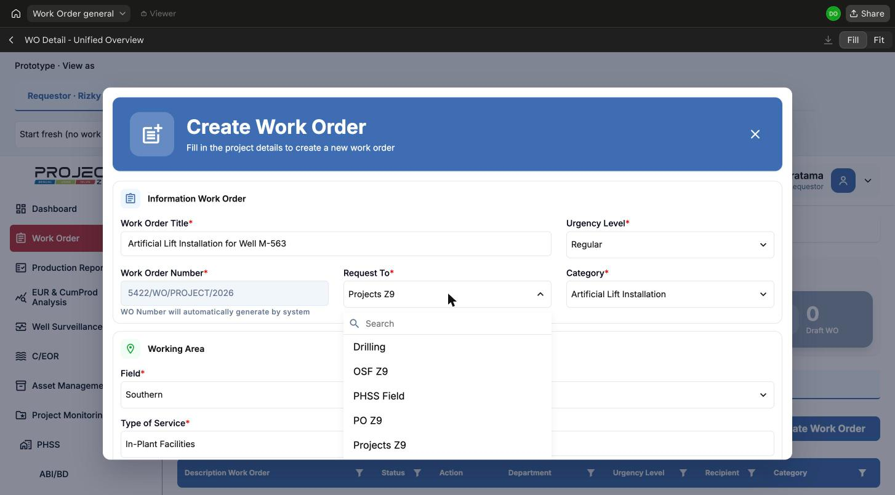
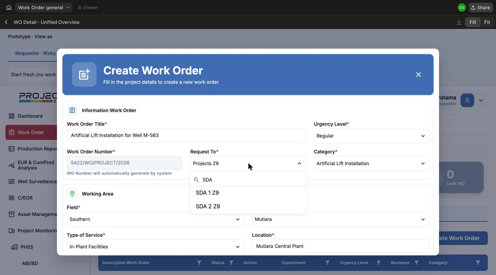
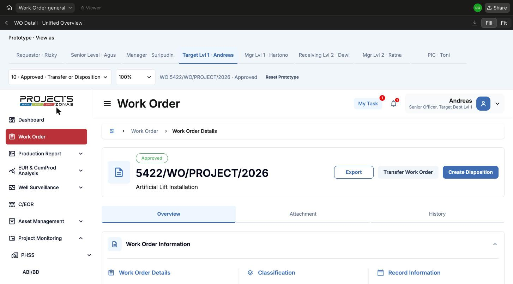

# Work Order: open questions

20 Nov 2026, updated 24 Nov. This file has **only open questions**. Each question has:
- one short question,
- the reason we ask,
- our proposal, if we have one.

Decisions and answered questions are in `00-Decision-Log.md`. The ID in brackets, for example [K1], shows where the question comes from. The section "Reference" at the end explains each ID and each source.

**Words used in this file:**
- **WO:** Work Order.
- **AP:** Action Plan.
- **Level:** a department in the WO flow.
  - Level 0 = the requestor department.
  - Level 1 = the target department (Request To).
  - Level 2 = the assigned department (only after a Transfer).
- **Layer:** a step in one Level.
  - Layer 0 = PIC or requestor.
  - Layer 1 = Senior or Asst. Manager.
  - Layer 2 = Manager.
  - The system does not check the position. Each layer holds a permission ID. Every user with that permission, in the department of the Level, can act.
- **Route (approval flow):** the approval chain in Data Config. Each department selects its own flow by hand.
- **WO project:** a project that a WO makes.

---

## A. Design source

**Q01 [Q1]. Which prototype and which layout are the source of truth?**
- **Why we ask:**
  - Two boards have the same logic but different detail layouts:
    - "Unified Overview": collapsible sections, PIC list with roles.
    - "SSDP ⇄ PO": flat cards, first 5 PIC names.
  - The Figma links to a newer prototype (`S4gBiqBpHasmfJnZKQQZMu`).
- **Proposal:** use the newer prototype and the Unified layout. Ignore the "SSDP ⇄ PO" board.

---

## B. Request To and categories

**Q04 [Q2b]. What does a WO to SDA 1 Z9 or SDA 2 Z9 mean?**
- **Why we ask:**
  - The team doc lists SDA 1 Z9 and SDA 2 Z9 in Request To, with no Category and no Function.
  - Today SDA only makes action plans. SDA does not receive them.
  - SDA is not in the schedule-type list (simple or detailed).
- Which work does SDA do with the WO, and which schedule does it use?

**Q08 [K4]. Does Facility Upgrade belong to Projects Z9 or to OSF Z9?**
- **Why we ask:** the prototype puts it in Projects. A Figma note puts it in OSF.
- A: Use Figma
- **New conflict (24 Nov):** the newer team doc lists Facility Upgrade under **Project Z9**. Confirm that the Figma (OSF) is still correct.

**Q09 [K5]. Which non-well categories need approval?**
- **Examples:** Maintenance, Plant Upgrading, Heavy Equipment, WLI work.
- **Proposal:** each category that makes a project needs the full approval chain.

**Q10 [K7]. Where does the work go for Updating Well Data and Plant Performance Study?**
- **Why we ask:** these two categories have no AP.

**Q13 [K10]. Does the category set the Work Order Type, or does the user select it?**
- The types are Updating Parameter, Study and New Work.
- **Proposal:** the category sets it. Example: Choke = Updating Parameter, PPS = Study, RTWS = New Work.

**Q15 [D1]. Can one WO have more than one AP (more than one well)?**
- Also:
  - Can Well Surveillance make an AP without a WO?
  - What do we do with the ~50 dev APs that already have a WO number?

**Answered (see `00-Decision-Log.md`):**
- Q02 (which Request To can receive Well Test / AL WHC Installation): answered 24 Nov by the team doc lists. Well Test: PHSS Field, PEP Production, PO Z9. AL Installation: PO Z9 and Project Z9. Each department selects its own approval flow.
- Q03 (AL Installation to Projects Z9 or PO Z9): answered 24 Nov. The team doc lists both.
- Q05 (Request To "Internal, Level 1, or Level 2"): answered. User: "It same". The list is the 11 departments of the team doc.
- Q06 (add the Figma-only categories): answered. User: "Yes".
- Q07 (category names): answered 24 Nov. PCTGL, Choke, "Sonolog / BJP Update". "Inception" = Inspection and "Gas List" = Gas Lift are typos.
- Q11 (Sonolog for PHSS): answered 24 Nov. The team doc lists Sonolog / BJP Update for PHSS Field.
- Q12 (PHSS Function): answered 24 Nov. The Function stays on the form. Both PHSS functions have the same category list.
- Q14 (Drilling flow): answered 24 Nov. Drilling uses the simple schedule. The form shows no Category and no Function.

---

## C. Approval

**Q18 [Q4c]. Do the buttons use "Work Order" or "Action Plan" in their names?**
- **Example:** "Approve Modification" or "Approve Action Plan".
- **Proposal:** use the WO name, because the WO is the parent (D1).

**Q23 [R9]. Does Layer 0 (PIC) ever approve?**
- **Proposal:** no. Layer 0 only makes the WO or does the work.

**Q24 [D4]. Does a WO with no approval still get a WO number and notifications?**
- **Proposal:** yes.

**Q25 [Q6c]. Do we keep a counter of reject loops?**
- **Why we ask:** the Figma asks for a modification error rate and a reject count per level.
- **Proposal:** keep the counter for reports only.

**Answered (see `00-Decision-Log.md`):**
- Q16 (how the system finds the Layer of a user): answered 24 Nov. Each layer of the route holds a permission ID. Every user with that permission, in the department of the Level, can review. No step is skipped for a Senior requestor: another Senior reviews. The backend uses the permission ID only to list users (`GET /users/by-permission/{id}`). It does not check it on actions. The user's first proposal was "a permission number for each Layer, in the user's department … read, modify, approval (level 1, 2, 3)".
- Q17 (one or two confirmations for a Level 1 rejection): answered. Two confirmations, as the MoM says: the target Manager, then the requestor Manager (D3b).
- Q19 (more than one approver in one layer): answered 24 Nov. Every user with the permission can review, so the first user who acts decides.
- Q20 (change the approvers during approval): answered 24 Nov. Nobody edits a list. The approvers are the users with the permission.
- Q21 (Modify and Reject route by category): answered 24 Nov. The target department selects its own flow by hand in "Set Approval Flow".
- Q22 (phase 1 of the automatic route change): no longer needed. The automatic route search is replaced by manual flow selection (24 Nov).

---

## D. Transfer and Disposition

**Q26 [Q5a]. Can a Well Test WO or an AL WHC Installation WO go to a Level 2 department (Transfer)?**

**Q27 [Q5b]. Is the Disposition PIC the same as today's execution PIC?**
- **Why we ask:** today the execution PIC must be an active user of the execution department.

**Answered (see `00-Decision-Log.md`):**
- Q28 (AL flow: Transfer or new WO): answered. User: "Transfer keeps the same WO number. A new WO gets a new number."
- Transfer rules, decided 24 Nov: a user needs the transfer permission. The user selects a department from a list and a sub-unit. Notes are optional. The status goes back to Waiting Approval, and the assigned department selects its own flow. The assigned department cannot transfer again.

---

## E. Schedule and project

**Q30 [P10]. What is different between a detail schedule and a simple schedule?**
- **Why we ask:** WO projects do not use `.mpp` (P0).
- **Proposal:**
  - **Detail:** many WBS levels, manual weight, one PIC per task.
  - **Simple:** two levels; weight from cost.

**Q31 [K14, P3]. Must each task have a cost?**
- **Why we ask:**
  - The MoM (6 Nov) says cost is not required.
  - The MoM (19 Nov) says cost or percentage is required, and the total must not be more than the WO budget.
  - With no cost, the S-curve is flat.
- **Proposal:** follow 19 Nov. Each task needs a cost.

**Q32 [P9]. Does the WO budget limit each project, or the total of all its projects?**

**Q33 [P2]. Does the daily plan use working days or all calendar days?**
- **Why we ask:** the Knowledge Documents say Monday to Friday. The code uses all days.
- **Proposal:** working days, with the holiday list in Data Config.

**Q34 [P4]. Is a WO project without a critical path acceptable?**
- **Why we ask:** the critical path comes from `.mpp`. WO projects do not use `.mpp`.

**Q35 [P6]. Is the Project No of a WO project the WO number?**
- **Why we ask:** the Figma "Project Details" sample shows Project Number / AFE = "5422/WO/PROJECT/2026" (the WO number).
- **Alternative:** the PIC types a number (AFE).
- **Proposal:** use the WO number, as the Figma shows.

**Q36 [P7]. Who sets the project approvers of a WO project?**
- **Proposal:** the route sets them (Manager of the PIC's Level). Nobody changes them manually.

**Q37 [P11]. Which project category does each WO category use?**
- **Why we ask:**
  - Dev has only three project categories: `fasprod`, `newwelldevelopment` and `flowline`.
  - OSF, WLI, PHSS, PEP and PO categories have none.
- **What the Figma shows (23 Nov):** each WO category maps to "Budget Type → Project Category → Class". Examples:
  - RTWS → ABI BD → NWD → RTWS
  - Heavy Equipment → ABI NBD or ABO → Fasprod → HE
  - Well Test → ABO → Well Test
  - The full list is in the category breakdown, section "Project class list".
- **Proposal:**
  - Use the Figma Project Category values (NWD, Fasprod, PCTGL, WORKOVER, Well Service, Drilling, Maintenance, Well Action, Well Test, Study…) as the project categories.
  - Store the Class (RTWS, HE, AFA…) as the sub-category.
  - Map each WO category to one category and class.

**Q38 [P12]. Do we add a `budget_type` field to projects?**
- **Why we ask:**
  - The WO budget types are ABI BD, ABI NBD, ABO R and ABO NR.
  - `projects.rkap_type` has CO, UB and CF.
  - These are two different lists.

**Q39 [P13]. Which field records match "PHSS Northern" and "PHSS Southern"?**
- **Why we ask:** a project needs a field before submit.

**Q40 [P14]. Can a WO project have no WBS?**
- **Why we ask:** the MoM (19 Nov) says WBS is optional for a WO. Today project submit requires a WBS.
- **Proposal:** yes. Skip the WBS check for WO projects.

**Q41 [P15]. Can the PIC save a schedule that is not complete and continue later?**
- **Why we ask:** a task needs dates, duration and weight. A half-typed schedule does not have them yet.
- **Proposal:** yes. The PIC saves the schedule as a draft. The system makes the project tasks only when the PIC submits a complete schedule.

**Q42 [C6]. How does the PIC change the schedule of a WO project after approval?**
- **Why we ask:** today a schedule change (rebaseline) needs a new `.mpp` file. WO projects do not use `.mpp`.
- **Proposal:**
  - The PIC edits the grid or uploads a new Excel file.
  - The change goes through the same rebaseline approval as today.

**Answered (see `00-Decision-Log.md`):**
- Q29 (department or category sets the schedule type): answered 24 Nov. The **department** sets it. Simple = WLI, Field PHSS, Field PEP RAM, Field PEP PE, PO Zona, Drilling. Detailed = Project, OSF.

---

## F. Finish and close

**Q43 [Q7b, K15, P8]. When does a WO close, and who closes it?**
- **Why we ask:**
  - MoM 6 Nov: the WO is complete at project Finish.
  - MoM M014 (Work Order topic): the requestor checks the work first.
  - MoM 19 Nov: "Finish Work Order" finishes all schedules of the WO.
  - So one WO can have more than one project.
- **Proposal:** the WO closes when all its projects are finished. The requestor's well update comes after and does not stop the close.

**Q44 [K11]. Which Finish fields does each category need?**
- **Why we ask:** the Figma shows only the Maintenance fields and the cost / RKAP cards.

---

## G. WO number

**Q45 [D5]. How does the system make the WO number?**
- Padding: 4 digits (0044) or none (44)?
- One counter per year, or one counter per department?
- Does the system give the number at Draft or at Submit?
- Do we change the existing WO numbers to the new format?

---

## H. Action Plan form

**Q46 [F12]. Is Prime Mover required for AL Update and AL Installation?**
- **Why we ask:** the sources do not agree.
  - The Figma "Action Plan – Artificial Lift Update" form (method Gas Lift) shows **Prime Mover\*** and **Power\*** as required.
  - The prototype shows Prime Mover as optional.
  - MoM M002: for SRP, Prime Mover and Power are **not** required.
  - The current system does not require it.
- **Proposal:** Prime Mover and Power are required only when the Figma marks them (Gas Lift). They stay optional for SRP and ESP (M002).

---

## Reference

### Source documents
- **All links:** see `01-Links.md`.
- **Knowledge Documents:** the WO knowledge that we collected (flows, data, rules). It is the main reference of this file.
- **First draft of the Knowledge Documents:** "Work Order Module (PHANTOM)". The design team wrote it from the prototype.
- **Prototype:** the claude.ai artifact `S4gBiqBpHasmfJnZKQQZMu`. The Figma links to it. It is newer than the prototype of the first draft of the Knowledge Documents.
- **Figma:** "PHI - Latest Design", page "Work Order". It shows the flows:
  - "Flow Work Order V2",
  - "Detail Schedule",
  - "Simple Schedule".
- **MoM:** the Google Doc "Recap MOM PHI (Phantom)". It has notes from many meetings. It gives each topic a code (M002, M009, M014…).

### MoM meetings used in this file
- **MoM 22 Okt:** KOM Sprint 2. Topics: WHC ticket, Gas Lift PHSS flow, department list, WO number format.
- **MoM 6 Nov:** MoM Sprint 3. Topics: approval flow, disposition, link to Project Monitoring, simple and detail schedule.
- **MoM 19 Nov:** "Regarding Work Order Module". This is a Q&A with PHI (Ardi, Atina) and Ocean (Naya). Topics:
  - WO fields,
  - Level and Layer names,
  - rejection and modify flow,
  - urgency,
  - simple schedule.

### MoM topic codes
- **M002:** "Data Parameter dan Equipment Artificial Lift (SRP & ESP)". The AL parameters for PEP: SRP, ESP, HPU.
- **M009:** "Notifikasi Gas Lift / Artificial Lift". The AL notifications.
  - **Point 2:** a well with no flow and low cumulative production gets a notification to change the AL. The new work connects this notification to the WO.
  - **Point 3:** a gas-lift need sends a notification to PO. There are two entry points:
    1. An AP to install AL in Well Surveillance: SSDP makes it, PO validates it, then **PO makes a WO to Project**.
    2. The general WO module (M014).
  - PHI joined M009 and M014 into one flow.
- **M014:** "Work Order". The general WO module: purpose, Incoming / Outgoing, Draft / Submit, urgency and SLA, approval levels, requestor check at the end.

### ID prefixes in brackets
- **Q1–Q7:** the first question list (18–19 Nov). It came from the Knowledge Documents review and the Figma.
- **F12:** a finding of the Knowledge Documents review about the Prime Mover field.
- **D1, D4, D5:** open sub-questions of the decisions D1, D4 and D5 (from the Knowledge Documents review).
- **C6:** the schedule-type point of the Knowledge Documents review. The Figma settled it: PRJ and OSF use the detail schedule.
- **TD1–TD16:** decisions of 24 Nov from the team doc and the user's answers (`11-TeamDoc-Decisions-24Nov.md`).
- **K1–K15:** open points of the category breakdown (categories per Request To).
- **X10–X14:** conflicts between the MoM and the Knowledge Documents.
- **R2–R9:** questions on the automatic approval route idea (stages, bindings, layer rules). The team replaced that idea on 24 Nov with manual flow selection.
- **P2–P15:** questions on WO projects and project tasks.

### Decision codes in the text
- **D1:** the WO is the parent. The AP is the child. The approval route is on the WO.
- **D3b:** a declined rejection goes back to the target Senior. The Reject button is hidden.
- **C6:** PRJ and OSF use the detail schedule. All other departments use the simple schedule. Confirmed 24 Nov with the full department list.
- **P0:** a WO project does not use `.mpp`. The PIC makes the schedule in the app (grid or Excel).
- The full decision list is in the decision log (`00-Decision-Log.md`).

