# Work Order: Figma screens for each endpoint

Made on 24 Nov. Source: Figma "PHI - Latest Design", page "Work Order" (links in `02-Knowledge.md` §11). The endpoint numbers are from `03-Endpoint-Plan.md`.
Screenshots are in `img/endpoints/`.

**Updated 26 Nov to the built endpoints** (on `phi-dev` after PR #1548, plus PR #1552 open). All paths start with `/api/v1`. The path is `/work-order/...` (singular), not the planned `/work-orders/...`. The summary table of every endpoint and its screen is in §13.

**Changed 27 Nov to the FE API spec** (Notion "Work Order — API Spec (FE)", branch `feat/PHI-2996-wo-fe-api-spec`, not merged yet). The detail-level endpoints now have the working area in the path: `/work-order/{working_area}/{id}/...` (`working_area` = `phss` / `pep` / `zone9`; only the value is checked). Modify is `PUT`, the attachment edit / delete are `PUT` / `DELETE`. New: the attachment list, Export, Modification Comparison. The FE numbers (Notion #1–#17) are in §13.

---

## 1. Overview and list

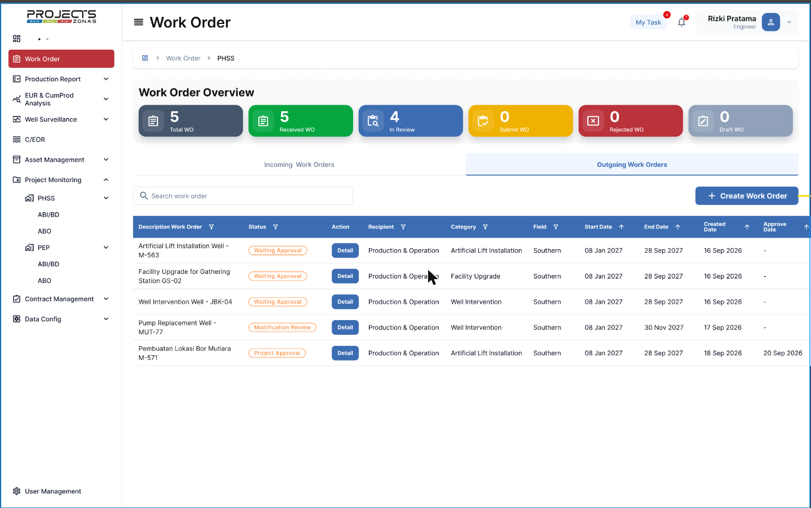

- **Endpoints:**
  - `GET /work-order/{working_area}/overview` (#1, `working_area` = `zone9` / `phss` / `pep`) gives the 6 cards: `total_wo`, `received_wo`, `in_review` (waiting for my approval), `submit_wo`, `rejected_wo`, `draft_wo` (my drafts).
  - `GET /work-order/{working_area}?flow_type=incoming|outgoing&search=&status=&recipient=&category=&field_id=&sort_column=&sort_order=&page=&page_size=` (#2) gives the table. `flow_type` is required: `outgoing` = the Outgoing tab, `incoming` = the Incoming tab (only after the Level 0 Manager approved). `search` looks in the WO number, the title and the description.
  - The "+ Create Work Order" button opens screen 2. It shows on the Outgoing tab only.
- **What the screen shows:**
  - The first column "Description Work Order" shows the WO **title** (for example "Artificial Lift Installation Well - M-563"), not the scope of work. See our review of PR #1533, point 3.
  - The filter icons are on Description, Status, Recipient, Category and Field → the `search`, `status`, `recipient`, `category` and `field_id` parameters. The sort arrows are on Start Date, End Date, Created Date and Approve Date → `sort_column` = `start_date` / `end_date` / `created_date` (default) / `approve_date`, `sort_order` = `asc` / `desc`. Built (WO-T00).

## 2. Create Work Order form

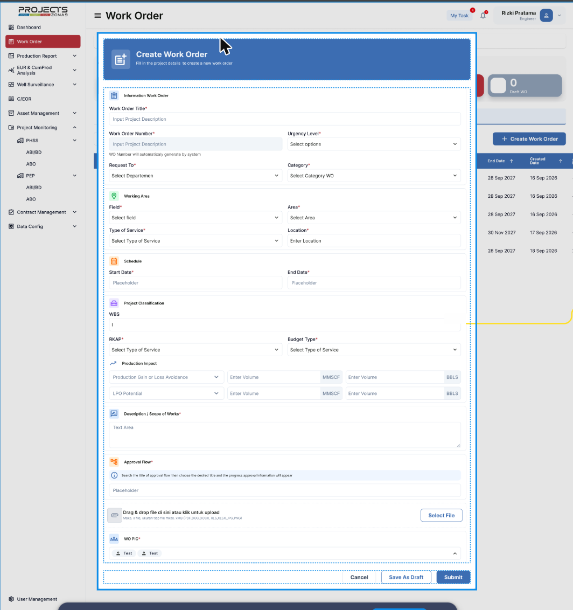

- **Endpoints:**
  - `GET /work-order/next-number` (#3) fills "Work Order Number". It is read-only, with the note "WO Number will automatically generate by system".
  - `GET /work-order/form-options` (#4) fills Request To (`request_to`), Budget Type (`budget_types`) and gives `categories_without_approval` (a category in this list needs no Approval Flow). The other lists (Category, Field / Area, Type of Service, RKAP, Production Impact) come from the existing master-data endpoints.
  - **Approval Flow field.** The Figma text says: "Search the title of approval flow then choose the desired title and the progress approval information will appear". Two calls:
    1. **Search the routes:** `GET /approval-routes?category=wo_approve_level_0&department_id={requestor department}&search={text}&status=active`. No new endpoint (#5 is this call). Since 26 Nov (TD34) the route categories are `wo_approve_level_0 / 1 / 2` and `wo_reject_level_0 / 1 / 2`, one route per department of the Level.
    2. **Show the progress after the user selects a route:** `GET /approval-routes/{id}` (this endpoint exists). For a WO route it must return, for each step:
       - Level (0) and Layer (1 Senior / Asst. Manager, 2 Manager);
       - the permission ID and the SLA;
       - the users who can approve, from the permission ID filtered by the requestor department (the `/users/by-permission/{id}?department=` logic).
    - The FE sends the selected `approval_route_id` (or `approvers[]`, which wins) with Save As Draft / Submit. At Submit, the backend copies the Level 0 steps into `work_order_approvers`. Only active users are copied. A route with no active Layer 1 user is refused (400).
  - `GET /users/by-permission/{id}?department=` (changed endpoint §3.1), or a department user list, fills "WO PIC".
  - "Save As Draft" calls `POST /work-order/draft` (#6), or `POST /work-order/draft/{id}` (#7) for a saved draft. The body is **multipart/form-data** (arrays and objects as JSON strings). The draft then shows in the Outgoing tab of its creator only, and in the "Draft WO" card.
  - "Submit" calls `POST /work-order/{working_area}` (#8), with `id` for a saved draft. Result: `waiting_approval` at Level 0 Layer 1, or `approved` at Level 1 when the category needs no approval. N1 goes to the Layer 1 approvers.
  - Files: #6 / #7 / #8 can carry the files in the same multipart body. Modify (`PUT /work-order/{working_area}/{id}`) adds a new `file` as an attachment. `POST /work-order/{working_area}/{id}/attachments` (#12; max 5 files, 10 MB each; PDF, DOC, DOCX, XLS, XLSX, JPG, PNG).
- **Note:** the form has no "Function" field. The team doc adds Function for PHSS / Sangasanga / Sangatta / Tanjung Field. The Figma needs an update.

## 3. Work Order details (target department, Level 1)

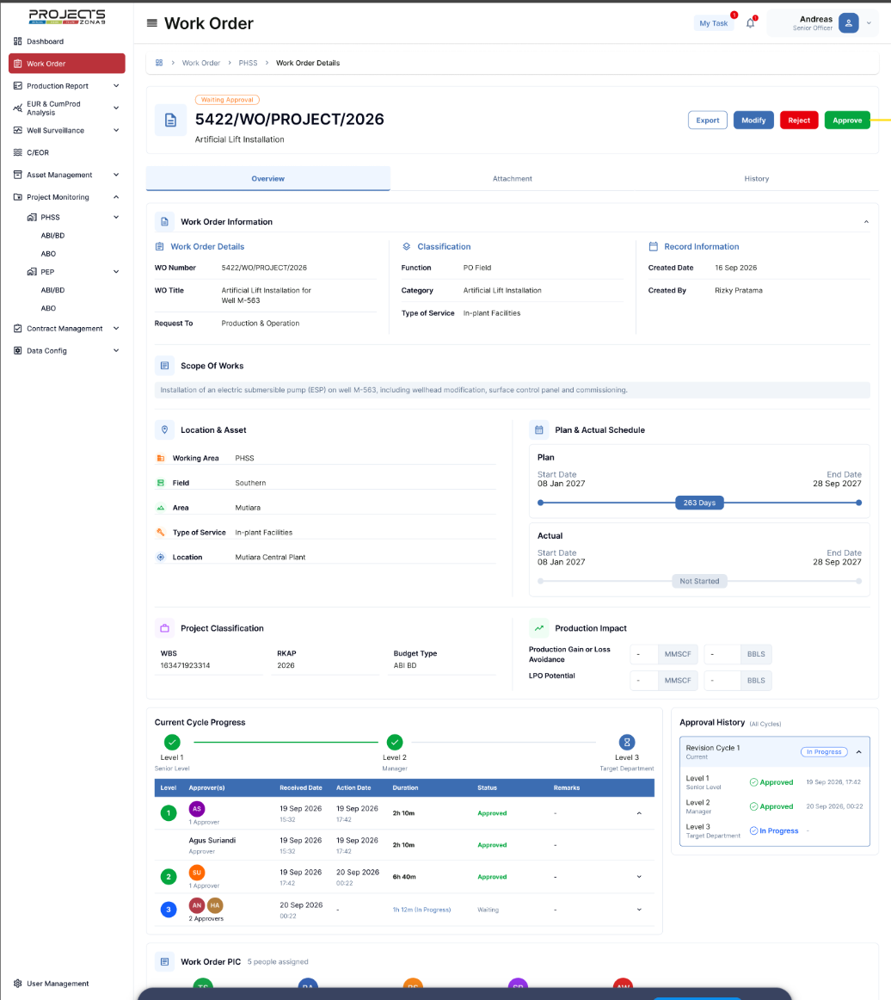

- **Endpoints:**
  - `GET /work-order/{working_area}/{id}` (#10, Notion #6) gives the Notion fields: `created_by` { id, full_name }, `working_area`, `field` / `area` { id, name }, `rkap` { id, code }, plan and actual dates with `plan_duration` / `actual_duration`, `production_impact_type` + gas / oil, `lpo_potential`, `approval_process` (levels of the current cycle + `revision_cycles`), `approval_status` (the banner), `pics` { id, full_name, position }, `attachment`, `action_plan` (Modify prefill). It also gives:
    - the header: number, title, status badge;
    - `actions` = the buttons for this user now: `approve`, `set_approval_flow`, `modify`, `reject`, ~~`modification_decision`, `rejection_decision`~~ (27 Nov, TD42: the Manager gets `approve` + `reject` in `modification_review` / `rejection_review`), `transfer`, `disposition`, `create_project`. The FE shows a button only when its action is in the list. Export = `GET /work-order/{working_area}/{id}/export` (Notion #12, a PDF file). `reject` shows for the approver of the current step (27 Nov, TD41: no reject route needed), `rejection_decision` for the Manager in `rejection_review`;
    - the Overview tab: Information, Classification, Record, Scope of Works, Location & Asset, Plan & Actual Schedule, Project Classification, Production Impact;
    - "Current Cycle Progress" = `approval_process.levels`, with the approvers for each step (Received Date, Action Date, Duration, Status, Remarks). Level numbers: Level 0 Layer 1 = 1 (Senior), Layer 2 = 2 (Manager), Level 1 = 3 (Target Department), Level 2 = 4;
    - "Approval History (All Cycles)" = `approval_process.revision_cycles`;
    - "Work Order PIC".
  - `GET /work-order/{id}/approvers?level=&layer=` (#22) gives the "2 Approvers" lists in the cycle table (default = the current step), with `full_name`, `position` and `sla_days`.
  - The buttons call `POST /work-order/{id}/approve` (#15), `PUT /work-order/{working_area}/{id}` (#17 Modify, Notion #14) and `POST /work-order/{working_area}/{id}/reject` (#18, Notion #13). Approve works on Level 0, 1 and 2.
- **Set Approval Flow (G38, built):** when the WO arrives at Level 1 (or Level 2 after a Transfer), the backend copies the newest active `wo_approve_level_1` (or `_2`) route of that department at once. Then the Senior sees Approve, Modify and Reject, as in the Figma. When the department has no such route, the detail gives `set_approval_flow`, and the Senior can still Approve. `POST /work-order/{working_area}/{id}/approval-flow` (#21, Notion #16) { `approvers`: [{ `level`, `sla_days`, `user_id[]` }] } (or { `approval_route_id` }) sets it. The Figma has no window for it yet.
- **Step labels:** the progress bar says "Level 1 Senior / Level 2 Manager / Level 3 Target Department". In our words these are Level 0 Layer 1, Level 0 Layer 2 and Level 1 Layer 1.

## 4. History tab

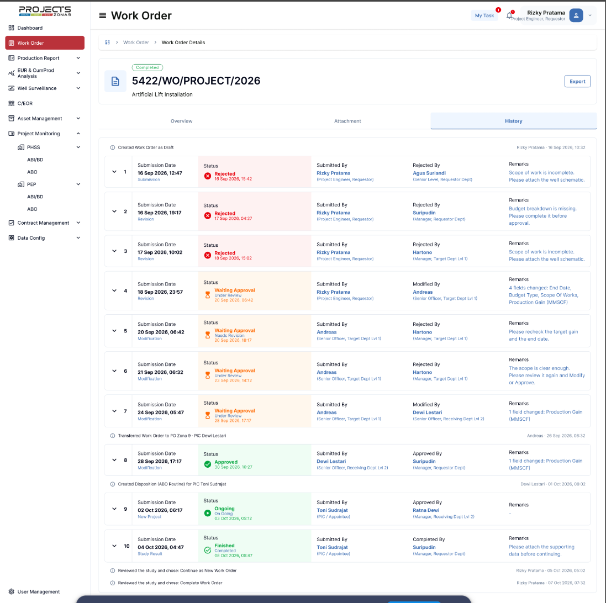

- **Endpoint:** `GET /work-order/{working_area}/{id}/histories` (#11, Notion #17): one array, oldest first, with two kinds of items. `activity` = one line (description, created_by, created_at), for example a transfer or a disposition. `submission` = an expandable row (number, `submission_type`, status / sub_status, action, action_by, remarks, `approvals[]` with received / action date and duration). Built types: `submission` and `modification`. Target-department readers do not see the Level 0 modify events. Each row has: submission date and type (Submission / Revision / Modification / New Project / Study Result), status, Submitted By, Rejected / Modified / Approved By, and Remarks. Event lines are included (draft created, transfer, disposition, study decisions).
- **Conflict with a decision:** rows 1–3 show a WO **rejected at Level 0** and then **resubmitted** ("Revision"). Our decision says a reject is final (after the reject route confirms it, TD34), and the requestor makes a new WO with a new number. There is no re-submit, so there is no "Revision" row. The Figma needs an update.

## 5. Attachment tab

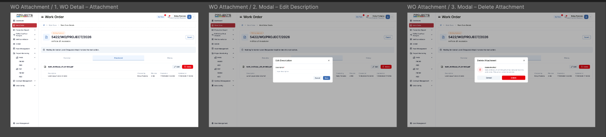

- **Endpoints:**
  - The list comes from `GET /work-order/{working_area}/{id}/attachments` (Notion #7): id, file_name, file_url, file_size, description, created_by, created_at, updated_at.
  - "Edit" (description) calls `PUT /work-order/{working_area}/{id}/attachments/{attachment_id}` (#13, Notion #8) { `description` } (mandatory, max 255).
  - "Delete" calls `DELETE /work-order/{working_area}/{id}/attachments/{attachment_id}` (#14, Notion #9) (soft delete).
  - Not on a `rejected` / `completed` WO. Who may use the buttons is checked on the FE only (TD39).
- **Not in the Figma:** the tab has no "Add file" button. Endpoint #12 (`POST /work-order/{working_area}/{id}/attachments`) is not used by the Figma; Create and Modify send the file in their own multipart body.

## 6. Reject window

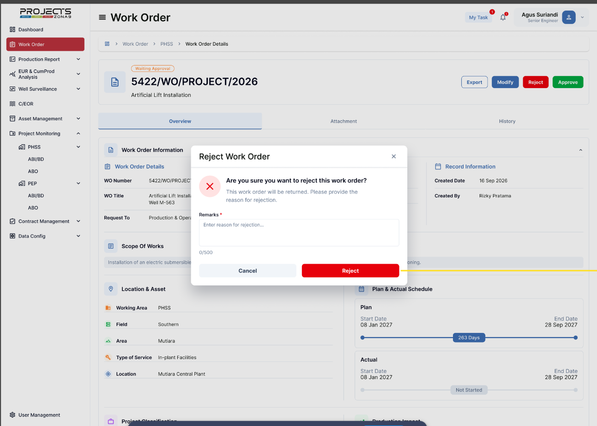

- **Endpoint:** `POST /work-order/{working_area}/{id}/reject` (#18, Notion #13) { `remarks` } (mandatory, max 500). By the Layer 1 or Layer 2 approver of the current step, on Level 0, 1 or 2.
- **What happens (27 Nov, TD41):** a Senior reject is not final: the WO goes to `rejection_review` at the Manager (next layer) of the same Level, N11 to the Manager. The banner `approval_status` shows `rejected` (the Senior, the remarks) at once. A reject by the Manager (the last layer) is decided at once (N6 / N12): at Level 0 the WO is `rejected` at Layer 0 and returned to the requestor with the same number (TD45, replaces the `draft` of TD43; detail `actions` `edit` / `submit` for the requestor, who edits and submits again); at Level 1 / 2 it is `rejected` (final, no actions). No reject route is used.
- ~~**What happens (TD34):** the reject is not final yet. The users of the Level's `wo_reject_level_N` route (department of that Level) get the WO in `rejection_review` (N11). With no route, or no active user, the result is 400 and the detail hides Reject.~~
- **The same window shape is used for the Manager's decision:** "Yes, Reject / No, Cancel" → `POST /work-order/{id}/rejection/decision` (#20) { `decision`: `confirm` | `cancel`, `remarks` }. confirm → `rejected` (final, N6 / N12). cancel → back to `waiting_approval` at the Senior ("Rejection Cancelled" notification), banner `rejection_not_accepted` (the Manager, the remarks). **27 Nov (TD42): removed; the Manager uses Approve (`POST /work-order/{id}/approve` or bulk #3) / Reject (#13).**

## 7. Transfer Work Order window

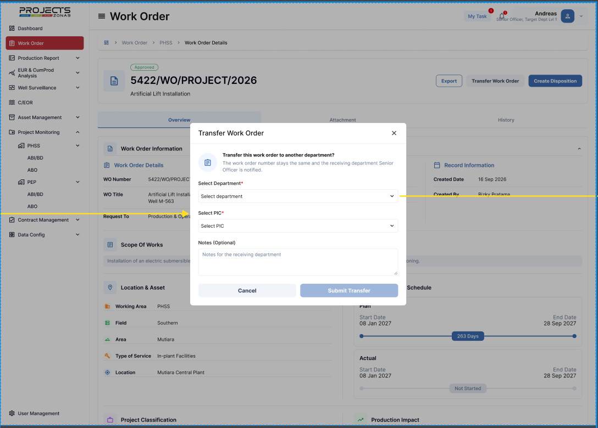

- **Endpoints:**
  - `GET /work-order/{id}/transfer-options` (#23) fills "Select Department" (`departments`) and gives `sub_units` (PE / PO / RAM / WO-WS).
  - `GET /users/by-permission/{id}?department=` fills "Select PIC" (users of the selected department).
  - "Submit Transfer" calls `POST /work-order/{working_area}/{id}/transfer` (#24, Notion #11) { `department`, `sub_unit?`, `pic_ids?`, `notes?` }. Only `approved` at Level 1, once. → `waiting_approval` at Level 2 (N13, N14).
- **Built now:** `sub_unit` and `pic_ids` are both optional until the conflict below is decided.
- **Answers an open point:** the Figma **has a PIC field, and it is mandatory**. The team doc decision does not list PIC, and it adds a sub-unit (PE / PO / RAM / WO-WS) that the Figma does not show. Decide: department + PIC + sub-unit, or department + PIC only?
- **Notes** are optional in the Figma. This agrees with the decision.

## 8. Create Disposition window

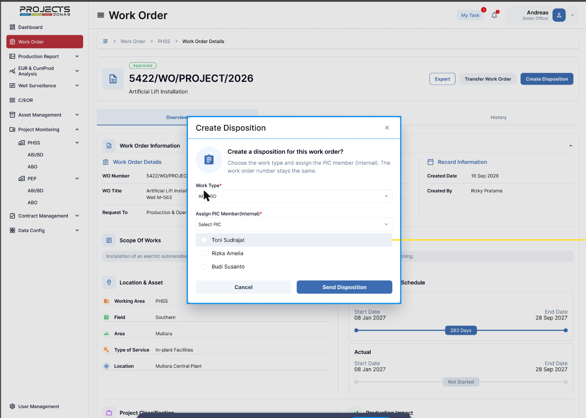

- **Endpoints:**
  - "Work Type" values: `abibd`, `abinbd`, `abo_routine`, `abo_non_routine` (config `work_order.disposition_work_types`). The rules: ABI/BD only for Projects and PO, ABI/NBD only for OSF, ABO Routine and ABO Non Routine for all departments. The backend refuses a work type that the department may not use.
  - "Assign PIC Member (Internal)" (one or more): the users of the Level department.
  - "Send Disposition" calls `POST /work-order/{working_area}/{id}/disposition` (#25, Notion #10) { `work_type`, `pic_ids[]` (min 1), `notes?` }. Only `approved` at Level 1 / 2. → `project_preparation` (N15 to the PICs and the requestor).
- **Notes:** this frame has no Notes field, but a later frame of the same flow has "Notes (Optional)", as the team doc says.

## 9. Approve confirmation window

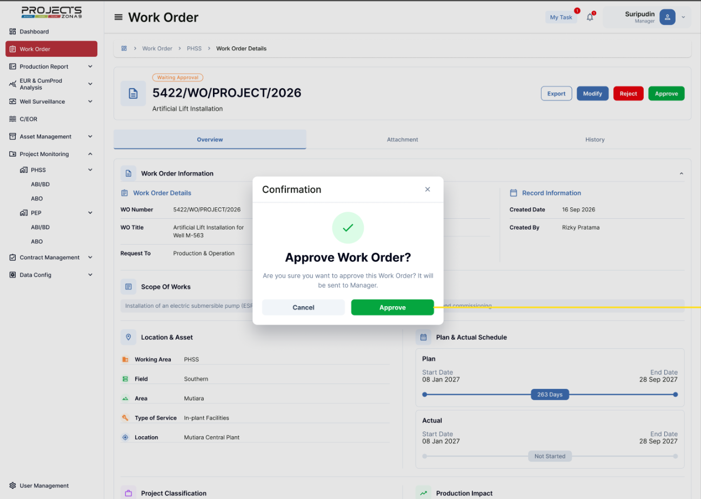

- **Where:** Details page → the green **Approve** button (top right). It shows for an approver whose step is the current one, with status Waiting Approval.
- **The window:** "Approve Work Order? Are you sure you want to approve this Work Order? It will be sent to Manager." It has Cancel and Approve buttons. There is no Remarks field.
- **Endpoint:** `POST /work-order/{id}/approve` (#15) { `remarks?` } (max 500; the window has no field, so the FE sends none). The same window is used at every step (Level 0 Layer 1 and 2, Level 1 / 2 Senior). The text changes for each step ("sent to Manager", "sent to target department", …).
- **Two users at the same moment:** the second approve gets **409** ("This work order was changed by another user at the same time; reload it and try again"). The FE reloads the detail.
- The **Reject** button on the same header opens the window in §6.

## 10. Modification Comparison window (approve or reject a change)

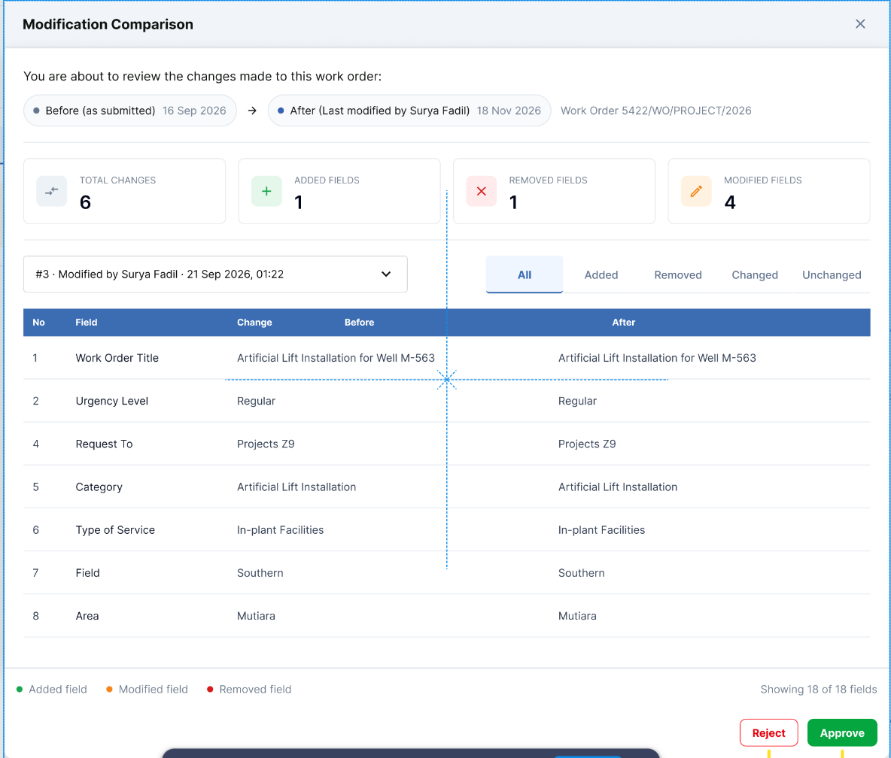

- **Where:** Details page of a WO in **Modification Review** → "View Changes". The Figma has this window for several actors: Senior Requestor, Manager Requestor, Senior Target Dept (Level 1) and Manager Target Dept (Level 1).
- **The window shows:**
  - before (as submitted) vs after (last modified by …), with the dates;
  - counts of total, added, removed and modified fields;
  - a version picker ("#3 · Modified by … · date");
  - the tabs All / Added / Removed / Changed / Unchanged;
  - the table Field / Before / After;
  - **Reject** and **Approve** buttons.
- **Endpoints:**
  - The change itself is sent by "Modify" → `PUT /work-order/{working_area}/{id}` (#17, Notion #14), multipart, the same fields as Create (no `approvers`), with `remarks?` and an optional new `file`. Level 0 Layer 1 → a proposal for the Layer 2 Manager (N5). Layer 2 → Self Modify (applied and approved). Level 1 / 2 → a proposal for the Level's Manager.
  - The data comes from `GET /work-order/{working_area}/{id}/modifications` (Notion #15): the modifications, latest first, each with `revision_number`, `modified_by`, `modified_at`, `submitted_at` and `fields[]` { field, label, before, after (display strings), `change_type`: added / removed / modified / unchanged }. The FE counts the cards from `change_type`.
  - The buttons call `POST /work-order/{id}/modification/decision` (#19) { `decision`: `approve` | `reject`, `remarks?` }: **27 Nov (TD42): removed; the Manager uses Approve (`POST /work-order/{id}/approve` or bulk #3) / Reject (#13).**
    - The **Level 0 Manager** approves the Senior's change (applied, the WO goes to Level 1), or rejects it (dropped, back to Level 0 Layer 1).
    - The **Manager of the target department** approves the Senior's change, or rejects it (the change is dropped, and the WO goes back to the Senior).
    - The **Manager of the requestor department** ("Modification OK?") approves (the change is copied into the WO, and the status becomes Approved), or rejects (the change is dropped, and the status becomes Approved with the old values).

## 11. Project Approval (Project Monitoring)

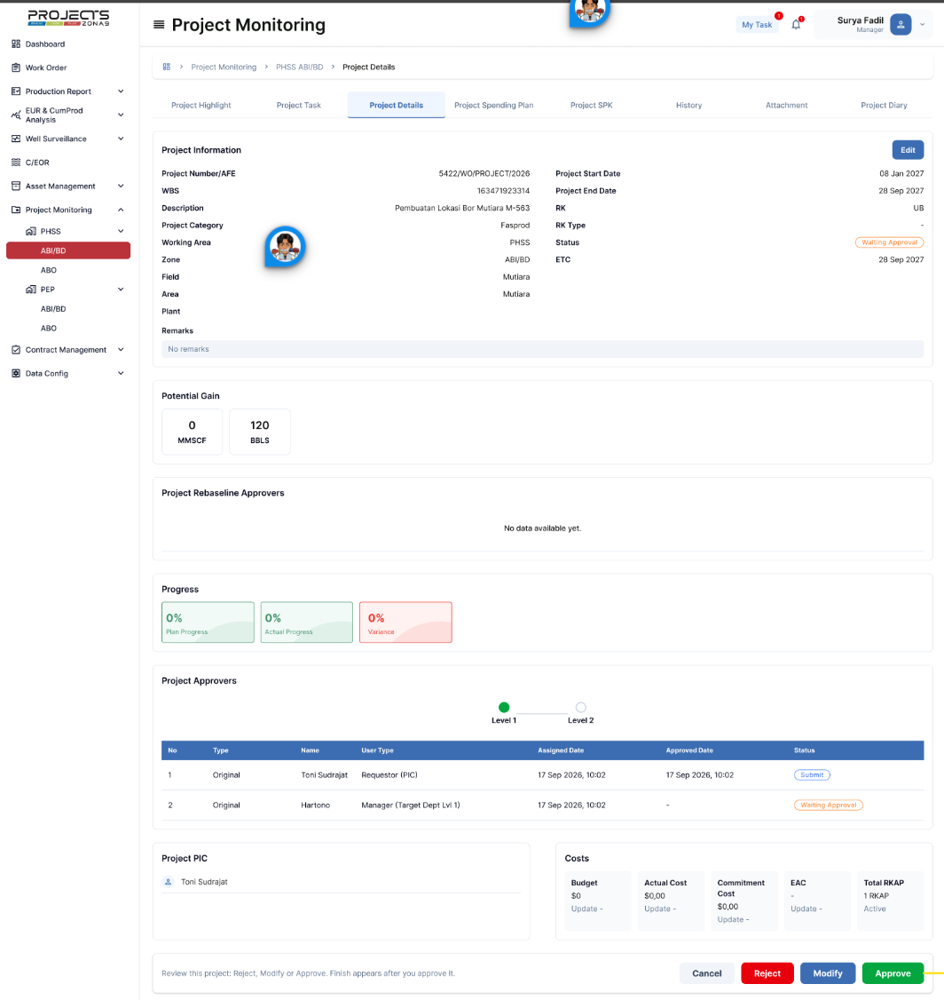

- **Where:** Project Monitoring → Project Details of the project that the PIC made from the WO. The Project Number / AFE = the WO number (5422/WO/PROJECT/2026).
- **Who:** the Manager of the target department (in the Figma: "Hartono, Manager (Target Dept Lvl 1)"). The "Project Approvers" table shows the requestor (PIC) as Submit and the Manager as Waiting Approval.
- **Buttons:** Cancel / Reject / Modify / Approve. The footer says: "Review this project: Reject, Modify or Approve. Finish appears after you approve it."
- **Endpoints:**
  - The "Create Project" form (Level 1 / 2 PIC) is filled by `GET /work-order/{id}/project-prefill` (#26): description = WO title, project number = WO number, category `other`, `work_type` from the disposition, field, area, RKAP, WBS, department, `schedule_kind` (detail / simple), PICs.
  - "Create Project" = the existing `POST /projects` with `work_order_id`. Only a disposition PIC of the WO or a user of the department of its current Level (the detail gives `create_project`); anyone else gets **403**. Allowed in `project_preparation`, `project_approval` and `on_going` (one WO, many projects). WBS is optional.
  - Submit and approval: the existing `POST /projects/submit` and `POST /projects/approval`. The WO status follows its projects: a submitted project → `project_approval`; approved (in progress) → `on_going`; returned (revise) → back to `project_preparation` when no other project is live; every live project finished → `completed`.
  - Notifications (in-app only, PR #1552): the approvers get the in-app request but **no email**. "Revise" sends N18 to the project PICs and creator. `completed` sends N19 to the requestor and the Senior Officer.
  - An Action Plan WO skips this step (not built, needs WO-T21).

## Where each approve and reject happens

| Who | Step | UI | Endpoint |
|---|---|---|---|
| Senior / Manager of the requestor department | Approve or reject the submitted WO | Details page buttons → §9 / §6 | #15 / #18 |
| Senior of the target department | Approve the WO, or ask for Modify / Reject | Details page buttons → §9 / §6 (flow copied at once; Set Approval Flow only when the department has no route) | #15 / #17 / #18 / #21 |
| Manager of the requestor department | Approve or reject a Level 0 Senior's change | §10 | #19 |
| Manager of the target department | Approve or reject a change | §10 | #19 |
| Manager of the requestor department | "Modification OK?" | §10 | #19 |
| Manager of the same Level (TD41) | Confirm or cancel a rejection ("Yes, Reject / No, Cancel") | **Not in the Figma** (one reject step only) | #20 |
| Manager of the target department | Approve or reject the WO project | §11 (Project Monitoring) | `POST /projects/approval` |

## 12. Input Parameter: the Action Plan window inside Create Work Order (simple schedule)

Figma section "Input Parameter" (node `18806-110894`), part of "Level 0 Simple Schedule › Create WO". When the requestor selects a well category (for example Request To = Sangatta Field), Create Work Order opens an **"Action Plan"** window for the well parameters. Screenshots are in `img/input-parameter/`.

| Frame | Window | Fields (`*` = required) |
|---|---|---|
| WLI Parameter | **empty (marked "On progress")** | – |
| Well Test Update | 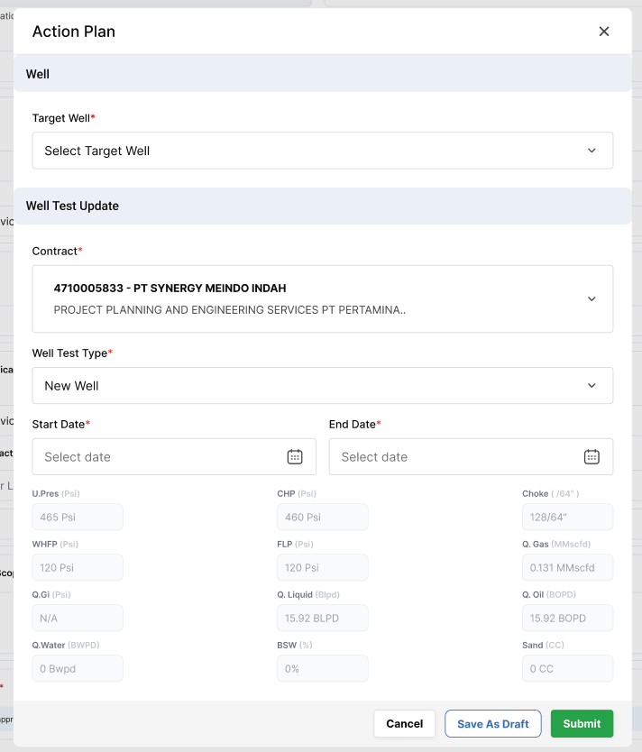 | Target Well*, Contract*, Well Test Type* (for example New Well), Start / End Date*; read-only last test values (U.Pres, CHP, Choke, WHFP, FLP, Q.Gas, Q.Gi, Q.Liquid, Q.Oil, Q.Water, BSW, Sand) |
| Artificial Lift Update | 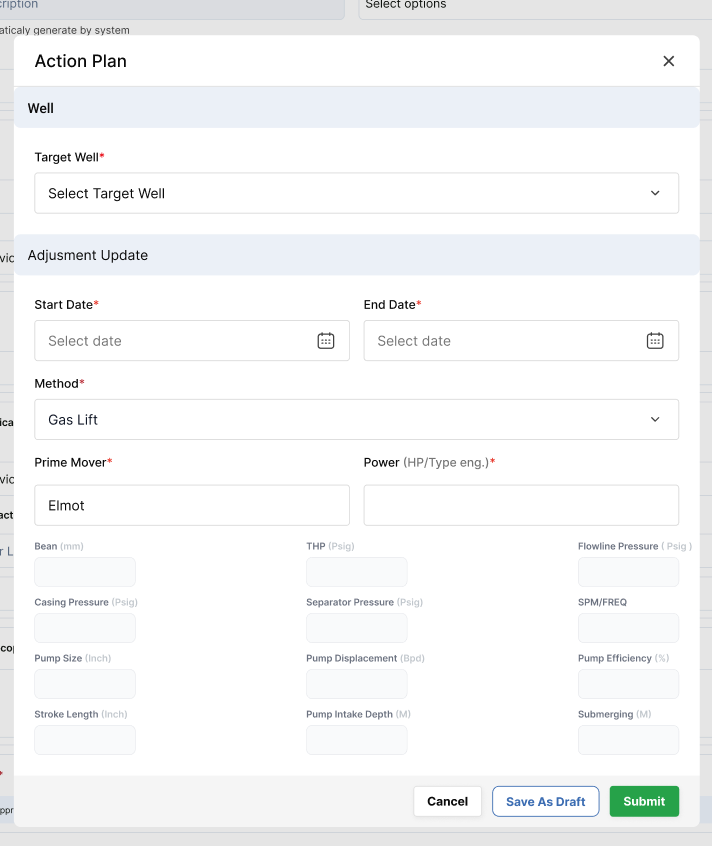 | Target Well*, Start / End Date*, Method* (Gas Lift), **Prime Mover\***, **Power\***; optional Bean, THP, Flowline Pressure, Casing Pressure, Separator Pressure, SPM/FREQ, Pump Size, Pump Displacement, Pump Efficiency, Stroke Length, Pump Intake Depth, Submerging |
| Artificial Lift Installation | 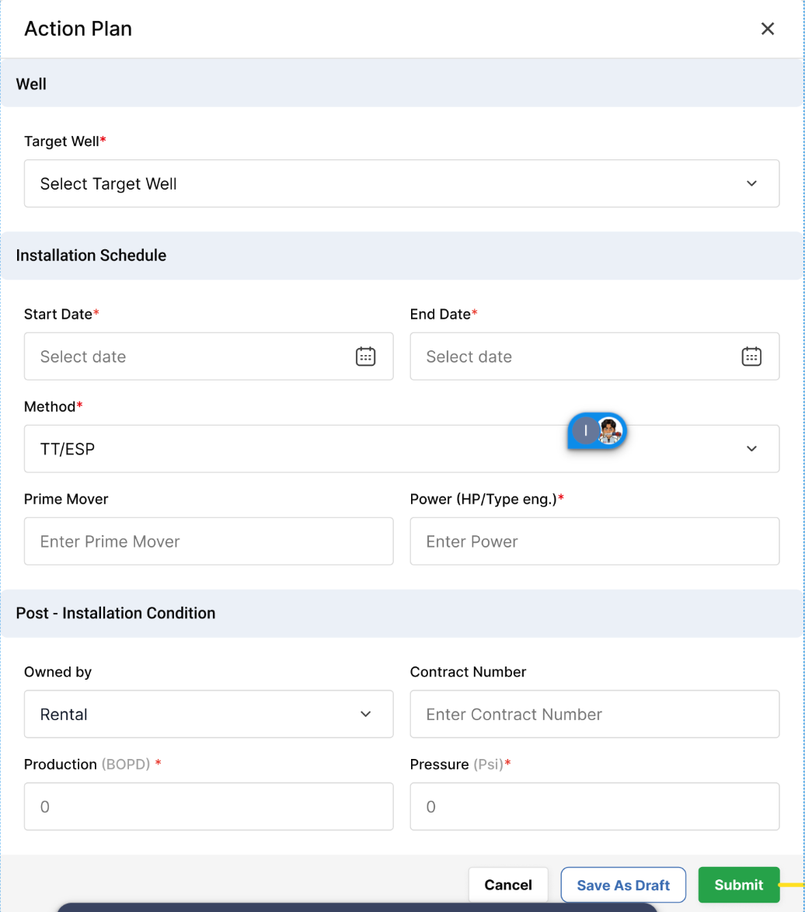 | Target Well*, Start / End Date*, Method* (TT/ESP), Prime Mover (**optional**), **Power\***; Post-Installation: Owned by (Rental), Contract Number, Production (BOPD)*, Pressure (Psi)* |
| Sonolog | 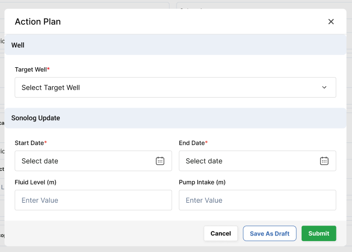 | Target Well*, Start / End Date*, Fluid Level (m), Pump Intake (m) |
| Choke Adjustment | 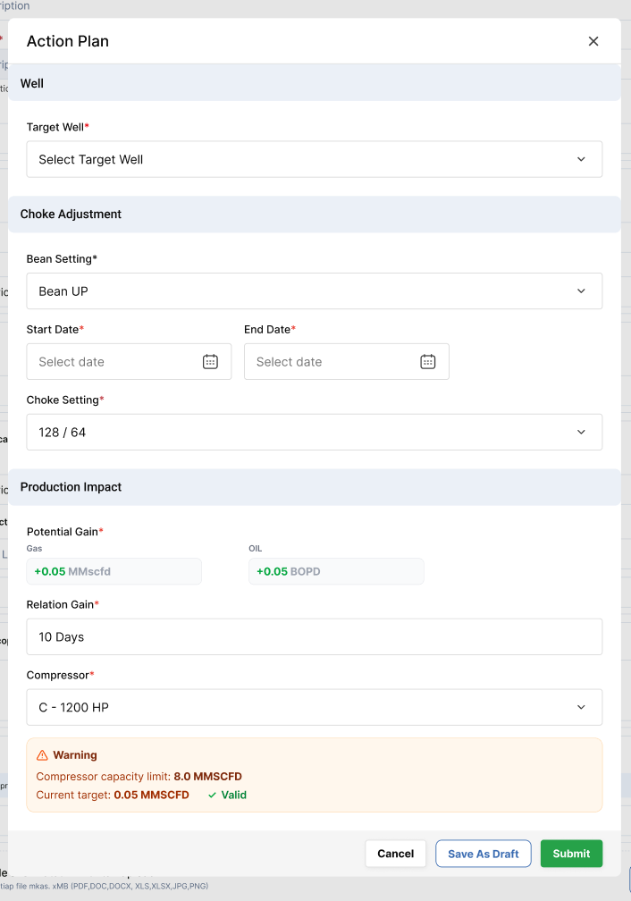 | Target Well*, Bean Setting* (Bean UP), Start / End Date*, Choke Setting* (128/64); Production Impact: Potential Gain* (Gas / Oil), Relation Gain*, Compressor*, with a compressor-capacity warning |

- **Endpoints:**
  - The window's "Submit" / "Save As Draft" send the Action Plan with the WO: `POST /work-order/draft` / `POST /work-order/{working_area}` (#6–#8) take the Action Plan keys in the multipart body. The separate AP link (`POST /well-surveilence/action-plans/{pep|phss}/submit` with `work_order_id`, one AP per WO, TD32) is **not built** (WO-T21).
  - The last well test values come from the existing well / Action Plan read endpoints.
- **Prime Mover (open question Q46):** the Figma shows it **required for Artificial Lift Update (Gas Lift)** and **optional for Artificial Lift Installation (TT/ESP)**. Power is required in both. This agrees with the proposal in Q46: required for Gas Lift, optional for SRP / ESP.
- **WLI:** the WLI parameter form is not designed yet.

---

## Endpoints with no screen in this file
| Endpoint | Why |
| --- | --- |
| #9 delete draft (`POST /work-order/{id}/delete`) | No Figma screen found. Built: own draft only, soft delete. |
| #16 bulk approve (`POST /work-order/{working_area}/approve`, Notion #3 "Approve Selected") | No bulk action in the Figma list (no checkbox column), but the FE spec has it. Built: { `ids[]` (1–100), `remarks?` } → `approved` + `failed[{ id, reason }]`. Check with FE whether it is still needed. |
| #21 Set Approval Flow (`POST /work-order/{working_area}/{id}/approval-flow`, Notion #16) | **Not in the Figma.** Built; needed only when the department has no `wo_approve_level_1 / 2` route. |
| #20 rejection decision (`POST /work-order/{id}/rejection/decision`) | **Not in the Figma.** ~~Built as the reject route round (TD34).~~ 27 Nov (TD41): the Manager of the same Level decides; cancel = banner `rejection_not_accepted` (Notion `approval_status`). **27 Nov (TD42): removed; the Manager uses Approve (`POST /work-order/{id}/approve` or bulk #3) / Reject (#13).** |
| #27 export (`GET /work-order/{working_area}/{id}/export`, Notion #12) | Built 27 Nov: a PDF (header, scope, production impact, PICs, approval steps, history). The Figma has the Export button only. |

## 13. Every endpoint and its screen (27 Nov, FE API spec)

Notion # = the number in "Work Order — API Spec (FE)". Status "Done" = on `phi-dev`; "Branch" = on `feat/PHI-2996-wo-fe-api-spec` (not merged).

| # | Notion # | Endpoint | Screen | Status |
| --- | --- | --- | --- | --- |
| 1 | 1 | `GET /work-order/{working_area}/overview` | §1 cards | Done |
| 2 | 2 | `GET /work-order/{working_area}?flow_type=…` | §1 table | Done |
| 3 | 5 | `GET /work-order/next-number` (the FE spec uses `/well-surveilence/action-plans/next-wo-number`) | §2 | Done |
| 4 | – | `GET /work-order/form-options` | §2 | Done |
| 5 | – | `GET /approval-routes?category=work_order_pep\|work_order_phss&department_id=…` (existing) | §2 Approval Flow | Done (no new endpoint) |
| 6 / 7 | – | `POST /work-order/draft`, `POST /work-order/draft/{id}` | §2 Save As Draft | Done |
| 8 | 4 | `POST /work-order/{working_area}` (multipart) | §2 Submit | Done |
| 9 | – | `POST /work-order/{id}/delete` | none | Done |
| 10 | 6 | `GET /work-order/{working_area}/{id}` (Notion fields + `actions`) | §3 | Branch |
| 11 | 17 | `GET /work-order/{working_area}/{id}/histories` (activity / submission items) | §4 | Branch |
| – | 15 | `GET /work-order/{working_area}/{id}/modifications` | §10 | Branch (new) |
| – | 7 | `GET /work-order/{working_area}/{id}/attachments` | §5 | Branch (new) |
| 12 | – | `POST /work-order/{working_area}/{id}/attachments` | none | Branch |
| 13 | 8 | `PUT /work-order/{working_area}/{id}/attachments/{attachment_id}` | §5 | Branch |
| 14 | 9 | `DELETE /work-order/{working_area}/{id}/attachments/{attachment_id}` | §5 | Branch |
| 15 | – | `POST /work-order/{id}/approve` | §9 | Done (409 on a parallel approve) |
| 16 | 3 | `POST /work-order/{working_area}/approve` { `ids` } | list "Approve Selected" | Branch |
| 17 | 14 | `PUT /work-order/{working_area}/{id}` (multipart) | §10 (the change) | Branch |
| 18 | 13 | `POST /work-order/{working_area}/{id}/reject` | §6 | Branch |
| 19 | – | `POST /work-order/{id}/modification/decision` | §10 | Done **27 Nov (TD42): removed; the Manager uses Approve (`POST /work-order/{id}/approve` or bulk #3) / Reject (#13).** |
| 20 | – | `POST /work-order/{id}/rejection/decision` | §6 (same window), not in the Figma | Done **27 Nov (TD42): removed; the Manager uses Approve (`POST /work-order/{id}/approve` or bulk #3) / Reject (#13).** |
| 21 | 16 | `POST /work-order/{working_area}/{id}/approval-flow` | not in the Figma | Branch |
| 22 | – | `GET /work-order/{id}/approvers?level=&layer=`, `GET /users/by-permission/{id}?department=` | §3, §2, §7 | Done |
| 23 | – | `GET /work-order/{id}/transfer-options` | §7 | Done |
| 24 | 11 | `POST /work-order/{working_area}/{id}/transfer` | §7 | Branch |
| 25 | 10 | `POST /work-order/{working_area}/{id}/disposition` | §8 | Branch |
| 26 | – | `GET /work-order/{id}/project-prefill` | §11 Create Project | Done |
| 27 | 12 | `GET /work-order/{working_area}/{id}/export` (PDF) | Details header | Branch (new) |
| – | – | `POST /projects` with `work_order_id`, `/projects/submit`, `/projects/approval` (existing, changed) | §11 | Done |
| – | – | `POST /well-surveilence/action-plans/{pep\|phss}/submit` with `work_order_id` | §12 | To do (WO-T21) |

---

## 14. Approval route keys and approver permissions (26 Nov)

FE question (26 Nov): are the WO approval route keys `work_order_phss` / `work_order_pep`? Which permission ID lists the approver users?

### 14.1 Route keys (category of `approval_routes`, TD38, 27 Nov)
The keys are **`work_order_pep`** and **`work_order_phss`** (changed 27 Nov; TD34 `wo_approve_level_*` / `wo_reject_level_*` is replaced).

| Category | When | Route department (`department_id`) |
|---|---|---|
| `work_order_pep` | Every Level, approve and reject, when the WO field is PEP | The department of the Level |
| `work_order_phss` | Every Level, approve and reject, when the WO field is PHSS | The department of the Level |

- The backend takes the category from the WO field (`fields.working_area`). A WO with no PEP / PHSS field gets 400 when it needs a route.
- Level 0: the requestor selects the route on the Create form (a `work_order_{pep|phss}` route of the requestor department).
- Level 1 / 2 (27 Nov, TD41: a reject uses no route): the backend takes the newest active route of that category of the Level's department.
- One department needs one active route for each working area it works in.

### 14.2 Permissions to fetch the route users
Fetch: `GET /users/by-permission/{permissionId}?department={department of the Level}`. The backend uses these IDs only to list users. It does not use them to allow or block an action (TD13). IDs 273–279 are in groups 31 "Work Order" and 32 "Work Order Approval" (`WorkOrderPermissions`). They are granted in the Retina ACL.

One approval layer (TD35, 27 Nov). The route has 1 layer, and its users have **277** (TD37). 276 is not used.

| Level | Route categories | Route layer users | `department` filter |
|---|---|---|---|
| Level 0 | `work_order_pep` / `work_order_phss` | **277** Approve | Requestor department |
| Level 1 | `work_order_pep` / `work_order_phss` | **277** Approve | Target department (Request To) |
| Level 2 | `work_order_pep` / `work_order_phss` | **277** Approve | Transfer or Disposition department |

Other user lists on the WO screens (the same endpoint):

| List | Permission | `department` filter |
|---|---|---|
| Requestor PICs (Create form, §2) | **274** Create / Submit | Requestor department |
| Disposition PICs (§8) | **275** Process | Department that does the work |
| Transfer PIC (§7, optional) | **275** Process | Department that receives the WO |
| Who can Set Approval Flow (Level 1 / 2) | **278** Set Approval Flow | Department of the Level |
| Who can Transfer (Level 1) | **279** Transfer | Target department |
| All WO readers | **273** Read | – |

Notes:
- SYSROLEs (TD36): `{Dept} - WO - Modify` (273, 274, 275), `{Dept} - WO - Approval` (273, 277, 278, 279), `{Dept} - WO - Guest` (273). The existing department roles get the same sets.
- The route admin puts 277 on the one layer of each of the 6 routes.

### 14.3 Dev users that have WO permissions (checked 27 Nov)
Source: dev DB, `mock_auth_sessions` (stage `session`) of the `phi.wo.*` users (`06` §4). Login is mock auth; the password is ignored. The permission seed `seed_work_order_permissions.sql` ran on dev on 27 Nov: 277 is now "Approve Work Order"; 276 is still in `permissions` ("Approve Work Order Layer 1").

| Username | Department | SYSROLE | WO SEQ | Use |
|---|---|---|---|---|
| `phi.wo.po.pic` | Production Operations | Production Operations - Modify - Member | 273, 274, 275 | Requestor / PIC |
| `phi.wo.po.senior` | Production Operations | Production Operations - Approval - Member | 273, 277, 278, 279 | Approver (route level 1 on dev) |
| `phi.wo.po.senior2` | Production Operations | Production Operations - Approval - Member | 273, 277, 278, 279 | Approver (`wo_reject_level_0` on dev) |
| `phi.wo.po.manager` | Production Operations | Production Operations - Approval Manager | 273, 277 | Approver (route level 2 on dev) |
| `phi.wo.osf.pic` | Operation & Surface Facilities | Operations & Surface Facilities - Modify - Member | 273, 274, 275 | Requestor / PIC |
| `phi.wo.osf.senior` | Operation & Surface Facilities | Operations & Surface Facilities - Approval - Member | 273, 277, 278, 279 | Approver (route level 1 on dev) |
| `phi.wo.osf.manager` | Operation & Surface Facilities | Operations & Surface Facilities - Approval Manager | 273, 277 | Approver (route level 2 on dev) |
| `phi.wo.osf.guest` | Operation & Surface Facilities | Operations & Surface Facilities - Read - Guest | 273 | Read only |
| `phi.wo.prj.pic` | Project | Projects - Modify - Member | 273, 274, 275 | Requestor / PIC |
| `phi.wo.prj.senior` | Project | Projects - Approval - Member | 273, 277, 278, 279 | Approver (route level 1 on dev) |
| `phi.wo.prj.manager` | Project | Projects - Approval Manager | 273, 277 | Approver (route level 2 on dev) |
| `phi.wo.sda1.pic` | Subsurface Development Area 1 | Subsurface Development Area 1 - Modify - Member | 273, 274, 275 | Requestor / PIC |
| `phi.wo.gm` | Production Operations | PO / OSF / Projects - Approval Manager | 273, 277 | Approver in 3 departments |

**Updated 27 Nov (TD37):** the 4 `Approval - Member` users now have 277 in place of 276 (`mock_auth_sessions`, 8 rows; `sql/seed_wo_test_users.sql` and `gen_wo_seed.py` changed the same way). `GET /users/by-permission/277?department=` now lists the Seniors and the Managers. Log in again to get the new ACL.

**Old dev WO routes (26 Nov, before TD38: old categories).** A route has no permission column: `approval_route_users` keeps the users (level + user). 277 only fills the user picker when the admin makes a route. The dev routes are curl-test routes with 2 levels (Senior, Manager), because the code in PR #1548 still uses 2 layers. They change to 1 level when the code moves to one layer (TD35).

| Category | Department on dev | Dev routes | Users (level) |
|---|---|---|---|
| `wo_approve_level_0` | Production Operations | 6 (curl) | `phi.wo.po.senior` (1), `phi.wo.po.manager` (2) |
| `wo_approve_level_1` | Operation & Surface Facilities | 6 (curl) | `phi.wo.osf.senior` (1), `phi.wo.osf.manager` (2) |
| `wo_approve_level_2` | Project | 6 (curl) | `phi.wo.prj.senior` (1), `phi.wo.prj.manager` (2) |
| `wo_reject_level_0` | Production Operations | 6 (curl) | `phi.wo.po.senior2` (1), `phi.wo.po.manager` (2) |
| `wo_reject_level_1` | Operation & Surface Facilities | 6 (curl) | `phi.wo.osf.manager` (1) |
| `wo_reject_level_2` | – | none | – |
| `work_order` (old, replaced by TD34) | Production Operations | 1 | the code does not read it |

**Dev WO routes for TD38 (made 27 Nov, PR #1556).** One route for each category and department. The route serves approve and reject on that Level. The users are copied from the newest old approve route of the department. The old `wo_*` routes above stay on dev, but the new code does not read them.

| Category | Department on dev | Title | Users (level) |
|---|---|---|---|
| `work_order_pep` | Production Operations | WO PO PEP (dev 27 Nov) | `phi.wo.po.senior` (1), `phi.wo.po.manager` (2) |
| `work_order_phss` | Production Operations | WO PO PHSS (dev 27 Nov) | `phi.wo.po.senior` (1), `phi.wo.po.manager` (2) |
| `work_order_pep` | Operation & Surface Facilities | WO OSF PEP (dev 27 Nov) | `phi.wo.osf.senior` (1), `phi.wo.osf.manager` (2) |
| `work_order_phss` | Operation & Surface Facilities | WO OSF PHSS (dev 27 Nov) | `phi.wo.osf.senior` (1), `phi.wo.osf.manager` (2) |
| `work_order_pep` | Project | WO Project PEP (dev 27 Nov) | `phi.wo.prj.senior` (1), `phi.wo.prj.manager` (2) |
| `work_order_phss` | Project | WO Project PHSS (dev 27 Nov) | `phi.wo.prj.senior` (1), `phi.wo.prj.manager` (2) |
