# **WORK ORDER**

Draft v0.2 · 24 Nov 2026 (v0.1: 19 Nov) · format follows "Phantom Fase 2" (team format reference) (tab Artificial Lift).

**Sources:** team doc "PRD Phantom Fase 2" (Sprint 3 SSDP, WO Lv 0 / Lv 1 / Lv 2, read 24 Nov), first draft of the Knowledge Documents, "Work Order Module (PHANTOM)" (`claude.ai/artifact/3A8M7RGwuGg1RnGYuyedah`), prototype `claude.ai/artifact/S4gBiqBpHasmfJnZKQQZMu`, Figma "PHI - Latest Design" › page Work Order (Flow Work Order V2 3/11/2026, Detail Schedule 5/11/2026, Simple Schedule 5/11/2026), current system (AL / WT Action Plan approval, PR #1476).

**Decisions applied (18–19 Nov):** D1 WO is the parent of the Action Plan · D2 approval levels come from approval routes (submit, Modify, Reject) · D3 returns go back to the reviewer, Rejected is final · D4 only Well Test + AL WHC Installation need target approval · D5 WO number `<seq>/WO/PROJECT/<year>` · C6 PRJ + OSF use detail schedule, others use simple schedule · D7 Finish may skip the result parameters · D8 bulk approve = plain Approve only.

**Decisions applied (19–24 Nov), they replace older rules above where they differ:**
- Levels: Level 0 = requestor department, Level 1 = target department (Request To), Level 2 = assigned department (only after a Transfer). Layer 1 = Senior / Asst. Manager, Layer 2 = Manager (an SOP only; the system does not check the position).
- Approval flow: the requestor selects the Level 0 flow in Create WO (Layer 1, then Layer 2 of the requestor department). The target department and the assigned department each select their own flow in the "Set Approval Flow" window.
- Approvers: each route layer holds a permission ID. Every user with that permission in the department of the Level can act. No step is skipped for a Senior requestor: another Senior reviews. The backend uses the permission ID only to list users (`GET /users/by-permission/{id}`). It does not check the permission ID to allow or block an action.
- Level 0: an approver can modify and approve in one step; the requestor gets a notification only (X2). A reject at Level 0 is final; the requestor makes a new WO with a new number (X3).
- Level 1 modify: Layer 2 Level 1 approves, then Layer 2 Level 0 checks (X4). If Level 0 declines, the system drops the proposal and the WO goes to Approved with the old values (X5).
- Level 1 reject: two confirmations, first Layer 2 Level 1, then Level 0. If Level 0 declines the rejection, the WO goes back to Layer 1 Level 1 and the Reject button is hidden (D3b, R8).
- A category with no approval skips all approval steps (R1).
- WO number format comes from `custom_configurations` (D5b; the format itself is open, Q45). The Finish parameters are required (D7b).
- Schedule type by department: simple = WLI, Field PHSS, Field PEP RAM, Field PEP PE, PO Zona, Drilling; detail = Project, OSF (TD4).
- No `.mpp` for WO projects: both schedule types are built in the app (P0). A well WO also makes a simple project; an Action Plan WO skips the project approval (P1). A flag on `projects` marks a project from a WO (F1).
- Transfer: needs a permission, department from a list for each department, sub-unit, notes optional, status back to Waiting Approval, no second transfer (TD12, TD15).
- Full list and dates: `00-Decision-Log.md`. Status chart: `12-WO-Status-Flow.md`.

Matched with MoM recap (M014, 22 Okt, 6 Nov, 19 Nov): see `05-MoM-vs-KnowledgeDocuments.md`. MoM items are tagged [MoM].

Open items are in each story's **Question** row and in `03-Major-Questions.md` (Q01–Q46). Links: `01-Links.md`.

Figma: https://www.figma.com/design/usSi3zXbPKJf1snvAFEyLl/PHI---Latest-Design?node-id=18789-49609

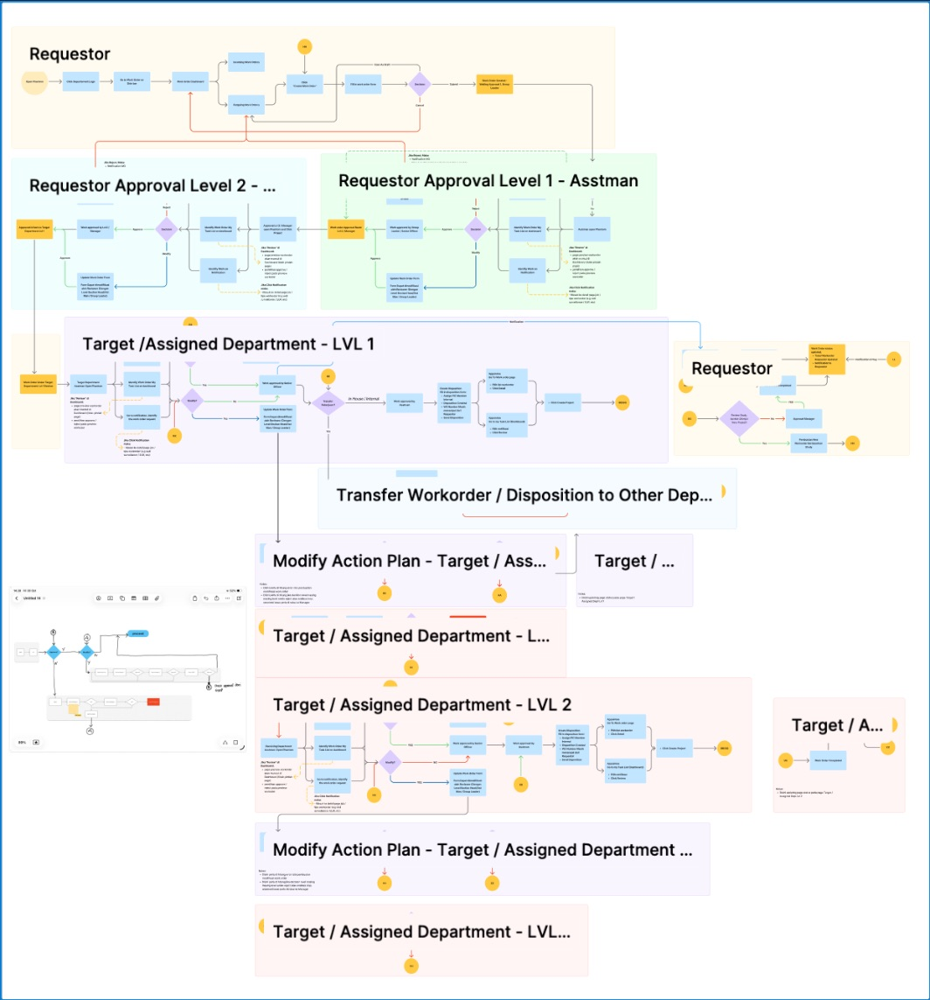

---

# **FEATURE BREAKDOWN**

| Flow | Story | Actor | Figma lane | Jira |
| :---- | :---- | :---- | :---- | :---- |
| FLOW 1 – Create & Submit | 1.1 Create / edit WO (form + cascading rules) | Requestor | Requestor | TBD |
| | 1.2 Action Plan step for well categories | Requestor | Requestor | TBD |
| | 1.3 WO number generation | System | – | TBD |
| FLOW 2 – Requestor Approval | 2.1 Layer 1 Level 0 (no skip; another Senior reviews) | Senior / Asst. Manager (permission) | Requestor Approval Lvl 1 | TBD |
| | 2.2 Approval Level 2 | Manager Requestor | Requestor Approval Lvl 2 | TBD |
| | 2.3 Requestor-side reject | Senior Level / Manager | Requestor Approval Lvl 1/2 | TBD |
| | 2.4 Bulk approve | Senior Level / Manager | – | TBD |
| | 2.5 SLA + auto-escalation by Urgency [MoM] | System | – | TBD |
| FLOW 3 – Target Review Approve | 3.1 Review and approve | Senior Officer target | Target Lvl 1 | TBD |
| | 3.2 Set Approval Flow (target / assigned dept) | Target or assigned dept user (permission) | – | TBD |
| FLOW 4 – Modify | 4.1 Modify WO / Action Plan | Senior Officer target | Modify | TBD |
| | 4.2 Modify approve (Layer 2 Level 1, then Layer 2 Level 0) | Manager target → Manager Requestor | Modify | TBD |
| | 4.3 Modify reject (return to reviewer) | Any Modify route level | Modify | TBD |
| FLOW 5 – Reject | 5.1 Target-side reject (two confirmations) | Senior Officer → Manager target → Manager Requestor | Rejection | TBD |
| FLOW 6 – Transfer / Disposition | 6.1 Transfer WO to the assigned dept (Level 2) | Level 1 user with the transfer permission | Approved | TBD |
| | 6.2 Create Disposition | Senior Officer Lvl 1/2 | Approved | TBD |
| FLOW 7 – Project / Action creation | 7.1 Create Project – detail schedule (PRJ, OSF) | PIC | Detail Schedule | TBD |
| | 7.2 Create Project / Action – simple schedule (others) | PIC | Simple Schedule | TBD |
| | 7.3 Project approval | Manager of PIC's level | Detail / Simple | TBD |
| FLOW 8 – Finish | 8.1 Finish + result parameters | PIC | All lanes (end) | TBD |
| | 8.2 Requestor checks result and updates well | Requestor | All lanes (end) | TBD |
| FLOW 9 – Screens & Notification | 9.1 WO list (Incoming / Outgoing / Waiting for me) | All | – | TBD |
| | 9.2 WO detail, History, View Changes | All | – | TBD |
| | 9.3 Notification center | All | Entry notes | TBD |

---

# **DATA ATTRIBUTES**

Status column: **New** = new column/table · **Move** = exists on the action plan today, moves to the WO (D1) · **Exists** = reuse as is · **Change** = exists, rule changes.

## **A. `work_orders` (new, parent)**

| Field | Type | Req | Rule / source | Status |
| :---- | :---- | :---- | :---- | :---- |
| id | Guid | Y | PK | New |
| work_order_number | nvarchar(30) | Y | Format from `custom_configurations` (D5b; changed 19 Nov). The format itself is open (Q45: `<seq>/WO/PROJECT/<year>` or the requester dept code of MoM 22 Okt). Unique, never changes (also after transfer / disposition). The Action Plan uses the WO number; it does not make its own (D1) | Move (from `pep_/phss_action_plan.work_order_number`) |
| title | nvarchar(200) | Y | Work Order Title | New |
| urgency_level | nvarchar(20) | Y | LOV: Regular / High Priority (19 Nov MoM: "Urgent"). Drives SLA: Regular = layer SLA from the route (e.g. 14 days), High = 2 × 24 h per layer, then the WO goes to the next layer and the system records it [MoM 19 Nov] | New |
| work_order_type | nvarchar(30) | Y | LOV: Updating Parameter / Study / New Work [MoM 19 Nov] | New |
| review_by_user_id | Guid | N | Review By | New |
| requestor_user_id | Guid | Y | Creator | New |
| requestor_department_id | Guid | Y | From the creator's department (org tree) | New |
| request_to_department_id | Guid | Y | LOV Request To (11 depts): Drilling, OSF Z9, PHSS Field, PO Z9, Project Z9, Sangasanga Field, Sangatta Field, SDA 1 Z9, SDA 2 Z9, Tanjung Field, WLI Z9. Use the same key style as `requestor_department_id` | New |
| function | nvarchar(30) | C | Required when Request To = Tanjung / Sangatta / Sangasanga (RAM / PE / Production) or PHSS Field (WO/WS / Facility Maintenance) | New |
| category | nvarchar(60) | C | LOV by Request To (+ Function). None for Drilling, SDA 1 Z9, SDA 2 Z9. "Others" for the rest | New |
| type_of_service | nvarchar(20) | Y | In-Plant / Out-Plant Facilities | New |
| working_area | nvarchar(10) | Y | PHSS / PEP | New |
| field_id, area_id | Guid | Y | Cascading (e.g. PHSS Northern, PHSS Southern); Area follows Field; changing Field clears an invalid Area | New |
| plant_id | Guid | C | Required for In-Plant | New |
| location_text | nvarchar(200) | C | Required for Out-Plant (free text) | New |
| start_date, end_date | date | Y | end ≥ start | New |
| wbs | nvarchar(max) JSON array | N | Digits only, several, no duplicates | New |
| rkap_year | int | Y | LOV 2026, 2027 | New |
| budget_type | nvarchar(20) | Y | ABI BD / ABI NBD / ABO R / ABO NR (master list open) | New |
| prod_gain_mmscf, prod_gain_bbls | decimal(18,2) | N | Production Gain or Loss Avoidance | New |
| lpo_mmscf, lpo_bbls | decimal(18,2) | N | LPO Potential | New |
| scope_of_works | nvarchar(max) | Y | Free text | New |
| requires_approval | bit | Y | From the category (see `06-WO-Category-Breakdown.md`, "Approval flow by category"). False = skip all approval steps, Level 0 too (R1, changed 20 Nov) | Move |
| schedule_kind | nvarchar(10) | Y | Set by the department, not by the user (TD4, changed 24 Nov): `detail` = Project, OSF; `simple` = WLI, Field PHSS, Field PEP RAM, Field PEP PE, PO Zona, Drilling. Fixed in code first, configurable later | New |
| status | nvarchar(30) | Y | See §C status list | Move (`approval_status`) |
| current_round | nvarchar(10) | N | submit / modify / reject | New |
| current_cycle_id | Guid | N | FK `work_order_approval_cycles` | Move |
| current_level | int | Y | Level that must act: 0 requestor, 1 target, 2 assigned (changed 24 Nov) | New |
| current_layer | int | N | Layer that must act: 1 Senior / Asst. Manager, 2 Manager | New |
| level0_route_id, level1_route_id, level2_route_id | Guid | N | Flow selected by each department: Level 0 in Create WO, Level 1 / 2 in "Set Approval Flow" (TD1, TD2) | New |
| no_reject | bit | Y | True after Level 0 declines a rejection: Layer 1 Level 1 can only Approve or Modify (D3b) | New |
| owner_department_id | Guid | Y | Target (Level 1), then the assigned dept (Level 2) after a transfer | New |
| sub_department | nvarchar(20) | C | Sub-unit selected at Transfer: PE / PO / RAM / WO-WS (TD12) | New |
| review_pic_id | Guid | N | Senior Officer who holds the review | Move |
| execution_department_id, execution_pic_id | Guid | N | Disposition PIC = execution PIC? (Q5b) | Move |
| reject_loop_count | int | Y | Default 0; reporting only (Q6c) | New |
| modification_count | int | Y | For "modification error rate" (Figma Modify note) | New |
| project_id | Guid | N | Changed 24 Nov: do not link one project here. One WO can have more than one schedule (K15, MoM 19 Nov). The link is `projects.work_order_id` (not unique) | Remove |
| submitted_at, approved_at, approved_by, rejected_at, rejected_by, completed_at, completed_by | datetime / Guid | N | Audit | Move + New |
| created_at, created_by, updated_at, updated_by, is_deleted | – | Y | Standard | New |

## **B. Child and support tables**

| Table | Key fields | Rule | Status |
| :---- | :---- | :---- | :---- |
| `pep_action_plan`, `phss_action_plan` | + `work_order_id` Guid FK | D1: Action Plan is the child. Approval columns (`approval_status`, `current_cycle_id`, `review_pic_id`, `execution_*`, `requires_approval`) move to `work_orders`. 1 WO : N plans? (Q / D1) | Change |
| `*_action_plan_well_test` | contract_number, well_test_type (`production_test` / `optimization_test`), start, end | PHI-2354 values, not the Knowledge Documents's New / Routine / Re-test | Exists |
| `*_action_plan_artificial_lift` | whc_type, compression_type, owned_by, contract_number / asset_number, cost_allocation, production ≤ compression | Prime Mover: optional for SRP (MoM M002: only stroke length + SPM are required; prime mover = SRP free text). The Figma AL Update form (Gas Lift) marks Prime Mover and Power as required (F12y, 23 Nov) — **open, Q46**. Pressure dropped | Exists |
| `*_action_plan_choke` | bean (up/down), start, end, choke_setting, relation_gain_days, compressor_id | Compressor capacity warning (BR-5) is new | Change |
| `pep_action_plan_sonolog` | start, end | PEP only today; Knowledge Documents list PHSS Field | Exists |
| `work_order_sequences` | short_name, year, last_seq | Today it counts per department short name (SDA1 / SDA2). Format from `custom_configurations` (D5b); key, padding and issue time open (Q45) | Change |
| `work_order_approval_cycles` | id, work_order_id, round (submit/modify/reject), cycle_no, path, previous_cycle_id, approval_process_id, outcome, decided_by/at, remarks, closed_at/by | Re-host of `action_plan_approval_cycles` (replace `action_plan_source` + `action_plan_id`) | Move |
| `work_order_approvers` | cycle_id, stage, level, layer, permission_id, department, user_id, received_at, due_at, acted_at, escalated_at, escalated_from_user_id | Changed 24 Nov: copied when each department sets its flow (Level 0 at submit, Level 1 / 2 at "Set Approval Flow"). Users = `GET /users/by-permission/{id}` filtered by the department of the Level. No skip for a Senior requestor. One user can be in more than one step. No permission check on actions. due_at from Urgency SLA; escalated_* set by the escalation job | Move + New cols |
| `work_order_approver_slas` | cycle_id, level, sla_days | Drives On Track / Near Due / Delayed chips | Move |
| `work_order_modifications` | cycle_id, modified_by, modified_role, level (Target / Receiving), original_snapshot, proposed_snapshot (WO + Action Plan fields), changed_fields, outcome, applied_at/by, visibility | Drives View Changes; Lvl 1 / Lvl 2 visibility rule | Move |
| `approval_routes` | category "Work Order - {Department}"; Level 0 / 1 / 2, each with Layer 1 and Layer 2; each layer holds a permission ID | Changed 24 Nov (TD3, TD11): one route category per department; people select the route by hand. Replaces `wo_{dept}_submit` / `_modify` / `_reject` | Change (new categories) |
| `work_order_transfers` | work_order_id, from_department_id, to_department_id, sub_department, notes, transferred_by/at | Only from Level 1 Approved; once (no second transfer). Needs the transfer permission. Department from a list for each department; sub-unit required; notes optional (TD12) | New |
| `work_order_pics` | work_order_id, user_id, kind (transfer / disposition), assigned_by/at | Multi PIC; must be active user of the dept | New |
| `work_order_dispositions` | work_order_id, work_type (ABI BD / ABI NBD / ABO Routine / ABO Non Routine), project_class, notes, created_by/at | Work Type by department (TD5): ABI/BD only Projects and PO; ABI/NBD only OSF; ABO Routine and ABO Non Routine for all. Work type pre-fills Project Type. Project class from category (Figma, checked 23 Nov): PRJ ABI BD → NWD → Flowline / RTWS / Gas Lift, ABI BD → Fasprod; OSF ABI NBD / ABO → Fasprod → HE / AFA / Maintenance / Inspection (budget type sets the class), ABO → Fasprod → Others / Study / Rig Inspection; WLI → Well Service / PCTGL / Workover; Fields / PO → ABO → Maintenance / Operation / Well Action / Updating Data / Well Test / Study / AL Install; Drilling → ABI BD → Drilling. Full list: `06-WO-Category-Breakdown.md` | New |
| `work_order_attachments` | work_order_id, kind (request / result / study), file_key (MinIO), file_name, size, mime, uploaded_by/at | Max 5 files, 10 MB, PDF/DOC/DOCX/XLS/XLSX/JPG/PNG | New |
| `work_order_results` | work_order_id, category, parameters JSON, finished_by/at, requestor_checked_by/at, well_updated_at, well_update_target (status_sumur / al_equipment / choke / sonolog / mtu / eur_zona) | Finish pop-up (Figma) + Requestor check; the parameters are required (D7b, changed 19 Nov). Maintenance parameters: Desc. Project / Scope, Timeline, Potential Gain, Potential LPO, Remarks. Pop-up also shows read-only project cost cards (Budget, Actual, Commitment, EAC, Total RKAP) and RKAP rows | New |
| `work_order_activity_logs` | work_order_id, occurred_at, activity, user_id, role, duration_since_prev, remarks, cycle_id, modification_id | One row per action (History tab) | New |
| `projects` | + `work_order_id` (not unique), + origin flag (`manual` / `work_order`) | Project born from a WO; one WO can have more than one project; Finish of the WO finishes all of them. A well WO also makes a simple project (P1). Project No = WO number (Figma sample, Q35). Project Details shows the WO Number [MoM 6 Nov]; Finish checks it. See `08-WO-Project-Task-Changes.md` | Change |
| `project_tasks` | wbs_code (num), level, name (desc), start, finish, predecessors (pred), plan_cost (cost), weight | Simple schedule rows → tasks without Aspose; weight from cost, fallback when cost is empty (cost weight not mandatory [MoM 6 Nov]); On Stream last (PHI-2267); input on screen or Excel upload [MoM]; no `.mpp` for WO projects, detail and simple (P0) | Change (new import path) |
| `custom_configurations` | `wo.request_to`, `wo.category.{dept}`, `wo.function`, `wo.budget_type`, `wo.work_type`, `wo.urgency`, `wo.type_of_service`, `wo.number_format`, `wo.transfer_departments.{dept}`, `wo.schedule_type` (later) | LOV store, one row per list | New rows |

## **C. Status list (changed 24 Nov)**

Status = the badge. `current_level` + `current_layer` say who must act. Chart: `12-WO-Status-Flow.md`.

| Status | Who acts (Level / Layer) | Next |
| :---- | :---- | :---- |
| draft | Requestor | waiting_approval (Level 0 / Layer 1); approved if the category has no approval (R1) |
| waiting_approval (Level 0) | Layer 1, then Layer 2 of the requestor dept | next layer, or waiting_approval at Level 1; Modify = edit and approve in one step (X2); rejected (final, X3) |
| waiting_approval (Level 1 or 2) | Layer 1 of the target / assigned dept | approved; "Set Approval Flow" first for Modify or Reject (then Approve is hidden) |
| modification_review | Layer 2 Level 1, then Layer 2 Level 0 | approved with the new values; target Manager rejects → waiting_approval (Level 1, proposal dropped); Level 0 declines → approved with the old values (X5) |
| rejection_review | Layer 2 Level 1, then Layer 2 Level 0 | rejected; target Manager "No, Cancel" → waiting_approval (Level 1); Level 0 declines → waiting_approval (Level 1) with `no_reject` (D3b) |
| approved | Layer 1 of the target dept | waiting_approval at Level 2 (Transfer, Level 1 only); project_preparation (Create Disposition) |
| rejected | – (final; new WO with a new number) | – |
| project_preparation | PIC | project_approval; on_going for an Action Plan WO (project approval skipped, P1) |
| project_approval | Project approvers (Q36 open) | on_going, project_preparation |
| on_going | PIC | completed (Finish, parameters required) |
| completed | – | – |

Removed: needs_revision as its own step, the Re-Submit of a rejected WO, the skip of Layer 1 for a Senior requestor. Study path (study review / study approval): in the Figma Requestor lane, not decided yet. Bypass by the urgent SLA: check with the team.

---- | :---- | :---- |
| draft | Requestor | waiting_approval |
| waiting_approval (submit route level n) | Senior Level / Manager Requestor | waiting_review, rejected |
| waiting_review | Senior Officer target / receiving | approved, modification_review, rejection_review |
| modification_review (route level n) | Modify route (last = Manager Requestor?) | approved, waiting_review |
| rejection_review (route level n) | Reject route | rejected, waiting_review |
| approved | Senior Officer | waiting_review (receiving, after transfer), project_preparation |
| rejected | – (final; Figma allows re-submit, Q6b) | – |
| project_preparation | PIC | project_approval |
| project_approval | Manager of PIC's level | on_going, project_preparation |
| on_going | PIC | completed |
| completed | – | – |

Removed by D3: needs_revision (mr1/mr2), "rejection not approved" banner, Re-Submit from target-side reject. Study path (sr / sa / sn): the Figma Requestor lane has it ("Review Study Apakah Dilanjut New Project?" Yes → new WO based on the study, No → Manager approval → Completed), but no screen leads into it. Out of scope until confirmed.

---

# **FLOW 1 - CREATE & SUBMIT**

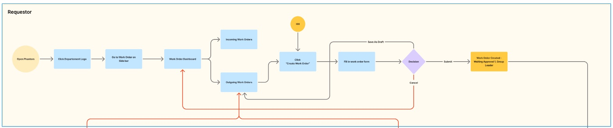

# **NID WO-1.1 [Jira TBD]**

**Work Order - Create & Submit - Requestor Create Work Order**

| Notion ID               | WO-1.1 / Create Work Order                                                                                                                                                                                                                                                                                                                                                                                                                                                                                                                                                                                                                                                                                                                                                                                                                                                                                                                                                                                                                                                                                                                                                                                                                                                                                                                                                                                                                                                                                                                                  |
| :---------------------- | :---------------------------------------------------------------------------------------------------------------------------------------------------------------------------------------------------------------------------------------------------------------------------------------------------------------------------------------------------------------------------------------------------------------------------------------------------------------------------------------------------------------------------------------------------------------------------------------------------------------------------------------------------------------------------------------------------------------------------------------------------------------------------------------------------------------------------------------------------------------------------------------------------------------------------------------------------------------------------------------------------------------------------------------------------------------------------------------------------------------------------------------------------------------------------------------------------------------------------------------------------------------------------------------------------------------------------------------------------------------------------------------------------------------------------------------------------------------------------------------------------------------------------------------------------------- |
| **Link Figma**          | https://www.figma.com/design/usSi3zXbPKJf1snvAFEyLl/PHI---Latest-Design?node-id=18789-49609                                                                                                                                                                                                                                                                                                                                                                                                                                                                                                                                                                                                                                                                                                                                                                                                                                                                                                                                                                                                                                                                                                                                                                                                                                                                                                                                                                                                                                                                 |
| **Acceptance Criteria** | **ENTRY POINT : Work Order page › Create Work Order** **Given** Requestor is on the Work Order page **When** Requestor clicks Create Work Order **Then** System shows the form with: Work Order Title, Work Order Type (Updating Parameter / Study / New Work), Urgency Level, Review By, Request To, Function, Category, Type of Service, Field, Area, Location, Start Date, End Date, WBS, RKAP, Budget Type, Production Gain or Loss Avoidance (MMSCF / BBLS), LPO Potential (MMSCF / BBLS), Scope Of Works, Approval Flow, attachments, WO PIC 1. Request To (11): Drilling, OSF Z9, PHSS Field, PO Z9, Project Z9, Sangasanga Field, Sangatta Field, SDA 1 Z9, SDA 2 Z9, Tanjung Field, WLI Z9 2. Function shows only for PHSS Field (WO/WS, Facility Maintenance) and Sangasanga / Sangatta / Tanjung Field (RAM, PE, Production) 3. Category follows Request To (+ Function). Drilling, SDA 1 Z9, SDA 2 Z9 have no Category and no Function. OSF Z9: Heavy Equipment, AFA / Modification, Maintenance, Inspection, Others. PHSS Field: Maintenance Field, Choke Adjustment, Well Test, Sonolog / BJP Update, Artificial Lift Update. PO Z9: Choke Adjustment, Artificial Lift Update, Artificial Lift Installation, Well Test. Project Z9: RTWS Installation, Gas Lift Installation, Plant Upgrading, Artificial Lift Installation, Facility Upgrade. Field RAM: Maintenance Field, Modification. Field PE: Choke Adjustment, Sonolog / BJP Update, Artificial Lift Update, Updating Well Data. WLI Z9 and Field Production: see the team doc (cut in the export) 4. Approval Flow: the requestor selects one flow from Data Config ("Work Order - {Department}"). It has only the Level 0 steps: Layer 1 (Senior / Asst. Manager), then Layer 2 (Manager) of the requestor dept. If the flow does not exist, the requestor makes it first in Approval Route (TD1, changed 24 Nov: the target-Senior step is removed) 5. Attachments: max 5 files, 10 MB each, PDF / DOC / DOCX / XLS / XLSX / JPG / PNG 6. Changing Request To / Function clears an invalid Category; changing Field clears an invalid Area 7. Location = plant for In-Plant, free text for Out-Plant 8. WBS: digits only, Enter adds, duplicates ignored, Backspace on empty removes the last **When** Requestor clicks Save as Draft **Then** WO is saved with status Draft and shows in Outgoing › Draft WO. Only the Requestor can edit or submit it **When** Requestor clicks Submit (non-well category) **Then** the system copies the Level 0 steps of the selected flow to the WO, and the WO goes to Waiting Approval at Layer 1 Level 0 (Flow 2). Every user with the layer permission in the requestor dept gets a notification **When** the category has no approval (R1) **Then** the WO skips all approval steps and goes to Approved at the target dept **When** Requestor clicks Cancel **Then** user returns to the Work Order dashboard and nothing is saved |
| **Design**              | img/q2-request-to-list.jpg, img/q2-request-to-sda.jpg                                                                                                                                                                                                                                                                                                                                                                                                                                                                                                                                                                                                                                                                                                                                                                                                                                                                                                                                                                                                                                                                                                                                                                                                                                                                                                                                                                                                                                                                                                       |
| **Negative Case**       | End Date before Start Date → "End date cannot be before start date" Required field empty → Submit disabled, field marked WBS with letters → not added Upload 6th file / > 10 MB / wrong type → "Maximum 5 files" / "file is larger than 10 MB" / "file type is not supported"                                                                                                                                                                                                                                                                                                                                                                                                                                                                                                                                                                                                                                                                                                                                                                                                                                                                                                                                                                                                                                                                                                                                                                                                                                                                      |
| **Question** | Answered 24 Nov: the route is selected by hand (Level 0 by the requestor). Answered 23 Nov: the Figma has the Drilling lane (simple schedule). Still open: what a WO to SDA 1/2 Z9 means; "Request To: Internal, Level 1, or Level 2" (MoM 19 Nov, Q05); "PIC: Predefined value" — from where? Work Order Type (Updating Parameter / Study / New Work) and Review By are not in the team doc form — keep or drop? |

# **NID WO-1.2 [Jira TBD]**

**Work Order - Create & Submit - Action Plan step (well categories)**

| Notion ID | WO-1.2 / Action Plan as WO child (D1) |
| :---- | :---- |
| **Link Figma** | https://www.figma.com/design/usSi3zXbPKJf1snvAFEyLl/PHI---Latest-Design?node-id=18789-49609 |
| **Acceptance Criteria** | **Given** Requestor picks a well category (Choke Adjustment, Well Test, Sonolog / BJP Update, AL Update, AL Installation) **When** Requestor fills the WO form **Then** Submit becomes **Next** and opens the Action Plan form: Target Well (filtered by Field and Area) + category fields: - Choke Adjustment: Bean Up/Down, Start, End, Choke Setting, Relation Gain (days), Compressor; warning when the target exceeds compressor capacity - Well Test: Contract, Well Test Type (production_test / optimization_test), Start, End; latest well test shown read-only - Sonolog / BJP Update: Start, End; fluid level + pump intake read-only - AL Update: Start, End, Method, Power, Prime Mover. For Gas Lift the Figma marks Prime Mover and Power as required; for SRP / ESP they are optional (MoM M002) — **open, Q46** - AL Installation (WHC): WHC Type, Compression Type, Owned By (Rental → Contract No. / Owned → Asset No.), Production (≤ compression), Cost Allocation (WBS) **When** Requestor clicks Submit **Then** System saves the WO and the Action Plan with `work_order_id` = the WO. Approval state lives on the WO, not on the Action Plan |
| **Design** | img/q3-senior-level-approval.jpg (AL Installation WO with Action Plan) |
| **Negative Case** | Target Well not in the selected Field / Area → cannot submit AL Installation Production > Compression Type value → blocked Required category field empty → Submit disabled |
| **Question** | Decided: the Action Plan uses the route of the WO (X12). Decided: a well WO also makes a simple project (P1). Still open: M009 "PO makes a WO to Project" — new WO or Transfer (X13)? One WO with several wells / Action Plans (Q15)? Can Well Surveillance still make a plan without a WO? Migrate ~50 dev plans that already have a WO number? Prime Mover / Power for Gas Lift (Q46) |

# **NID WO-1.3 [Jira TBD]**

**Work Order - Create & Submit - WO number**

| Notion ID | WO-1.3 / WO number (D5) |
| :---- | :---- |
| **Link Figma** | – |
| **Acceptance Criteria** | **When** a WO gets its number **Then** the format comes from `custom_configurations` (D5b), for example `<seq>/WO/PROJECT/<year>` (5422/WO/PROJECT/2026); the number is sequential from `work_order_sequences` **And** the Action Plan uses the WO number; it does not make its own number (D1) **And** the number never changes, also after Transfer, Disposition and Create Project ("Workorder Number selalu terbawa") |
| **Design** | – |
| **Negative Case** | Two submits at the same time → no duplicate number (row lock on sequence) |
| **Question** | Open (Q45): which format goes in the config — `PROJECT` or the requester dept code of MoM 22 Okt ("4 digit/WO/pemberi kerja/tahun")? Padding (5422 vs 0044)? One counter per year or per dept? Issued at draft or at submit? Migrate `{D4}/WO/{SDA1\|SDA2}/{year}` numbers? |

---

# **FLOW 2 - REQUESTOR APPROVAL**

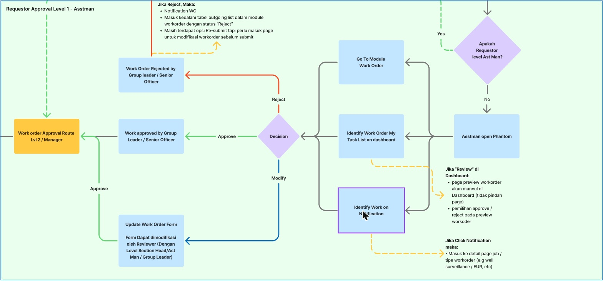

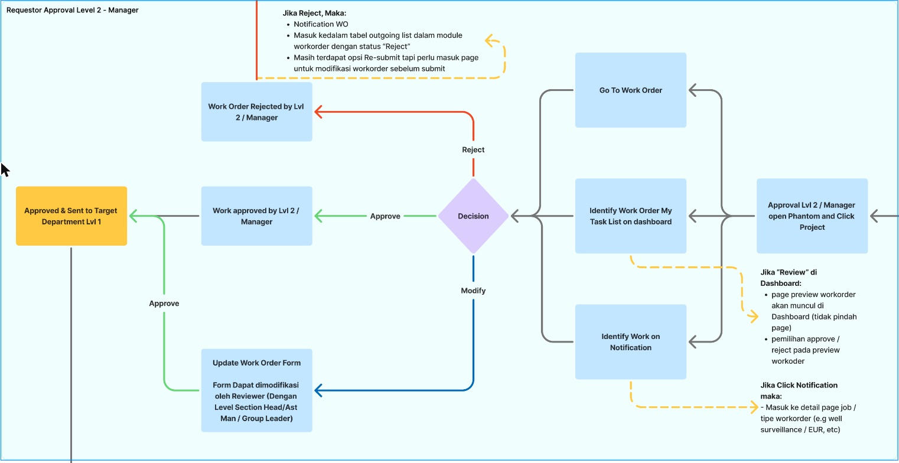

# **NID WO-2.1 [Jira TBD]**

**Work Order - Requestor Approval - Layer 1 Level 0 (Senior / Asst. Manager)**

| Notion ID | WO-2.1 / Layer 1 Level 0 |
| :---- | :---- |
| **Link Figma** | https://www.figma.com/design/usSi3zXbPKJf1snvAFEyLl/PHI---Latest-Design?node-id=18789-49609 |
| **Acceptance Criteria** | **ENTRY POINT : Notification Center / Waiting for me / Dashboard Review preview** **Given** a WO is submitted **Then** WO status = Waiting Approval at Layer 1 Level 0. Every user with the Layer 1 permission in the requestor dept can act **And** no step is skipped when the requestor is a Senior: another Senior reviews (TD8, changed 24 Nov). The system does not check the position **When** the Senior clicks Approve **Then** the WO goes to Layer 2 Level 0; Manager Requestor and Requestor are notified ("Work Order Approved at Level 1") **When** the Senior clicks Modify, edits and approves **Then** the WO changes and is approved in one step; a modification record is saved (who, role, time, before / after); the Requestor gets a notification only; the flow does not stop (X2) |
| **Design** | img/q3-senior-level-approval.jpg, img/figma-requestor-l1.jpg |
| **Negative Case** | User who is not the pending approver → read-only, "Waiting for approval by <name>" |
| **Question** | Decided: the chain is the Level 0 flow that the requestor selects (TD1). Decided: no position validator (TD3, TD8). Open: can the Level 0 flow be empty? |

# **NID WO-2.2 [Jira TBD]**

**Work Order - Requestor Approval - Layer 2 Level 0 (Manager Requestor)**

| Notion ID | WO-2.2 / Layer 2 Level 0 |
| :---- | :---- |
| **Link Figma** | https://www.figma.com/design/usSi3zXbPKJf1snvAFEyLl/PHI---Latest-Design?node-id=18789-49609 |
| **Acceptance Criteria** | **Given** WO is at Layer 2 Level 0 **When** Manager Requestor clicks Approve **Then** WO goes to Waiting Approval at Layer 1 Level 1 (target dept, Request To); every user with the Layer 1 permission in the target dept gets "Incoming Work Order Request"; the Requestor gets "Work Order Approved at Level 2" **And** the WO shows in the target's Incoming Work Orders **When** Manager clicks Modify **Then** the WO changes and is approved in one step (X2); the Requestor gets a notification only; the Senior is notified |
| **Design** | img/prd-flow-requestor-approval-l2.jpg |
| **Negative Case** | – |
| **Question** | – |

# **NID WO-2.3 [Jira TBD]**

**Work Order - Requestor Approval - Reject**

| Notion ID | WO-2.3 / Requestor-side reject |
| :---- | :---- |
| **Link Figma** | https://www.figma.com/design/usSi3zXbPKJf1snvAFEyLl/PHI---Latest-Design?node-id=18789-49609 |
| **Acceptance Criteria** | **When** Senior Level or Manager Requestor clicks Reject **Then** a reason is required (max 500 chars) and Fields to revise is optional **And** WO status = Rejected, shown in Outgoing with status "Reject"; Requestor is notified "Work Order Rejected" with the fields to revise |
| **Design** | img/figma-requestor-l1.jpg |
| **Negative Case** | Empty reason → Reject disabled; > 500 chars → blocked by counter |
| **Question** | Decided (X3): a reject at Level 0 is final. There is no Re-submit. The Requestor makes a new WO with a new number |

# **NID WO-2.4 [Jira TBD]**

**Work Order - Requestor Approval - Bulk Approve**

| Notion ID | WO-2.4 / Bulk approve (D8) |
| :---- | :---- |
| **Link Figma** | – |
| **Acceptance Criteria** | **Given** Senior Level / Manager has several WOs in Waiting For My Action **When** user selects cards and clicks Approve Selected (or Approve All) **Then** each WO moves to its next level and each party is notified **And** only WOs where the user holds a plain Approve are selectable (not modification, rejection or study approvals) |
| **Design** | – (Approve All not in design yet) |
| **Negative Case** | One WO fails (e.g. already acted by another user) → others still move; failed WO is listed with the reason |
| **Question** | G3: partial-failure message wording |

# **NID WO-2.5 [Jira TBD]**

**Work Order - Approval - SLA and auto-escalation [MoM]**

| Notion ID | WO-2.5 / Urgency SLA |
| :---- | :---- |
| **Link Figma** | – |
| **Acceptance Criteria** | **Given** a WO waits at an approval level **When** Urgency = Regular **Then** the level's due time = the route level SLA (e.g. 14 days) **When** Urgency = High Priority / Urgent **Then** the layer's due time = 2 × 24 hours [MoM 19 Nov] **When** the due time passes without action **Then** the system moves the WO to the next layer automatically, logs "Escalated" in History, and notifies the next approver and the skipped approver **And** routing chips show On Track / Near Due / Delayed from the due time |
| **Design** | – |
| **Negative Case** | Last level passes its due time → no next level: stays, chip = Delayed, notify the level's manager? |
| **Question** | Open: does the team still want this bypass (not in the team doc of 24 Nov)? Does it apply to target review, Modify and Reject too? Working days or calendar hours? What happens at the last layer? |

---

# **FLOW 3 - TARGET REVIEW APPROVE**

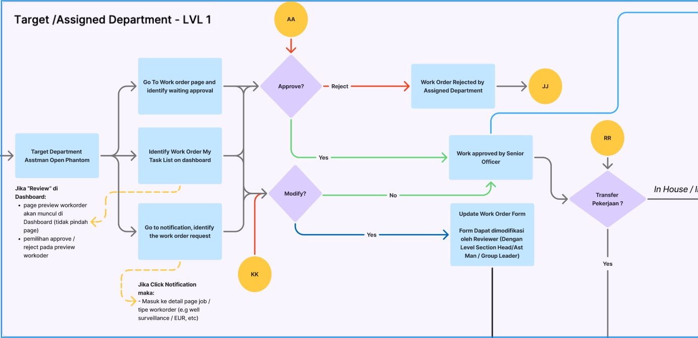

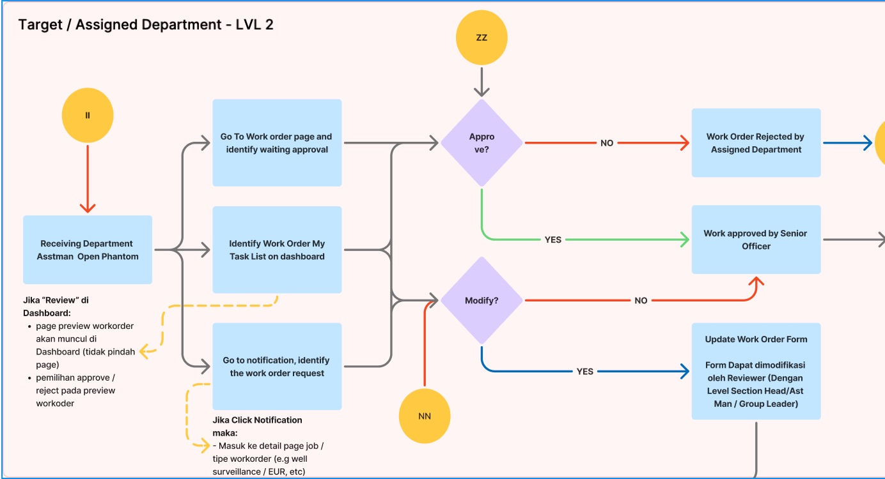

# **NID WO-3.1 [Jira TBD]**

**Work Order - Target Review - Senior Officer Approve**

| Notion ID | WO-3.1 / Target review |
| :---- | :---- |
| **Link Figma** | https://www.figma.com/design/usSi3zXbPKJf1snvAFEyLl/PHI---Latest-Design?node-id=18789-49609 |
| **Acceptance Criteria** | **ENTRY POINT : Notification Center ("Incoming Work Order Request" → Go to Work Order) / Incoming Work Orders** **Given** WO is in Waiting Approval at Layer 1 Level 1 (target dept) **When** a user with the Layer 1 permission of the target dept opens it **Then** the buttons Approve and Set Approval Flow are shown. Modify and Reject need the target dept's flow first (WO-3.2). Approve does not need a flow **When** Senior Officer clicks Approve **Then** WO status = Approved; Requestor gets "Work Order Approved by Target Department"; Transfer / Create Disposition become available (Flow 6) **And** for a well WO the Action Plan status becomes On Going and the Action Plan Details button on the well page can be clicked |
| **Design** | img/q5-approved-transfer-disposition.jpg |
| **Negative Case** | Category without approval (R1) → WO skips all approval steps and goes straight to Approved |
| **Question** | Decided 24 Nov: the pool = users with the layer permission in the target dept (`GET /users/by-permission/{id}` + department filter). Open: the permission IDs (see `09-WO-Permission-Level-Plan.md`) and the Retina role mapping |

# **NID WO-3.2 [Jira TBD]**

**Work Order - Target Review - Set Approval Flow (new 24 Nov)**

| Notion ID | WO-3.2 / Set Approval Flow |
| :---- | :---- |
| **Link Figma** | – |
| **Acceptance Criteria** | **Given** WO status = Waiting Approval at Level 1 (or Level 2 after a Transfer) **And** the user is in the department of that Level (Request To, or the assigned dept) and has the permission "set approval at level 1" **When** the user opens WO Details from the Incoming tab **or** the Outgoing tab and clicks Set Approval Flow **Then** the system shows the window Set Approval Flow with the mandatory field Approval Flow. The user searches and selects a flow from Data Config ("Work Order - {Department}") **And** the window shows the approvers of each layer of the selected flow **When** the user clicks Submit **Then** the system checks the field, saves the flow on the WO, copies the steps of that Level, and shows "Set work order approval flow succeed" **And** WO Details shows only Modify and Reject (no Approve) **When** the user clicks Cancel or Close (X) **Then** nothing is saved |
| **Design** | Team doc "PRD Phantom Fase 2", WO Lv 1 - Modal Set Approval Flow (see `01-Links.md`) |
| **Negative Case** | No flow selected → Submit blocked. User of another dept → button hidden |
| **Question** | – |

---

# **FLOW 4 - MODIFY**

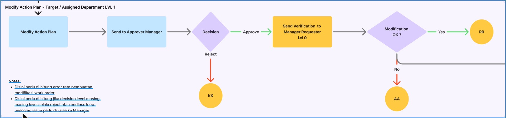

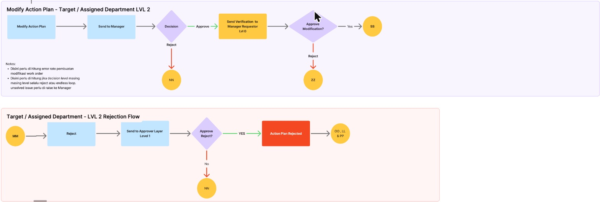

# **NID WO-4.1 [Jira TBD]**

**Work Order - Modify - Senior Officer Modify**

| Notion ID | WO-4.1 / Modify WO + Action Plan |
| :---- | :---- |
| **Link Figma** | https://www.figma.com/design/usSi3zXbPKJf1snvAFEyLl/PHI---Latest-Design?node-id=18789-49609 |
| **Acceptance Criteria** | **Given** the target dept set its flow (WO-3.2) **When** Senior Officer clicks Modify **Then** the form opens with WO fields and Action Plan fields **When** Senior Officer clicks Save Modification **Then** a modification record is saved (original + proposed snapshot, changed fields) and WO status = Modification Review at Layer 2 Level 1 **And** the WO data does not change until the last level approves **And** Requestor side sees every modification; Lvl 1 sees only Lvl 1 changes, Lvl 2 only Lvl 2 changes |
| **Design** | img/q4-modify-lane-manager-requestor.jpg |
| **Negative Case** | Save with no change → "No changes to save" |
| **Question** | – |

# **NID WO-4.2 [Jira TBD]**

**Work Order - Modify - Approve Modification**

| Notion ID | WO-4.2 / Modify approve |
| :---- | :---- |
| **Link Figma** | https://www.figma.com/design/usSi3zXbPKJf1snvAFEyLl/PHI---Latest-Design?node-id=18789-49609 |
| **Acceptance Criteria** | **When** Layer 2 Level 1 (Manager target) clicks Approve Modification **Then** WO goes to Layer 2 Level 0 (Manager Requestor, found by the layer permission in the requestor dept) to check ("Send Verification to Manager Requestor Lvl 0", X4). This also applies after a Transfer (Level 2 modified) **When** the Manager Requestor clicks "Modification OK?" = Yes **Then** the proposed snapshot is applied, WO status = Approved, Requestor + Level 1 (+ Level 2 if transferred) get "Modification Approved" **When** the Manager Requestor declines **Then** the system drops the proposal and the WO goes to Approved with the old values (X5) **And** the WO shows the banner "This work order has been modified" + View Changes |
| **Design** | img/q4-modify-lane-manager-requestor.jpg |
| **Negative Case** | – |
| **Question** | Decided: Manager Requestor checks (X4); decline = old values (X5). Open: button text names the WO, not Action Plan (Q18) |

# **NID WO-4.3 [Jira TBD]**

**Work Order - Modify - Reject Modification**

| Notion ID | WO-4.3 / Modify reject (D3) |
| :---- | :---- |
| **Link Figma** | https://www.figma.com/design/usSi3zXbPKJf1snvAFEyLl/PHI---Latest-Design?node-id=18789-49609 |
| **Acceptance Criteria** | **When** Layer 2 Level 1 (Manager target) clicks Reject Modification (reason required) **Then** the proposal is dropped, the WO returns to Waiting Approval at Layer 1 Level 1 with the old values, `reject_loop_count` + 1 **And** the Senior Officer can Approve, Modify or Reject again |
| **Design** | img/figma-modify-reject-lanes.jpg |
| **Negative Case** | Empty reason → blocked |
| **Question** | Q6c: keep loop / error-rate counters for reporting only? Escalation "raise unsolved issue to Manager" in scope? |

---

# **FLOW 5 - REJECT**

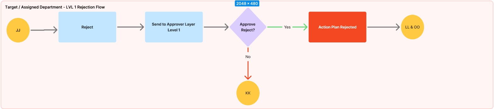

# **NID WO-5.1 [Jira TBD]**

**Work Order - Reject - Target-side Reject with approval**

| Notion ID | WO-5.1 / Target reject |
| :---- | :---- |
| **Link Figma** | https://www.figma.com/design/usSi3zXbPKJf1snvAFEyLl/PHI---Latest-Design?node-id=18789-49609 |
| **Acceptance Criteria** | **Given** the target dept set its flow (WO-3.2) **When** Senior Officer clicks Reject (reason required) **Then** WO status = Rejection Review at Layer 2 Level 1; the Manager target gets "Rejection Approval" **When** the Manager target clicks "Yes, Reject" **Then** the WO goes to Layer 2 Level 0 (Manager Requestor) to approve or refuse the rejection (D3b, R8) **When** the Manager target clicks "No, Cancel" **Then** WO returns to Waiting Approval at Layer 1 Level 1 **When** the Manager Requestor approves the rejection **Then** WO status = Rejected (final); Requestor + all levels get "Work Order Rejected" **When** the Manager Requestor refuses the rejection **Then** WO returns to Layer 1 Level 1, `no_reject` = true: the Reject button is hidden; only Approve or Modify (D3b) |
| **Design** | img/q4-reject-lane-manager-requestor.jpg, img/d3-rejection-not-approved-banner.jpg |
| **Negative Case** | Empty reason → blocked |
| **Question** | Decided: two confirmations (MoM, R8); a declined rejection hides Reject (D3b, changed 19 Nov). Open: Q17 — tell PHI that the Figma shows only one layer |

---

# **FLOW 6 - TRANSFER / DISPOSITION**

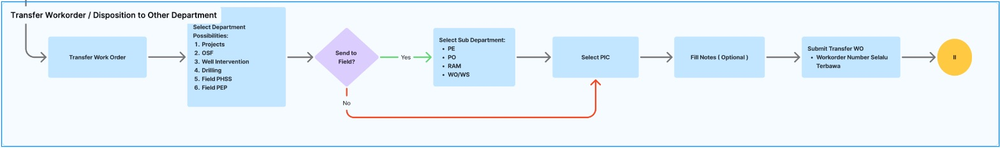

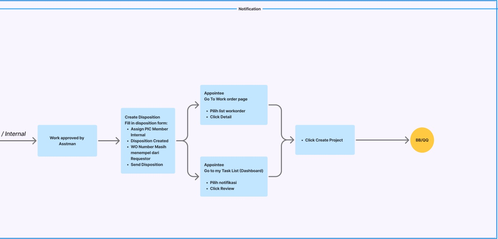

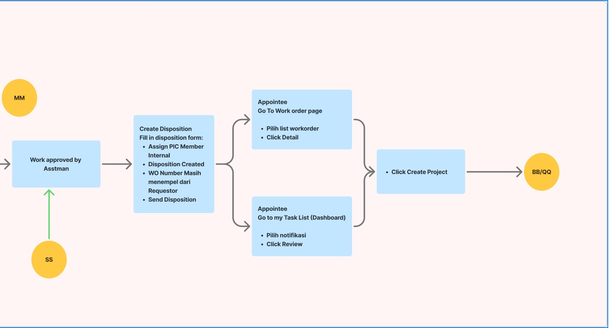

# **NID WO-6.1 [Jira TBD]**

**Work Order - Approved - Transfer Work Order**

| Notion ID | WO-6.1 / Transfer |
| :---- | :---- |
| **Link Figma** | https://www.figma.com/design/usSi3zXbPKJf1snvAFEyLl/PHI---Latest-Design?node-id=18789-49609 |
| **Acceptance Criteria** | **Given** WO is Approved at Level 1 **And** the user has the transfer permission in the target dept (TD12) **When** the user clicks Transfer Work Order **Then** dialog: Department (required; from the list for each department in `custom_configurations`), Sub-unit (PE / PO / RAM / WO-WS, required), PIC (multi; open), Notes (optional) **When** user clicks Transfer **Then** WO number stays the same; WO status = Waiting Approval at Level 2 (assigned dept) (TD15); users of the assigned dept get "Transferred Work Order"; Requestor gets "Work Order Transferred" **And** the assigned dept selects its own flow in Set Approval Flow (WO-3.2), then can Approve / Modify / Reject (Flow 3–5) **And** the assigned dept cannot transfer again; it can only make a disposition (M8) |
| **Design** | img/q5-approved-transfer-disposition.jpg |
| **Negative Case** | No department or no sub-unit → Transfer disabled; Level 2 Approved → Transfer button hidden; user without the permission → button hidden |
| **Question** | Open: Transfer allowed for Well Test and AL WHC Installation WOs (Q5a)? Is PIC still in the Transfer dialog (MoM 19 Nov: Department, PIC, Notes)? |

# **NID WO-6.2 [Jira TBD]**

**Work Order - Approved - Create Disposition**

| Notion ID | WO-6.2 / Disposition |
| :---- | :---- |
| **Link Figma** | https://www.figma.com/design/usSi3zXbPKJf1snvAFEyLl/PHI---Latest-Design?node-id=18789-49609 |
| **Acceptance Criteria** | **When** Senior Officer clicks Create Disposition **Then** dialog: Work Type (required): ABI/BD only for Projects and PO, ABI/NBD only for OSF, ABO Routine and ABO Non Routine for all departments (TD5); Assign PIC Member Internal (multi, required); Notes (optional) **When** user clicks Send Disposition **Then** WO status = Project Preparation and the button Create Project shows; PIC and Requestor get "Disposition Created"; the WO number stays ("WO Number masih menempel dari Requestor") |
| **Design** | img/q5-approved-transfer-disposition.jpg |
| **Negative Case** | No Work Type / no PIC → Send disabled; Work Type not allowed for the dept → not in the list; PIC not an active user of the dept → blocked |
| **Question** | Q5b: Disposition PIC = today's `execution_pic_id`? |

---

# **FLOW 7 - PROJECT / ACTION CREATION**

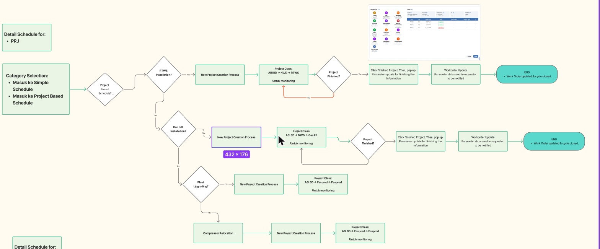

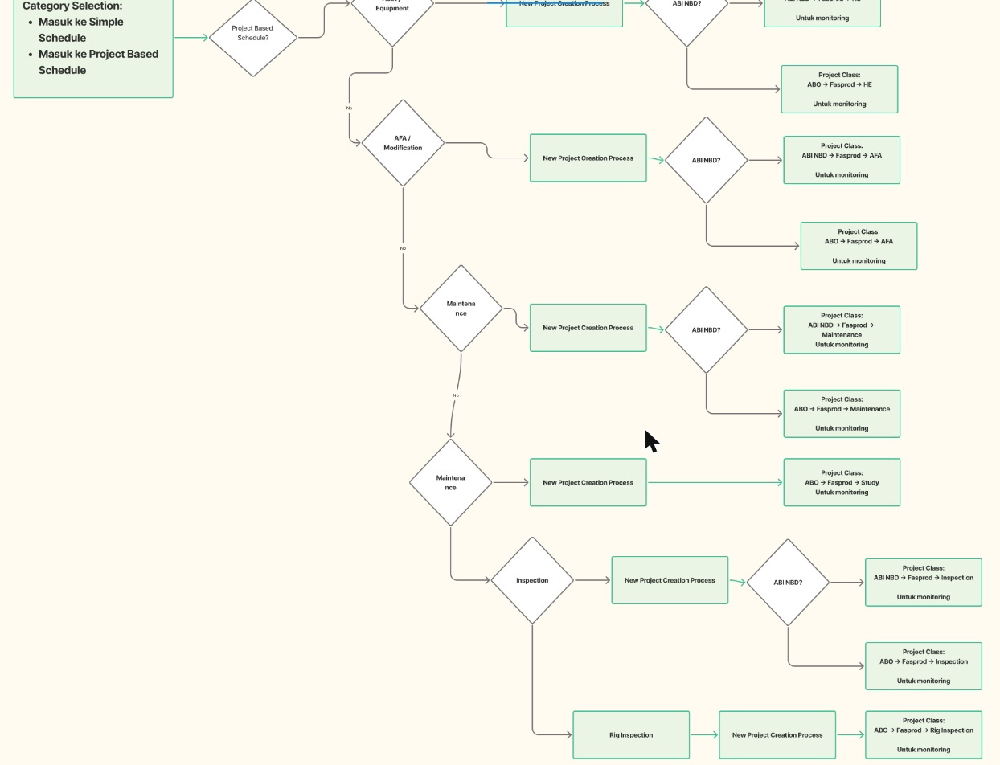

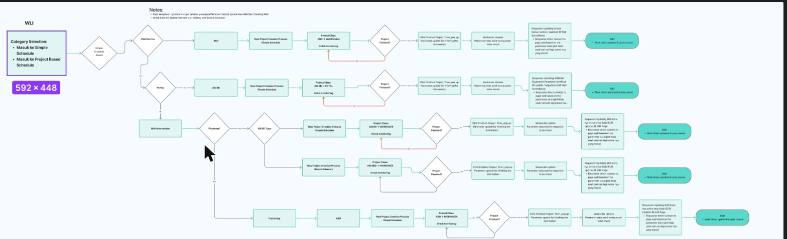

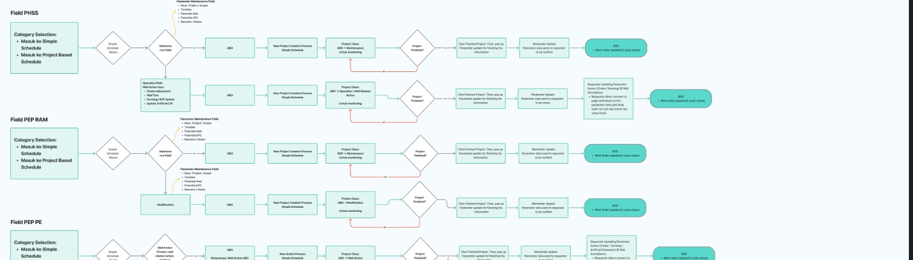

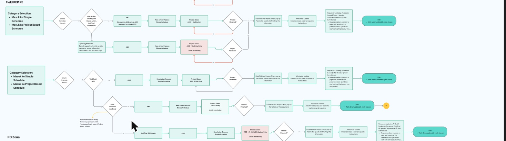

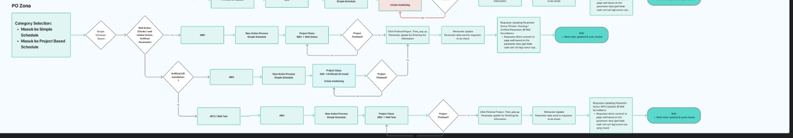

# **NID WO-7.1 [Jira TBD]**

**Work Order - Create Project - Detail Schedule (Projects Z9, OSF Z9)**

| Notion ID               | WO-7.1 / Detail schedule                                                                                                                                                                                                                                                                                                                                                                                                                                                                                                                                                                                                                                                                                                                          |
| :---------------------- | :------------------------------------------------------------------------------------------------------------------------------------------------------------------------------------------------------------------------------------------------------------------------------------------------------------------------------------------------------------------------------------------------------------------------------------------------------------------------------------------------------------------------------------------------------------------------------------------------------------------------------------------------------------------------------------------------------------------------------------------------ |
| **Link Figma**          | https://www.figma.com/design/usSi3zXbPKJf1snvAFEyLl/PHI---Latest-Design?node-id=18789-49609                                                                                                                                                                                                                                                                                                                                                                                                                                                                                                                                                                                                                                                       |
| **Acceptance Criteria** | **ENTRY POINT : Work Order page / Task List › WO › Create Project** **Given** WO is in Project Preparation and the department is Project or OSF (`schedule_kind` = detail) **When** PIC clicks Create Project **Then** the project form opens with Project Type pre-filled from Work Type; fields: Description, Project Number / AFE, Category, Sub-Category, Rig Type, Working Area → Field → Area → Plant, Start / End, WBS, RK year + RK Type, Estimation Cost, Potential Gain, LPO, Remarks, Project PIC; completion % shown **When** PIC clicks Submit **Then** the PIC builds the detail schedule in the app (grid or Excel upload); there is no `.mpp` for a WO project (P0, changed 20 Nov). The project gets `projects.work_order_id` = the WO and origin = `work_order`; WO status = Project Approval |
| **Design**              | img/prd-flow-detail-schedule-prj.jpg, img/prd-flow-detail-schedule-osf.jpg                                                                                                                                                                                                                                                                                                                                                                                                                                                                                                                                                                                                                                                                        |
| **Negative Case**       | Wrong Excel template → rejected; WBS already used by a live project → blocked                                                                                                                                                                                                                                                                                                                                                                                                                                                                                                                                                                                                                                                                          |
| **Question**            | I4: several WO WBS values → one project WBS? Sub-Category DLC/GL/FL/RTWS vs DLC/Non-DLC. F2: add Compressor Relocation category?                                                                                                                                                                                                                                                                                                                                                                                                                                                                                                                                                                                                                  |

# **NID WO-7.2 [Jira TBD]**

**Work Order - Create Project - Simple Schedule (all other departments)**

| Notion ID               | WO-7.2 / Simple schedule                                                                                                                                                                                                                                                                                                                                                                                                                                                                                                                                                                                                                                                                                                                                                                                                                                                  |
| :---------------------- | :------------------------------------------------------------------------------------------------------------------------------------------------------------------------------------------------------------------------------------------------------------------------------------------------------------------------------------------------------------------------------------------------------------------------------------------------------------------------------------------------------------------------------------------------------------------------------------------------------------------------------------------------------------------------------------------------------------------------------------------------------------------------------------------------------------------------------------------------------------------------ |
| **Link Figma**          | https://www.figma.com/design/usSi3zXbPKJf1snvAFEyLl/PHI---Latest-Design?node-id=18789-49609                                                                                                                                                                                                                                                                                                                                                                                                                                                                                                                                                                                                                                                                                                                                                                               |
| **Acceptance Criteria** | **Given** `schedule_kind` = simple (WLI, Field PHSS, Field PEP RAM, Field PEP PE, PO Zona, Drilling) **When** PIC fills the project form and clicks Next **Then** step 2 lets the PIC build the schedule on screen **or** upload an Excel file [MoM 6 Nov]; the task grid: No (1, 1.1 …), Task, Start, End, Predecessor, Cost (Rp or % of WBS budget) 1. Two levels (parent, sub-task); row 1 = project, spans earliest start → latest end 2. On Stream is required and always the last row 3. Predecessor MS-Project style: `2`, `2FS+3d`, `3SS`, `4FF-1d`; empty = FS after previous; working days Mon–Fri 4. Dates are manual; system shows "Earliest start …" / "Earliest end …" 5. Parent dates and cost roll up from sub-tasks; Rp ↔ % are derived; cost is optional (weight falls back when empty) **When** PIC clicks Submit **Then** backend converts rows to `project_tasks` (no Aspose), weight from cost, On Stream date per PHI-2267; WO status = Project Approval **And** a well WO (Action Plan) also makes this simple project, because SPK and contract need a project; it skips the project approval and goes to On Going (P1) |
| **Design**              | img/prd-flow-simple-schedule-wli.jpg, -phss-pep-ram.jpg, -pep-pe.jpg, -po-zona.jpg                                                                                                                                                                                                                                                                                                                                                                                                                                                                                                                                                                                                                                                                                                                                                                                        |
| **Negative Case**       | Unknown task / self link / link to own parent or child / circular predecessor / end before start → row error No On Stream row or not last → Submit blocked                                                                                                                                                                                                                                                                                                                                                                                                                                                                                                                                                                                                                                                                                                             |
| **Question** | Decided: no `.mpp`, Excel / grid for both (P0); a well WO also makes a simple project (P1). Open: Gantt / S-curve / weight rules [MoM 6 Nov]; working days or calendar days (Q33); AL Installation via PO simple (Figma) or Projects Z9 (prototype)? Backend owner for the new import?                                                                                                                                                                                                                                                                                                                                                                                                                                                                                                                                                                                                                                   |

# **NID WO-7.3 [Jira TBD]**

**Work Order - Create Project - Project Approval**

| Notion ID | WO-7.3 / Project approval |
| :---- | :---- |
| **Link Figma** | https://www.figma.com/design/usSi3zXbPKJf1snvAFEyLl/PHI---Latest-Design?node-id=18789-49609 |
| **Acceptance Criteria** | **ENTRY POINT : Project Monitoring › Project Approval Summary › Project Details** **When** the project is submitted **Then** it goes to the project approvers (proposal: the Manager of the PIC's Level, Level 1 or Level 2; open, Q36); they get "New Project Approval" **And** an Action Plan WO skips this step (P1) **When** manager approves **Then** project = On Going, WO = On Going, PIC gets "Project Approved" **And** Project Details shows the Work Order Number with a link to the WO [MoM 6 Nov] **When** manager revises / rejects **Then** WO returns to Project Preparation with the reason; PIC is notified |
| **Design** | – |
| **Negative Case** | – |
| **Question** | I4: today project approval is approve / revise only (revise → draft); add Modify? I5: suppress project approval email for WO projects? |

---

# **FLOW 8 - FINISH**

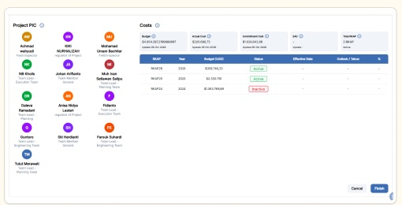

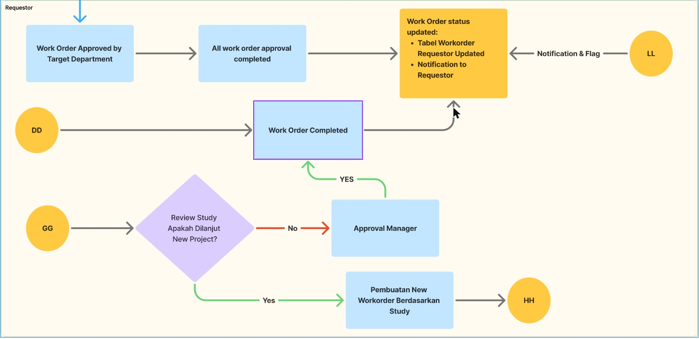

# **NID WO-8.1 [Jira TBD]**

**Work Order - Finish - PIC Finish Project**

| Notion ID | WO-8.1 / Finish |
| :---- | :---- |
| **Link Figma** | https://www.figma.com/design/usSi3zXbPKJf1snvAFEyLl/PHI---Latest-Design?node-id=18789-49609 |
| **Acceptance Criteria** | **Given** project / action is On Going **When** PIC clicks Finished Project **Then** the system checks the project has a Work Order Number [MoM 6 Nov]; if yes, pop-up "Parameter update for finishing the information" opens with the category's result fields (Choke Adjustment Result, Well Test Result, Post-Installation Result) or study document upload (Plant Performance Study). MoM examples: RTWS = time parameter, Gas Lift = Gas Lift schedule, Fast Prod = time / schedule **When** PIC confirms "Yes, Project Finished" **Then** result is saved in `work_order_results`, WO = Completed (or waits for Requestor check, see Question), Requestor and Senior Officer get "Work Order Completed" **And** the parameters are required (D7b, changed 19 Nov) **And** Finish of the WO finishes all schedules (projects) under it [MoM 19 Nov] |
| **Design** | img/prd-flow-finish-parameter-popup.jpg, img/prd-flow-requestor-finish.jpg |
| **Negative Case** | Non-PIC user → Finish hidden |
| **Question** | Decided: parameters required (D7b). Open: which Finish fields for each category (Q44) |

# **NID WO-8.2 [Jira TBD]**

**Work Order - Finish - Requestor checks and updates well**

| Notion ID | WO-8.2 / Requestor follow-up |
| :---- | :---- |
| **Link Figma** | https://www.figma.com/design/usSi3zXbPKJf1snvAFEyLl/PHI---Latest-Design?node-id=18789-49609 |
| **Acceptance Criteria** | **ENTRY POINT : Notification "Work Order Completed" → Go to Work Order** **Given** PIC finished a well WO **When** Requestor opens the notification **Then** Requestor sees the result parameters and a link to the well page (Well Surveillance / EUR Page) **When** Requestor updates the well parameter (Choke / Sonolog / AL Parameter / MTU / EUR Zona) **Then** `requestor_checked_at` / `well_updated_at` is set and the WO cycle is closed ("Work Order updated & cycle closed") |
| **Design** | img/prd-flow-finish-parameter-popup.jpg, img/prd-flow-requestor-finish.jpg |
| **Negative Case** | – |
| **Question** | Open (Q43): is this step in scope? Does the WO stay open until the Requestor updates the well, or close at Finish? (M014: the receiver sends a verification to the requestor; 6 Nov: notification "WO selesai" at Finish) |

---

# **FLOW 9 - SCREENS & NOTIFICATION**

# **NID WO-9.1 [Jira TBD]**

**Work Order - List - Incoming / Outgoing**

| Notion ID | WO-9.1 / WO list |
| :---- | :---- |
| **Link Figma** | https://www.figma.com/design/usSi3zXbPKJf1snvAFEyLl/PHI---Latest-Design?node-id=18789-49609 |
| **Acceptance Criteria** | **When** user opens the Work Order page **Then** 6 summary cards: Total WO, Received WO, In Review, Submit WO, Rejected WO, Draft WO **And** tabs Incoming Work Order / Outgoing Work Order; the selected tab has a blue bottom line and a light blue background **And** "Search work order" filters the table while the user types or on Enter **And** "+ Create Work Order" shows only on the Outgoing tab **And** the table has 11 columns: Description (filter), Status (filter), Action ("Detail"), Recipient (filter), Category (filter), Field (filter), Start Date (sort), End Date (sort), Created Date (sort), Approve Date (sort; "-" when empty), Remarks ("-" when empty) **And** (prototype) task tiles (Waiting for me, Completed WO, On going elsewhere) and Waiting For My Action cards — not in the team doc; keep or drop is open **And** Export the open WO to CSV (Section, Field, Value) |
| **Design** | Figma Overview Work Order (node 18806-94201, see `01-Links.md`) |
| **Negative Case** | Empty → "No work order yet" / "No task is waiting for you" |
| **Question** | The team doc says the same overview for every Level (the Lv 2 overview is a copy of Lv 0). Open: Q1 final layout Unified vs SSDP ⇄ PO board? Does the requestor story "entitas PHSS" mean one page for each working area? |

# **NID WO-9.2 [Jira TBD]**

**Work Order - Detail - Overview, History, View Changes**

| Notion ID | WO-9.2 / WO detail |
| :---- | :---- |
| **Link Figma** | https://www.figma.com/design/usSi3zXbPKJf1snvAFEyLl/PHI---Latest-Design?node-id=18789-49609 |
| **Acceptance Criteria** | **When** user opens a WO **Then** tabs Overview / Attachment / History. Overview blocks: Header (no., title, status chip, urgency, owner actions), Banners (Rejected by…, Modified + View Changes), Work Order Information, Scope Of Works, Location & Asset, Plan & Actual Schedule, Project Classification, Production Impact, Action Plan / Result, Record Information, Work Order PIC, Current Cycle Progress, Approval History, Disposition & New Project **When** user clicks View Changes **Then** Before vs After with tiles (Total / Added / Removed / Modified) and tabs All / Added / Removed / Changed / Unchanged, grouped by section incl. Action Plan fields **And** History rows: Date & Time, Activity, User + role, Duration, Remarks **And** Current Cycle Progress shows the steps of the flows that each department selected (Level 0, Level 1, Level 2), like Project Approval [MoM 19 Nov] **And** every department can view the WO (except sensitive data); Create / Modify / Reject buttons show only for the owning department [MoM 22 Okt] |
| **Design** | – |
| **Negative Case** | Lvl 1 user opens a Lvl 2 modification → not visible |
| **Question** | – |

# **NID WO-9.3 [Jira TBD]**

**Work Order - Notification Center**

| Notion ID | WO-9.3 / Notifications |
| :---- | :---- |
| **Link Figma** | – |
| **Acceptance Criteria** | **When** any transition happens **Then** in-app notification: title, "Work Order Number [No. WO] …", time WITA dd/mm/yyyy hh:mm, CTA Go to Work Order (Go to Project for project events). Recipients = the next route level + the parties in the Knowledge Documents §6 table **When** user clicks the banner **Then** user lands on the WO detail (or the well / EUR page for the Requestor follow-up) |
| **Design** | – |
| **Negative Case** | – |
| **Question** | I5: map to existing `phantom_iac_*` templates or new `wo_*` templates? |
