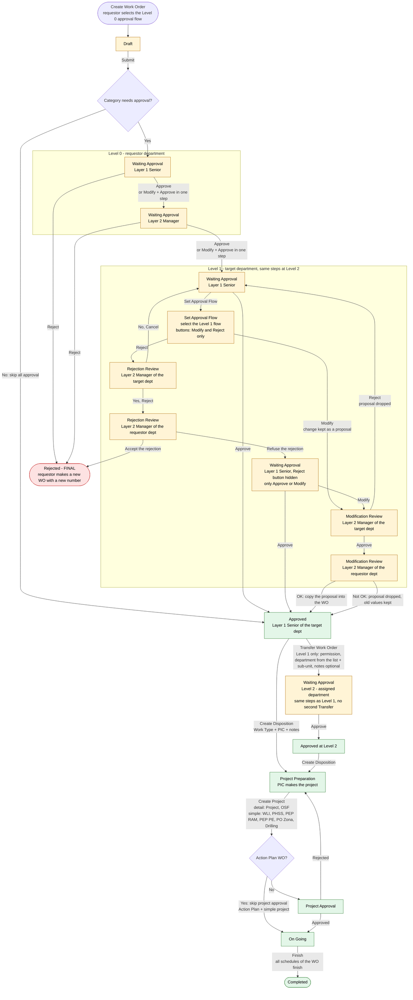
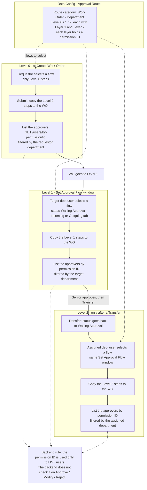
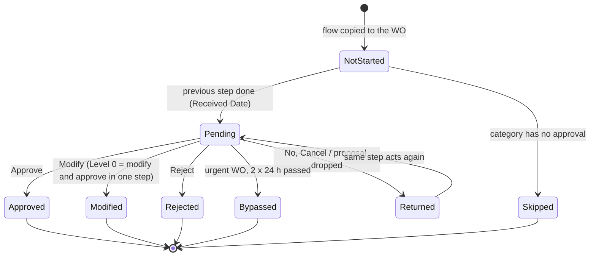

# Work Order: status flow and approval route flow

Made on 24 Nov from the decisions in `00-Decision-Log.md` and `11-TeamDoc-Decisions-24Nov.md`.

Words:
- **Level 0** = requestor department.
- **Level 1** = target department (Request To).
- **Level 2** = assigned department (only after a Transfer).
- **Layer 1** = Senior / Asst. Manager. **Layer 2** = Manager. The system does not check the position. Every user who has the permission of the layer, in the department of the Level, can act.

Not in these charts:
- The Study flow (study review / study approval).
- The urgent rule: 2 × 24 h per layer, then the WO goes to the next layer.

---

## 1. Work Order status flow

**How to read it**
- **Level 0:** a Modify by the Senior or the Manager of the requestor department changes the WO and approves it in one step. The requestor gets a notification only.
- **Level 1:**
  - Approve does not need an approval flow.
  - Modify and Reject need the target department's flow first ("Set Approval Flow").
- **A modification in the target department:** the change stays a proposal until both Managers agree. If the requestor Manager refuses it, the WO becomes Approved with the old values.
- **A Reject from the target department needs two confirmations:** first the target Manager, then the requestor Manager. If the requestor Manager refuses the rejection, the WO goes back to the target Senior with the Reject button hidden.
- **Level 2:** the WO gets Level 2 only after a Transfer. The steps are the same as Level 1, but the assigned department cannot transfer again.

---

## 2. Approval route flow (who approves, and when the system finds them)

---

## 3. Status of one approval step

Each copied step (Level + Layer) on a WO moves through these states.

- Received Date = the time the step goes to **Pending**. Action Date = the time it leaves Pending. Duration = the difference, compared with the SLA.
- **Bypassed** is from the urgent rule in the MoM. Check whether the team still wants it.
