# Work Order: Figma screens for each endpoint

Made on 24 Nov. Source: Figma "PHI - Latest Design", page "Work Order" (links in `01-Links.md`). The endpoint numbers are from `13-WO-Endpoint-Plan.md`.
Screenshots are in `img/endpoints/`.

---

## 1. Overview and list

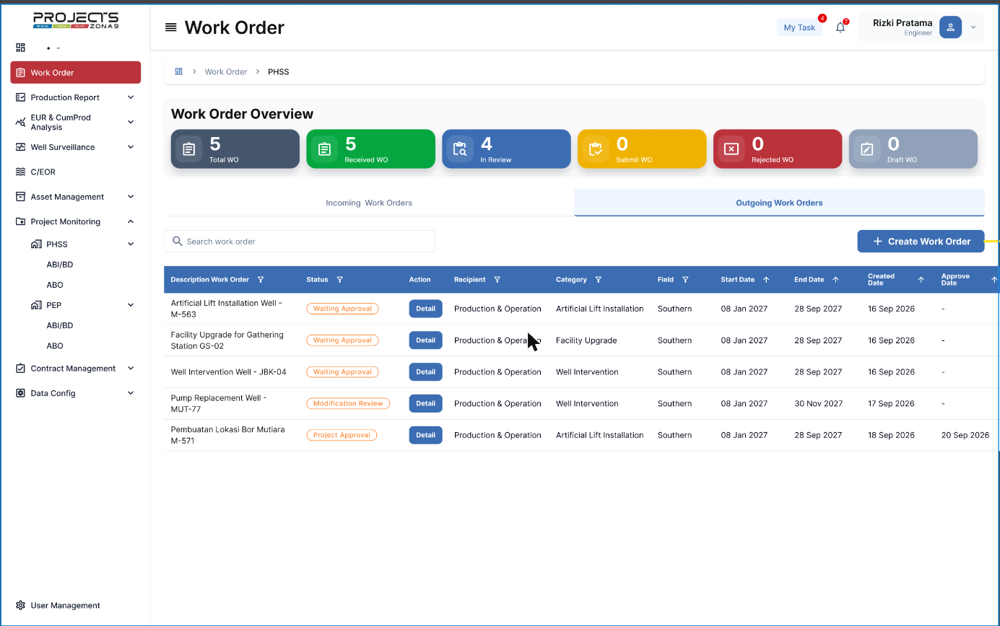

- **Endpoints:**
  - `GET /work-orders/overview?tab=` (#1) gives the 6 cards: Total WO, Received WO, In Review, Submit WO, Rejected WO, Draft WO.
  - `GET /work-orders?tab=&search=&…` (#2) gives the table, the tabs Incoming / Outgoing, and the search.
  - The "+ Create Work Order" button opens screen 2. It shows on the Outgoing tab only.
- **What the screen shows:**
  - The first column "Description Work Order" shows the WO **title** (for example "Artificial Lift Installation Well - M-563"), not the scope of work. See our review of PR #1533, point 3.
  - The filter icons are on Description, Status, Recipient, Category and Field. The sort arrows are on Start Date, End Date, Created Date and Approve Date. PR #1533 has none of them yet.

## 2. Create Work Order form

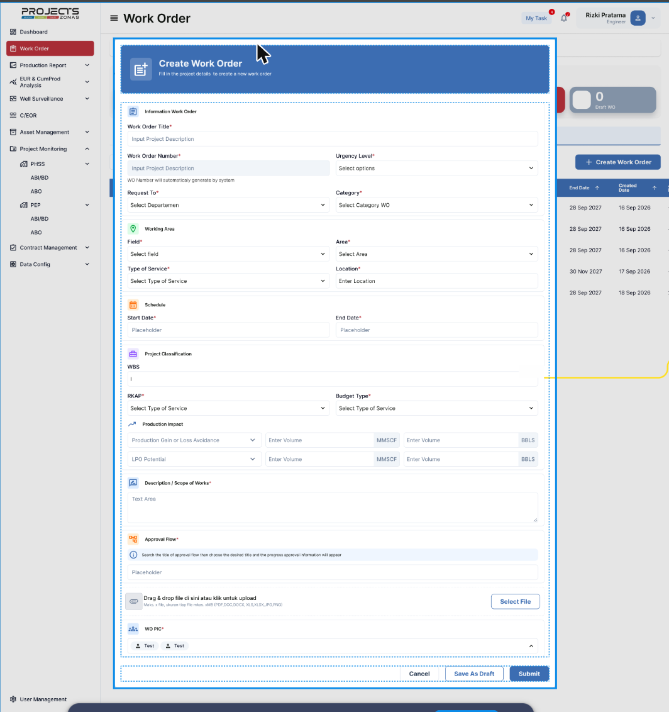

- **Endpoints:**
  - `GET /work-orders/next-number` (#3) fills "Work Order Number". It is read-only, with the note "WO Number will automatically generate by system".
  - `GET /work-orders/form-options` (#4) fills Request To, Category, Field / Area, Type of Service, RKAP, Budget Type and Production Impact.
  - **Approval Flow field.** The Figma text says: "Search the title of approval flow then choose the desired title and the progress approval information will appear". Two calls:
    1. **Search the routes:** `GET /approval-routes?category=work_order&department_id={requestor department}&search={text}&status=active`. This endpoint exists today, and it already has the filters `search`, `category`, `department_id` and `status`. The change: accept the category "Work Order - {Department}" and return only Level 0 routes. Our plan item #5 (`GET /work-orders/approval-flows?level=0&department=`) can be this same call, so no new endpoint is needed.
    2. **Show the progress after the user selects a route:** `GET /approval-routes/{id}` (this endpoint exists). For a WO route it must return, for each step:
       - Level (0) and Layer (1 Senior / Asst. Manager, 2 Manager);
       - the permission ID and the SLA;
       - the users who can approve, from the permission ID filtered by the requestor department (the `/users/by-permission/{id}?department=` logic).
    - The FE sends the selected `approval_route_id` with Save As Draft / Submit. At Submit, the backend copies the Level 0 steps into `work_order_approvers`.
  - `GET /users/by-permission/{id}?department=` (changed endpoint §3.1), or a department user list, fills "WO PIC".
  - "Save As Draft" calls `POST /work-order/draft` (#6), or `POST /work-order/draft/{id}` (#7) for a saved draft. **Built 24 Nov** on `feat/work-order-draft` (JSON body). The draft then shows in the Outgoing tab of its creator only, and in the "Draft WO" card.
  - "Submit" calls `POST /work-orders/submit` (#8).
  - Files: #6 / #7 take no files. After Save As Draft returns the `id`, the FE sends the files with `POST /work-orders/{id}/attachments` (#12; max 5 files, 10 MB each; PDF, DOC, DOCX, XLS, XLSX, JPG, PNG). Submit (#8) is not built yet.
- **Note:** the form has no "Function" field. The team doc adds Function for PHSS / Sangasanga / Sangatta / Tanjung Field. The Figma needs an update.

## 3. Work Order details (target department, Level 1)

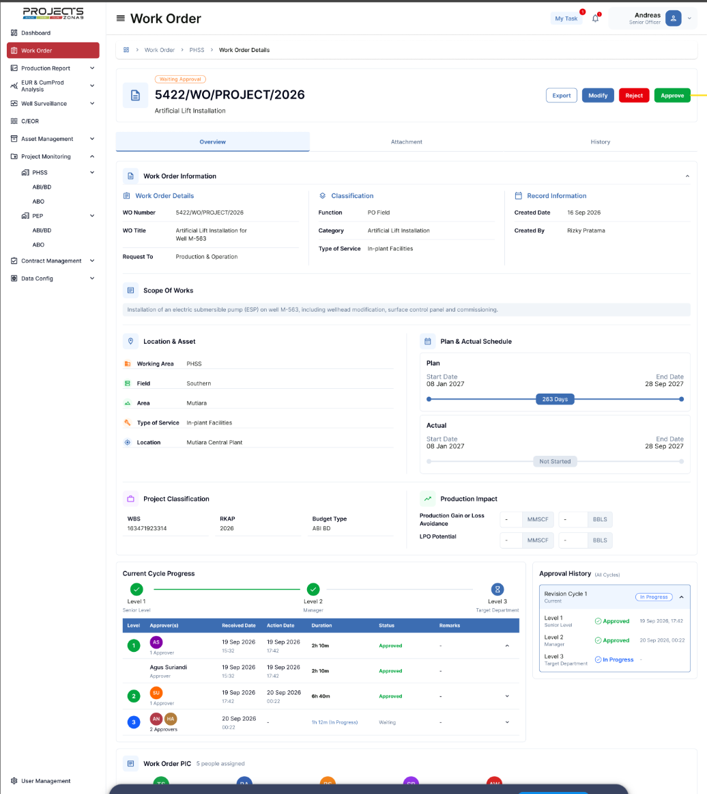

- **Endpoints:**
  - `GET /work-orders/{id}` (#10) gives:
    - the header: number, title, status badge;
    - the buttons for this user (Export / Modify / Reject / Approve);
    - the Overview tab: Information, Classification, Record, Scope of Works, Location & Asset, Plan & Actual Schedule, Project Classification, Production Impact;
    - "Current Cycle Progress", with the approvers for each step (Received Date, Action Date, Duration, Status, Remarks);
    - "Approval History (All Cycles)";
    - "Work Order PIC".
  - `GET /work-orders/{id}/approvers?level=&layer=` (#22) gives the "2 Approvers" lists in the cycle table.
  - The buttons call `POST /work-orders/{id}/approve` (#15), `/modify` (#17) and `/reject` (#18).
- **Conflict with the team doc:** the Figma shows Approve, Modify and Reject at once for the target Senior. The team doc needs **"Set Approval Flow"** first. After that, only Modify and Reject show. The Figma has no "Set Approval Flow" window yet (a Figma search finds no match). So `POST /work-orders/{id}/approval-flow` (#21) has no screen yet.
- **Step labels:** the progress bar says "Level 1 Senior / Level 2 Manager / Level 3 Target Department". In our words these are Level 0 Layer 1, Level 0 Layer 2 and Level 1 Layer 1.

## 4. History tab

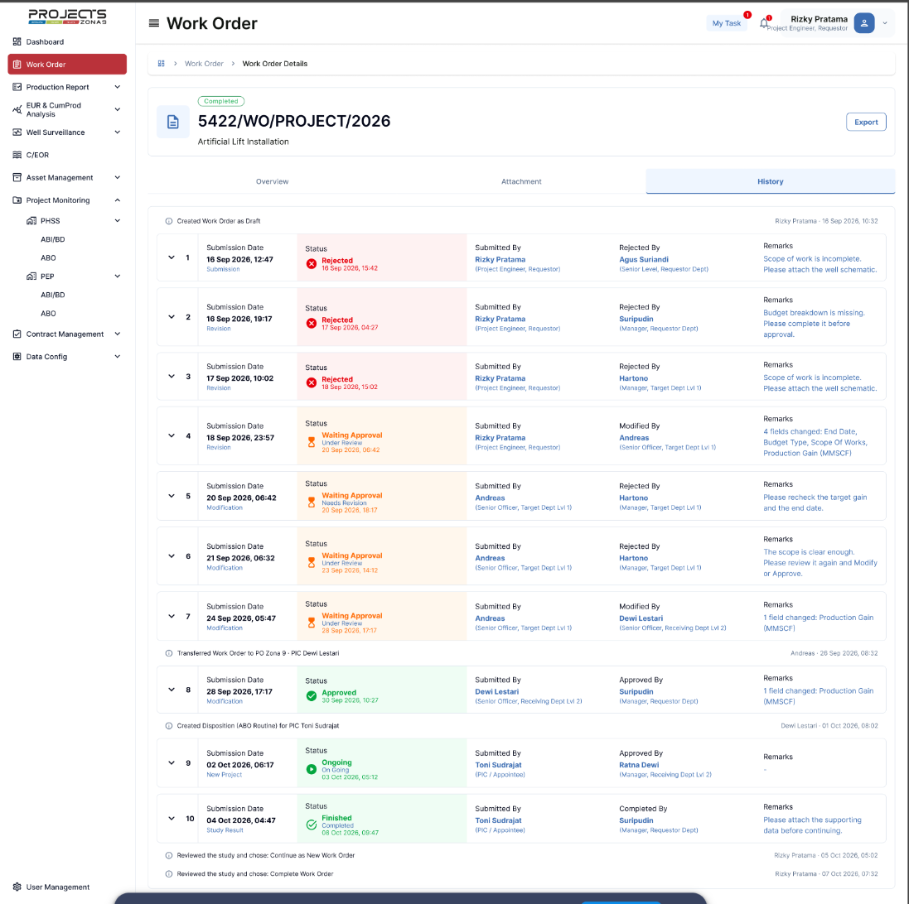

- **Endpoint:** `GET /work-orders/{id}/histories` (#11). Each row has: submission date and type (Submission / Revision / Modification / New Project / Study Result), status, Submitted By, Rejected / Modified / Approved By, and Remarks. Event lines are included (draft created, transfer, disposition, study decisions).
- **Conflict with a decision:** rows 1–3 show a WO **rejected at Level 0** and then **resubmitted** ("Revision"). Our decision says a reject at Level 0 is final, and the requestor makes a new WO with a new number. The Figma needs an update, or the decision must change.

## 5. Attachment tab

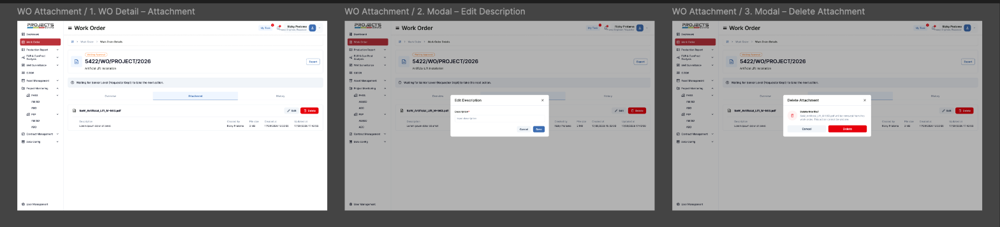

- **Endpoints:**
  - The list comes from `GET /work-orders/{id}` (#10), or from a separate attachment list.
  - "Edit" (description) calls `POST /work-orders/{id}/attachments/{attachmentId}` (#13).
  - "Delete" calls `POST /work-orders/{id}/attachments/{attachmentId}/delete` (#14).
- **Not in the Figma:** the tab has no "Add file" button. Endpoint #12 (`POST /{id}/attachments`) is used only by the Create / Modify form.

## 6. Reject window

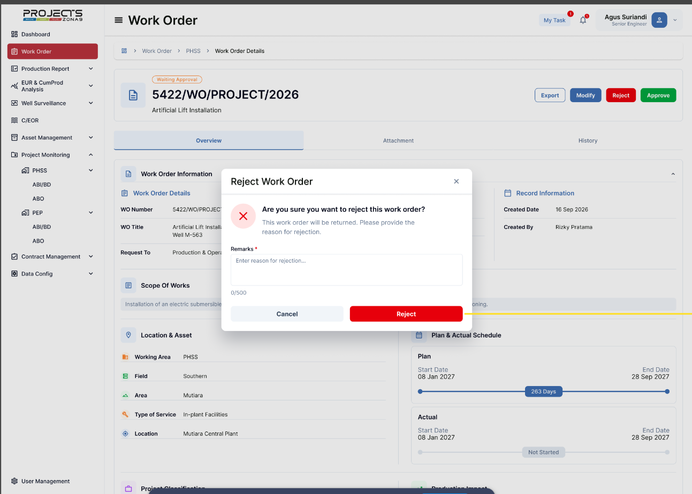

- **Endpoint:** `POST /work-orders/{id}/reject` (#18). "Remarks" is mandatory, max 500 characters.
- **The same window shape is used for:**
  - the confirmation of the target Manager ("Yes, Reject / No, Cancel") → `POST /{id}/rejection/decision` (#20);
  - the requestor Manager's accept or refuse of the rejection → #20.

## 7. Transfer Work Order window

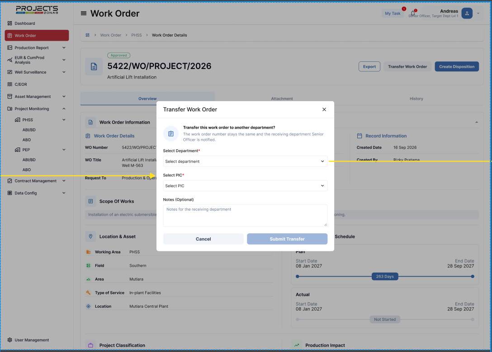

- **Endpoints:**
  - `GET /work-orders/{id}/transfer-options` (#23) fills "Select Department".
  - `GET /users/by-permission/{id}?department=` fills "Select PIC" (users of the selected department).
  - "Submit Transfer" calls `POST /work-orders/{id}/transfer` (#24).
- **Answers an open point:** the Figma **has a PIC field, and it is mandatory**. The team doc decision does not list PIC, and it adds a sub-unit (PE / PO / RAM / WO-WS) that the Figma does not show. Decide: department + PIC + sub-unit, or department + PIC only?
- **Notes** are optional in the Figma. This agrees with the decision.

## 8. Create Disposition window

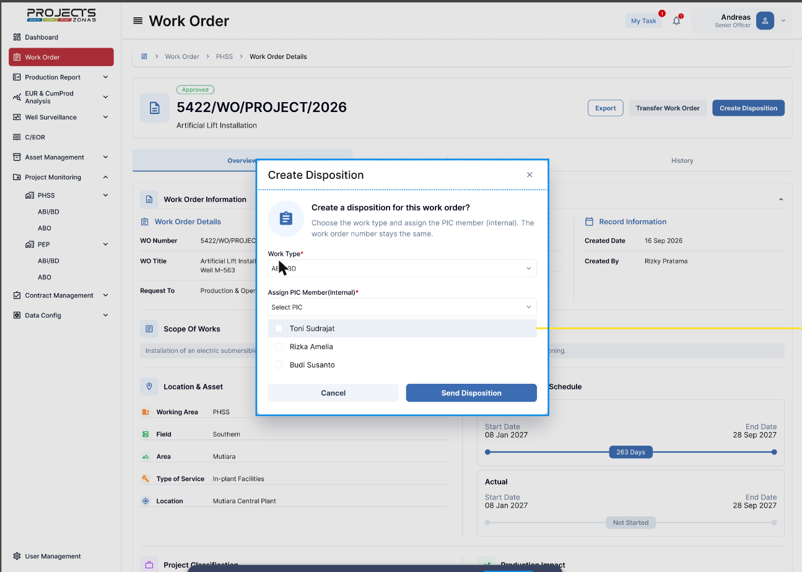

- **Endpoints:**
  - "Work Type" options: from `GET /work-orders/form-options` (#4) or `/transfer-options` (#23). The rules: ABI/BD only for Projects and PO, ABI/NBD only for OSF, ABO Routine and ABO Non Routine for all departments.
  - "Assign PIC Member (Internal)" (more than one): the users of the target department.
  - "Send Disposition" calls `POST /work-orders/{id}/disposition` (#25).
- **Notes:** this frame has no Notes field, but a later frame of the same flow has "Notes (Optional)", as the team doc says.

## 9. Approve confirmation window

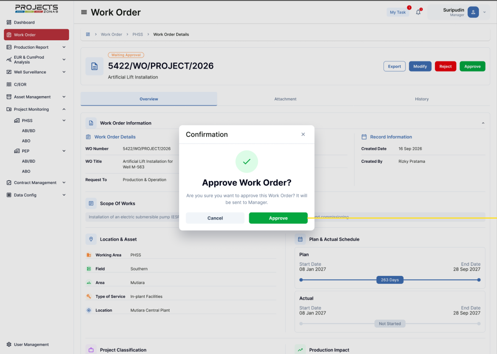

- **Where:** Details page → the green **Approve** button (top right). It shows for an approver whose step is the current one, with status Waiting Approval.
- **The window:** "Approve Work Order? Are you sure you want to approve this Work Order? It will be sent to Manager." It has Cancel and Approve buttons. There is no Remarks field.
- **Endpoint:** `POST /work-orders/{id}/approve` (#15). The same window is used at every step (Level 0 Layer 1 and 2, Level 1 Senior). The text changes for each step ("sent to Manager", "sent to target department", …).
- The **Reject** button on the same header opens the window in §6.

## 10. Modification Comparison window (approve or reject a change)

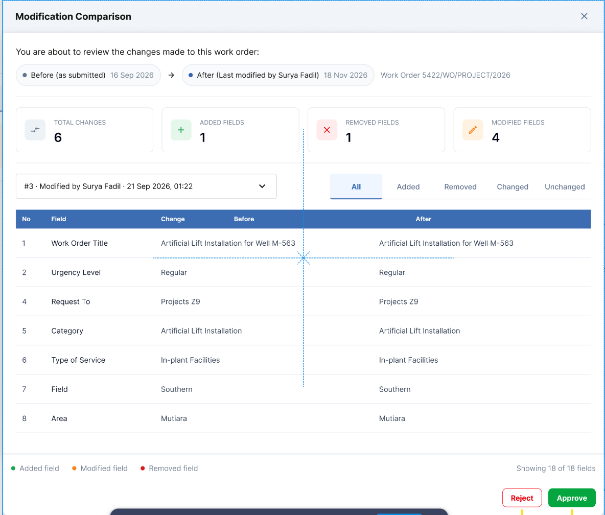

- **Where:** Details page of a WO in **Modification Review** → "View Changes". The Figma has this window for several actors: Senior Requestor, Manager Requestor, Senior Target Dept (Level 1) and Manager Target Dept (Level 1).
- **The window shows:**
  - before (as submitted) vs after (last modified by …), with the dates;
  - counts of total, added, removed and modified fields;
  - a version picker ("#3 · Modified by … · date");
  - the tabs All / Added / Removed / Changed / Unchanged;
  - the table Field / Before / After;
  - **Reject** and **Approve** buttons.
- **Endpoints:**
  - The data comes from `GET /work-orders/{id}/histories` (#11): the snapshots of two versions in a row.
  - The buttons call `POST /work-orders/{id}/modification/decision` (#19) with `approve` / `reject`:
    - The **Manager of the target department** approves the Senior's change, or rejects it (the change is dropped, and the WO goes back to the Senior).
    - The **Manager of the requestor department** ("Modification OK?") approves (the change is copied into the WO, and the status becomes Approved), or rejects (the change is dropped, and the status becomes Approved with the old values).

## 11. Project Approval (Project Monitoring)

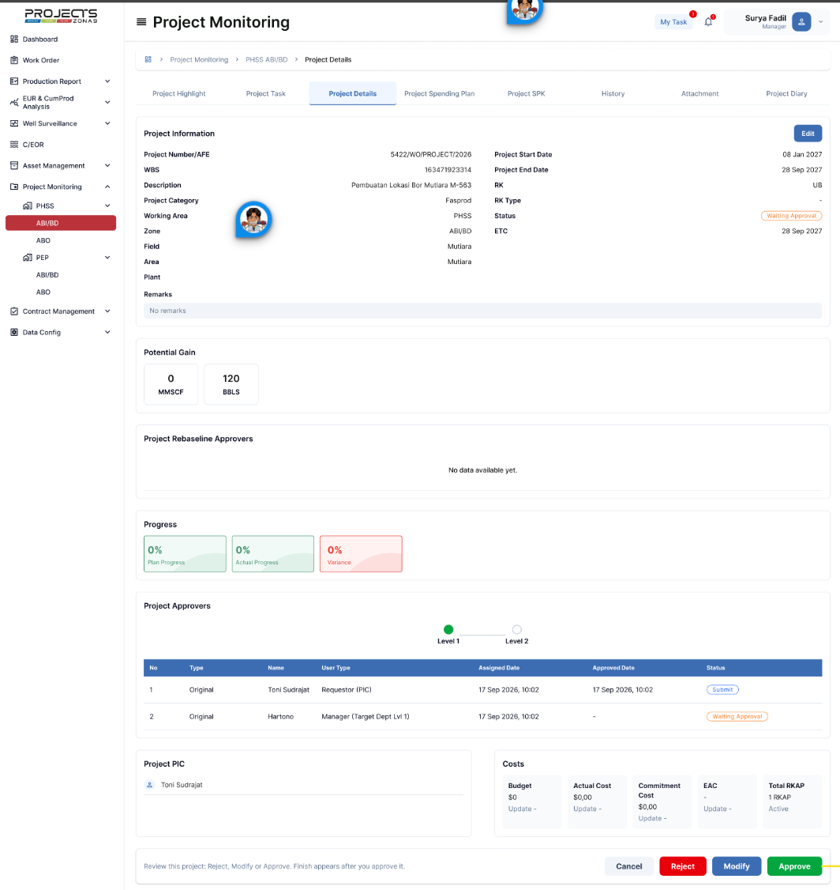

- **Where:** Project Monitoring → Project Details of the project that the PIC made from the WO. The Project Number / AFE = the WO number (5422/WO/PROJECT/2026).
- **Who:** the Manager of the target department (in the Figma: "Hartono, Manager (Target Dept Lvl 1)"). The "Project Approvers" table shows the requestor (PIC) as Submit and the Manager as Waiting Approval.
- **Buttons:** Cancel / Reject / Modify / Approve. The footer says: "Review this project: Reject, Modify or Approve. Finish appears after you approve it."
- **Endpoints:** the existing `POST /projects/approval`. Changed (§3.5 of `13`): when the project has a `work_order_id`, approve → WO status On Going; reject → WO status Project Preparation. An Action Plan WO skips this step.

## Where each approve and reject happens

| Who | Step | UI | Endpoint |
|---|---|---|---|
| Senior / Manager of the requestor department | Approve or reject the submitted WO | Details page buttons → §9 / §6 | #15 / #18 |
| Senior of the target department | Approve the WO, or ask for Modify / Reject | Details page buttons → §9 / §6 (team doc: Set Approval Flow first, not in the Figma) | #15 / #17 / #18 |
| Manager of the target department | Approve or reject a change | §10 | #19 |
| Manager of the requestor department | "Modification OK?" | §10 | #19 |
| Manager of the target department | Confirm a rejection ("Yes, Reject / No, Cancel") | **Not in the Figma** (one reject step only) | #20 |
| Manager of the requestor department | Accept or refuse a rejection | **Not in the Figma** | #20 |
| Manager of the target department | Approve or reject the WO project | §11 (Project Monitoring) | `POST /projects/approval` |

## 12. Input Parameter: the Action Plan window inside Create Work Order (simple schedule)

Figma section "Input Parameter" (node `18806-110894`), part of "Level 0 Simple Schedule › Create WO". When the requestor selects a well category (for example Request To = Sangatta Field), Create Work Order opens an **"Action Plan"** window for the well parameters. Screenshots are in `img/input-parameter/`.

| Frame | Window | Fields (`*` = required) |
|---|---|---|
| WLI Parameter | **empty (marked "On progress")** | – |
| Well Test Update | 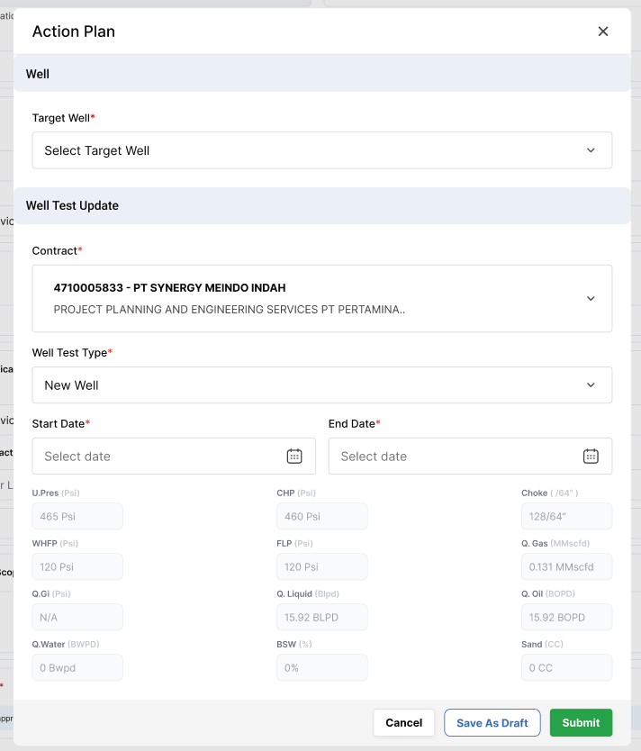 | Target Well*, Contract*, Well Test Type* (for example New Well), Start / End Date*; read-only last test values (U.Pres, CHP, Choke, WHFP, FLP, Q.Gas, Q.Gi, Q.Liquid, Q.Oil, Q.Water, BSW, Sand) |
| Artificial Lift Update | 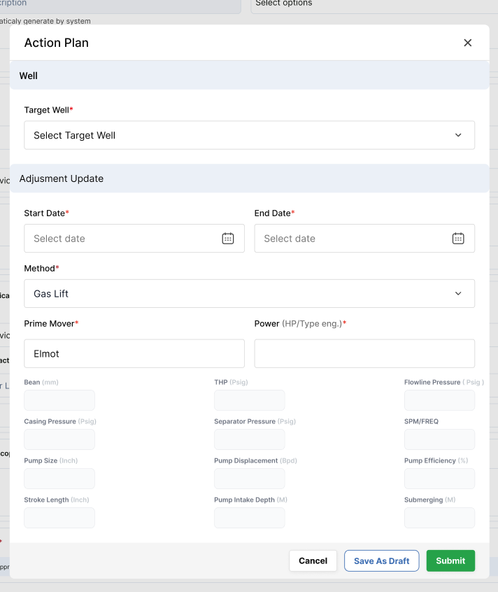 | Target Well*, Start / End Date*, Method* (Gas Lift), **Prime Mover\***, **Power\***; optional Bean, THP, Flowline Pressure, Casing Pressure, Separator Pressure, SPM/FREQ, Pump Size, Pump Displacement, Pump Efficiency, Stroke Length, Pump Intake Depth, Submerging |
| Artificial Lift Installation | 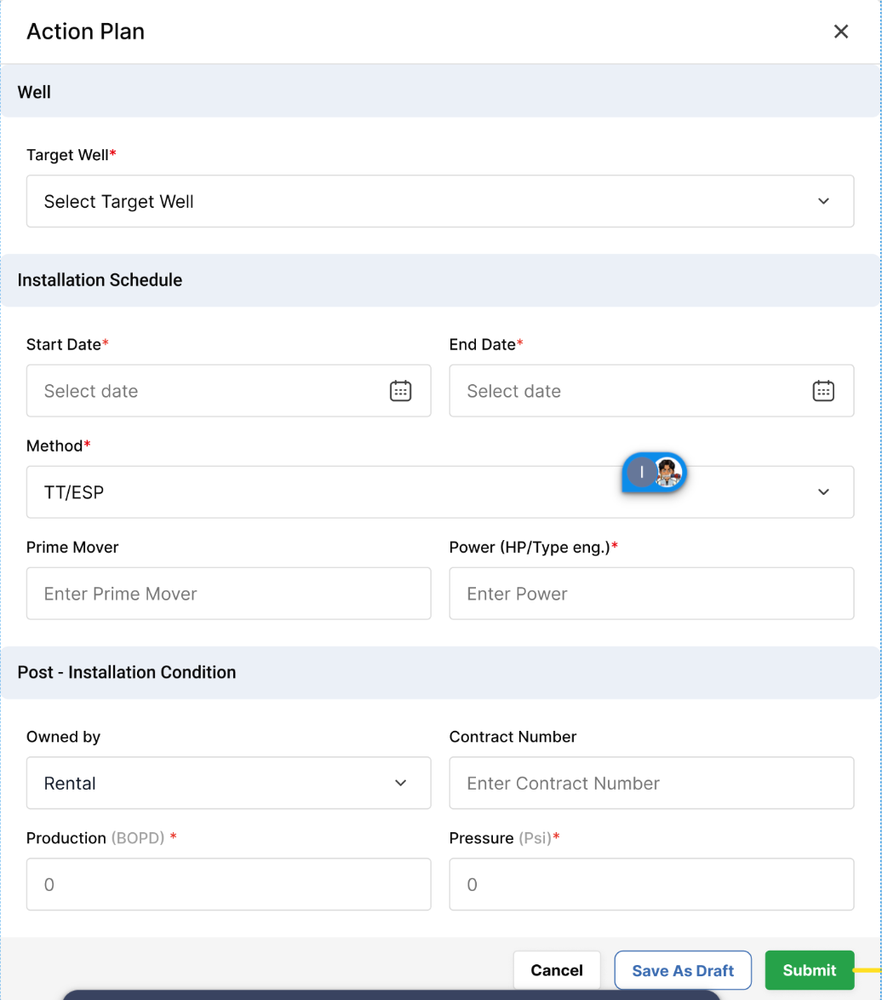 | Target Well*, Start / End Date*, Method* (TT/ESP), Prime Mover (**optional**), **Power\***; Post-Installation: Owned by (Rental), Contract Number, Production (BOPD)*, Pressure (Psi)* |
| Sonolog | 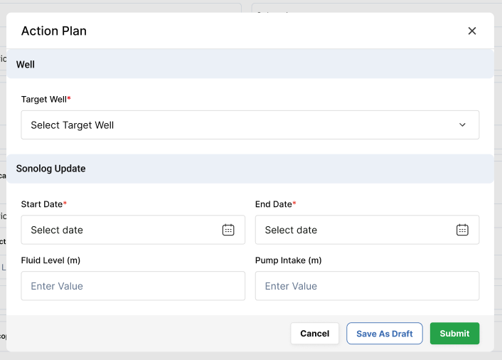 | Target Well*, Start / End Date*, Fluid Level (m), Pump Intake (m) |
| Choke Adjustment | 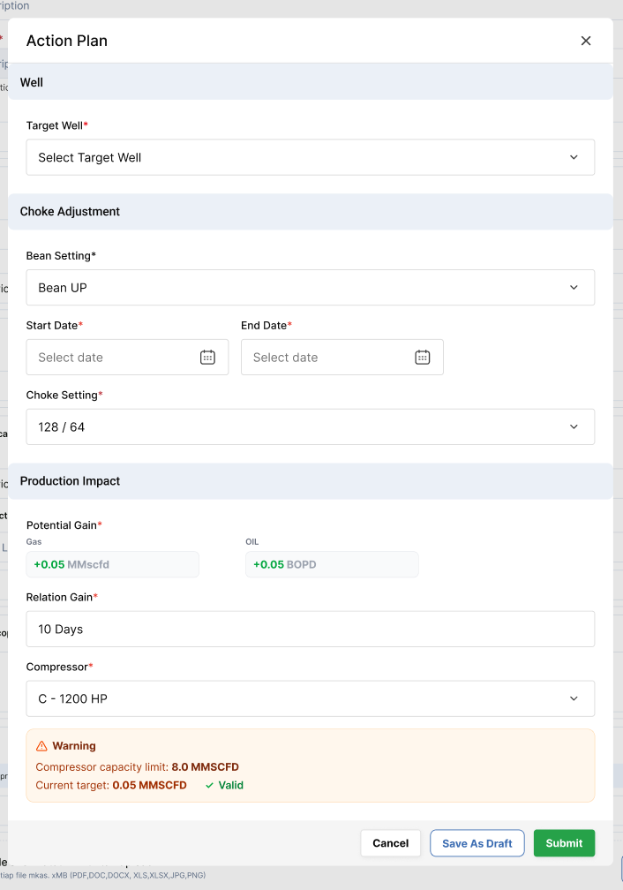 | Target Well*, Bean Setting* (Bean UP), Start / End Date*, Choke Setting* (128/64); Production Impact: Potential Gain* (Gas / Oil), Relation Gain*, Compressor*, with a compressor-capacity warning |

- **Endpoints:**
  - The window's "Submit" / "Save As Draft" send the Action Plan with the WO. They use `POST /work-orders/draft` / `submit` (#6–#8), with the Action Plan part of the payload. Or they use the existing `POST /well-surveilence/action-plans/{pep|phss}/draft|submit` with `work_order_id` (§3.4 of `13`).
  - The last well test values come from the existing well / Action Plan read endpoints.
- **Prime Mover (open question Q46):** the Figma shows it **required for Artificial Lift Update (Gas Lift)** and **optional for Artificial Lift Installation (TT/ESP)**. Power is required in both. This agrees with the proposal in Q46: required for Gas Lift, optional for SRP / ESP.
- **WLI:** the WLI parameter form is not designed yet.

---

## Endpoints with no screen in this file
| Endpoint               | Why                                                                                                              |
| ---------------------- | ---------------------------------------------------------------------------------------------------------------- |
| #9 delete draft        | No Figma screen found.                                                                                           |
| #16 bulk approve       | No bulk action in the Figma list (no checkbox column). Check with FE whether it is still needed.                 |
| #21 Set Approval Flow  | **Not in the Figma.** It comes from the team doc only.                                                           |
| #26 project prefill    | The "Create Project" form (PIC) is in the Level 1 flow. Not captured yet. The approval of the project is in §11. |
| #20 rejection decision | **Not in the Figma.** The decided two-step reject has no screens.                                                |
